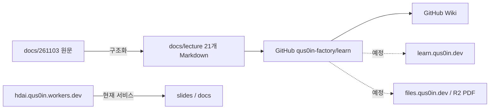

# qus0in-factory/learn

## 아키텍처

## 연결 주소

- 저장소: https://github.com/qus0in-factory/learn
- 강의 목차: https://github.com/qus0in-factory/learn/blob/main/docs/lecture/index.md
- Wiki: https://github.com/qus0in-factory/learn/wiki
- Issue #1: https://github.com/qus0in-factory/learn/issues/1
- Milestone v0.1.0: https://github.com/qus0in-factory/learn/milestone/1
- 현재 서비스: https://hdai.qus0in.workers.dev/git/
- 강의 사이트(예정): https://learn.qus0in.dev
- 파일 제공(예정): https://files.qus0in.dev
- 12주제 PDF(R2, 예정, 미생성)
- 기존 슬라이드(게시하지 않음)
