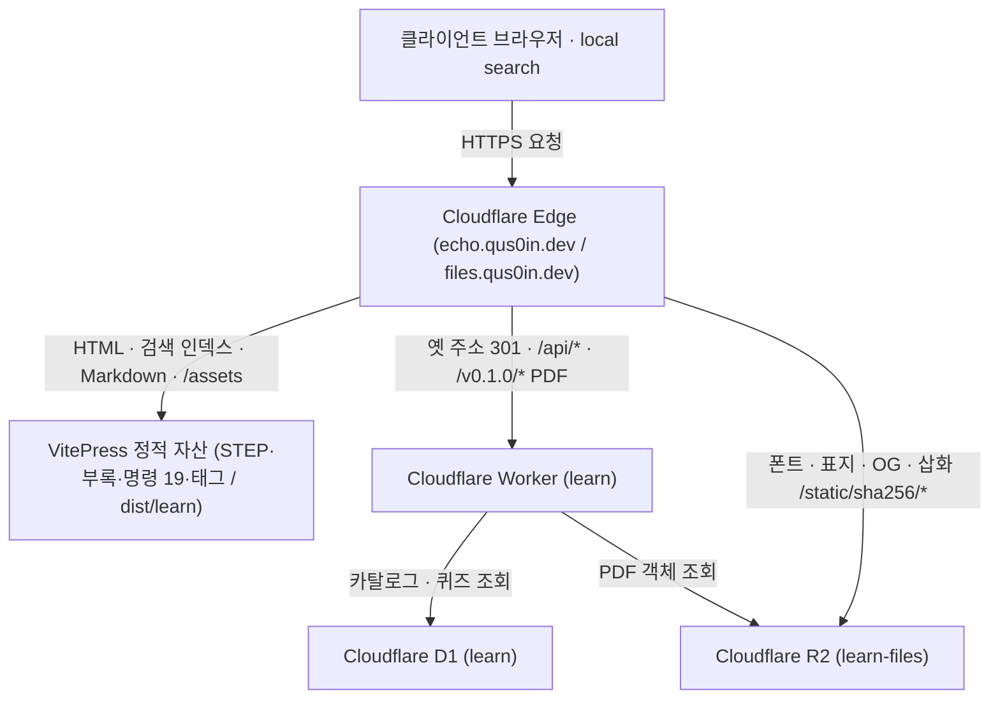

# 에코익힘책 (AI & 코딩 익힘책)
> AI & 코딩 웹 학습 플랫폼
- https://echo.qus0in.dev/

## 과정과 운영

- [Go Git 集](https://echo.qus0in.dev/git/) · [Go Git 集 순한맛](https://echo.qus0in.dev/git-easy/)
- [현재 운영 상태](docs/operations/index.md) · [교재 구조 프레임워크](docs/course-framework.md) · [검색·분석과 소유자 작업](docs/operations/search-analytics.md)

## 아키텍처

## 주요 구성 요소

- **VitePress 정적 사이트** (`learn-site`): 강의 마크다운과 반응형 컴포넌트를 빌드해 정적 웹페이지를 만든다.
- **Cloudflare Worker learn** (`learn-worker`): 에지에서 라우팅, API, 구 경로 리다이렉트, 캐시 헤더를 처리한다.
- **Cloudflare D1 learn**: 카탈로그·PDF 레지스트리·퀴즈 데이터를 관리하는 서버리스 관계형 데이터베이스다.
- **Cloudflare R2 learn-files** (`files.qus0in.dev`): 버전별 PDF와 `static/<sha256>` 정적 자산(폰트, 표지 이미지)을 불변 캐시로 제공한다.

## 디렉터리 구조

- `learn-site`: VitePress 기반 정적 사이트 설정, 테마, UI 컴포넌트
- `learn-worker`: Cloudflare Worker 라우팅, API 및 D1/R2/ASSETS 바인딩 설정 (`wrangler.jsonc`)
- `scripts`: D1 동기화, PDF 운용, 검증 및 린트 자동화 스크립트
- `docs`: 강의 마크다운 문서(`lecture/`), 공용 정적 자산(`public/`), 운영 가이드(`setup/`)
- PDF 원본은 `scripts/learn-pdf/pilot/step01.json`–`step12.json`이다. 강의 사실 대조는 `docs/lecture`다.
- 개념 장은 비교·분할·단계·행(`compare`, `split`, `steps`, `rows`)과 수치·문장(`stat`, `statement`), 기존 표·코드를 섞는다. PDF는 12개이고 각 20–24장, 합계 270장이다.
- 고정·교체·readback은 [운영 목차](docs/operations/index.md)를 따른다. 현재 고정 revision은 `6e8aed6c038f0da51751ab3cbadec21fd670fbea`다. 2026-11-14 사이트·D1 전환과 HTTP·R2 readback을 완료했다.

## 라이선스

- 코드: [MIT](LICENSE). 상업적 사용·수정·재배포를 포함해 MIT 조건에 따라 사용할 수 있다.
- 교안 콘텐츠: [CC BY-NC-SA 4.0](LICENSE-CONTENT). 출처를 표시하고 비상업적으로 사용하며, 변경본은 같은 조건으로 공유한다.
- 사이트 이름·로고·표지·OG 이미지·고유 디자인: 비상업적 이용을 포함해 별도 허락 없이 사용할 수 없다. 자세한 범위는 [라이선스 안내](docs/licenses.md)를 참고한다.
- 제3자 의존성·폰트·아이콘: [docs/license-notices.md](docs/license-notices.md) · [전문](docs/public/third-party-notices.txt)
- 문의: qus0in@gmail.com
