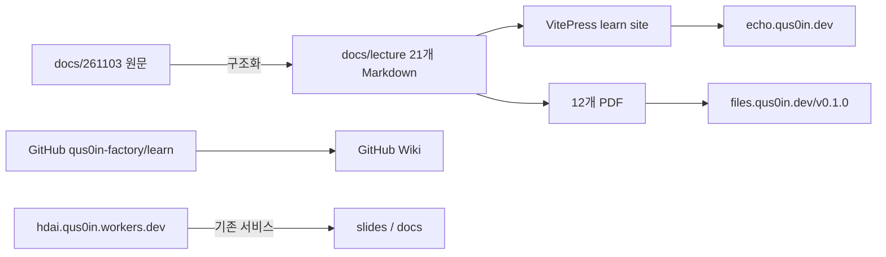

# qus0in-factory/learn

## 아키텍처

## 연결 주소

- 저장소: https://github.com/qus0in-factory/learn
- 강의 목차: https://github.com/qus0in-factory/learn/blob/main/docs/lecture/index.md
- Wiki: https://github.com/qus0in-factory/learn/wiki
- Issue #1: https://github.com/qus0in-factory/learn/issues/1
- Issue #3: https://github.com/qus0in-factory/learn/issues/3
- PR #2: https://github.com/qus0in-factory/learn/pull/2
- 현재 서비스: https://hdai.qus0in.workers.dev/git/
- 강의 사이트(에코익힘책): https://echo.qus0in.dev/
- Git 과정: https://echo.qus0in.dev/git/
- 12주제 PDF:
  - https://files.qus0in.dev/v0.1.0/01-environment.pdf?revision=0444320a59711d0568077bd9e8ac85daef2d2cda
  - https://files.qus0in.dev/v0.1.0/02-local-repository.pdf?revision=0444320a59711d0568077bd9e8ac85daef2d2cda
  - https://files.qus0in.dev/v0.1.0/03-commit-history.pdf?revision=0444320a59711d0568077bd9e8ac85daef2d2cda
  - https://files.qus0in.dev/v0.1.0/04-amend-ignore.pdf?revision=0444320a59711d0568077bd9e8ac85daef2d2cda
  - https://files.qus0in.dev/v0.1.0/05-remote.pdf?revision=0444320a59711d0568077bd9e8ac85daef2d2cda
  - https://files.qus0in.dev/v0.1.0/06-pages.pdf?revision=0444320a59711d0568077bd9e8ac85daef2d2cda
  - https://files.qus0in.dev/v0.1.0/07-markdown-mermaid.pdf?revision=0444320a59711d0568077bd9e8ac85daef2d2cda
  - https://files.qus0in.dev/v0.1.0/08-profile-records.pdf?revision=0444320a59711d0568077bd9e8ac85daef2d2cda
  - https://files.qus0in.dev/v0.1.0/09-issues.pdf?revision=0444320a59711d0568077bd9e8ac85daef2d2cda
  - https://files.qus0in.dev/v0.1.0/10-branches-tags.pdf?revision=0444320a59711d0568077bd9e8ac85daef2d2cda
  - https://files.qus0in.dev/v0.1.0/11-merge-conflicts.pdf?revision=0444320a59711d0568077bd9e8ac85daef2d2cda
  - https://files.qus0in.dev/v0.1.0/12-pull-request.pdf?revision=0444320a59711d0568077bd9e8ac85daef2d2cda
