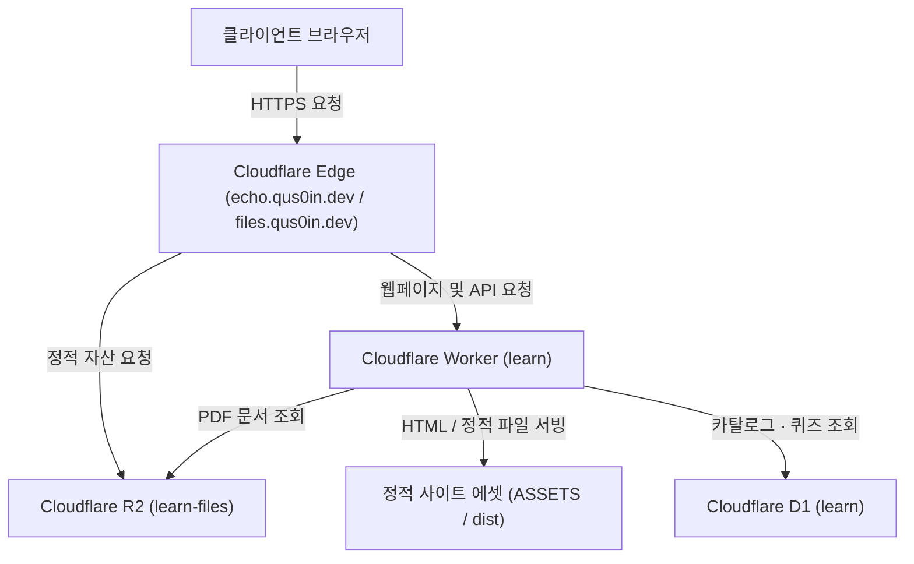

# qus0in-factory/learn

에코익힘책(echo.qus0in.dev)은 Git과 GitHub 실습 과정을 제공하는 웹 학습 플랫폼입니다.

## 아키텍처

## 주요 구성 요소

- **VitePress 정적 사이트** (`learn-site`): 강의 마크다운과 반응형 컴포넌트를 빌드하여 정적 웹페이지를 생성합니다.
- **Cloudflare Worker learn** (`learn-worker`): 에지 환경에서 라우팅, API 서빙, 구 경로 리다이렉트, 캐시 헤더를 처리합니다.
- **Cloudflare D1 learn**: 카탈로그·PDF 레지스트리·퀴즈 데이터를 관리하는 서버리스 관계형 데이터베이스입니다.
- **Cloudflare R2 learn-files** (`files.qus0in.dev`): 버전별 PDF 문서 및 `static/<sha256>` 해시 경로 기반 정적 자산(폰트, 표지 이미지)을 불변 캐시로 서빙합니다.

## 디렉터리 구조

- `learn-site`: VitePress 기반 정적 사이트 설정, 테마, UI 컴포넌트
- `learn-worker`: Cloudflare Worker 라우팅, API 및 D1/R2/ASSETS 바인딩 설정 (`wrangler.jsonc`)
- `scripts`: D1 동기화, PDF 운용, 검증 및 린트 자동화 스크립트
- `docs`: 강의 마크다운 문서(`lecture/`), 공용 정적 자산(`public/`), 운영 가이드(`setup/`)
