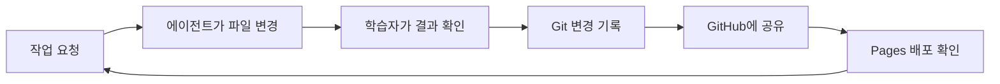
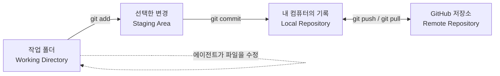
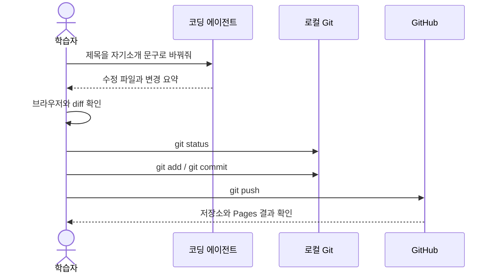
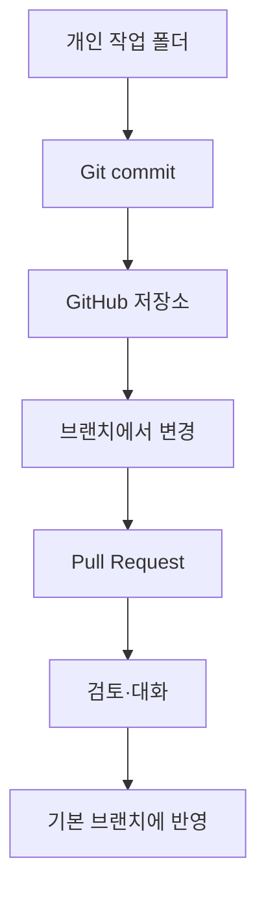

# Git 중심 형상관리와 코딩 에이전트 활용 교육 초안

> 대상: 코딩 학습 3주차, Python 기초 문법을 익히는 초보자
> 운영: 2일, 하루 오전·오후 각 3시간. 45분 수업과 15분 휴식, 실제 수업 9시간과 설치·인증·질문 여유 2시간.
> 상태: 러프한 교육 설계 초안. 실제 기수 환경과 계정 정책을 확인하며 조정한다.

## 1. 교육 목표

학습자가 코딩 에이전트의 도움을 받아 작은 웹페이지를 만들고, 변경을 Git으로 기록하며, GitHub에 저장하고 공개 웹사이트로 배포한다. 핵심은 명령어를 많이 외우는 것보다 아래 반복을 이해하고 직접 해보는 것이다.

1. 에이전트에게 작은 작업을 요청한다.
2. 결과를 브라우저와 변경 내용으로 확인한다.
3. Git으로 변경을 저장한다.
4. GitHub에 올리고 배포 결과를 확인한다.



## 2. 초보자를 위한 기본 그림

Git은 내 컴퓨터의 파일 변경을 기록하고 되돌아볼 수 있게 하는 버전 관리 도구다. GitHub는 Git 저장소를 원격에 보관하고 이슈·Pull Request·웹 배포 등 협업 기능을 제공하는 서비스다. 둘을 같은 것으로 설명하지 않는다.



기본 설명은 파일을 고치고(`Working Directory`), 다음 기록에 담을 변경을 고르고(`Staging Area`), 기록을 만든 뒤(`commit`), 원격 저장소와 맞추는 흐름(`push`/`pull`)으로 구성한다. `status`는 현재 파일과 스테이징 상태를 읽는 도구로 반복 사용한다.

## 3. 수업에서 사용하는 도구의 역할

| 도구 | 수업에서의 역할 | 초보자 안내 |
| --- | --- | --- |
| Git | 변경 기록의 핵심 | 명령어를 한 번에 하나씩 실행하고 `status`로 확인 |
| GitHub | 원격 저장소, 공유와 배포 | 웹 화면으로 저장소와 변경 기록을 확인 |
| 코딩 에이전트(예: OpenCode) | HTML/CSS 등의 작은 수정 제안·수행 | 요청을 작게 나누고 변경 파일과 결과를 직접 검토 |
| Git Bash | Windows에서 Git 명령 실행 | 복사한 명령도 실행 전 대상 폴더와 의미 확인 |
| VS Code | 파일과 변경사항 확인 | 에이전트가 만든 코드를 읽고 브라우저 결과와 대조 |
| GitHub CLI (`gh`) | 일부 GitHub 작업을 터미널에서 수행 | Git 자체와 별도 프로그램이며 첫 실습의 필수 조건으로 두지 않음 |
| ChatGPT의 GitHub 연결/앱 | 허용된 저장소를 찾아 코드·문서를 질의하는 선택 기능 | 이용 가능성과 기능이 요금제·제품 화면·조직 정책에 따라 다름 |

GitHub CLI는 GitHub에서 제공하는 명령줄 인터페이스다. 공식 안내는 Pull Request 생성, 저장소 fork 등 GitHub 작업을 예로 든다. Git은 로컬 변경 이력을 다루고, `gh`는 GitHub 서비스 작업을 보완한다. 설치 및 인증 환경이 불확실하면 강의자는 시연만 하고 웹 화면으로 과제를 완료할 수 있게 한다. [GitHub CLI 문서](https://docs.github.com/en/github-cli/github-cli/about-github-cli)

ChatGPT의 GitHub 앱/연결은 수업에서 “GPT 플러그인”이라고 부르던 기능을 가리킬 수 있으나, 플러그인·앱 명칭과 제공 방식은 바뀔 수 있다. 현재 OpenAI 안내에 따르면 연결한 GitHub 저장소의 허가된 내용을 검색·분석할 수 있지만, ChatGPT GitHub 앱 자체는 저장소에 코드나 PR을 쓰는 기능을 제공하지 않는다. 사용 가능 여부도 계정, 작업 공간, 제품 표면에 따라 다르므로 수업 필수 도구로 가정하지 않는다. [GitHub 연결 안내](https://help.openai.com/en/articles/11145903-connecting-github-t-chatgpt-deep-research)

## 4. 2일 운영안

매 행은 45분 수업이며 뒤에 15분 휴식이 온다. 매일 세 번째 수업의 마지막 20분은 과제 15분과 확인 질문 5분으로 고정한다. 계획은 기존 `draft.md`의 배포 후 개인화 흐름을 바탕으로 한 제안이다.

| 일자·시간 | 수업 내용 | 학습자가 남기는 것 |
| --- | --- | --- |
| 1일차 오전 1 | Git, VS Code, 에이전트 설치 시작. 다운로드 중 VCS와 Git/GitHub 차이, 작업 폴더·스테이징·로컬 저장소 설명 | 도구 준비 현황 |
| 1일차 오전 2 | 설치·Git 사용자 설정·GitHub 로그인 확인. 에이전트에 웹페이지를 요청하고 브라우저에서 결과 확인 | 로컬 웹페이지 |
| 1일차 오전 3 | `init`, `status`, `add`, `commit`으로 첫 변경 기록. 과제: 제목 수정 후 커밋. 확인: `add` 전후 `status` 차이 말하기 | 첫 커밋 |
| 1일차 오후 1 | 작은 문구 변경을 요청하고 변경 전후 확인. `log`로 이력과 커밋 메시지 살펴보기 | 두 번째 변경 기록 |
| 1일차 오후 2 | README와 `.gitignore`의 용도를 확인하고 저장소에 GitHub 원격 연결 | 설명이 있는 저장소 |
| 1일차 오후 3 | `push`, GitHub 저장소 확인, Pages 설정과 배포. 과제: 수정·커밋·push 후 배포 확인. 확인: 로컬 커밋을 원격에 올리는 명령 | 공개된 정적 웹사이트 |
| 2일차 오전 1 | 첫날 흐름 복습. 각자 웹페이지의 주제와 바꾸고 싶은 분위기 정하기 | 개인 변경 목표 |
| 2일차 오전 2 | 눈누 등에서 폰트를 고르고 이용 조건 확인. 에이전트와 폰트 적용 후 비교 | 폰트 변경과 기록 |
| 2일차 오전 3 | 파비콘 적용 및 브라우저 탭 확인. 과제: 폰트 또는 파비콘 변경. 확인: 웹폰트 적용 전 확인할 점 | 파비콘 또는 폰트 변경 |
| 2일차 오후 1 | Coolors 등에서 색을 고르고 콘텐츠·레이아웃을 개선. 작은 단위로 확인·커밋 | 개인화된 웹페이지 |
| 2일차 오후 2 | `branch`와 Pull Request 개념 소개. 여건에 따라 짝 리뷰 또는 강사 시연. GitHub CLI 설치·인증이 준비된 경우 `gh`로 PR 조회/생성 시연 | 선택 활동 결과 |
| 2일차 오후 3 | 배포 확인, README 보완, 웹페이지 공유·회고. 과제: 색상이나 소개 문구를 바꾸고 커밋. 확인: 배포 반영을 확인하는 위치 | 완성 페이지와 회고 |

## 5. 학습 흐름의 작은 예

에이전트가 코드를 생성하더라도 파일과 Git 이력을 확인하는 책임은 학습자에게 둔다. 첫날은 `git status`를 전후 비교하는 습관을 만든다.



초기 명령은 강사가 한 줄씩 안내한다. 실제 계정 이름·메일 주소는 각 학습자가 설정하며, 토큰이나 비밀번호를 채팅창·저장소에 붙이지 않는다.

```bash
git config --global user.name "내 이름"
git config --global user.email "내 이메일"
git init
git status
git add index.html style.css
git commit -m "첫 웹페이지 추가"
git log --oneline
```

명령은 저장소 폴더 안에서 실행한다. 아직 존재하지 않는 파일을 예시로 든 경우 실제 파일 이름에 맞춰 바꾼다. 원격 저장소 연결과 Pages 공개 범위는 강의 환경의 계정·조직 정책을 먼저 확인한다.

## 6. 협업 기능과 선택 기능의 위치



Issue, Label, Milestone, Wiki, fork, tag, 충돌 해결, `reset`·`amend`·`revert` 비교는 9시간의 필수 성과에서 제외한다. 브랜치와 PR은 협업의 모양을 보여주는 짧은 소개로 둔다. GitHub CLI는 설치·로그인에 시간이 들 수 있으므로 여유 시간에 시연하고, CLI 사용 여부가 Git 학습 성과를 가리지 않게 한다.

ChatGPT GitHub 연결은 요청 시점을 기준으로 공식 안내를 다시 확인한다. 수업에서는 연결을 설정하지 않아도 되는 저장소 예시 또는 공개 저장소를 활용하고, 민감하거나 개인적인 코드는 연결하지 않는다. 커넥터가 코드를 읽고 설명하는 것과 코딩 에이전트가 로컬 파일을 바꾸는 것은 서로 다른 작업 흐름으로 설명한다.

## 7. 준비물과 진행 리스크

- Windows PC, 안정적인 인터넷, Git·VS Code·선정한 코딩 에이전트 설치 권한.
- GitHub 개인 계정 또는 교육용 계정, 이메일 확인과 인증 수단. 조직 계정은 앱 승인이나 저장소 생성 제한이 있을 수 있다.
- GitHub Pages를 사용할 계정의 공개 범위·기능 가능 여부 확인. GitHub Pages는 저장소의 정적 HTML/CSS/JavaScript를 호스팅한다. 공개 저장소에서 GitHub Free로 쓸 수 있으며, 비공개 저장소 등은 요금제에 따라 조건이 다르다. [GitHub Pages 소개](https://docs.github.com/en/pages/getting-started-with-github-pages/what-is-github-pages)
- 폰트·아이콘·이미지는 출처와 이용 조건을 확인한다. 페이지가 저장소 하위 경로로 배포되어도 자원이 표시되는지 확인한다.
- 설치·인증 장애는 2시간 여유 시간을 우선 사용한다. 일정이 밀리면 PR 실습은 시연으로 전환하고, 로컬 커밋·push·배포 확인은 우선 보장한다.

## 8. 성공 기준과 미정 항목

교육 후 학습자가 다음을 말하거나 직접 수행하면 핵심 목표를 달성한 것으로 본다.

- 작업 폴더, 스테이징 영역, 커밋 이력, GitHub 원격 저장소의 역할을 간단히 설명한다.
- 변경 전후 `git status`를 확인하고, 선택한 파일을 커밋한다.
- 커밋과 `push`의 차이를 설명하고 변경을 GitHub로 올린다.
- Pages에 배포된 자기 웹페이지를 열어 본다.
- 에이전트가 만든 변경을 브라우저와 diff로 확인한 다음 기록한다.

수업 확정 전에 결정할 항목: 코딩 에이전트의 제품·요금제와 설치 권한, GitHub 계정 준비 방법, Pages 저장소 공개 정책, GitHub CLI를 학습자 실습에 포함할지, ChatGPT GitHub 연결을 강사 시연에 포함할지. 제품 기능은 교육 직전에 공식 문서와 실제 계정 화면으로 재확인한다.

## 참고 자료

- [GitHub CLI 소개](https://docs.github.com/en/github-cli/github-cli/about-github-cli)
- [GitHub CLI 빠른 시작](https://docs.github.com/en/github-cli/github-cli/quickstart)
- [ChatGPT에서 GitHub 연결](https://help.openai.com/en/articles/11145903-connecting-github-t-chatgpt-deep-research)
- [GitHub Pages란?](https://docs.github.com/en/pages/getting-started-with-github-pages/what-is-github-pages)
