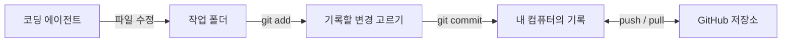
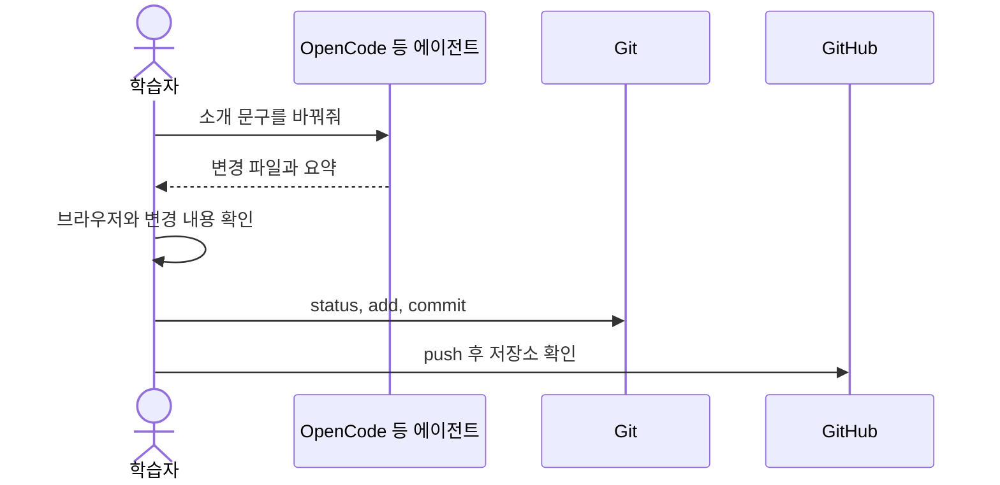

# Git 중심 형상관리와 코딩 에이전트

---

## 오늘의 목표

- 에이전트로 작은 웹페이지를 만들고 결과를 확인한다.
- Git으로 변경을 기록하고 GitHub에 올린다.
- 속도보다 확인하고 기록하는 습관을 익힌다.

---

## 순서는 유연하게

설치·인증이 막히면 질문과 준비 시간을 먼저 쓰고, 준비된 사람은 실습을 이어갑니다. 매 3시간 블록은 핵심 설명, 직접 해보기, 실습 과제와 퀴즈로 마무리합니다.

---

## Git과 GitHub

- Git: 내 컴퓨터에서 파일 변경 이력을 기록하는 도구
- GitHub: Git 저장소를 원격에 보관하고 공유하는 서비스
- 코딩 에이전트: 요청에 따라 파일을 바꾸는 도구
- VS Code: 파일·변경 내용을 살펴보는 편집기

---

## 변경이 기록되는 길



---

## 매번 확인할 명령

```bash
git status
git add index.html style.css
git status
git commit -m "첫 웹페이지 추가"
git log --oneline
```

한 줄씩 실행하고 상태를 읽습니다. `add`는 다음 기록에 넣을 변경을 고르고, `commit`은 로컬 이력을 만듭니다.

---

## 작은 요청, 직접 확인



---

## 에이전트에게 잘 부탁하기

“페이지를 예쁘게 해줘” 대신 대상 파일과 바꿀 점, 지켜야 할 점을 말합니다. 한 번에 한두 가지를 요청하고 브라우저와 변경 내용을 확인합니다.

> `index.html`의 제목을 “나의 첫 페이지”로 바꿔줘. 다른 파일은 건드리지 말고 바뀐 내용을 요약해줘.

---

## OpenCode와 GitHub CLI

- OpenCode 같은 코딩 에이전트는 로컬 프로젝트의 파일을 읽고 수정할 수 있습니다.
- Git 명령은 로컬 변경 기록을 다룹니다.
- GitHub CLI `gh`는 저장소·이슈·Pull Request 같은 GitHub 작업을 돕습니다.
- 설치와 로그인은 선택 활동입니다. 준비가 안 되어도 GitHub 웹 화면으로 진행할 수 있습니다.

---

## GPT의 GitHub 연결

ChatGPT GitHub 연결은 허용된 저장소 내용을 찾아 질문하는 기능입니다. 코딩 에이전트처럼 로컬 파일을 수정하거나 PR을 만드는 기능과 구분합니다. 계정·조직 정책에 따라 쓸 수 없을 수 있으므로 필수로 두지 않습니다. 비밀 값이나 개인 코드는 채팅에 넣지 않습니다.

---

## 실습 블록 A · 준비와 첫 커밋

[블록 A 안내·실습·퀴즈](/git/docs/blocks/a/)

- Git 설치와 사용자 이름·이메일 설정을 확인합니다.
- 프로젝트 폴더에서 `git init`, `git status`를 실행합니다.
- 에이전트에 제목 변경을 요청하고 브라우저와 변경 파일을 확인합니다.
- 과제: 제목을 자기 문구로 바꾸고 커밋합니다.

### 퀴즈 A

`git add` 전후 `git status`에서 무엇이 달라지나요? Git과 GitHub는 어떤 점이 다른가요?

---

## 실습 블록 B · GitHub에 공유

[블록 B 안내·실습·퀴즈](/git/docs/blocks/b/)

- GitHub 저장소를 만들고 로컬 저장소와 연결합니다.
- `git push` 후 웹에서 커밋과 파일을 확인합니다.
- Pages는 정적 페이지를 공개할 때 강사 안내에 따라 설정합니다.
- 과제: 문구를 한 번 더 바꾸고 커밋·push한 뒤 저장소에서 확인합니다.

### 퀴즈 B

`commit`과 `push`의 차이는 무엇인가요? push 결과는 어디서 확인하나요?

---

## 실습 블록 C · 페이지 개인화

[블록 C 안내·실습·퀴즈](/git/docs/blocks/c/)

- 폰트·색상·소개 문구 중 하나를 골라 작은 변경을 요청합니다.
- 폰트·아이콘·이미지의 사용 조건을 확인합니다.
- 변경 전후 브라우저 화면과 Git 기록을 비교합니다.
- 과제: 색상 또는 소개를 바꾸고 커밋·push합니다.

### 퀴즈 C

외부 폰트를 사용하기 전에 무엇을 확인해야 하나요? 에이전트가 고친 파일은 어떻게 확인하나요?

---

## 실습 블록 D · 협업 맛보기

[블록 D 안내·실습·퀴즈](/git/docs/blocks/d/)

- 브랜치는 작업을 나누는 길, Pull Request는 변경을 제안하고 검토하는 방법입니다.
- 짝 리뷰 또는 강사 시연으로 변경 요약을 읽습니다.
- 여유가 있으면 `gh`로 PR을 살펴봅니다.
- 과제: 다른 사람의 변경을 읽고 질문 또는 칭찬 한 줄을 남깁니다.

### 퀴즈 D

Pull Request는 어떤 때 쓰나요? GitHub CLI를 쓸 수 없어도 협업 흐름을 배울 수 있나요?

---

## 320px에서도 읽기

휴대폰 화면에서는 한 번에 한 단계만 봅니다. 명령은 짧은 코드 블록으로 제시하고, 긴 흐름은 다이어그램으로 나눕니다. 화면이 좁으면 슬라이드를 확대하거나 강사 화면을 함께 봅니다.

---

## 마무리 체크

- 변경 전후 `git status`를 확인했다.
- 브라우저와 파일 변경 내용을 확인한 뒤 커밋했다.
- commit은 로컬 기록, push는 원격 공유임을 안다.
- GitHub에서 저장소와 배포 결과를 열어 보았다.
