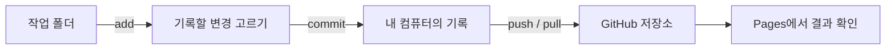

# Git → Markdown → Branch

---

## 수업에서 만드는 것

내 웹페이지를 조금씩 고쳐 브라우저에서 확인하고, Git으로 기록해 GitHub에 공유합니다. README와 학습 기록을 쓰고, 마지막에는 Branch와 Pull Request로 협업 흐름을 살펴봅니다.

네 블록은 각각 3시간입니다. 45분 수업과 15분 휴식을 세 번 반복합니다.

---

## 변경이 기록되는 흐름

Git은 내 컴퓨터의 변경 이력을 기록하고, GitHub는 원격 공유와 협업, Pages 배포를 제공합니다.

---

## 네 블록의 순서

1. **Git** — 로컬 변경을 기록하고 상태를 읽습니다.
2. **GitHub** — 원격 저장소에 공유하고 Pages를 확인합니다.
3. **Markdown** — README와 학습 기록을 작성합니다.
4. **Branch** — 작업을 나누고 변경을 검토합니다.

각 블록은 배경과 목적을 확인하고, 할 일을 정한 뒤, 단계별 진행 흐름을 따라 실습합니다.

---

## A · 첫 기록이 필요한 이유

파일을 고치기만 하면 무엇이 바뀌었는지 놓치거나 이전 상태를 찾기 어렵습니다. Git은 변경을 골라 기록으로 남깁니다. 이번 실습의 목적은 Git과 GitHub를 구분하고, 내 컴퓨터에 첫 기록을 만드는 것입니다.

---

## A · 무엇을 해볼까요?

- 작업 폴더, Staging Area, Repository의 역할을 확인합니다.
- 에이전트로 제목을 바꾸고 브라우저와 변경 내용을 살펴봅니다.
- 첫 변경을 커밋하고 기록을 확인합니다.

[블록 A 안내·실습·퀴즈](/git/docs/blocks/a/)

---

## A · 진행 순서

도구와 Git 사용자 설정 확인 → 프로젝트 폴더 열기 → `init`·`status` → 제목 수정 → `add` 전후 상태 비교 → `commit`·`log`

과제는 자기 문구로 제목을 바꿔 커밋하는 것입니다. 마지막에는 `add` 전후 상태와 Git·GitHub의 차이를 설명합니다.

---

## B · 원격 공유가 필요한 이유

로컬 커밋은 내 컴퓨터 안의 기록입니다. 다른 사람과 공유하거나 웹페이지로 공개하려면 GitHub 원격 저장소에 올리고 결과를 확인해야 합니다.

---

## B · 무엇을 해볼까요?

- GitHub 저장소와 로컬 저장소를 연결합니다.
- 커밋을 push하고 웹에서 파일과 이력을 확인합니다.
- Pages 배포 주소를 열어 페이지를 확인합니다.

[블록 B 안내·실습·퀴즈](/git/docs/blocks/b/)

---

## B · 진행 순서

저장소 만들기 → 원격 주소 확인 → `remote` 연결 → `push` → GitHub에서 커밋 확인 → Pages 설정과 배포 상태 확인

과제는 문구를 다시 바꾸고 커밋·push하는 것입니다. 마지막에는 commit과 push의 차이, 확인 위치를 말합니다.

---

## C · Markdown이 필요한 이유

코드를 공유해도 사용법이나 배운 내용을 함께 적지 않으면 다른 사람이 맥락을 알기 어렵습니다. Markdown은 제목, 목록, 링크를 일반 텍스트로 간단히 작성하는 방법입니다.

---

## C · 무엇을 해볼까요?

- README에 자기소개와 Pages 주소를 적습니다.
- Issue로 다음 개선점을 남깁니다.
- Profile, Label, Milestone, TIL, 회고, 부검, Wiki의 쓰임을 살펴봅니다.

[블록 C 안내·실습·퀴즈](/git/docs/blocks/c/)

---

## C · 진행 순서

`.md` 문법 확인 → README 편집 → 저장소 화면에서 확인 → Issue 작성 → 학습 기록과 Wiki의 쓰임 살펴보기

과제는 소개와 배포 링크를 README에 추가하는 것입니다. 마지막에는 Markdown과 Issue가 어떤 상황에 쓰이는지 말합니다. `gh`와 ChatGPT GitHub 연결은 선택 기능입니다.

---

## D · Branch와 검토가 필요한 이유

기본 브랜치에 바로 변경을 쌓으면 검토 중인 작업과 안정된 작업이 섞입니다. Branch는 별도 작업 흐름을 만들고, Pull Request는 변경을 합치기 전에 제안하고 검토하게 합니다.

---

## D · 무엇을 해볼까요?

- 새 Branch에서 작은 변경을 만듭니다.
- 병합 방식과 충돌 상황을 살펴봅니다.
- Pull Request에서 변경을 설명하고 의견을 나눕니다.

[블록 D 안내·실습·퀴즈](/git/docs/blocks/d/)

---

## D · 진행 순서

현재 브랜치 확인 → 새 브랜치에서 수정·커밋 → `log --graph` 확인 → 병합과 충돌 시연 → 웹에서 PR 검토

Fast-forward는 포인터를 앞으로 옮기고, 3-way merge는 갈라진 변경을 합칩니다. 일정이 밀리면 PR은 강사 시연으로 진행합니다.

---

## 안전하게 마무리하기

- 명령은 한 줄씩 실행하고 `status`와 diff로 변경을 확인합니다.
- `reset --hard`는 저장하지 않은 변경을 지울 수 있어 실습 명령으로 복사하지 않습니다.
- `amend`는 공유 전 최신 커밋, `revert`는 되돌림 커밋에 씁니다.
- Windows 설치와 복사 가능한 전체 명령은 [상세 안내](/git/docs/git-guide/)에 있습니다.
