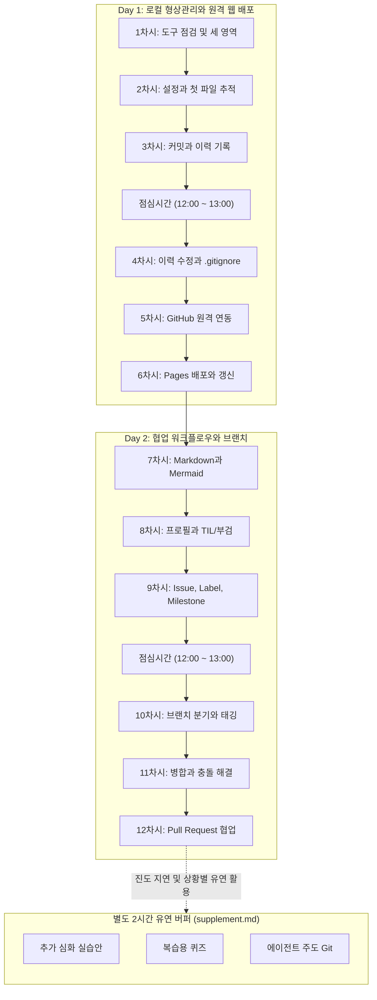
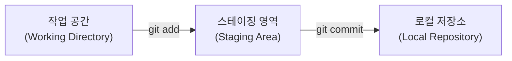
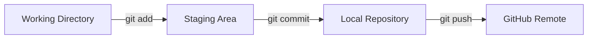

# Git 중심 형상관리와 개발 워크플로우 상세 커리큘럼

본 문서는 형상관리 도구를 처음 접하는 입문자를 위해 설계된 2일(12차시, 총 12시간, 점심시간 제외) 확정 교육 실행 계획서입니다. 개발 입문 약 15일 차 학습자가 정적 웹페이지의 변경을 안전하게 실험하고 기록하며 동료와 협업하는 실무 기본기를 체득하도록 돕습니다.

---

## 1. 교육 개요 및 운영 원칙 (Educational Overview & Principles)

### 1.1 입문자 눈높이와 학습 배경
- **대상 독자:** 개발 입문 약 15일 차 학습자입니다.
- **배경 이해:** 웹페이지를 만들다가 이전 코드로 되돌리고 싶어 파일을 `index_v1.html`, `index_final.html`처럼 복사해 본 경험이 있는 수준을 전제로 합니다. 터미널 검은 화면(CLI)에 명령어를 입력하는 것에 아직 낯설음을 느낄 수 있으므로, 모든 개념은 일상적인 비유(장바구니, 사진 앨범, 안전 잠금장치 등)와 `index.html` 제목·소개 문구·CSS 색상 변경 등 직관적인 정적 웹 파일 작업 흐름을 중심으로 설명합니다.

### 1.2 1시간 블록 기반 시간표와 버퍼(Buffer) 운영 원칙
- **정규 본 과정 일정:** 총 2일, 일 6시간 (오전 3시간, 오후 3시간), 총 12시간 (720분, 점심시간 제외) 정규 본 과정입니다.
- **시간표 구조 (1시간 단위 독립 블록):**
  - **오전 블록:** 09:00 ~ 10:00, 10:00 ~ 11:00, 11:00 ~ 12:00 (각 1시간)
  - **점심시간 (고정): 12:00 ~ 13:00 (60분 고정 휴식)**
  - **오후 블록:** 13:00 ~ 14:00, 14:00 ~ 15:00, 15:00 ~ 16:00 (각 1시간)
  - 각 1시간 블록은 **집중 수업 45분 + 휴식 15분**으로 구성되며, 매 시간마다 명확한 주제와 독립적인 산출물이 완료되도록 완결성을 보장합니다.
- **본 과정과 별도 2시간 버퍼(Buffer) 구분 및 3개 추가 파트:**
  - 본 과정 12차시 외에 초기 설치·환경 장애 대응 및 진도 지연을 흡수하기 위한 **별도 2시간 버퍼(Buffer)**를 편성합니다.
  - 버퍼 시간은 2시간 확정 추가 수업으로 단정하지 않으며, 각 파트별 고정 시간을 두지 않습니다. 실제 설치나 진도 지연 상황에 따라 실제 남은 시간을 기준으로 유연하게 활용하며, 개별 학습이나 추가 실습 진행 여부는 현장 상황에 맞춰 결정합니다.
  - 버퍼 시간 활용을 위한 3개 추가 파트 (상세 실습 안내 및 문항은 beam 담당 [supplement.md](supplement.md)에서 제공):
    1. **추가 심화 실습안:** 본 과정에서 완성한 웹페이지를 발전시키는 확장 실습.
    2. **복습용 퀴즈:** 핵심 개념 점검 문항 모음.
    3. **에이전트 주도 Git:** 코딩 에이전트와 연계한 심화 워크플로우 탐색.

### 1.3 도구의 위상 및 보조 참고 도구
- **필수 핵심 도구:**
  - **VS Code:** 코드 편집과 터미널을 함께 사용하는 주력 에디터.
  - **터미널 (Git Bash / macOS 기본 터미널):** 리눅스 표준 터미널 환경을 경험하기 위한 주 CLI 도구.
  - **OpenCode:** 초보자가 복잡한 웹 코딩 문법에 매몰되지 않고 정적 웹페이지(HTML/CSS/MD)를 생성하여 빠른 피드백을 얻도록 돕는 보조 에이전트.
  - **GitHub & GitHub Pages:** 원격 저장소 보관 및 클릭 몇 번으로 전 세계에 내 웹사이트를 공개하는 무료 호스팅 플랫폼.
- **선택 참고 및 추가 활용 도구 (학습 부담 없는 시각적 보조):**
  - **Mermaid:** 마크다운 문서 안에서 텍스트 코드로 순서도와 다이어그램을 즉시 그릴 수 있는 도구입니다. 7차시에서 직접 실습하여 Git의 흐름을 학습자가 손으로 시각화합니다.
  - **눈누(noonnu.com):** 다양한 무료/오픈 웹폰트를 모아둔 사이트입니다. 필수 사항이 아니며, 폰트마다 상업적 이용 가능 범위와 허용 조건(라이선스)이 서로 다르므로 반드시 개별 폰트의 라이선스 규정을 먼저 확인한 뒤 적용하도록 안내합니다.
  - **Bulma:** 복잡한 CSS 작성 없이 클래스 이름만으로 깔끔한 레이아웃을 만들어 주는 경량 CSS 프레임워크입니다. 추가 스타일링을 원하는 학습자를 위한 선택 팁으로 소개합니다.
  - **Coolors:** 조화로운 색상 조합 팔레트를 원클릭으로 추천해 주는 사이트입니다. 웹페이지 색상을 바꿀 때 색상 코드를 참고하는 보조 도구로 언급합니다.
  - **GitHub CLI (`gh`) 및 ChatGPT - GitHub 연동:** 초급자에게 복잡한 CLI 설치 및 권한 오류를 주지 않기 위해 강사의 데모 시연 및 자습 안내 중심으로 다룹니다.

### 1.4 운영 장애 및 OS 차이 부록 분리 원칙
- **공통 흐름 원칙:** 본 커리큘럼 본문은 특정 OS에 치우치지 않는 공통 Git 워크플로우를 기술합니다.
- **운영 트러블슈팅 부록 참조:** Windows 환경의 자격 증명 관리자 충돌 및 삭제 절차는 본 수업의 흐름을 끊지 않도록 본문에서 장황하게 설명하지 않고, beam 담당 문서의 [practice.md 부록 A: Windows 자격 증명과 GitHub 인증](practice.md#부록-a-windows-자격-증명과-github-인증)을 참조하도록 연결합니다.
- **OS별 환경 차이 부록 참조:** macOS 터미널(zsh)과 Windows Git Bash의 경로 표기(`C:\` vs `/c/`), 줄바꿈(CRLF vs LF), 키체인 인증 등의 상세 차이는 beam 담당 문서의 [practice.md 부록 E: macOS와 Windows 사용 차이](practice.md#부록-e-macos와-windows-사용-차이)를 참조하도록 연결합니다.
- **명령어 옵션 및 마크다운·보조도구 부록 참조:** 상세 옵션과 위험도 일람은 [practice.md 부록 B: Git 명령 바리에이션과 옵션](practice.md#부록-b-git-명령-바리에이션과-옵션), 웹 폰트·스타일·색상 보조 리소스는 [practice.md 부록 C: 선택 참고: 눈누·Bulma·Coolors](practice.md#부록-c-선택-참고-눈누bulmacoolors), 마크다운 문법 표는 [practice.md 부록 D: Mermaid 시각화](practice.md#부록-d-mermaid-시각화)를 각각 연결합니다.

---

## 2. 전체 커리큘럼 시간표 요약 (12차시 확정 일람표)

점심시간은 매일 12:00 ~ 13:00로 고정되며, 모든 1시간 블록은 독립적인 주제와 실습으로 완결됩니다. 실습 번호는 `practice.md`의 실습 1 ~ 12와 1:1로 일치합니다.

| 일자 | 교시 | 시간 블록 (총 60분) | 모듈명 및 차시 주제 | 실습 번호 연결 (practice.md) | 핵심 따라하기 실습 내용 |
| :--- | :---: | :---: | :--- | :---: | :--- |
| **Day 1<br/>오전** | 1차시 | 09:00 ~ 10:00 | 형상관리 입문과 도구 점검 | 실습 1 환경과 세 영역 | VCS vs SCM 개념, VS Code & 터미널 & OpenCode 점검, 로컬 3영역 멘탈 모델 |
| | 2차시 | 10:00 ~ 11:00 | Git 설정과 작업 공간 | 실습 2 로컬 저장소 생성 | `git config` 등록, `git init`, `.gitkeep`, OpenCode 웹페이지 생성, `status`, `add` |
| | 3차시 | 11:00 ~ 12:00 | 커밋과 이력 기록 | 실습 3 첫 커밋과 이력 | `git commit -m` 메시지 작성, 커밋 해시 구조, Commit Convention, `log --oneline`, `reset` 맛보기 |
| **Day 1<br/>점심** | - | **12:00 ~ 13:00** | **점심 식사 및 휴식 (60분 고정)** | - | **오전 실습 환경 정리 및 완전 휴식** |
| **Day 1<br/>오후** | 4차시 | 13:00 ~ 14:00 | 이력 수정과 파일 배제 | 실습 4 이력 수정과 배제 | `commit --amend` 오타 수정, `revert` 안전 취소, `reset+` 3모드 비교, `.gitignore` 패턴 |
| | 5차시 | 14:00 ~ 15:00 | 원격 저장소와 동기화 | 실습 5 GitHub 원격 연동 | GitHub 저장소 생성, `remote add origin`, `push -u`, `pull`, `clone` vs `fork`, `main` 브랜치 |
| | 6차시 | 15:00 ~ 16:00 | 웹 배포와 배포 갱신 | 실습 6 Pages 배포 | GitHub Pages 정적 웹 호스팅, OpenCode 수정 반영 후 배포 갱신 검증, Actions 확인 |
| **Day 2<br/>오전** | 7차시 | 09:00 ~ 10:00 | Markdown과 Mermaid | 실습 7 Markdown과 Mermaid | `.md` 문법, **Mermaid 다이어그램 직접 그리기**, `README.md` 작성, Bulma 소개 |
| | 8차시 | 10:00 ~ 11:00 | 개발자 프로필과 기록 | 실습 8 프로필과 지속적 기록 | GitHub Profile Special Repo, Wiki 지식베이스, TIL 및 사후분석(부검) 문서화 |
| | 9차시 | 11:00 ~ 12:00 | 작업 관리와 확장 도구 | 실습 9 Issue, Label, Milestone | GitHub Issue 생성, Label 태그 분류, Milestone 목표 묶기, `gh` 및 AI 연동 데모 |
| **Day 2<br/>점심** | - | **12:00 ~ 13:00** | **점심 식사 및 휴식 (60분 고정)** | - | **오전 브랜치 작업 점검 및 완전 휴식** |
| **Day 2<br/>오후** | 10차시 | 13:00 ~ 14:00 | 브랜치와 태깅 | 실습 10 브랜치와 태그 | `git branch` 분기, `switch -c`, 릴리스 태그 `git tag` 관리, `checkout` 변천사 |
| | 11차시 | 14:00 ~ 15:00 | 병합과 충돌 해결 | 실습 11 병합과 충돌 | Fast-forward vs 3-way merge, 의도적 Conflict 발생 및 해결, `log --graph`, `merge --abort` |
| | 12차시 | 15:00 ~ 16:00 | 풀 리퀘스트와 협업 | 실습 12 Pull Request | 기능 브랜치 push, Pull Request 작성, diff 리뷰 코멘트, Merge PR, 브랜치 정리, 종합 회고 |



### 별도 2시간 버퍼(Buffer) 및 추가 3파트 연계 안내
- **운영 목적:** 본 과정 12차시 외에 설치·환경 장애 대응 및 진도 지연을 흡수하기 위한 유연한 버퍼 시간입니다.
- **운영 원칙:** 2시간 확정 추가 수업으로 단정하지 않으며, 각 파트별 고정 시간을 두지 않고 실제 남은 시간과 현장 상황에 맞춰 활용합니다.
- **추가 3개 파트 구성 (상세: [supplement.md](supplement.md)):**
  1. **추가 심화 실습안:** 본 과정 결과물 고도화 및 확장 실습
  2. **복습용 퀴즈:** 핵심 형상관리 개념 점검 문항 모음
  3. **에이전트 주도 Git:** 코딩 에이전트와 연계한 심화 워크플로우

---

## 3. 차시별 상세 커리큘럼

---

### [1차시] 개발자를 위한 첫 번째 안전망: VCS/SCM과 Git의 세 영역

- **시간표:** Day 1 09:00 ~ 10:00 (수업 45분 09:00~09:45 / 휴식 15분 09:45~10:00)
- **실습 번호 연결:** 실습 1 환경과 세 영역
- **차시 목표:**
  - 웹페이지 코드를 이전 시점으로 안전하게 되돌리기 위해 버전 관리(VCS)와 형상 관리(SCM)가 왜 필수적인지 웹 파일 관리 경험에 빗대어 설명할 수 있다.
  - 내 컴퓨터 안에서 파일이 이동하는 세 가지 핵심 영역(작업 폴더, 스테이징 영역, 저장소)의 동작 원리를 이해한다.
  - VS Code와 터미널, OpenCode가 올바르게 준비되었는지 확인한다.

#### 소프트웨어 안전망과 형상관리의 필요성
- 웹페이지를 만들면서 겪는 흔한 상황을 떠올립니다. 잘 나오던 화면의 제목이나 레이아웃을 조금 고쳤는데 화면이 깨져서 이전 상태로 돌아가고 싶을 때, 파일명을 `index1.html`, `index2.html`, `index_final.html`로 여러 개 복사해 두면 무엇이 최신인지 헷갈리게 됩니다.
- 이러한 혼란을 방지하고 코드의 과거 이력을 타임머신처럼 저장해 주는 도구가 버전 관리 시스템(VCS)이며, 프로젝트의 코드와 문서 전체를 하나의 유기적인 상태로 관리하는 것을 형상 관리(SCM)라고 부릅니다.

#### 로컬 3단계 정거장의 구조와 상태 변화
Git은 파일 변경을 무작정 저장하지 않고 명확한 3단계를 거칩니다.



- **작업 공간 (Working Directory):** 내가 VS Code에서 실제로 `index.html`, `style.css` 같은 웹 코드를 작성하고 저장하는 현재 폴더입니다.
- **스테이징 영역 (Staging Area / Index):** 마트에서 물건을 카트에 담듯, 다음 저장 기록에 포함할 변경 파일들만 골라 올려두는 대기 장소입니다.
- **로컬 저장소 (Repository):** 카트에 담긴 물건들의 계산을 마치고 영수증을 발행하듯, 파일들의 현재 상태를 확정하여 안전하게 보관하는 스냅샷 앨범입니다.

- **핵심 명령어:**
  - `git --version`: Git 설치 버전 점검.
  - `pwd`: 현재 작업 디렉터리 경로 확인.
- **추가 참고 옵션:**
  - 터미널 명령어의 기본 구조(`명령어 [하위명령] [옵션] [대상]`)와 일상적 옵션 지정 방식 비교.

#### 환경 점검과 터미널 도구 확인
- **실습 단계:**
  1. VS Code를 실행하고 터미널 창을 엽니다 (`Ctrl + ~`).
  2. `git --version`을 입력하여 버전 정보가 정상 출력되는지 확인합니다.
  3. 실습 폴더를 생성하고 기본 상태를 점검합니다.
  4. OpenCode 인터페이스를 열어 정상 응답하는지 점검합니다.
- **추가 참고 활동:**
  - VS Code의 터미널 테마와 폰트를 가독성 좋게 조정해 봅니다.
- **산출물 및 완료판정:**
  - *산출물:* 터미널 정상 구동 및 Git 버전 출력 확인 화면.
  - *완료판정:* `git --version` 결과가 터미널에 표시되고, 3개 영역(작업공간, 스테이징, 저장소)의 차이를 구두로 말할 수 있으면 통과.
- **지연 및 트러블슈팅 대안 (부록 참조):**
  - OS별 터미널 종류나 경로 표기 차이는 [practice.md 부록 E: macOS와 Windows 사용 차이](practice.md#부록-e-macos와-windows-사용-차이)를 참조하여 환경을 맞춥니다.

---

### [2차시] 작업 공간 열기: Git 설정과 첫 파일 추적

- **시간표:** Day 1 10:00 ~ 11:00 (수업 45분 10:00~10:45 / 휴식 15분 10:45~11:00)
- **실습 번호 연결:** 실습 2 로컬 저장소 생성
- **차시 목표:**
  - `git config`를 통해 커밋에 기록될 작업자 정보를 설정한다.
  - `git init`으로 새 저장소를 초기화하고, 숨김 폴더 `.git`의 의미를 안다.
  - OpenCode로 첫 웹페이지를 생성하고, `git status`와 `git add`로 파일을 추적하며 `.gitkeep`의 쓰임을 체득한다.

#### 작업자 정보 등록과 폴더 추적이 필요한 이유
- 협업할 때 누가 코드를 작성했는지 기록되지 않으면 문제가 발생했을 때 작성자를 찾을 수 없습니다. 따라서 작업 전 작성자 이름과 이메일을 등록해야 합니다.
- 또한 컴퓨터 안의 일반 폴더는 파일 변경을 스스로 기억하지 못하므로, "이 폴더 감시 및 기록 시작" 선언(`init`)을 해야 비로소 버전 관리가 시작됩니다.

#### 저장소 초기화와 파일 감시 원리
- **핵심 명령어:**
  - `git config --global user.name "이름"`: 전역 작업자 이름 등록.
  - `git config --global user.email "이메일"`: 전역 작업자 이메일 등록.
  - `git init`: 현재 폴더를 Git 저장소로 초기화 (`.git` 폴더 생성).
  - `git status`: 현재 파일들의 상태(Untracked vs Staged) 점검.
  - `git add <파일명>`: 특정 파일을 스테이징 영역에 추가.
  - `.gitkeep`: 빈 디렉터리를 Git에 인식시키기 위한 관례적 빈 파일.
- **추가 참고 옵션:**
  - `git config --list`: 현재 설정된 모든 Git 옵션 조회.
  - `git config --local`: 현재 프로젝트 폴더에만 적용되는 설정 지정.
  - `git add .`: 변경된 모든 파일을 한 번에 스테이징 영역에 올리기.

#### 웹 파일 생성과 첫 스테이징 실습
- **실습 단계:**
  1. 터미널에 본인의 영문 이름과 이메일 등록 (`git config --global ...`).
  2. 새 실습 폴더 `my-web`을 만들고 폴더 내부로 이동하여 `git init` 실행.
  3. OpenCode에 명사형 프롬프트 입력:
```text
HTML5 표준 index.html 및 style.css 2개 파일 생성. 개발자 자기소개, 헤더, 소개글, 프로젝트 목록 영역 포함.
```
  4. 생성된 기본 정적 웹 파일 예시 (`index.html` 및 `style.css`):
```html
<!-- index.html -->
<!DOCTYPE html>
<html lang="ko">
<head>
  <meta charset="UTF-8">
  <title>주니어 개발자 포트폴리오</title>
  <link rel="stylesheet" href="style.css">
</head>
<body>
  <header><h1>홍길동의 포트폴리오</h1></header>
  <main><p>웹 개발을 시작한 지 15일 차인 주니어 개발자입니다.</p></main>
</body>
</html>
```
```css
/* style.css */
body { font-family: sans-serif; margin: 2rem; background-color: #f8fafc; }
header h1 { color: #1e293b; }
```
  5. `git status`를 입력하여 빨간색 Untracked 파일 목록 확인.
  6. 빈 폴더 생성 및 빈 추적 파일 생성 (`mkdir -p images && touch images/.gitkeep`). 경로 미존재로 인한 add 오류를 방지하기 위해 폴더와 빈 파일을 반드시 함께 만듭니다.
  7. 스테이징 등록: `git add index.html style.css images/.gitkeep` 실행 후 다시 `git status`를 입력하여 초록색 "Changes to be committed" 확인.
- **추가 참고 활동:**
  - `git add .` 명령어로 모든 변경을 일괄 스테이징하는 편리함과 의도치 않은 파일 포함 주의점 비교.
- **산출물 및 완료판정:**
  - *산출물:* `my-web/.git` 저장소 및 스테이징 영역에 등록된 웹페이지 파일들.
  - *완료판정:* `git status` 실행 시 녹색 목록에 파일들이 정상 노출되면 통과.
- **지연 및 트러블슈팅 대안:**
  - OpenCode 접속 지연 시 상기 기본 `index.html` 샘플을 복사하여 즉시 스테이징 실습을 진행합니다.

---

### [3차시] 타임머신 기록 생성: 커밋, 이력 기록과 메시지 규칙

- **시간표:** Day 1 11:00 ~ 12:00 (수업 45분 11:00~11:45 / 휴식 15분 11:45~12:00)
- **실습 번호 연결:** 실습 3 첫 커밋과 이력
- **차시 목표:**
  - 스테이징 영역의 파일들을 `git commit`으로 확실한 스냅샷 기록으로 박제한다.
  - 커밋 해시(SHA-1 Hash)의 의미와 직관적인 커밋 메시지 컨벤션을 체득한다.
  - `git log --oneline`으로 이력을 확인하고, 실수로 올린 파일을 내리는 기초 `reset`을 경험한다.

#### 의미 있는 작업 단위 기록의 필요성
- 웹페이지에 새로운 섹션을 추가하거나 디자인을 다듬을 때 체크포인트를 남기듯, Git에서는 의미 있는 작업 단위마다 스냅샷을 찍어야 나중에 화면이나 기능이 깨졌을 때 정확히 그 지점으로 되돌릴 수 있습니다.
- 이때 명확한 접두어(`feat:`, `docs:` 등)를 붙이는 규칙을 적용하면 나중에 어떤 변경인지 한눈에 알 수 있습니다.

#### 커밋 스냅샷과 메시지 컨벤션 체계
- **핵심 명령어:**
  - `git commit -m "메시지"`: 인라인으로 한 줄 설명과 함께 스냅샷 확정.
  - `git log --oneline`: 커밋들을 한 줄 요약 형태로 간결하게 열람.
  - `git reset <파일명>`: 마지막 커밋 기준 상태로 되돌려 스테이징 영역(초록색)에 올라간 파일을 다시 작업 공간(빨간색)으로 내리기 (언스테이징).
  - vi 에디터 비상 탈출: 실수로 `-m` 없이 `git commit`만 쳐서 vi 화면이 떴을 때, `Esc` 누른 후 `:wq` 입력 후 엔터 (저장 종료) 또는 `:q!` (취소).
- **추가 참고 옵션:**
  - `git log -n 3`: 최근 3개의 커밋만 보기.
  - `git log --stat`: 변경된 파일과 라인 수 통계 보기.
  - Commit Convention: `feat:`, `docs:`, `fix:`, `style:` 접두어 활용.

#### 첫 커밋 기록과 이력 확인 절차
- **실습 단계:**
  1. 첫 번째 커밋 확정: `git commit -m "feat: 첫 번째 웹페이지 파일 추가"`.
  2. `git log --oneline`을 실행하여 고유 해시값과 메시지 확인.
  3. OpenCode에 명사형 프롬프트 입력:
```text
index.html의 메인 타이틀을 '주니어 웹 개발자 홍길동의 포트폴리오'로 변경 및 서브 소개 문구 갱신
```
  4. 브라우저에서 화면 변경을 확인한 뒤, 터미널에서 `git status`로 변경(modified) 확인 후 `git add index.html`.
  5. 두 번째 커밋 확정: `git commit -m "docs: 메인 타이틀 소개 문구 수정"`.
  6. `git log --oneline`으로 2개의 이력이 쌓인 것을 확인.
- **추가 참고 활동:**
  - 실수로 추가한 파일을 `git reset <파일명>`으로 내려보는 언스테이징 실습.
- **산출물 및 완료판정:**
  - *산출물:* 2개 이상의 커밋이 정상적으로 기록된 로컬 저장소 이력.
  - *완료판정:* `git log --oneline` 실행 시 커밋 해시와 메시지가 2줄 이상 출력되면 통과.
- **지연 및 트러블슈팅 대안:**
  - vi 에디터 입력 모드에 갇힌 경우 강사가 `Esc` 후 `:q!` 입력을 안내합니다.

---

### [점심시간] 12:00 ~ 13:00 (60분 고정)
- 오전 실습 환경을 점검하고 충분한 휴식을 취합니다. 13:00 정각에 4차시를 시작합니다.

---

### [4차시] 이력 수정과 배제: amend, revert, reset과 .gitignore

- **시간표:** Day 1 13:00 ~ 14:00 (수업 45분 13:00~13:45 / 휴식 15분 13:45~14:00)
- **실습 번호 연결:** 실습 4 이력 수정과 배제
- **차시 목표:**
  - 방금 작성한 커밋의 오타나 누락을 `git commit --amend`로 안전하게 덮어쓴다.
  - 원격에 공유된 이력을 안전하게 취소하는 `git revert`와 로컬 포인터를 이동시키는 `git reset` 3단계 모드를 비교한다.
  - `.gitignore`를 만들어 임시 파일이나 비밀번호 파일이 Git에 기록되지 않도록 완벽히 배제한다.

#### 이력 수정과 불필요한 파일 배제의 이유
- 방금 커밋을 완료했는데 오타가 났거나 파일 하나를 빠뜨렸을 때 매번 새 커밋을 만들면 히스토리가 지저분해집니다.
- 또한 편집기 임시 파일(`*.tmp`), 운영체제 찌꺼기(`.DS_Store`, `Thumbs.db`), 비공개 설정 파일(`.env`) 같은 파일들은 저장소 용량을 낭비하고 보안 위험을 초래하므로 Git 추적에서 원천 차단해야 합니다.

#### 직전 커밋 수정과 안전한 취소 및 무시 규칙
- **핵심 명령어:**
  - `git commit --amend -m "새메시지"`: 최근 커밋을 새로운 내용으로 대체 (원격 공유 전 로컬 전용).
  - `git revert <커밋해시>`: 기존 커밋을 삭제하지 않고 역변경 커밋을 새로 추가 (공유 후 취소의 표준 안전망).
  - `.gitignore`: 추적에서 제외할 파일 패턴 등록.
- **추가 참고 옵션 (`reset` 3모드 비교 및 위험도):**
  - `--soft`: 커밋만 취소, 파일은 스테이징(초록색) 유지.
  - `--mixed`: 커밋과 스테이징 취소, 파일은 작업폴더(빨간색) 유지.
  - `--hard`: 파일 변경까지 영구 삭제 (초보자 주의 필요).
  - 세부 옵션과 위험도 일람은 [practice.md 부록 B: Git 명령 바리에이션과 옵션](practice.md#부록-b-git-명령-바리에이션과-옵션)을 참조합니다.

#### amend와 gitignore 적용 절차
- **실습 단계:**
  1. 직전 커밋 메시지를 `git commit --amend -m "docs: 메인 타이틀 및 소개 문구 최종 수정"`으로 덮어쓰고 `git log --oneline`으로 확인.
  2. 프로젝트 루트에 `.gitignore` 파일을 만들고 무시 패턴 작성:
```gitignore
# 운영체제 임시 파일
.DS_Store
Thumbs.db
*.tmp

# 환경설정 및 민감정보 파일
.env
```
  3. 가짜 비밀파일 `.env`를 만들어 저장한 후 `git status`를 쳐서 빨간색으로 감지되지 않음을 직접 확인.
  4. `.gitignore` 파일 커밋: `git add .gitignore` → `git commit -m "chore: .gitignore 설정 추가"`.
- **추가 참고 활동:**
  - `git revert` 명령어로 과거 커밋을 안전하게 상쇄하는 시연 관찰.
- **산출물 및 완료판정:**
  - *산출물:* 정상 적용된 `.gitignore` 파일과 amend로 정돈된 커밋 이력.
  - *완료판정:* `.env` 파일을 생성해도 `git status`에 전혀 잡히지 않으면 통과.
- **지연 및 트러블슈팅 대안:**
  - 실수로 `--hard` 옵션을 사용해 파일이 지워진 경우 VS Code 타임라인 기능으로 복원 지원.

---

### [5차시] 내 컴퓨터를 넘어 클라우드로: GitHub 원격 연동과 동기화

- **시간표:** Day 1 14:00 ~ 15:00 (수업 45분 14:00~14:45 / 휴식 15분 14:45~15:00)
- **실습 번호 연결:** 실습 5 GitHub 원격 연동
- **차시 목표:**
  - GitHub 원격 저장소(Remote Repository)를 생성하고 내 로컬과 연결(`remote`)한다.
  - 기본 브랜치 명칭의 유래(`main` vs `master`)를 이해하고 `git push`와 `git pull`의 동기화 흐름을 체득한다.
  - 원격 코드를 내려받는 `clone`과 타인의 저장소를 복제하는 `fork`의 차이를 구분한다.

#### 로컬 백업을 넘어 클라우드 협업으로 나아가는 이유
- 내 노트북에만 코드가 있으면 하드디스크가 고장 났을 때 모든 기록이 유실됩니다.
- GitHub 클라우드에 원격 저장소를 두고 코드를 푸시(`push`)해 두면 전 세계 어디서든 안전하게 백업되고 동료와 협업할 수 있습니다.

#### 원격 저장소 연결과 동기화 메커니즘
- **핵심 명령어:**
  - `git remote add origin <URL>`: 원격 저장소 주소를 `origin` 이름으로 등록.
  - `git remote -v`: 등록된 원격 주소 목록 조회.
  - `git branch -M main`: 기본 브랜치를 `main`으로 확정.
  - `git push -u origin main`: 로컬 `main` 브랜치를 원격에 처음 업로드하며 업스트림 연결.
  - `git pull`: 원격의 최신 커밋을 내 로컬로 내려받기.
- **추가 참고 옵션:**
  - `clone` vs `fork`: 직접 쓰기 권한이 있는 저장소 통째 복제(`clone`)와 타인의 오픈소스 기여를 위한 내 계정 복제(`fork`) 비교.
  - `main vs master`: 포용적 언어 정책에 따른 기본 브랜치 명칭 역사.

#### GitHub 저장소 연결과 push 동기화 실습
- **실습 단계:**
  1. GitHub 웹에서 새 빈 저장소 `portfolio-web` 생성 (README, .gitignore 추가 체크 해제).
  2. 터미널에서 브랜치 이름 확인: `git branch -M main`.
  3. 원격 주소 연결: `git remote add origin https://github.com/USER/portfolio-web.git`.
  4. 원격 연결 확인 후 푸시: `git push -u origin main` (브라우저 로그인 인증 승인).
  5. GitHub 웹 화면을 새로고침하여 로컬 파일과 커밋 이력이 올라간 것 확인.
- **추가 참고 활동:**
  - 별도 폴더에 `git clone`을 받아 파일을 하나 추가 커밋 후 push하고, 원래 폴더에서 `git pull`로 가져오는 왕복 흐름 체험.
- **산출물 및 완료판정:**
  - *산출물:* GitHub 웹에 파일과 커밋이 완벽하게 백업된 원격 저장소.
  - *완료판정:* GitHub 웹페이지에서 내 파일들과 커밋 히스토리가 보이면 통과.
- **지연 및 트러블슈팅 대안 (부록 참조):**
  - Windows 인증 팝업 실패나 403 오류 시 [practice.md 부록 A: Windows 자격 증명과 GitHub 인증](practice.md#부록-a-windows-자격-증명과-github-인증)을 참조하여 자격 증명 관리자에서 이전 계정을 삭제하고 재인증합니다.

---

### [6차시] 전 세계에 내 사이트 공개하기: GitHub Pages 배포와 배포 갱신

- **시간표:** Day 1 15:00 ~ 16:00 (수업 45분 15:00~15:45 / 휴식 15분 15:45~16:00)
- **실습 번호 연결:** 실습 6 Pages 배포
- **차시 목표:**
  - GitHub Pages 서비스를 이용해 내 정적 웹페이지를 인터넷에 실시간 라이브 사이트로 배포한다.
  - OpenCode로 사이트 내용을 수정하고, push를 통해 배포 사이트가 자동으로 갱신되는 파이프라인을 체득한다.
  - 선택 참고 도구(Coolors, 눈누)의 존재를 알고 나만의 사이트를 가꾸는 시각을 넓힌다.

#### 정적 웹 배포와 실시간 공개의 목적
- 개발한 웹페이지가 내 컴퓨터 안(`localhost`)에만 머물러 있으면 다른 사람이나 채용 담당자에게 보여줄 수 없습니다.
- GitHub Pages를 활용하면 서버 구매나 복잡한 설정 없이도 무료로 공용 URL을 발급받아 포트폴리오를 공개할 수 있습니다.

#### GitHub Pages 호스팅과 자동 재배포 파이프라인
- **핵심 배포 기능:**
  - GitHub Pages 설정: 저장소 Settings > Pages에서 소스 브랜치를 `main`으로 지정하면 무료 라이브 배포 활성화.
  - 배포 갱신 흐름: 로컬 수정 → `git add` → `git commit` → `git push` → GitHub Pages 자동 재배포.
- **선택 참고 도구:**
  - **눈누(noonnu.com) & Coolors:** 폰트와 색상 조합을 참고하는 보조 사이트 (눈누 폰트는 일괄 상업적 이용이 가능한 것이 아니므로 개별 폰트의 라이선스 범위 확인 필수 안내). 세부 링크는 [practice.md 부록 C: 선택 참고: 눈누·Bulma·Coolors](practice.md#부록-c-선택-참고-눈누bulmacoolors)를 참조합니다.
  - GitHub Actions: 배포 빌드 파이프라인 진행 상태 확인.

#### Pages 활성화와 웹페이지 갱신 배포 절차
- **실습 단계:**
  1. GitHub 저장소 웹 페이지의 `Settings` 탭 → `Pages` 메뉴 이동.
  2. Source를 `Deploy from a branch`로 두고, Branch를 `main` / `/(root)`로 선택 후 `Save`.
  3. 상단에 발급되는 라이브 사이트 URL 클릭하여 접속 확인.
  4. OpenCode에 명사형 프롬프트 입력:
```text
소개 페이지 하단 푸터에 연락처 이메일 및 저작권 표기 HTML 영역 추가
```
  5. 브라우저에서 변경 화면 확인.
  6. 변경 사항 배포 반영:
     `git add index.html` → `git commit -m "feat: 푸터 연락처 영역 추가"` → `git push origin main`.
  7. 약 1~2분 후 배포된 실제 URL을 새로고침하여 변경된 푸터가 반영되었는지 확인.
- **추가 참고 활동:**
  - GitHub 저장소의 `Actions` 탭에서 빌드 진행 과정을 눈으로 확인.
- **산출물 및 완료판정:**
  - *산출물:* 스마트폰이나 다른 PC에서도 접속 가능한 실제 공개 웹 URL.
  - *완료판정:* 웹 브라우저 주소창에 GitHub Pages URL을 입력했을 때 내 포트폴리오 페이지가 정상 표시되면 통과.
- **지연 및 트러블슈팅 대안:**
  - 배포 지연 시 약 1~2분의 시간이 걸릴 수 있음을 안내하고 시크릿 창으로 접속을 유도합니다.

---

### [7차시] 개발자의 언어로 문서화하기: Markdown과 Mermaid 시각화

- **시간표:** Day 2 09:00 ~ 10:00 (수업 45분 09:00~09:45 / 휴식 15분 09:45~10:00)
- **실습 번호 연결:** 실습 7 Markdown과 Mermaid
- **차시 목표:**
  - 마크다운(`.md`) 핵심 문법을 익히고 프로젝트 얼굴인 `README.md`를 표준 형식으로 작성한다.
  - **Mermaid 다이어그램 문법을 학습하여 Git의 3영역 흐름도를 마크다운 코드 블록으로 직접 시각화한다.**
  - 선택 스타일링 도구인 Bulma의 역할을 이해한다.

#### 프로젝트 문서화와 다이어그램 시각화의 목적
- 코드가 아무리 훌륭해도 설명서가 없으면 다른 개발자가 이 프로젝트를 사용할 수 없습니다.
- 텍스트 코드로 순서도를 그려주는 **Mermaid**를 활용하면 별도의 이미지 편집기 없이도 마크다운 문서 안에서 바로 다이어그램을 유지보수할 수 있습니다.

#### Markdown 문법과 Mermaid 시각화 원리
- **마크다운 핵심 문법:**
  - 제목: `#` (H1) ~ `###` (H3), 강조: `**굵게**`, `*기울임*`.
  - 목록: `- `, `1. `, 링크: `[텍스트](경로)`, 코드 블록: 언어별 코드펜스.
  - 체크리스트: `- [x] 완료`, `- [ ] 예정`.
  - 상세 문법 일람표는 [practice.md 부록 D: Mermaid 시각화](practice.md#부록-d-mermaid-시각화)를 참조합니다.
- **Mermaid 직접 그리기 문법:**
  - 코드 블록 언어로 `mermaid` 지정.
  - `flowchart LR` (좌에서 우로): 노드와 화살표로 데이터 흐름 표현.
- **선택 참고 도구 (Bulma):**
  - 클래스명만 붙이면 깔끔한 버튼이나 반응형 레이아웃을 제공하는 경량 CSS 프레임워크 Bulma 소개. 세부 내용은 [practice.md 부록 C: 선택 참고: 눈누·Bulma·Coolors](practice.md#부록-c-선택-참고-눈누bulmacoolors)를 참조합니다.

#### README 작성과 Mermaid 다이어그램 렌더링 실습
- **실습 단계:**
  1. VS Code에서 `my-web/README.md` 파일 생성 및 미리보기 실행 (`Ctrl + K` 누른 후 `V`).
  2. `README.md` 예시 작성:
````markdown
# 나의 웹 포트폴리오 (My Portfolio)

> 웹 개발 15일 차에 제작한 첫 번째 반응형 정적 웹 포트폴리오입니다.

## 배포 링크
- 라이브 웹사이트: https://USER.github.io/portfolio-web/

## 기술 스택
| 구분 | 기술명 |
| :--- | :--- |
| 언어 | HTML5, CSS3 |
| 형상관리 | Git, GitHub |
| 배포 | GitHub Pages |

## Git 워크플로우 다이어그램


## 향후 추가 계획
- [x] 기본 소개 및 기술 스택 작성
- [ ] 다크 모드 토글 기능 추가
- [ ] 프로젝트 카드 반응형 레이아웃 보완
````
  3. 미리보기 창에서 순서도 다이어그램과 체크리스트가 깔끔하게 렌더링되는 것을 확인.
  4. 커밋 및 원격 반영:
     `git add README.md` → `git commit -m "docs: README 및 Mermaid 다이어그램 추가"` → `git push origin main`.
- **추가 참고 활동:**
  - 체크리스트 문법으로 앞으로 추가할 기능 목록 확장해 보기.
- **산출물 및 완료판정:**
  - *산출물:* Mermaid 다이어그램과 배포 링크가 포함된 깔끔한 `README.md`.
  - *완료판정:* GitHub 저장소 메인 화면에서 README와 Mermaid 다이어그램이 정상 렌더링되면 통과.
- **지연 및 트러블슈팅 대안:**
  - 마크다운 문법이 익숙하지 않은 수강생을 위해 상기 기본 템플릿을 채팅창으로 제공합니다.

---

### [8차시] 개발자 프로필 구축과 지속적 성장 기록: TIL, 회고, 부검

- **시간표:** Day 2 10:00 ~ 11:00 (수업 45분 10:00~10:45 / 휴식 15분 10:45~11:00)
- **실습 번호 연결:** 실습 8 프로필과 지속적 기록
- **차시 목표:**
  - GitHub Special Profile 저장소를 만들어 나만의 개발자 대시보드를 꾸민다.
  - 프로젝트 지식베이스 공간인 GitHub Wiki 탭의 쓰임을 안다.
  - TIL(Today I Learned), KPT 회고, 에러 재발 방지를 위한 사후분석(부검, Post-mortem) 문서화 습관을 정립한다.

#### 개발자 프로필 대시보드와 회고 문서화의 이유
- 개발 학습 15일 차를 넘어가면 배운 내용이 머릿속에서 뒤섞이기 시작합니다. 에러를 만났을 때 해결한 과정을 기록해 두지 않으면 다음번에 똑같은 에러로 시간을 허비하게 됩니다.
- 실패와 에러를 개인의 탓으로 돌리지 않고 원인과 해결책을 차분히 정리하는 사후분석(부검) 문서는 개발자를 가장 빠르게 성장시키는 자산입니다.

#### Profile 저장소와 지속적 성장 기록 프레임워크
- **핵심 개념:**
  - **GitHub Profile Repo:** 내 GitHub 아이디와 똑같은 이름(`<아이디>/<아이디>`)으로 저장소를 만들면 프로필 첫 화면에 README가 명함처럼 노출되는 히든 기능.
  - **TIL (Today I Learned):** 오늘 알게 된 점 핵심 요약.
  - **부검 (Post-mortem):** 장애/에러 사후분석 (발생 상황 → 원인 분석 → 조치 내용 → 재발 방지책).
- **추가 참고 개념:**
  - **GitHub Wiki:** 코드 저장소와 분리하여 매뉴얼이나 용어집을 웹에서 바로 정리하는 탭 기능.
  - **KPT 회고:** Keep(좋았던 점), Problem(어려웠던 점), Try(다음에 시도할 점) 3분할 회고법.

#### 프로필 페이지와 사후분석(부검) 문서 작성 실습
- **실습 단계:**
  1. GitHub 웹에서 본인 아이디와 동일한 이름의 새 저장소(`<아이디>/<아이디>`) 생성 (고양이 축하 배너 확인).
  2. 프로필 README에 본인 소개 문구와 관심 기술 작성 후 커밋.
  3. 내 프로젝트 폴더에 `docs/post-mortem.md` 파일을 만들고 사후분석 작성:
```markdown
# 사후분석(Post-mortem): git add 경로 미일치 오류 분석

## 1. 발생 상황
- images 폴더 없이 `git add images/.gitkeep` 실행 시 fatal pathspec 오류 발생.

## 2. 원인 분석
- 디스크 상에 실제 디렉터리가 생성되지 않은 상태에서 하위 파일 경로를 지정함.

## 3. 조치 내용
- `mkdir -p images && touch images/.gitkeep`로 폴더와 파일을 먼저 생성한 뒤 스테이징함.

## 4. 재발 방지책
- 파일 스테이징 전 `git status`로 실제 디스크 변경 목록을 확인하는 습관 정착.
```
  4. 작성된 문서를 커밋하고 GitHub로 푸시: `git add docs/post-mortem.md` → `git commit -m "docs: 에러 사후분석 문서 추가"` → `git push origin main`.
- **추가 참고 활동:**
  - Shields.io 마크다운 배지 코드를 프로필에 추가해 보기.
- **산출물 및 완료판정:**
  - *산출물:* 본인 프로필 메인 화면에 띄워진 프로필 README 및 프로젝트 내 사후분석 문서.
  - *완료판정:* `https://github.com/<본인아이디>` 접속 시 프로필 소개 카드가 노출되면 통과.
- **지연 및 트러블슈팅 대안:**
  - 프로필 저장소 특수 기능이 뜨지 않으면 계정 ID의 대소문자가 정확히 일치하는지 확인합니다.

---

### [9차시] 팀의 할 일 관리와 스마트 도구 탐색: Issue, Label, Milestone

- **시간표:** Day 2 11:00 ~ 12:00 (수업 45분 11:00~11:45 / 휴식 15분 11:45~12:00)
- **실습 번호 연결:** 실습 9 Issue, Label, Milestone
- **차시 목표:**
  - GitHub Issue로 개발할 일(Task)을 등록하고 Label과 Milestone으로 체계화한다.
  - GitHub CLI(`gh`)와 ChatGPT-GitHub 연동의 개념과 역할을 이해한다.

#### 체계적인 작업 관리와 티켓 추적의 목적
- 개발할 기능이나 고쳐야 할 버그를 머릿속으로만 생각하면 중요한 작업을 빠뜨리게 됩니다.
- GitHub Issue를 활용하면 할 일을 카드 형태로 만들고, 색상 라벨로 분류하며, 목표 마감일(Milestone)별로 진척도(%)를 시각적으로 추적할 수 있습니다.

#### Issue, Label, Milestone의 작업 분류 체계
- **기본 핵심 기능:**
  - **Issue:** 작업 요청서 및 버그 리포트 티켓.
  - **Label:** 이슈의 종류(`bug`, `enhancement`, `documentation`)를 나타내는 색상 태그.
  - **Milestone:** 목표 스프린트 및 소속 이슈들의 해결률을 게이지 바로 표시.
- **선택 심화 및 시연 도구:**
  - **GitHub CLI (`gh`):** 터미널에서 `gh issue list` 등을 실행하는 공식 CLI 도구 시연.
  - **ChatGPT - GitHub Plugin:** 저장소 코드를 AI로 질의하는 기능 소개 및 보안 주의점.

#### 마일스톤 생성과 이슈 티켓 등록 실습
- **실습 단계:**
  1. GitHub 저장소 웹 페이지의 `Issues` 탭 클릭.
  2. `Milestones` 메뉴로 들어가 "v1.0 포트폴리오 완성" 마일스톤 생성.
  3. 새 이슈 2건 등록:
     - 1건: `[기능] 다크모드 토글 버튼 추가` (Label: `enhancement`, Milestone 할당).
     - 1건: `[문서] README에 라이선스 표기 보완` (Label: `documentation`, Milestone 할당).
  4. Milestones 탭에서 0% 진척도 게이지 확인.
- **추가 참고 활동:**
  - 강사가 터미널에서 `gh issue list` 명령어로 방금 만든 이슈를 터미널에서 조회하는 시연 관찰.
- **산출물 및 완료판정:**
  - *산출물:* 라벨과 마일스톤이 부여된 2개 이상의 GitHub 이슈 티켓.
  - *완료판정:* Issues 목록에 라벨 색상이 입혀진 티켓이 정상 등록되어 있으면 통과.
- **지연 및 트러블슈팅 대안:**
  - 웹 화면 UI 위치를 찾기 어려워하는 학습자는 화면 공유를 통해 클릭 위치를 짚어줍니다.

---

### [점심시간] 12:00 ~ 13:00 (60분 고정)
- 오전 실습 환경을 점검하고 충분한 휴식을 취합니다. 13:00 정각에 10차시를 시작합니다.

---

### [10차시] 안전하게 갈라지는 평행우주: 브랜치 기본과 버전 태깅

- **시간표:** Day 2 13:00 ~ 14:00 (수업 45분 13:00~13:45 / 휴식 15분 13:45~14:00)
- **실습 번호 연결:** 실습 10 브랜치와 태그
- **차시 목표:**
  - 메인 코드를 망치지 않고 자유롭게 실험하기 위해 브랜치(Branch)를 만들고 전환한다.
  - `checkout`에서 최신 `switch`로 발전한 명령어 역사를 이해하고 적용한다.
  - 특정 릴리스 시점에 이름을 붙이는 릴리스 태그(`git tag`)를 발행한다.

#### 메인 코드 보호와 독립된 실험 가지의 필요성
- 배포 중인 `main` 브랜치에서 직접 코드를 개발하다가 코드가 망가지면 배포 사이트도 즉시 마비됩니다.
- 마치 평행우주를 만들듯 독립된 복사본 가지(Branch)를 뻗어서 작업하면, 마음껏 실험하다가 실패하면 가지를 버리고 성공했을 때만 합칠 수 있어 안전합니다.

#### 브랜치 분기와 버전 태깅 메커니즘
- **핵심 명령어:**
  - `git branch`: 현재 로컬에 존재하는 브랜치 목록과 위치 확인.
  - `git switch -c <새브랜치명>`: 새 브랜치를 만들면서 동시에 그 브랜치로 이동.
  - `git switch <브랜치명>`: 기존 브랜치로 전환.
  - `git tag <태그명>`: 현재 커밋에 가벼운 버전 태그 부여 (예: `v0.1.0`).
- **추가 참고 옵션:**
  - `git checkout <브랜치명>`: 과거 버전 Git에서 브랜치 전환에 쓰이던 구 명령어 비교.
  - `git branch -d <브랜치명>`: 작업이 끝난 브랜치를 안전하게 삭제.
  - `git tag -a v1.0.0 -m "메시지"`: 작성자와 설명이 포함된 주석 태그 생성.
  - 브랜치 및 태그 관련 상세 옵션은 [practice.md 부록 B: Git 명령 바리에이션과 옵션](practice.md#부록-b-git-명령-바리에이션과-옵션)을 참조합니다.

#### 브랜치 생성, 이동 및 태그 부여 실습
- **실습 단계:**
  1. 터미널에서 현재 브랜치 확인: `git branch`.
  2. 새 기능 브랜치 생성 및 이동: `git switch -c feature/profile-design`.
  3. OpenCode에 명사형 프롬프트 입력:
```text
프로필 카드 영역의 테두리와 여백 스타일 개선을 위한 CSS 선택자 보완
```
  4. 커밋 실행: `git add .` → `git commit -m "feat: 프로필 카드 스타일 개선"`.
  5. 메인 브랜치로 복귀: `git switch main`.
  6. 코드가 원래대로 돌아오는 브랜치 격리 현상을 직접 목격.
  7. 현재 `main`에 버전 태그 부여: `git tag v0.1.0`.
- **추가 참고 활동:**
  - 주석 태그 `git tag -a v0.2.0 -m "Release v0.2.0"` 생성 및 조회.
- **산출물 및 완료판정:**
  - *산출물:* 분기된 브랜치(`feature/profile-design`)의 독립 커밋과 `main`의 `v0.1.0` 태그.
  - *완료판정:* `git switch`로 두 브랜치를 오갈 때 파일 내용이 바뀌는 것을 확인하면 통과.
- **지연 및 트러블슈팅 대안:**
  - 미커밋 변경으로 브랜치 전환이 거절되면 `git status`로 변경 파일을 확인하고 커밋을 먼저 완료하도록 안내합니다.

---

### [11차시] 갈라진 가지 합치기와 충돌 해결: 병합(Merge)과 충돌(Conflict)

- **시간표:** Day 2 14:00 ~ 15:00 (수업 45분 14:00~14:45 / 휴식 15분 14:45~15:00)
- **실습 번호 연결:** 실습 11 병합과 충돌
- **차시 목표:**
  - Fast-forward 병합과 3-Way 병합의 원리 차이를 이해한다.
  - 두 사람이 같은 줄을 동시에 수정했을 때 생기는 충돌(Conflict)을 마주하고 직접 해결한다.
  - `git log --graph --oneline --all`로 브랜치의 갈라짐과 합쳐짐을 그래프로 확인한다.

#### 작업 결과 통합과 충돌 해결 역량의 중요성
- 브랜치에서 개발을 성공적으로 마쳤다면 메인 줄기(`main`)에 합쳐야 배포 사이트에 반영됩니다.
- 이때 여러 작업자가 같은 파일의 같은 위치를 동시에 고쳤다면 Git은 어느 쪽 코드가 맞는지 판단할 수 없어 멈추게 됩니다. 이 충돌을 개발자는 직접 보고 정리할 수 있어야 합니다.

#### 병합 방식(Fast-forward vs 3-Way)과 충돌 마커 원리
- **병합의 두 가지 모습:**
  - **Fast-forward:** 기준 브랜치에 변경이 없어 단순히 포인터만 앞으로 이동하는 경우.
  - **3-Way Merge:** 기준 브랜치와 분기 브랜치 양쪽에 새 커밋이 있어 공통 조상을 바탕으로 합쳐지며 새로운 "Merge Commit"이 생성되는 경우.
- **충돌 마커 구조:**
  - `<<<<<<< HEAD`: 현재 내 브랜치의 코드.
  - `=======`: 경계선.
  - `>>>>>>> feature/...`: 가져오려는 브랜치의 코드.
- **핵심 명령어:**
  - `git merge <브랜치명>`: 다른 브랜치의 변경을 현재 브랜치로 병합.
  - `git merge --abort`: 충돌 발생 시 병합을 취소하고 시작 전 안전한 상태로 되돌리기.
  - `git log --graph --oneline --all`: 터미널에서 아스키아트로 브랜치 줄기 시각화.

#### 브랜치 병합, 충돌 해결 및 그래프 확인 절차
- **실습 단계:**
  1. `main` 브랜치에서 `index.html` 5번째 줄을 수정한 뒤 커밋: `git commit -am "docs: 메인에서 타이틀 수정"`.
  2. 기능 브랜치로 전환하여 같은 5번째 줄을 다르게 수정 후 커밋: `git commit -am "docs: 기능브랜치에서 타이틀 수정"`.
  3. `main`으로 복귀 후 `git merge feature/profile-design` 실행.
  4. 터미널에 `CONFLICT` 빨간 경고 발생 목격.
  5. VS Code 에디터에서 충돌 마커 확인 후, 원하는 코드로 깔끔하게 정리.
  6. 해결 완료 확정: `git add index.html` → `git commit -m "merge: 메인 타이틀 충돌 수동 해결"`.
  7. 그래프 확인: `git log --graph --oneline --all -10`으로 갈라졌다가 하나로 합쳐진 브랜치 선 확인.
- **추가 참고 활동:**
  - 비상 탈출 명령어인 `git merge --abort`의 사용 시점과 원리 이해.
- **산출물 및 완료판정:**
  - *산출물:* 충돌이 해결되어 머지 커밋이 기록된 로컬 이력 및 그래프 로그.
  - *완료판정:* `git log --graph --oneline` 실행 시 합쳐진 그래프가 보이고 파일에 충돌 마커가 없으면 통과.
- **지연 및 트러블슈팅 대안:**
  - 충돌 마커 수동 정리가 어려운 학습자는 VS Code 에디터의 상단 원클릭 버튼("Accept Current Change")을 활용하도록 안내합니다.

---

### [12차시] 현업 협업의 표준: 풀 리퀘스트(PR)와 종합 회고

- **시간표:** Day 2 15:00 ~ 16:00 (수업 45분 15:00~15:45 / 휴식 및 피날레 15분 15:45~16:00)
- **실습 번호 연결:** 실습 12 Pull Request
- **차시 목표:**
  - 로컬 기능 브랜치를 GitHub에 푸시하고 Pull Request(PR)를 작성하여 코드 리뷰를 요청한다.
  - 웹상에서 diff를 점검하고 PR을 안전하게 병합(Merge)한 뒤, 로컬 브랜치를 동기화·정리한다.
  - 2일간의 전체 형상관리 파이프라인을 최종 점검하고 회고한다.

#### 협업 코드 리뷰와 Pull Request의 목적
- 실무에서는 아무리 뛰어난 개발자라도 `main` 브랜치에 함부로 직접 push하지 못하도록 막아둡니다.
- 브랜치에서 만든 코드를 "작업 내용 검토 및 메인 브랜치 병합 제안"으로 공식 전달하는 절차가 **Pull Request(PR)**입니다. 동료의 리뷰를 거치면서 버그를 사전에 차단하고 코드 품질을 높입니다.

#### 원격 PR 제출, diff 검토, 머지 사이클
- **기본 실습 사이클:**
  1. 기능 브랜치 생성 및 작업 (`switch -c`)
  2. 원격 저장소로 브랜치 업로드 (`git push -u origin <브랜치명>`)
  3. GitHub 웹에서 Pull Request 열기 (마크다운 설명 작성)
  4. Files changed 탭에서 변경된 diff 확인 및 리뷰 코멘트 작성
  5. "Merge pull request" 클릭하여 `main`에 병합
  6. 로컬 메인으로 돌아와 `git pull`로 최신 상태 맞추기
  7. 다 쓴 브랜치 정리 (`git branch -d`)
- **추가 참고 옵션:**
  - PR 병합의 3가지 방식 비교: Create a merge commit, Squash and merge, Rebase and merge.

#### PR 생성, 셀프 리뷰, 머지 및 브랜치 정리 실습
- **실습 단계:**
  1. 새 브랜치 생성: `git switch -c feature/final-polish`.
  2. OpenCode에 명사형 프롬프트 입력:
```text
style.css의 메인 배경 색상과 카드 모서리 라운드 스타일 최종 다듬기
```
     *(만약 에이전트 도구 응답이 지연되거나 수정 사항이 발생하지 않은 경우, `index.html` 파일의 소개 문구 한 줄을 직접 수정한 뒤 `git status`로 변경 사항을 확인합니다.)*
  3. 커밋 전 `git status`로 변경 확인 후 커밋 실행: `git commit -am "feat: 최종 포트폴리오 스타일 다듬기"`.
  4. 원격으로 브랜치 푸시: `git push -u origin feature/final-polish`.
  5. GitHub 저장소 웹 페이지에서 초록색 **"Compare & pull request"** 클릭.
  6. PR 제목과 본문 작성 후 **"Create pull request"** 클릭.
  7. Files changed 탭에서 diff를 확인하고 코드에 셀프 리뷰 코멘트 작성.
  8. **"Merge pull request"** → **"Confirm merge"** 클릭하여 병합 완료 (Merged 보라색 뱃지 확인).
  9. 로컬 터미널로 복귀: `git switch main` → `git pull`로 병합 내용 수신.
  10. 작업 끝난 로컬 브랜치 삭제: `git branch -d feature/final-polish`.
  11. 최종 배포된 GitHub Pages 사이트를 열어 변경 사항 검증.
- **추가 참고 활동:**
  - 전체 2일간 배운 내용(로컬 3영역 → 커밋 → 원격 푸시 → Pages 배포 → 마크다운/Mermaid → 브랜치/PR) 총정리 질의응답.
- **산출물 및 완료판정:**
  - *산출물:* GitHub 상에 'Merged' 처리된 PR 기록 및 최종 갱신된 GitHub Pages 라이브 사이트.
  - *완료판정:* GitHub Pages 사이트에서 최종 변경이 반영되어 있고, 로컬 main에 최신 이력이 pull되어 있으면 통과.
- **지연 및 트러블슈팅 대안:**
  - PR 머지 버튼이 비활성화되거나 충돌 경고가 뜰 경우, 로컬에서 충돌 해결 후 다시 push하는 과정을 강사가 시연하며 안내합니다.

---

## 4. 원문(`docs/261102/draft.md`) 요구조건 대조표 (Coverage Matrix)

원문 draft.md에 나열된 총 45개의 모든 도구, 개념, 명령어 및 키워드가 본 커리큘럼의 어디에 100% 매핑되어 다루어지는지 검증하는 대조표입니다.

| 원문 섹션 | 원문 키워드 / 요구 조건 | 반영 차시 | 깊이 수준 | 구체적 반영 내용 및 검증 산출물 |
| :--- | :--- | :---: | :---: | :--- |
| **Git 도구** | `VSCode` | 1~12차시 전반 | 필수 실습 | 메인 코드 에디터, diff 뷰어, 터미널 내장 환경으로 전 차시 활용 |
| | `Git SCM (Git Bash) - CLI?` | 1차시, 전반 | 필수 실습 | Git for Windows 설치, Git Bash 터미널 CLI 환경 훈련, CLI vs GUI 비교 |
| | `GitHub` | 전반 (5, 6, 8, 9, 12차시) | 필수 실습 | 원격 저장소, Pages 호스팅, Profile, Issues, PR 협업 플랫폼 활용 |
| | `OpenCode` | 1, 2, 3, 6, 10, 12차시 | 필수 실습 | 초보자를 위한 정적 웹페이지(HTML/CSS) 생성 및 코드 변경 보조 에이전트 |
| **Git 개념** | `VCS? SCM?` | 1차시 | 필수 개념 | 버전 관리 시스템(VCS)과 형상 관리(SCM)의 정의와 차이점 강의 |
| | `Git Local (Working Directory, Staging Area/Index, Repository)` | 1, 2, 3차시 | 필수 개념/실습 | Git 로컬 3대 영역(작업 공간, 인덱스, 로컬 저장소) 상태 전이 멘탈 모델 체득 |
| | `.gitkeep` | 2차시 | 필수 실습 | 빈 디렉터리를 Git 추적 대상에 포함하기 위한 관례 파일 생성 실습 |
| | `.gitignore` | 4차시 | 필수 실습 | 민감정보, OS 임시파일, 로그 파일을 버전 관리에서 제외하는 패턴 문법 실습 |
| **Git 명령** | `init` | 2차시 | 필수 실습 | `git init`을 통한 새 로컬 저장소 초기화 및 `.git` 디렉터리 역할 이해 |
| | `add` | 2, 3차시 | 필수 실습 | Working Directory의 변경 파일을 Staging Area(인덱스)로 등록하는 실습 |
| | `status` | 2, 3, 4차시 | 필수 실습 | 매 작업 전후 상태(Untracked, Changes to be committed, Modified) 확인 습관화 |
| | `reset` | 3, 4차시 | 필수/선택 | 언스테이징(`git reset <file>`) 및 포인터 이동 기본 실습 |
| | `config` | 2차시 | 필수 실습 | 작업자 식별을 위한 `git config --global user.name / user.email` 설정 |
| | `commit (vi, hash)` | 3차시 | 필수 실습 | 스냅샷 확정, SHA-1 체크섬 해시 구조, 기본 vi 에디터 진입 시 탈출법(`:wq`, `:q!`) |
| | `log (oneline)` | 3, 11차시 | 필수 실습 | 커밋 히스토리 조회, `--oneline` 간결 출력 및 `--graph` 브랜치 시각화 |
| | `amend` | 4차시 | 필수 실습 | 직전 커밋 메시지 오타 수정 및 누락 파일 추가(`git commit --amend`) |
| | `revert` | 4차시 | 필수 실습 | 협업 환경에서 안전하게 기존 커밋을 상쇄하는 새 커밋 생성 실습 |
| | `reset+` | 4차시 | 심화 비교 | `git reset`의 3가지 옵션(`--soft`, `--mixed`, `--hard`) 심화 비교 |
| | `Commit (Message) Convention` | 3차시 | 필수 실습 | `feat:`, `fix:`, `docs:` 등 표준 커밋 메시지 작성 규칙 적용 |
| **Git 원격** | `Git Remote (Repository)` | 5차시 | 필수 개념 | 로컬 저장소와 GitHub 원격 저장소의 연결 및 분리 개념 확립 |
| | `github` | 5차시 | 필수 실습 | GitHub 클라우드 저장소 생성 및 원격 주소 확인 |
| | `remote` | 5차시 | 필수 실습 | `git remote add origin <URL>`, `git remote -v` 원격 저장소 식별자 관리 |
| | `push` | 5, 6, 12차시 | 필수 실습 | 로컬의 커밋을 원격 저장소 브랜치로 업로드 동기화(`git push -u origin main`) |
| | `pull` | 5, 12차시 | 필수 실습 | 원격 저장소의 최신 변경 사항을 내려받아 로컬 브랜치에 병합(`git pull`) |
| | `clone` | 5차시 | 개념/심화 | 원격 저장소를 로컬 컴퓨터로 통째로 복제해 오는 명령어 및 구조 이해 |
| | `fork` | 5차시 | 개념/심화 | 타인의 저장소를 내 GitHub 계정으로 복제하여 기여(PR) 준비를 하는 방식 |
| | `GitHub Pages` | 6차시 | 필수 실습 | 정적 웹사이트 무료 호스팅 설정, 실시간 배포 및 push 후 자동 갱신 검증 |
| **Markdown** | `.md` syntax | 7차시 | 필수 실습 | Headings, 목록, 링크, 이미지, 인용문, 코드 블록, 체크리스트 표준 문법 |
| | `README` | 7차시 | 필수 실습 | 프로젝트 명세서로서의 `README.md` 표준 템플릿 작성 및 프리뷰 대조 |
| | `GitHub Profile` | 8차시 | 필수 실습 | Special Repository(`<username>/<username>`)를 활용한 대시보드 구축 |
| | `Issue, Label, Milestone` | 9차시 | 필수 실습 | 작업 단위(Issue), 분류 태그(Label), 목표 일정 진척도(Milestone) 관리 |
| | `TIL + 회고, 부검` | 8차시 | 필수 실습 | Today I Learned 작성법, KPT 회고 및 오류 재발 방지를 위한 Post-mortem 템플릿 |
| | `ChatGPT - GitHub Plugin` | 9차시 | 강사 시연 | ChatGPT 앱/플러그인 기반 저장소 질의 기능 데모 및 보안/권한 한계 |
| | `GitHub CLI (msi, brew)` | 9차시 | 강사 시연 | Windows(`msi`), macOS(`brew`) 설치 경로 및 `gh` 터미널 기반 GitHub 제어 |
| | `Wiki` | 8차시 | 필수/선택 | 코드와 분리된 GitHub 프로젝트 지식베이스/매뉴얼 위키 페이지 활용 |
| **Branch** | `branch` | 10차시 | 필수 실습 | `git branch` 목록 조회 및 독립 작업 브랜치 생성 원리 이해 |
| | `checkout` | 10차시 | 역사 비교 | 과거 버전 브랜치 전환 및 체크아웃 방식의 역사적 맥락 학습 |
| | `switch` | 10차시 | 필수 실습 | 최신 Git 권장 단일 책임 명령어(`git switch`, `git switch -c`) 활용 |
| | `tag` | 10차시 | 필수 실습 | 소프트웨어 릴리스 버전 박제를 위한 주석 태그(`git tag -a v0.1.0`) 관리 |
| | `version(main vs master)` | 5, 10차시 | 필수 개념 | 기본 브랜치 명칭의 변경 역사와 브랜치 버전 관리 전략 이해 |
| | `fast forward` | 11차시 | 필수 개념 | 분기 없이 포인터만 전진하는 Fast-forward 병합 메커니즘 도식 이해 |
| | `3 way merge` | 11차시 | 필수 실습 | 공통 조상(Base)을 바탕으로 합쳐지며 병합 커밋을 만드는 3-Way 병합 실습 |
| | `conflict` | 11차시 | 필수 실습 | 동일 라인 동시 수정으로 인한 충돌 발생, 충돌 마커 이해 및 수동 해결 |
| | `log (graph)` | 11차시 | 필수 실습 | `git log --graph --oneline --all`로 분기와 병합의 시각적 히스토리 확인 |
| | `Pull Request` | 12차시 | 필수 실습 | 기능 브랜치 푸시, PR 생성, 코드 diff 확인, 리뷰 코멘트, Merge PR 완주 |

---

## 5. 교육 운영 및 위험 관리 가이드

### 5.1 운영 리스크별 단계적 대응 방안

1. **설치 및 네트워크 장애 (Day 1 오전)**
   - 오프라인 설치 파일(Git, VS Code)을 로컬 드라이브에 준비하고, 네트워크 지연 시 Day 1 오전은 로컬 Git 실습 중심으로 먼저 완수합니다.
2. **Windows 자격 증명 충돌 (Day 1 오후)**
   - Windows Credential Manager 계정 꼬임 문제 발생 시, 본 수업 흐름을 중단하지 않고 즉시 [practice.md 부록 A: Windows 자격 증명과 GitHub 인증](practice.md#부록-a-windows-자격-증명과-github-인증)을 참조하여 이전 계정을 삭제하고 브라우저 재인증을 유도합니다.
3. **OS별 터미널 환경 차이 (상시)**
   - Windows Git Bash와 macOS zsh의 경로 표기나 따옴표 차이로 명령어 오류 발생 시 [practice.md 부록 E: macOS와 Windows 사용 차이](practice.md#부록-e-macos와-windows-사용-차이)를 참조하여 학생의 OS에 맞는 경로로 수정합니다.
4. **vi 편집기 패닉 (Day 1 오전/오후)**
   - 강의 화면에 항상 `[vi 탈출: Esc -> :wq -> Enter]`를 고정 게시하고, 초급자 실습에서는 `-m "메시지"` 인라인 커밋을 기본 원칙으로 적용합니다.
5. **GitHub Pages 빌드 지연 및 404 (Day 1 오후)**
   - 최초 배포 시 약 1~2분의 빌드 시간이 소요됨을 사전 공지하고, 저장소가 Public인지, 파일명이 반드시 소문자 `index.html`인지 점검하며 브라우저 캐시 문제는 시크릿 모드로 안내합니다.
6. **충돌 해결 중 실수 (Day 2 오후)**
   - 코드가 꼬였을 때는 주저 없이 `git merge --abort` 명령어로 병합 시작 전 안전한 상태로 원상 복구할 수 있음을 사전 훈련시킨 후 충돌 해결을 진행합니다.

---

### 5.2 진도 지연 시 유연한 운영 전략 (Fallback Strategy)

- **핵심 필수 흐름:**
  - Git 로컬 3영역 상태 전이 (`status`, `add`, `commit`)
  - GitHub 원격 저장소 동기화 (`push`, `pull`) 및 Pages 정적 배포
  - Markdown 문법 및 Mermaid 기본 시각화
  - 독립 브랜치 생성 및 GitHub Pull Request 병합 경험
- **진도 지연 및 버퍼 활용 우선순위:**
  - 본 과정 진행 중 설치나 네트워크 이슈로 지연 발생 시 본 과정의 필수 실습 완료를 최우선으로 보장합니다.
  - 미진한 복습이나 추가 심화 실습은 본 과정 이후 편성된 별도 2시간 버퍼(Buffer) 시간을 유연하게 활용합니다.
  - `GitHub CLI (gh)` 및 `ChatGPT-GitHub 연동`은 강사 시연으로 진행하여 학생의 환경 오류를 차단합니다.
  - 복잡한 `reset 3모드`는 개념 도식 위주로 축소하고 실무에서 안전한 `revert`를 권장합니다.
