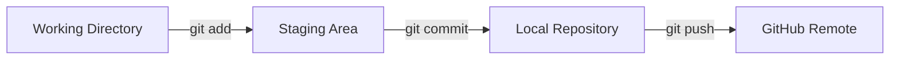
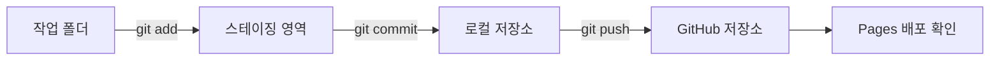
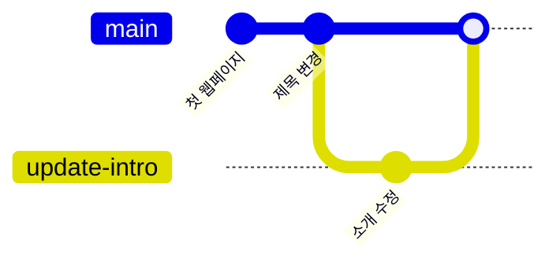

# Git·Markdown 실습 진행안

## 연습 목표

대상은 개발 입문 약 15일차 학습자다. [draft](../261102/draft.md)의 전체 주제를 [상세 커리큘럼](curriculum.md)과 연결해 실행한다. 보충 자료는 [supplement.md](supplement.md)를 참조한다. 대상과 운영 조건은 운영 가정이다. 사용자 확정 일정은 확정으로 취급한다. 각 실습의 시간은 해당 블록 안에 포함된다.

## 공통 안전 규칙

- 명령은 **별도 교육용 폴더**에서 한 줄씩 실행한다. 아래 셸 예제는 Windows Git Bash 기준이다. macOS에서는 동일한 Git 명령을 터미널에서 실행한다. PowerShell에서 그대로 실행한다고 가정하지 않는다. OS별 차이는 부록 E를 참조한다.
- 시작 전 `pwd`, `git status`, 실행 뒤 `git diff`/`git log`로 확인한다. 오류가 나면 다음 명령을 연속 실행하지 않는다.
- `USER`, `REPO`, `ISSUE_NUMBER` 등은 실제 값으로 바꾼다. 토큰을 URL·명령·파일·AI 대화에 넣지 않는다. 인증 창은 본인이 직접 처리한다.
- 교육 중 `reset --hard`, `clean -fd`, 강제 push, 타인 브랜치 삭제는 하지 않는다. `.gitignore`는 이미 추적된 비밀값을 보호하지 않는다.
- 유출 발견 시 공유를 멈추고 키를 즉시 폐기/재발급한다. 단순 파일 삭제나 revert만으로 기록에서 비밀값이 사라졌다고 판단하지 않는다. 교수자에게 알리고 플랫폼의 기록 정리 절차를 별도 승인받는다.
- OpenCode는 본인이 설치한 승인된 실행 방식으로 **교육용 폴더에서만** 연다. 이 문서는 설치 명령·모델 제공자를 고정하지 않는다. 저장소 접근·명령 실행 승인 여부를 확인하고 자동 전체 승인은 켜지 않는다.
- 모든 에이전트 프롬프트 앞에 다음 공통 문구를 붙인다: “교육용 저장소 한정. 비밀정보 요청 및 원격 변경 금지. 실행 전 변경 계획 제시. 학습자 직접 실행과 결과 검증.”

## 1시간 블록 배치

점심은 매일 12:00–13:00로 고정한다. 각 수업 뒤 15분 휴식이 있다. 각 실습은 아래 1시간 블록 안에서 시작·실행·완료한다.

| 일자 | 수업 45분 | 실습 | 차시 |
| --- | --- | --- | --- |
| 1일차 | 09:00–09:45 | 실습 1 환경과 세 영역 | 1차시 |
| 1일차 | 10:00–10:45 | 실습 2 로컬 저장소 생성 | 2차시 |
| 1일차 | 11:00–11:45 | 실습 3 첫 커밋과 이력 | 3차시 |
| 1일차 | 13:00–13:45 | 실습 4 이력 수정과 배제 | 4차시 |
| 1일차 | 14:00–14:45 | 실습 5 GitHub 원격 연동 | 5차시 |
| 1일차 | 15:00–15:45 | 실습 6 Pages 배포 | 6차시 |
| 2일차 | 09:00–09:45 | 실습 7 Markdown과 Mermaid | 7차시 |
| 2일차 | 10:00–10:45 | 실습 8 프로필과 지속적 기록 | 8차시 |
| 2일차 | 11:00–11:45 | 실습 9 Issue, Label, Milestone | 9차시 |
| 2일차 | 13:00–13:45 | 실습 10 브랜치와 태그 | 10차시 |
| 2일차 | 14:00–14:45 | 실습 11 병합과 충돌 | 11차시 |
| 2일차 | 15:00–15:45 | 실습 12 Pull Request | 12차시 |

이 표는 curriculum.md의 최종 12차시 시간표와 일치한다.

## 순서별 실행

### 실습 1. 환경과 세 영역 (1일차 09:00–09:45, 1차시)

**이 차시에서 하는 일**
- `index.html`을 `index_v1.html`, `index_final.html`처럼 복사하며 버전을 관리한 경험을 VCS/SCM으로 해결한다.
- 작업 공간, 스테이징 영역, 로컬 저장소의 차이를 말한다.
- VS Code, Git Bash, OpenCode가 실행 가능한지 확인한다.

**핵심 개념**
- VCS는 변경 이력을 타임머신처럼 저장한다.
- SCM은 프로젝트 전체의 상태를 관리한다.
- Git은 작업 공간 → 스테이징 → 저장소 순서로 이동한다.

**따라하기**
1. VS Code를 열고 터미널을 연다.
2. Git Bash를 기본 셸로 선택한다.
3. `git --version`을 실행한다.
4. OpenCode가 응답하는지 확인한다.
5. 세 영역을 그림이나 Mermaid로 설명한다.

**Git 명령**
```bash
git --version
```

**에이전트 요청 예시**
```text
정적 웹 파일 복사 경험 기반 VCS와 SCM 차이 3문장 설명
작업 공간, 스테이징 영역, 로컬 저장소 Mermaid flowchart 시각화
```

**예상 결과**
- Git 버전이 출력된다.
- 세 영역의 역할을 말할 수 있다.

**완료 기준**
- [ ] `git --version` 결과를 읽는다.
- [ ] 세 영역의 차이를 설명한다.

**문제 대응**
| 증상 | 원인 | 대응 |
| --- | --- | --- |
| Git 버전이 안 나옴 | Git 미설치 또는 PATH 문제 | Git for Windows 재설치 또는 환경 변수 확인 |
| 터미널이 안 열림 | VS Code 설정 문제 | VS Code를 재시작하고 터미널 메뉴 확인 |

**안전 주의**
- 계정 정보나 토큰을 터미널 출력에 남기지 않는다.

---

### 실습 2. 로컬 저장소 생성 (1일차 10:00–10:45, 2차시)

**이 차시에서 하는 일**
- 작업자 정보를 등록하고 빈 폴더를 Git 저장소로 초기화한다.
- OpenCode로 첫 웹페이지를 만들고 `status`, `add`로 파일을 추적한다.

**핵심 개념**
- `config`는 커밋 작성자를 기록한다.
- `init`은 `.git` 폴더를 만들고 저장소를 시작한다.
- `status`는 추적 상태를 보여준다.
- `add`는 다음 커밋에 담을 파일을 선택한다.
- `.gitkeep`은 빈 폴더를 추적하기 위한 관례다.

**따라하기**
1. 이름과 이메일을 등록한다.
2. `my-web` 폴더를 만들고 이동한다.
3. `git init`을 실행한다.
4. OpenCode에 자기소개 HTML/CSS 생성을 요청한다.
5. `git status`로 Untracked 상태를 확인한다.
6. 빈 폴더와 `.gitkeep`을 만든다.
7. `git add`로 파일을 선택한다.
8. `git status`로 staged 상태를 확인한다.

**HTML 코드**
```html
<!doctype html>
<html lang="ko">
<head>
  <meta charset="utf-8">
  <meta name="viewport" content="width=device-width, initial-scale=1">
  <title>나의 첫 웹페이지</title>
  <link rel="stylesheet" href="style.css">
</head>
<body>
  <main>
    <h1>나의 첫 웹페이지</h1>
    <p>Git과 GitHub를 배우는 중입니다.</p>
  </main>
</body>
</html>
```

**CSS 코드**
```css
body {
  font-family: sans-serif;
  margin: 0;
  padding: 2rem;
  background: #f7f7f7;
}

main {
  max-width: 720px;
  margin: 0 auto;
  background: #ffffff;
  padding: 2rem;
  border-radius: 8px;
}
```

**Git 명령**
```bash
git config --global user.name "이름"
git config --global user.email "이메일"
mkdir my-web
cd my-web
git init
mkdir -p images
touch images/.gitkeep
git status
git add index.html style.css images/.gitkeep
git status
```

**선택 참고 명령**
```bash
git config --list
git config --local user.name "이름"
git add .
```

**에이전트 요청 예시**
```text
초보자를 위한 1페이지 자기소개 HTML/CSS 생성
파일명은 index.html과 style.css로 고정
index.html 취미 또는 목표 문구 추가
```

**예상 결과**
- `.git` 폴더가 생성된다.
- `status`에서 파일이 staged로 보인다.

**완료 기준**
- [ ] `git status`로 staged 파일을 확인한다.
- [ ] `.gitkeep`의 역할을 설명한다.

**문제 대응**
| 증상 | 원인 | 대응 |
| --- | --- | --- |
| OpenCode 지연 | 네트워크 문제 | 강사 제공 샘플 파일 사용 |
| 파일이 안 보임 | 저장되지 않음 | 파일 저장 후 `status` 재확인 |

**안전 주의**
- `.env`나 개인 정보 파일을 add하지 않는다.

---

### 실습 3. 첫 커밋과 이력 (1일차 11:00–11:45, 3차시)

**이 차시에서 하는 일**
- 스테이징 영역의 변경을 커밋으로 확정한다.
- 커밋 해시와 메시지 규칙을 이해한다.
- `git log --oneline`으로 이력을 읽는다.

**핵심 개념**
- `commit`은 스냅샷을 만든다.
- 해시는 커밋을 구분하는 식별자다.
- 메시지는 `feat:`, `docs:`처럼 의도를 드러낸다.
- vi에 갇히면 `Esc` 후 `:wq` 또는 `:q!`를 사용한다.
- `git reset <파일>`은 stage를 해제한다.

**따라하기**
1. 첫 커밋을 만든다.
2. `git log --oneline`으로 해시와 메시지를 확인한다.
3. OpenCode로 제목을 수정한다.
4. `git status`, `git add`, `git commit`을 실행한다.
5. 이력이 2개 이상인지 확인한다.

**Git 명령**
```bash
git commit -m "feat: 첫 번째 웹페이지 파일 추가"
git log --oneline
git status
git add index.html
git commit -m "docs: 메인 타이틀 소개 문구 수정"
git log --oneline
```

**선택 참고 명령**
```bash
printf '<p>reset 연습</p>\n' >> index.html
git add index.html
git status --short
git reset index.html
git status --short
git checkout -- index.html
```

**에이전트 요청 예시**
```text
index.html 메인 제목 "홍길동의 포트폴리오" 변경
커밋 메시지와 변경 내용 일치 검토
```

**예상 결과**
- 2개 이상의 커밋이 보인다.
- 각 커밋에 해시와 메시지가 있다.

**완료 기준**
- [ ] `git log --oneline` 결과를 읽는다.
- [ ] 커밋 메시지 규칙을 설명한다.

**문제 대응**
| 증상 | 원인 | 대응 |
| --- | --- | --- |
| vi 화면에 갇힘 | `-m` 없이 commit 실행 | `Esc`, `:wq`, Enter |
| 커밋이 안 됨 | stage되지 않은 파일 | `git add` 후 재시도 |

**안전 주의**
- 비밀 파일을 커밋하지 않는다.

---

### 실습 4. 이력 수정과 배제 (1일차 13:00–13:45, 4차시)

**이 차시에서 하는 일**
- 직전 커밋을 `amend`로 덮어쓴다.
- `.gitignore`로 추적 제외 파일을 설정한다.
- `reset`과 `revert`의 차이를 이해한다.

**핵심 개념**
- `amend`는 공유 전 최신 커밋을 교체한다.
- `.gitignore`는 이미 추적 중인 파일을 보호하지 않는다.
- `revert`는 공유 후 취소에 안전하다.
- `reset --hard`는 작업 파일을 지울 수 있다.

**따라하기**
1. 직전 커밋 메시지를 amend한다.
2. `.gitignore`를 만든다.
3. `.env` 같은 가짜 비밀 파일을 만들고 추적되지 않음을 확인한다.
4. `.gitignore`를 커밋한다.
5. `revert`를 시연으로 확인한다.

**Git 명령**
```bash
git commit --amend -m "docs: 메인 타이틀 및 소개 문구 최종 수정"
printf '*.tmp\nThumbs.db\n.DS_Store\n.env\n' > .gitignore
touch .env
git status
git add .gitignore
git commit -m "chore: .gitignore 설정 추가"
```

**.gitignore 코드**
```text
*.tmp
Thumbs.db
.DS_Store
.env
```

**선택 참고 명령**
```bash
git revert HEAD
```

reset 모드 비교는 강사 시연으로만 진행한다.

**에이전트 요청 예시**
```text
.gitignore에 임시 파일과 캐시 파일 추가
amend와 revert 차이 초보자 눈높이 설명
```

**예상 결과**
- `.env`가 `status`에 나타나지 않는다.
- amend 후 커밋 메시지가 바뀐다.

**완료 기준**
- [ ] `.gitignore`가 커밋된다.
- [ ] `reset --hard`를 사용하지 않는 이유를 말한다.

**문제 대응**
| 증상 | 원인 | 대응 |
| --- | --- | --- |
| `.env`가 추적됨 | 이미 add된 파일 | 강사와 함께 캐시 제거 절차 확인 |
| amend 후 push 거부 | 이미 공유된 커밋 | push를 멈추고 강사에게 알림 |

**안전 주의**
- `reset --hard`를 실행하지 않는다.
- 공유된 이력은 `revert`로 되돌린다.

---

### 실습 5. GitHub 원격 연동 (1일차 14:00–14:45, 5차시)

**이 차시에서 하는 일**
- GitHub 저장소를 만들고 로컬 저장소와 연결한다.
- `push`로 커밋을 원격에 올린다.
- `clone`, `pull`, `fork`의 차이를 구분한다.

**핵심 개념**
- `remote add origin`은 원격 주소를 등록한다.
- `push -u origin main`은 처음 업로드와 기본 업스트림 설정을 한다.
- `main`과 `master`는 기본 브랜치 이름이다.
- `clone`은 원격을 복제하고 `fork`는 GitHub에서 복사본을 만든다.

**따라하기**
1. GitHub 웹에서 빈 저장소 `portfolio-web`를 만든다.
2. 원격 주소를 복사한다.
3. `git branch -M main`을 실행한다.
4. `git remote add origin 주소`를 실행한다.
5. `git remote -v`로 확인한다.
6. `git push -u origin main`을 실행한다.
7. GitHub 웹에서 파일과 커밋을 확인한다.

**Git 명령**
```bash
git branch -M main
git remote add origin https://github.com/계정이름/portfolio-web.git
git remote -v
git push -u origin main
```

**선택 참고 명령**
```bash
git pull origin main
cd ..
git clone https://github.com/계정이름/portfolio-web.git portfolio-web-copy
cd portfolio-web-copy
```

**에이전트 요청 예시**
```text
GitHub 저장소 생성 및 push 전 확인 체크리스트 작성
clone과 fork 차이 그림 기반 설명
```

**예상 결과**
- GitHub 웹에 커밋과 파일이 보인다.
- `remote -v`에 주소가 표시된다.

**완료 기준**
- [ ] `git push`가 성공한다.
- [ ] GitHub 웹에서 커밋을 확인한다.

**문제 대응**
| 증상 | 원인 | 대응 |
| --- | --- | --- |
| 인증 실패 | 계정/자격 증명 문제 | 부록 A와 부록 E 확인 |
| push 거부 | 원격에 초기 파일 존재 | 빈 저장소로 다시 만들거나 강사와 확인 |
| origin 중복 | 이미 등록됨 | `git remote -v`로 주소 확인 |

**안전 주의**
- 토큰을 채팅이나 파일에 붙이지 않는다.
- `push --force`를 사용하지 않는다.

---

### 실습 6. Pages 배포 (1일차 15:00–15:45, 6차시)

**이 차시에서 하는 일**
- GitHub Pages로 정적 웹사이트를 공개한다.
- push 후 배포가 갱신되는 흐름을 확인한다.
- 눈누와 Coolors를 선택 참고 도구로 소개한다.

**핵심 개념**
- Pages는 저장소의 정적 파일을 웹 주소로 제공한다.
- 배포 갱신 흐름은 수정 → add → commit → push → Pages 확인이다.
- Coolors와 눈누는 선택 참고 도구다.

**따라하기**
1. 저장소 Settings → Pages를 연다.
2. Source를 Deploy from a branch로 둔다.
3. Branch를 `main` / `/(root)`로 선택하고 저장한다.
4. 제공된 URL을 연다.
5. OpenCode로 푸터를 추가한다.
6. `git add`, `git commit`, `git push`를 실행한다.
7. 1분 후 Pages URL을 새로고침한다.

**Git 명령**
```bash
git add index.html
git commit -m "feat: 푸터 연락처 영역 추가"
git push origin main
```

**에이전트 요청 예시**
```text
index.html 하단 연락처 이메일과 카피라이트 푸터 추가
Coolors 색상 코드 배경색 적용
```

**예상 결과**
- Pages URL에서 웹페이지가 열린다.
- push 후 변경이 반영된다.

**완료 기준**
- [ ] Pages URL을 연다.
- [ ] push 후 변경 반영을 확인한다.

**문제 대응**
| 증상 | 원인 | 대응 |
| --- | --- | --- |
| Pages 404 | 브랜치/폴더 설정 오류 | Settings → Pages 재확인 |
| 변경이 안 보임 | 빌드 지연 또는 캐시 | 잠시 후 새로고침, 시크릿 창 사용 |
| 파일명 오류 | 대소문자 불일치 | `index.html` 소문자 확인 |

**안전 주의**
- 공개 저장소에 비밀 값을 올리지 않는다.

---

### 실습 7. Markdown과 Mermaid (2일차 09:00–09:45, 7차시)

**이 차시에서 하는 일**
- Markdown 문법으로 README를 작성한다.
- Mermaid로 Git 흐름을 시각화한다.
- Bulma를 선택 참고 도구로 소개한다.

**핵심 개념**
- Markdown은 제목, 목록, 링크, 코드를 표현한다.
- Mermaid는 텍스트로 다이어그램을 그린다.
- `flowchart LR`과 노드/화살표를 사용한다.

**따라하기**
1. `README.md`를 만든다.
2. VS Code 미리보기를 연다.
3. 제목, 소개, 배포 링크를 작성한다.
4. Mermaid 코드 블록을 추가한다.
5. 미리보기에서 렌더링을 확인한다.
6. `git add`, `git commit`, `git push`를 실행한다.

**Git 명령**
```bash
git add README.md
git commit -m "docs: README 및 Mermaid 다이어그램 추가"
git push origin main
```

**README 코드**
~~~markdown
# 나의 포트폴리오

## 소개
Git과 GitHub를 배우며 만든 첫 웹페이지입니다.

## 배포 주소
https://계정이름.github.io/portfolio-web/

## Git 흐름

~~~

**Mermaid 코드**


**에이전트 요청 예시**
```text
README 프로젝트 소개, 배포 링크, Mermaid 흐름도 작성
Mermaid 다이어그램 pull 흐름 추가
```

**예상 결과**
- README와 Mermaid가 GitHub에서 렌더링된다.
- 배포 링크가 열린다.

**완료 기준**
- [ ] README가 렌더링된다.
- [ ] Mermaid 코드를 읽는다.

**문제 대응**
| 증상 | 원인 | 대응 |
| --- | --- | --- |
| 렌더링 안 됨 | 코드 블록 언어 오류 | 언어를 `mermaid`로 지정 |
| 링크가 안 열림 | URL 오타 | 주소를 다시 복사 |

**안전 주의**
- README에 비밀 값을 적지 않는다.

---

### 실습 8. 프로필과 지속적 기록 (2일차 10:00–10:45, 8차시)

**이 차시에서 하는 일**
- GitHub Profile 저장소를 만든다.
- TIL, 회고, 사후분석(Post-mortem)을 작성한다.
- Wiki의 쓰임을 안다.

**핵심 개념**
- Profile Repo는 계정 ID와 같은 이름의 저장소다.
- TIL은 오늘 배운 점을 짧게 기록한다.
- Post-mortem은 현상, 원인, 조치, 재발 방지를 정리한다.
- KPT 회고는 Keep, Problem, Try로 나눈다.

**따라하기**
1. 웹 저장소 `my-web`에서 작업한다. Profile 저장소(`<계정ID>/<계정ID>`)는 별도 저장소다.
2. GitHub에서 계정 ID와 같은 이름의 Profile 저장소를 만든다.
3. Profile 저장소 README에 소개 문구를 작성한다.
4. 웹 저장소로 돌아와 `docs/post-mortem.md`를 만든다.
4. 사후분석 예시를 작성한다.
5. 커밋하고 push한다.
6. Wiki 탭을 확인한다.

**Git 명령**
```bash
mkdir -p docs
printf '# 에러 사후분석\n- 현상: ...\n- 원인: ...\n- 조치: ...\n- 재발 방지: ...\n' > docs/post-mortem.md
git add docs/post-mortem.md
git commit -m "docs: 사후분석 문서 추가"
git push origin main
```

**Post-mortem 예시**
```markdown
# 에러 사후분석
- 현상: git commit 입력 후 터미널이 멈춤
- 원인: -m 옵션을 빼먹어 vi 편집기가 실행됨
- 조치: Esc 후 :wq 입력
- 재발 방지: 항상 git commit -m "메시지" 사용
```

**에이전트 요청 예시**
```text
TIL 한 단락과 회고 한 단락 구분 작성
Post-mortem 템플릿 작성
```

**예상 결과**
- 프로필 README가 보인다.
- 사후분석 문서가 저장된다.

**완료 기준**
- [ ] 프로필 README를 확인한다.
- [ ] Post-mortem을 작성한다.

**문제 대응**
| 증상 | 원인 | 대응 |
| --- | --- | --- |
| Profile Repo가 안 보임 | 저장소 이름 불일치 | 계정 ID와 정확히 일치하는지 확인 |
| Wiki가 안 보임 | 기능 미지원 | `notes/wiki-draft.md`로 대체 |

**안전 주의**
- 공개 프로필에 개인 정보를 과도하게 적지 않는다.

---

### 실습 9. Issue, Label, Milestone (2일차 11:00–11:45, 9차시)

**이 차시에서 하는 일**
- Issue로 작업을 등록하고 Label과 Milestone으로 관리한다.
- `gh`와 ChatGPT GitHub 연동을 선택 기능으로 소개한다.

**핵심 개념**
- Issue는 작업 요청서다.
- Label은 이슈 종류를 분류한다.
- Milestone은 목표와 진행률을 추적한다.

**따라하기**
1. GitHub 저장소에서 Issues 탭을 연다.
2. Milestone `v1.0 포트폴리오 완성`을 만든다.
3. Label이 있는 Issue 2개를 만든다.
4. Milestone 게이지를 확인한다.
5. `gh` 시연을 관찰한다.

**Git/CLI 명령**
```bash
gh issue list --repo 계정이름/portfolio-web
```

**에이전트 요청 예시**
```text
Issue 초안 작성: 목적, 하지 않을 일, 완료 조건 3개 제안
Label과 Milestone 차이 설명
```

**예상 결과**
- Issue 2개가 등록된다.
- Label과 Milestone이 연결된다.

**완료 기준**
- [ ] Issue 2개를 만든다.
- [ ] Milestone 게이지를 확인한다.

**문제 대응**
| 증상 | 원인 | 대응 |
| --- | --- | --- |
| gh 명령 실패 | CLI 미설치 또는 인증 안 됨 | 브라우저로 동일 작업 수행 |
| Issue 권한 없음 | 저장소 권한 부족 | 개인 저장소에서 재시도 |

**안전 주의**
- Issue에 비밀 값을 적지 않는다.

---

### 실습 10. 브랜치와 태그 (2일차 13:00–13:45, 10차시)

**이 차시에서 하는 일**
- 브랜치로 작업을 격리한다.
- `switch`로 브랜치를 전환한다.
- 태그로 릴리스 지점을 기록한다.

**핵심 개념**
- 브랜치는 작업 흐름을 나눈다.
- `switch -c`는 생성과 전환을 함께 한다.
- `checkout`은 과거 명령으로 이해한다.
- 태그는 특정 커밋에 이름을 붙인다.

**따라하기**
1. 현재 브랜치를 확인한다.
2. `feature/profile-design` 브랜치를 만든다.
3. OpenCode로 스타일을 수정한다.
4. 커밋한다.
5. `main`으로 돌아온다.
6. 코드가 사라지는 것을 확인한다.
7. `v0.1.0` 태그를 만든다.

**Git 명령**
```bash
git branch
git switch -c feature/profile-design
git add .
git commit -m "feat: 프로필 카드 그림자 효과 추가"
git switch main
git tag v0.1.0
git tag
```

**선택 참고 명령**
```bash
git checkout feature/profile-design
git tag -a v0.2.0 -m "Release v0.2.0"
```

병합 전에는 `git branch -d feature/profile-design`이 "not fully merged"로 실패한다. 브랜치 삭제는 실습 11 병합 뒤에 수행한다.

**에이전트 요청 예시**
```text
프로필 영역 부드러운 그림자 스타일 추가
브랜치와 태그 차이 설명
```

**예상 결과**
- 브랜치 전환 시 파일 내용이 바뀐다.
- 태그가 생성된다.

**완료 기준**
- [ ] `git switch`로 두 브랜치를 오간다.
- [ ] 태그를 확인한다.

**문제 대응**
| 증상 | 원인 | 대응 |
| --- | --- | --- |
| 파일이 저장되지 않음 | 커밋 전 전환 | 커밋 후 전환 |
| 브랜치 이름 중복 | 이미 존재 | 다른 이름 사용 |

**안전 주의**
- `branch -D`로 브랜치를 강제 삭제하지 않는다.

---

### 실습 11. 병합과 충돌 (2일차 14:00–14:45, 11차시)

**이 차시에서 하는 일**
- Fast-forward와 3-way merge를 비교한다.
- 의도적 충돌을 만들고 해결한다.
- `log --graph`로 브랜치 흐름을 확인한다.

**핵심 개념**
- Fast-forward는 포인터만 이동한다.
- 3-way merge는 병합 커밋을 만든다.
- 충돌 마커는 `<<<<<<<`, `=======`, `>>>>>>>`다.
- `merge --abort`는 병합을 취소한다.

**따라하기**
1. `main`에서 5번째 줄 제목을 수정하고 커밋한다.
2. `feature/profile-design`으로 전환한다.
3. 같은 줄을 다르게 수정하고 커밋한다.
4. `main`으로 복귀한다.
5. `git merge feature/profile-design`을 실행한다.
6. 충돌을 확인한다.
7. VS Code 또는 직접 편집으로 해결한다.
8. `git add`, `git commit`으로 병합을 완료한다.
9. `git log --graph --oneline --all`을 확인한다.

**Git 명령**
```bash
git switch main
git commit -am "docs: 메인에서 타이틀 수정"
git switch feature/profile-design
git commit -am "docs: 기능브랜치에서 타이틀 수정"
git switch main
git merge feature/profile-design
git add index.html
git commit -m "merge: 메인 타이틀 충돌 수동 해결"
git log --graph --oneline --all
```

**선택 참고 명령**
```bash
git merge --abort
git branch -d feature/profile-design
```

**에이전트 요청 예시**
```text
충돌 양쪽 문장 통합 문장 제안, 파일 수정 금지
log graph에서 Fast-forward 가능 이유 설명
```

**예상 결과**
- 충돌이 해결된다.
- 그래프에 병합 흐름이 보인다.

**완료 기준**
- [ ] 충돌 마커가 없다.
- [ ] 병합 커밋을 확인한다.

**문제 대응**
| 증상 | 원인 | 대응 |
| --- | --- | --- |
| 충돌 마커 남음 | 해결 미완료 | 파일을 다시 편집하고 add |
| 병합이 꼬임 | 잘못된 해결 | `git merge --abort`로 복귀 |

**안전 주의**
- 충돌 파일을 저장하기 전에 강사와 확인한다.

---

### 실습 12. Pull Request (2일차 15:00–15:45, 12차시)

**이 차시에서 하는 일**
- 기능 브랜치를 push하고 PR을 만든다.
- diff를 리뷰하고 병합한다.
- 로컬 `main`을 동기화한다.

**핵심 개념**
- PR은 변경 제안과 검토 절차다.
- `push -u origin 브랜치명`으로 브랜치를 올린다.
- GitHub 웹에서 PR을 생성하고 병합한다.
- `git pull origin main`으로 로컬을 맞춘다.

**따라하기**
1. `feature/final-polish` 브랜치를 만든다.
2. OpenCode로 최종 스타일을 수정한다.
3. 커밋한다.
4. 브랜치를 push한다.
5. GitHub 웹에서 PR을 만든다.
6. Files changed에서 diff를 확인한다.
7. Merge pull request를 클릭한다.
8. 로컬 `main`으로 돌아와 `git pull origin main`을 실행한다.
9. 브랜치를 삭제한다.
10. Pages 사이트를 확인한다.

**Git 명령**
```bash
git switch -c feature/final-polish
```

**변경 코드**
```html
<!-- index.html의 </main> 앞에 추가 -->
<p>최종 포트폴리오 스타일을 다듬었습니다.</p>
```

```bash
git diff
git add index.html
git commit -m "feat: 최종 포트폴리오 스타일 다듬기"
git push -u origin feature/final-polish
git switch main
git pull origin main
git branch -d feature/final-polish
```

**선택 참고 명령**
```bash
gh pr create --base main --head feature/final-polish
gh pr diff
```

**에이전트 요청 예시**
```text
PR 본문 목적, 변경, 확인 결과, 남은 한계 작성
PR diff 목적·안전·재현성 기준 검토
```

**예상 결과**
- GitHub에 Merged PR이 보인다.
- 로컬 `main`이 최신 상태다.
- Pages 사이트가 갱신된다.

**완료 기준**
- [ ] PR이 병합된다.
- [ ] `git pull` 후 상태를 확인한다.

**문제 대응**
| 증상 | 원인 | 대응 |
| --- | --- | --- |
| PR 버튼이 안 보임 | push 미완료 | push 후 새로고침 |
| 병합 충돌 | 원격 변경과 충돌 | 로컬에서 해결 후 다시 push |

**안전 주의**
- PR 본문에 비밀 값을 적지 않는다.

---

## 판정·오류·지연 대응


| 상황 | 즉시 행동 | 제출/수업 유지 방법 |
| --- | --- | --- |
| 설치 불가 | 관리자 우회·출처 불명 설치 금지 | 짝 화면에서 상태 예측, 교수자 환경에서 핵심 실행; 직접 실행 여부 표시 |
| 인증/네트워크 장애 | 10분 후 원격 재시도 중단 | 로컬 bare 왕복, Issue/PR Markdown 초안. 원격 수행은 미검증으로 표시 |
| 파일 변경이 예상과 다름 | status/diff를 읽고 멈춤 | 타인의 파일을 되돌리지 않고 교수자와 범위 확인 |
| 잘못된 stage | git restore --staged로 대상만 해제 | 파일 내용이 남았는지 확인 후 다시 선택 |
| merge/revert 진행 중 | status로 진행 상태 확인 | 해당 작업의 --abort 사용 여부 교수자와 판단, 무관한 reset 금지 |
| 시간이 부족함 | 확장 도구 실행 보류 | supplement.md의 심화 실습·복습 퀴즈·에이전트 주도 Git 보류. README·TIL·안전 복구·브랜치/PR 필수 증거 우선 |
| AI 답과 결과 불일치 | 실제 Git 결과를 기준으로 멈춤 | 비밀값 없는 최소 출력으로 재질문하고 오류 원인/검증을 회고에 기록 |
| 공개 불가 | 비공개 유지, 공개 전환 강요 금지 | 교수자 화면 확인·비식별 캡처. Profile/Pages 선택 보류 |

이 문서의 명령은 수업용 실행안이며 실제 GitHub 계정·권한·OS 전부에서 실행 검증된 결과를 뜻하지 않는다. 개강 전 교수자가 별도 교육 환경에서 리허설하고 지원되지 않는 기능은 선택 대안으로 안내한다.

## 부록 A. Windows 자격 증명과 GitHub 인증

### 이 차시에서 하는 일

- Git은 로컬 사용자 설정과 GitHub 로그인 정보를 구분한다.
- `git config user.name/email`은 커밋 작성자 표시용이고 GitHub 로그인 계정과 다를 수 있다.
- 잘못된 계정으로 인증되었을 때 OS에 저장된 자격 증명을 확인·삭제·재인증한다.

### 핵심 개념

- Git Credential Manager는 Git 명령을 실행할 때 브라우저 또는 OS 저장소에서 인증 정보를 가져온다.
- 브라우저 GitHub 로그인은 웹 세션용이고, OS 자격 증명은 Git push/pull에 사용될 수 있다.
- Windows 제어판 → 사용자 계정 → 자격 증명 관리자 → Windows 자격 증명에서 GitHub 관련 항목을 확인한다.
- PC와 Windows 버전에 따라 메뉴 이름과 항목 위치가 다를 수 있다.

### 따라하기

1. `git remote -v`로 대상 저장소 주소가 맞는지 확인한다.
2. push/pull 시 인증 창이 뜨면 본인이 직접 GitHub 계정으로 로그인한다.
3. 다른 계정으로 잘못 인증된 경우 Windows 자격 증명 관리자를 연다.
4. `git:https://github.com` 또는 GitHub 관련 항목만 찾는다.
5. 해당 항목을 삭제한 뒤 다시 push/pull하여 재인증한다.
6. 재인증 후 `git config --local user.name`, `git config --local user.email`을 확인한다.
7. 실제 인증은 `git ls-remote origin` 또는 push 성공, GitHub Settings의 세션 목록, 필요 시 `gh auth status`로 확인한다.
8. 조직 SSO나 2FA가 걸린 계정은 브라우저 승인과 자격 증명 재등록을 함께 확인한다.

### 주의

- 무관한 자격 증명을 일괄 삭제하지 않는다.
- 토큰이나 비밀번호를 채팅·파일·Issue에 노출하지 않는다.
- 삭제 전 항목 이름과 주소를 확인한다.

## 부록 B. Git 명령 바리에이션과 옵션

### 이 차시에서 하는 일

- 초보 필수 명령과 선택 참고 명령을 구분한다.
- 하위 옵션의 의미와 사용 상황을 이해한다.

### 핵심 개념

| 구분 | 명령 | 의미와 사용 상황 |
| --- | --- | --- |
| 필수 | `git status` | 현재 변경과 stage 상태 확인 |
| 필수 | `git diff` | 작업 파일 변경 확인 |
| 필수 | `git add 파일명` | 다음 커밋에 넣을 파일 선택 |
| 필수 | `git commit -m "메시지"` | 선택한 변경을 기록 |
| 필수 | `git commit -am "메시지"` | 이미 추적 중인 파일의 변경만 자동 stage 후 커밋. 새 파일은 담지 않음 |
| 필수 | `git log --oneline` | 짧은 커밋 이력 확인 |
| 필수 | `git log --graph --oneline --all` | 브랜치 흐름 확인 |
| 필수 | `git push` | 로컬 커밋을 원격에 보냄 |
| 필수 | `git pull origin main` | 원격 변경을 로컬에 통합 |
| 필수 | `git switch -c 이름` | 새 브랜치 생성과 이동 |
| 필수 | `git restore --staged 파일명` | stage 해제, 작업 파일 보존 |
| 필수 | `git init` | 빈 폴더를 Git 저장소로 초기화 |
| 필수 | `git config --global user.name "이름"` | 커밋 작성자 이름 등록 |
| 필수 | `git config --global user.email "이메일"` | 커밋 작성자 이메일 등록 |
| 필수 | `git remote add origin 주소` | 원격 저장소 주소 등록 |
| 필수 | `git remote -v` | 등록된 원격 주소 확인 |
| 필수 | `git push -u origin main` | 첫 업로드와 업스트림 설정 |
| 참고 | `git diff --cached` | stage된 변경 확인 |
| 참고 | `git log -n 3` | 최근 3개 커밋 확인 |
| 참고 | `git log --stat` | 파일별 변경 통계 확인 |
| 참고 | `git merge --no-ff` | merge 커밋을 남기는 병합 |
| 참고 | `git tag -a v1.0.0 -m "메시지"` | 작성자와 설명이 포함된 주석 태그 생성 |
| 참고 | `git tag v0.1.0` | 가벼운 태그 생성 |
| 참고 | `git branch -d 이름` | 병합 완료된 브랜치 삭제 |
| 참고 | `git config --local user.name "이름"` | 이 저장소에만 작성자 이름 등록 |
| 참고 | `git clone 주소` | 원격 저장소를 별도 폴더에 복제 |
| 참고 | `git revert HEAD` | 공유 후 커밋을 안전하게 되돌림 |
| 참고 | `git merge --abort` | 진행 중인 병합 취소 |
| 참고 | `git checkout 브랜치명` | 브랜치 전환(과거 명령) |
| 참고 | `git add .` | 현재 폴더의 모든 변경을 stage |
| 참고 | `git status --short` | 변경 상태를 짧게 표시 |
| 참고 | `git log --decorate` | 브랜치와 태그 이름을 함께 표시 |
| 참고 | `git diff --staged` | stage된 변경 확인(--cached와 같음) |
| 금지 | `git reset --hard` | 추적 파일 변경 유실 가능 |
| 금지 | `git push --force` | 원격 이력 덮어쓰기 위험 |
| 금지 | `git clean -fd` | 추적되지 않은 파일 삭제 |
| 금지 | `git branch -D 이름` | 병합 여부와 관계없이 브랜치 강제 삭제 |

### 따라하기

- 처음에는 필수 명령만 사용한다.
- 선택 명령은 교수자 설명 후 사용한다.
- 금지 명령은 기본 실행에서 제외한다.

## 부록 C. 선택 참고: 눈누·Bulma·Coolors

### 이 차시에서 하는 일

- 폰트·CSS 프레임워크·색상 도구는 핵심 Git 흐름이 아니다.
- 시간이 남을 때 참고 도구로 소개한다.

### 핵심 개념

- 눈누: 웹폰트 출처와 사용 범위를 확인한다.
- Bulma: CSS 프레임워크 예시로, 클래스 적용과 라이선스를 확인한다.
- Coolors: 색상 조합 참고 도구로, 접근성과 대비를 확인한다.

### 따라하기

1. 핵심 실습을 먼저 완료한다.
2. 도구 하나만 선택해 적용한다.
3. 라이선스와 출처를 확인한다.
4. 작은 변경으로 커밋하고 Pages에서 확인한다.

## 부록 D. Mermaid 시각화

### 이 차시에서 하는 일

- Git과 웹 배포 흐름을 그림으로 확인한다.
- README에 구조도를 남겨 재사용한다.

### 핵심 개념

- Mermaid는 Markdown 안에서 다이어그램을 표현한다.
- `flowchart`, `sequenceDiagram`, `gitGraph`를 사용한다.

### 따라하기

README에 아래 코드를 추가하고 렌더링을 확인한다.





코딩 에이전트 요청 예시: “이 저장소 Git 흐름 Mermaid flowchart README 추가, 실제 파일 수정 금지, 코드 제안만”

## 부록 E. macOS와 Windows 사용 차이

### 이 차시에서 하는 일

- 같은 Git 명령이라도 터미널과 경로 표기, 인증 저장소가 다르다.
- 수업 본문은 공통 흐름을 유지하고 OS별 세부는 이 부록으로 분리한다.

### 핵심 개념

- Windows는 Git Bash를 기본 터미널로 사용한다. macOS는 기본 터미널(zsh)을 사용한다.
- `cd /c/Users/이름/Projects` 같은 POSIX 경로는 Windows Git Bash 기준이다. macOS에서는 `/Users/이름/Projects`를 사용한다.
- PowerShell과 CMD는 Git 명령을 그대로 실행하는 환경으로 가정하지 않는다.
- 홈 디렉터리는 Windows에서 `C:\Users\이름`, macOS에서 `/Users/이름`이다. Git Bash에서는 `~`로 접근한다.
- 따옴표는 명령 전체를 감싸는 방식과 셸 차이를 확인한다. 공백이 있는 경로는 따옴표로 감싼다.
- 줄바꿈은 저장소 설정과 에디터 설정에 따라 LF/CRLF가 달라질 수 있다. `.gitattributes`나 에디터 설정을 임의로 바꾸지 않는다.
- VS Code의 `code` 명령은 PATH에 등록된 경우에만 터미널에서 동작한다. 등록되지 않으면 VS Code에서 폴더를 연다.
- Windows 인증 정보는 자격 증명 관리자에 저장될 수 있다. macOS는 키체인 접근의 `로그인` 항목에서 `github.com` 관련 비밀번호를 확인한다.
- 잘못된 계정으로 인증된 경우 해당 GitHub 항목만 삭제하고 재인증한다. 무관한 자격 증명을 일괄 삭제하지 않는다.
- `gh`는 Windows에서 공식 설치 파일, macOS에서 Homebrew 등 공식 안내 경로로 설치한다. 수업 직전 지원 버전을 확인한다.

### 따라하기

1. 자신의 OS를 먼저 확인한다.
2. Windows에서는 Git Bash, macOS에서는 터미널을 연다.
3. 경로와 홈 디렉터리를 OS에 맞게 바꾼다.
4. 인증 실패 시 해당 OS의 자격 증명 저장소에서 GitHub 항목만 확인한다.
5. 설치 경로와 버전은 공식 안내를 기준으로 확인한다.

### 주의

- 비밀번호·토큰을 채팅·파일·Issue에 노출하지 않는다.
- OS별 메뉴와 항목명은 버전에 따라 다를 수 있다.
