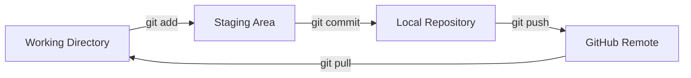

# Git·Markdown 실습 보충안

이 문서는 본 과정 12차시 이후 남은 시간이나 개별 학습에 사용하는 보충 자료다. 12차시 순서는 변경하지 않는다. 각 파트는 고정 배정 없이 남은 시간에 따라 진입·중단·산출물을 조정한다. 대상은 개발 입문 약 15일차 학습자다.

## 사용 원칙

- 본 과정의 핵심 따라하기 실습을 먼저 완료한다.
- 모든 명령은 별도 교육용 저장소에서 실행한다.
- 비밀정보, 토큰, 비밀번호를 채팅·파일·Issue에 남기지 않는다.
- 파괴적 명령과 원격 push는 별도 명시 승인 없이 실행하지 않는다.
- OS별 차이는 [practice.md 부록 E](practice.md#부록-e-macos와-windows-사용-차이)를 참조한다.
- 스타일·색상은 [practice.md 부록 C](practice.md#부록-c-선택-참고-눈누bulmacoolors)를 참조한다.
- Mermaid는 [practice.md 부록 D](practice.md#부록-d-mermaid-시각화)를 참조한다.

## 2시간 buffer 활용

본 과정 뒤 2시간 buffer 중 지연 대응 후 남은 시간을 활용한다. 개별 학습과 추가 실습은 현장 결정이다. 고정 배정하지 않는다.

| 남은 시간 | 가능한 조합 예시 |
| --- | --- |
| 15분 | README 링크 1개 확인, 퀴즈 3문항 |
| 30분 | README 보완 1개, 스타일 조정 1개 |
| 60분 | 심화 실습 2개, 복습 퀴즈 6문항 |
| 120분 | 심화 실습 3개, 복습 퀴즈 10문항, 에이전트 주도 Git |

진입 조건은 남은 시간과 학습자 상태에 따라 현장에서 정한다.

---

## 파트 1. 추가 심화 실습안

### 이 차시에서 하는 일

- 본 과정의 기본 흐름을 마친 학습자가 작은 변경을 더 안전하고 읽기 쉽게 다듬는다.
- README, 스타일, 배포 결과를 한 번 더 검토한다.

### 핵심 개념

- 코드 변경은 작은 단위로 나눈다.
- 변경 전후 `git status`, `git diff`를 확인한다.

### 시간별 진입 조건

- **15분:** README 링크 1개와 오탈자만 확인한다.
- **30분:** 스타일 또는 문구 1개를 수정하고 커밋한다.
- **60분:** 심화 실습 2개를 수행한다.

### 심화 실습 1. README 보완

**따라하기**
1. README의 목적, 환경, 실행 명령, 링크를 읽는다.
2. 빠진 항목 1개만 고른다.
3. OpenCode로 수정 초안을 받는다.
4. `git diff`로 변경을 검토한다.
5. `git add`, `git commit`, `git push`를 실행한다.

**Git 명령**
```bash
git status
git diff
git add README.md
git commit -m "docs: README 사용법 보완"
git push origin main
```

**명사형 프롬프트**
```text
README에서 초보자가 막힐 수 있는 항목 1개만 골라 보완 문장 제안
README 링크가 실제 파일을 가리키는지 점검 항목 목록
```

**확인법**
- README가 GitHub에서 렌더링된다.
- 링크를 클릭해 실제 파일이 열린다.

### 심화 실습 2. 스타일 조정

**따라하기**
1. 변경할 색상 또는 간격 1개를 고른다.
2. OpenCode로 CSS 수정 초안을 받는다.
3. 브라우저에서 결과를 확인한다.
4. `git diff`로 변경 범위를 확인한다.
5. 커밋하고 push한다.

**CSS 코드**
```css
body {
  background: #f7f7f7;
  color: #222222;
}

main {
  max-width: 720px;
  margin: 0 auto;
  padding: 2rem;
}
```

**Git 명령**
```bash
git status
git diff
git add style.css
git commit -m "style: 배경색과 간격 조정"
git push origin main
```

**명사형 프롬프트**
```text
style.css에서 배경색과 본문 간격만 조정하는 변경안
변경 파일과 CSS 속성 목록 정리
```

**확인법**
- 브라우저에서 색상 또는 간격이 바뀐다.
- Pages URL에서도 같은 결과가 보인다.

### 심화 실습 3. Mermaid 보완

**따라하기**
1. README의 Mermaid 코드를 연다.
2. 화살표 1개를 추가한다.
3. 미리보기에서 렌더링을 확인한다.
4. 커밋하고 push한다.

**Mermaid 코드**


**명사형 프롬프트**
```text
Mermaid 다이어그램에 pull 흐름 화살표 추가
노드 이름과 화살표 의미 표 작성
```

**확인법**
- Mermaid 다이어그램이 렌더링된다.
- 추가한 화살표가 보인다.

### 산출물

- README 또는 CSS 변경 1개
- Mermaid 보완 1개
- 커밋 1개 이상

---

## 파트 2. 복습용 퀴즈

### 이 차시에서 하는 일

- 본 과정에서 배운 Git 흐름을 학습자가 스스로 점검한다.
- 정답 확인보다 개념 연결을 목표로 한다.

### 핵심 개념

- 퀴즈는 학습용이다.
- 정답을 모르면 `practice.md`의 해당 차시와 부록을 다시 읽는다.

### 시간별 진입 조건

- **15분:** 3문항만 구두로 확인한다.
- **30분:** 6문항을 풀고 해설을 확인한다.
- **60분:** 10문항을 풀고 해설을 확인한다.

### 문항

1. `git status`는 무엇을 보여주는가?
2. `git add` 전후 상태는 어떻게 달라지는가?
3. 커밋과 `push`는 무엇이 다른가?
4. Git과 GitHub는 각각 무엇을 하는가?
5. Markdown은 어디에 쓰는가?
6. Issue와 Wiki는 어떤 기록에 적합한가?
7. 브랜치와 tag는 어떻게 다른가?
8. PR은 무엇을 제안하는가?
9. 충돌은 언제 생기는가?
10. Pages 변경 반영은 어디서 확인하는가?

### 해설

1. 현재 변경 파일과 스테이징 상태를 보여준다.
2. `add` 전에는 untracked/modified, 후에는 staged로 바뀐다.
3. commit은 로컬 기록, push는 원격 공유다.
4. Git은 로컬 버전 관리, GitHub는 원격 저장소와 협업 서비스다.
5. README, TIL, 회고, Issue 설명 등 문서 작성에 쓴다.
6. Issue는 작업 요청과 개선점, Wiki는 프로젝트 지식베이스에 적합하다.
7. 브랜치는 작업 흐름, tag는 릴리스 지점이다.
8. 브랜치 변경을 기본 브랜치에 반영해 달라고 제안한다.
9. 같은 파일의 같은 줄을 다르게 수정했을 때 생긴다.
10. GitHub Pages URL과 저장소 Actions/Pages 상태에서 확인한다.

### 산출물

- 이해하지 못한 항목 목록

---

## 파트 3. 에이전트 주도 Git

### 이 차시에서 하는 일

- 사람이 직접 실행하는 Git 기초와 달리, 에이전트가 상태 확인·diff 검토·stage·commit 등을 수행하는 흐름을 체험한다.
- 에이전트 사용 시 승인 경계와 결과 확인을 명확히 한다.

### 핵심 개념

- 이 파트는 보충안이다.
- 에이전트는 설명과 제안을 먼저 제공한다.
- 파일 수정, 명령 실행, 원격 변경은 학습자가 승인한다.
- 원격 push와 파괴적 명령은 별도 명시 승인이 필요하다.
- 비밀정보는 에이전트에게 전달하지 않는다.

### 시간별 진입 조건

- **15분:** 상태 확인과 diff 검토만 수행한다.
- **30분:** stage 후보 확인까지 수행한다.
- **60분:** stage와 commit까지 수행한다.

### 공통 안전 프롬프트 적용 예외

- 본 과정 공통 안전 프롬프트의 "학습자 직접 실행"은 사람이 직접 실행하는 기초 실습에 적용한다.
- 에이전트 주도 Git에서는 에이전트가 제안하고 학습자가 승인한 범위에서만 실행한다.
- "원격 변경 금지"는 학습자 승인 없이 push하는 것을 금지한다. 승인된 push는 허용한다.
- 파괴적 명령과 비밀정보 전달은 여전히 금지한다.
- 실행 후 사람이 `git status`, `git diff`, `git log`로 검증한다.

### 실행 검증 명령

```bash
git status
git diff
git diff --cached
git log --oneline -3
```

### 에이전트 주도 Git

1. 에이전트에게 현재 저장소 상태 확인을 요청한다.
2. 에이전트가 제안한 변경 계획을 읽는다.
3. 학습자가 승인한 파일만 수정한다.
4. `git status`와 `git diff`로 변경을 검토한다.
5. stage할 파일 목록을 확인한다.
6. 학습자가 승인한 뒤 commit한다.
7. push는 별도 명시 승인 후에만 실행한다.

### 명사형 프롬프트

```text
교육용 저장소 상태 확인: branch, status, 변경 파일 목록
변경 계획 제시: 대상 파일, 수정 이유, 예상 diff
diff 검토: 이번 목적과 무관한 변경 여부 확인
stage 후보 파일 목록과 제외 이유 제안
커밋 메시지 2개 제안: type과 변경 의도
push 전 확인 항목: branch, remote, commit hash
```

### 승인 경계

- 자동 전체 승인을 켜지 않는다.
- 파일 수정, 명령 실행, 원격 변경은 학습자가 확인한다.
- `reset --hard`, `push --force`, `branch -D`, `clean -fd`는 실행하지 않는다.
- 원격 push는 별도 명시 승인이 필요하다.
- 인증 창은 학습자가 직접 처리한다.
- 커밋 저자는 `git config user.name/email`에 등록된 학습자로 유지한다. 에이전트가 커밋해도 저자를 바꾸지 않는다.
- AI 결과와 실제 Git 결과가 다르면 실제 Git 결과를 기준으로 멈춘다.

### 결과 확인

- `git status`가 깨끗한지 확인한다.
- `git log --oneline`으로 커밋을 확인한다.
- `git diff`와 `git diff --cached`로 변경을 검토한다.
- 원격 변경이 있다면 GitHub 웹에서 파일과 커밋을 확인한다.

### 산출물

- 에이전트가 제안한 변경 계획
- 학습자가 승인한 stage/commit 결과
- 상태 확인 기록

---

## 보충안 공통 주의

- 보충안은 본 과정을 대체하지 않는다.
- 비밀정보와 파괴적 명령은 사용하지 않는다.
- OS별 차이는 [practice.md 부록 E](practice.md#부록-e-macos와-windows-사용-차이)를 참조한다.
- 스타일·색상은 [practice.md 부록 C](practice.md#부록-c-선택-참고-눈누bulmacoolors)를 참조한다.
- Mermaid는 [practice.md 부록 D](practice.md#부록-d-mermaid-시각화)를 참조한다.