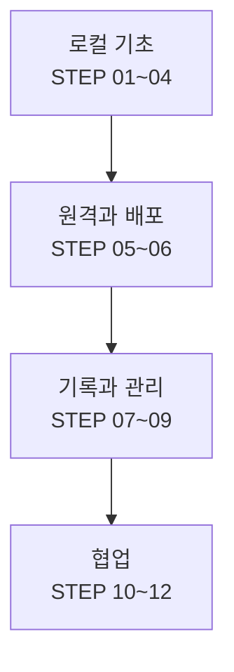

<CourseHeader />

## {{ learningGoals }}

- 웹페이지 변경을 커밋으로 남기고 이전 상태를 확인할 수 있다.
- GitHub에 코드를 백업하고 Pages 주소로 공개할 수 있다.
- README, TIL, Issue로 작업과 배운 점을 기록할 수 있다.
- 브랜치에서 실험하고 Pull Request로 `main`에 합칠 수 있다.

## 학습 흐름

12개 STEP은 네 묶음으로 이어진다.

## 강의 목차

<CourseContents />

## {{ appendix }}

<AppendixContents />
