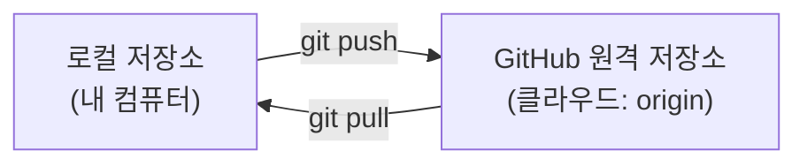
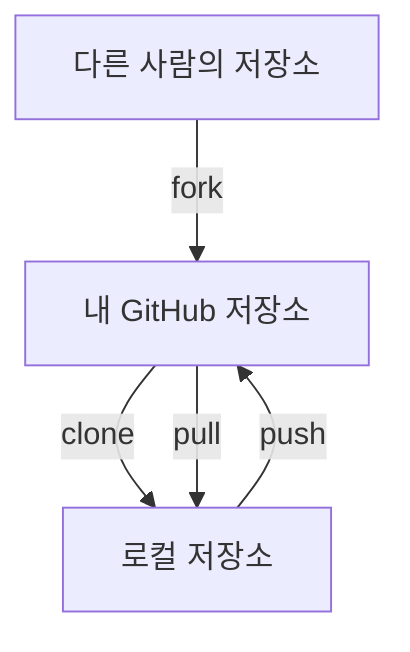
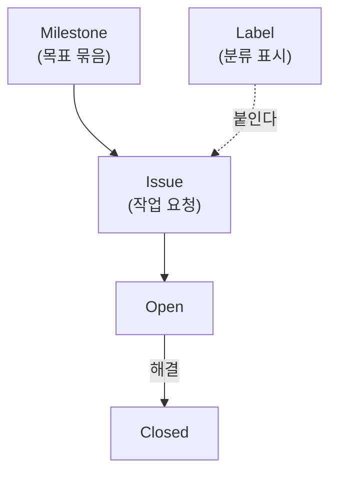
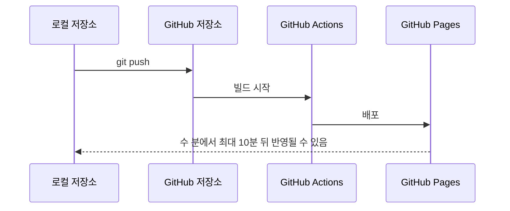

# GitHub란?

{{ easyNotice }}

출처: [STEP 05 원격 저장소와 동기화](/git/05-remote), [STEP 12 Pull Request](/git/12-pull-request), [STEP 09 Issue, Label, Milestone](/git/09-issues), [STEP 06 GitHub Pages 배포](/git/06-pages)

GitHub는 Git 저장소를 서버에 두고 네트워크로 접근할 수 있게 해 주는 호스팅 서비스다. GitLab·Bitbucket도 비슷한 일을 하며, 서비스별 차이는 [호스팅과 버전 관리](/git/appendix/15-hosting-vcs)에서 볼 수 있다. GitHub가 하는 일은 크게 세 가지로 나눌 수 있다.

1. 소스 코드를 공유하고 기여하는 곳
2. 이슈로 작업을 기록하는 곳
3. CI/CD의 중추

## 1. 소스 코드를 공유하고 기여한다

내 컴퓨터의 커밋은 로컬 저장소(`.git`)에만 있다. 컴퓨터를 잃어버리거나 저장 장치에 문제가 생겨 복구하지 못하면 작업물을 잃을 수 있다. 저장소를 GitHub에 올려 두면 쓰기 좋은 점이 세 가지 생긴다.

- 안전한 원격 백업: 어디서든 다른 PC에서 내 코드를 그대로 복원할 수 있다.
- 동료와의 협업: 하나의 저장소를 중심으로 여러 사람이 코드를 수정하고 합친다.
- 오픈소스 기여: 남의 저장소를 복사해 와서 고친 뒤, 원래 주인에게 반영해 달라고 제안할 수 있다.

로컬 저장소와 GitHub 저장소는 네트워크로 데이터를 주고받는다. 올리는 일이 `push`, 가져오는 일이 `pull`이다.

긴 웹 주소를 매번 입력하기 번거로워서, Git에서는 관례적으로 원격 저장소 주소에 `origin`이라는 짧은 별칭을 붙여 쓴다.

### 복제하고 가져오기

남의 저장소에서 작업을 시작할 때는 세 가지 말을 알면 된다.

- `fork`는 다른 사람의 GitHub 저장소를 내 GitHub 계정으로 복사해 오는 일이다. 오픈소스에 기여할 때 주로 쓴다.
- `clone`은 원격 저장소의 모든 커밋 이력과 코드를 내 컴퓨터로 통째로 내려받는 일이다.
- `pull`은 원격에 생긴 변경을 가져와 합치는 일이다.

### 변경을 제안하는 Pull Request

Pull Request(PR)는 브랜치에서 만든 변경을 검토하고 합쳐 달라고 제안하는 절차다. 동료가 바뀐 부분(diff)을 함께 보며 변경 의도와 오류를 확인한다. 혼자 작업할 때도 PR의 diff를 직접 읽어 보는 셀프 리뷰 습관이 도움이 된다.

<Illustration name="review" alt="동료들이 문서에서 바뀐 부분을 함께 보며 검토하는 모습" />

브랜치를 push한 뒤 PR을 만들고, 리뷰와 수정을 거쳐 병합하고, 로컬에 동기화한 뒤 다 쓴 브랜치를 정리하는 흐름이다.

<Illustration name="prflow" alt="푸시, PR 생성, 리뷰와 수정, 병합, 로컬 동기화, 브랜치 정리의 여섯 단계" />

## 2. 이슈로 작업을 기록한다

개발할 기능이나 고쳐야 할 버그를 머릿속으로만 생각하면 중요한 작업을 빠뜨릴 수 있다. GitHub Issue를 쓰면 할 일을 카드 형태로 만들고, 색상 라벨로 분류하고, 목표 마감일별로 진척도를 눈으로 확인할 수 있다.

- **Issue**는 작업을 요청하거나 버그를 알리는 티켓이다.
- **Label**은 이슈의 종류를 나타내는 색상 태그다. `bug`는 오류, `enhancement`는 새 기능 요청, `documentation`은 문서 작업을 구분할 때 쓴다.
- **Milestone**은 목표 기한과 그 안에 속한 이슈의 해결률을 게이지 바로 보여 준다.

Milestone, Label, Issue의 관계와 Issue 상태 변화

예를 들어 오류를 해결한 과정을 `docs/post-mortem.md`에 기록하고, 재발 방지 작업 Issue에 그 문서 링크를 붙인다. 문서에도 Issue 주소를 적어 두면 기록과 작업을 함께 찾을 수 있다.

이슈와 PR도 이어진다. PR 본문에 `Closes #7`처럼 이슈 번호를 적고 기본 브랜치에 병합하면 연결된 이슈가 자동으로 닫힌다.

## 3. CI/CD의 중추

GitHub는 코드를 보관하는 데서 끝나지 않고, 코드가 올라오면 자동으로 일을 시작하게 할 수 있다. 이 자동화를 CI/CD라고 부른다.

- CI(지속적 통합)는 코드가 올라올 때마다 빌드와 검사를 자동으로 실행하는 일이다.
- CD(지속적 배포)는 검사를 통과한 결과를 실제 사이트에 자동으로 공개하는 일이다.

GitHub에서는 GitHub Actions가 이 일을 맡는다. 대표적인 예가 GitHub Pages다. HTML 파일을 브라우저로 바로 열면 주소창에 인터넷 주소 대신 내 PC 안의 파일 경로가 보여서, 외부에 공유해도 상대방 컴퓨터에서는 열리지 않는다. GitHub Pages는 게시 브랜치에 `push`하면 GitHub가 변경을 감지해 사이트를 갱신하도록 해 준다. 이 흐름이 지속적 배포의 기초다.

<Illustration name="publish" alt="나만 열 수 있는 집에서 누구나 볼 수 있는 광장의 게시판으로 사이트가 공개되는 모습" />

`push`부터 사이트 반영까지의 배포 순서

기본 주소는 `https://<GitHub계정명>.github.io/<저장소이름>/` 형식이다. 반영에는 수 분에서 최대 10분이 걸릴 수 있으므로 Actions 상태와 Pages 설정을 확인한다.

가입과 저장소 만들기, 직접 해 보기는 [GitHub 실습](03-github-practice.md)에서 한다.
