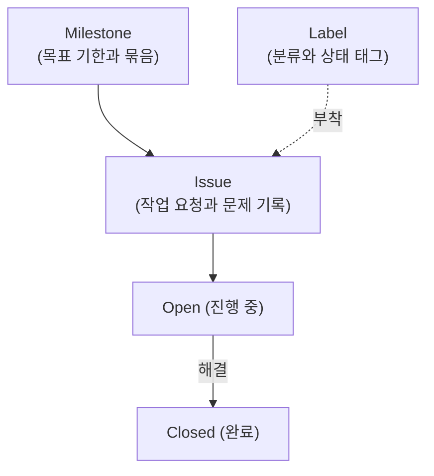
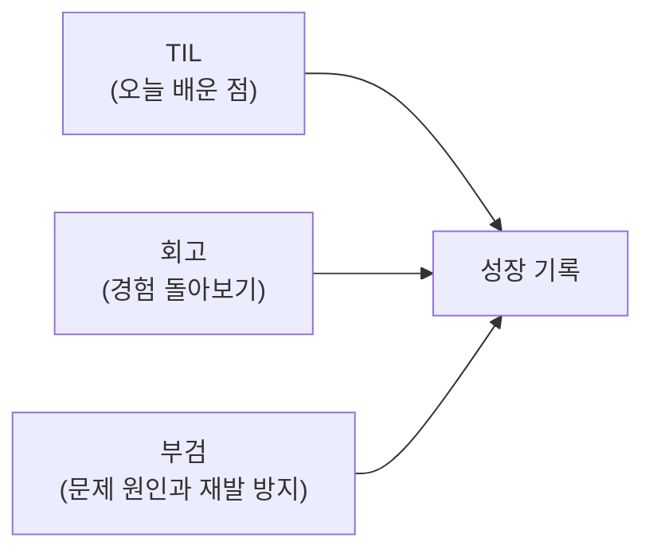

# AI와 GitHub

{{ easyNotice }}

출처: [STEP 07 마크다운과 다이어그램](/git/07-markdown-mermaid), [STEP 08 프로필과 작업 기록](/git/08-profile-records), [STEP 09 핵심 개념](/git/09-issues), [부록 프로필과 기록 작성](/git/appendix/13-profile-records), [부록 기록 작성 예시](/git/appendix/16-record-examples)

GitHub는 단순한 파일 저장소를 넘어 AI와 함께 작업 흐름을 정리하고 기록을 남기는 협업 공간이다. 절차와 실습은 뒤쪽 실습 페이지에서 다루며, 여기서는 AI와 협업할 때 꼭 알아야 할 핵심 개념을 먼저 살펴본다.

## 마크다운의 쓰임새

마크다운(Markdown)은 텍스트에 간단한 기호를 붙여 제목, 목록, 코드, 표, 링크 등을 표현하는 문서 작성 형식이다.

- **README**: 저장소 첫 화면에 자동으로 표시되는 대표 설명서다. AI에게 프로젝트의 목표와 실행 규칙을 알려 주는 첫 길잡이가 된다.
- **GitHub Profile**: 내 사용자 계정 이름과 같은 특별 저장소를 만들어 README를 올리면, GitHub 프로필 메인 화면에 내 소개와 기술 스택이 노출된다.
- **이슈와 PR 본문**: 마크다운을 써서 작업 요청이나 변경 사항을 구조화해 남긴다.

상세 문법과 작성 실습은 [마크다운 실습](/git-easy/github-practice/02-markdown)에서 직접 진행한다.

## AI 협업 개념: 이슈, 라벨, 마일스톤

GitHub에서 작업을 요청하고 진행 상태를 공유하는 대표 도구가 Issue, Label, Milestone이다.

1. **Issue (이슈)**
   - 해결해야 할 버그, 구현할 작업, AI에게 요청할 과제를 티켓 형태로 기록한다.
   - 배경, 작업 내용, 완료 조건을 명확히 적으면 AI가 목표를 오해하지 않고 코드를 작성할 수 있다.
2. **Label (라벨)**
   - 이슈와 PR을 색상 태그로 분류한다.
   - 예: `bug`(오류), `enhancement`(기능 개선), `documentation`(문서), `good first issue`(초보자 추천) 등.
3. **Milestone (마일스톤)**
   - 여러 이슈를 하나의 목표나 일정 단위(예: `v1.0 배포`, `1차 스프린트`)로 묶고 마감일을 지정한다.
   - 전체 이슈 중 몇 개가 닫혔는지 달성률(진행률 %)을 한눈에 파악할 수 있다.

## AI 학습과 프로젝트 기록: TIL, 회고, 부검

AI와 대화하며 코드를 작성하다 보면 무엇을 배웠고 어디서 문제가 생겼는지 놓치기 쉽다. 기록을 남기면 경험이 쌓이고 다음 작업의 실수를 줄일 수 있다.

- **TIL (Today I Learned)**: 오늘 새롭게 알게 된 개념, 실행한 명령, 직접 확인한 결과를 짧게 남긴다.
- **회고 (Retrospective)**: 작업 경험을 돌아보며 잘된 점을 유지하고 아쉬운 점을 고쳐 다음 행동을 정한다.
- **부검 (Post-mortem)**: 작업 실패나 오류가 났을 때 책임을 묻는 대신, 발생 상황과 객관적 원인을 분석하고 재발 방지책을 세운다.

## 기록을 돕는 작성 틀

내용을 논리적으로 정리할 때 유용한 대표 작성 틀이다.

### Why→What→How

이유, 내용, 방법 순서로 생각을 전개하는 틀이다.

- **Why (왜)**: 이 작업이나 학습이 왜 필요한가? 해결하려는 본질적 질문은 무엇인가?
- **What (무엇)**: 구체적으로 무엇을 알게 되었고 어떤 결과를 얻었는가?
- **How (어떻게)**: 어떤 절차와 명령으로 검증했는가? 앞으로 어떻게 적용할 것인가?

### STAR

경험과 문제 해결 과정을 객관적으로 설명하는 틀이다.

- **Situation (상황)**: 어떤 배경과 환경에서 발생한 일인가?
- **Task (과제)**: 해결해야 했던 목표나 문제는 무엇이었는가?
- **Action (행동)**: 문제를 해결하기 위해 구체적으로 어떤 조치를 취했는가?
- **Result (결과)**: 그 결과 어떤 변화가 생겼고 무엇을 확인했는가?

이러한 개념들을 바탕으로 이어지는 [GitHub 실습](/git-easy/github-practice/01-signup-and-repo)에서 저장소를 만들고 기록을 남기는 방법을 실습한다.
