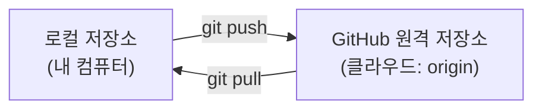
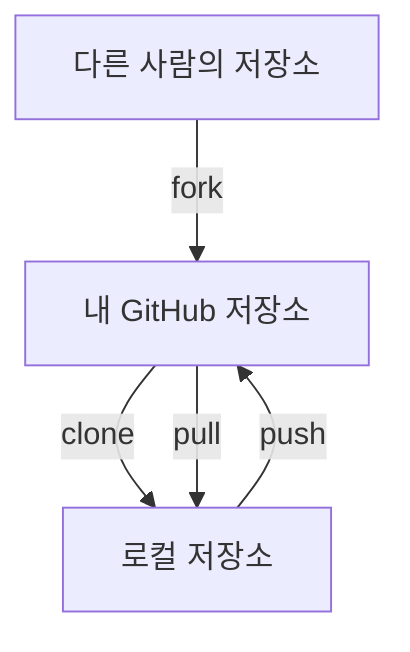
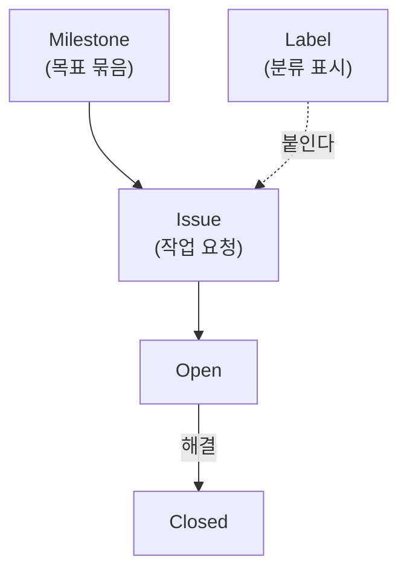
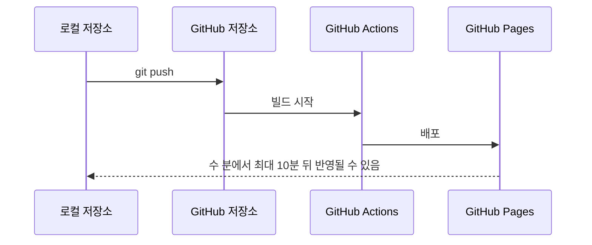

# AI와 GitHub

{{ easyNotice }}

출처: [STEP 05 원격 연결과 동기화 메커니즘](/git/05-remote), [STEP 09 핵심 개념](/git/09-issues), [STEP 12 핵심 개념](/git/12-pull-request), [STEP 06 호스팅 원리와 자동 재배포](/git/06-pages), 저장소 문서 `docs/261103/supplement.md`의 "에이전트 주도 Git"

## GitHub를 이루는 것들

**저장소**는 프로젝트의 파일과 변경 이력을 담는 곳이다. 내 컴퓨터의 로컬 저장소와 GitHub의 원격 저장소는 네트워크로 데이터를 주고받는다. 올리는 일이 `push`, 가져오는 일이 `pull`이고, 원격 저장소 주소에는 관례적으로 `origin`이라는 짧은 별칭을 붙인다.



**커밋**은 어느 시점의 프로젝트 모습을 기록한 하나의 저장 단위다. 커밋 메시지는 무엇을 왜 바꿨는지 알려 준다. 커밋이 쌓인 것이 변경 이력이다.

**복제**와 관련된 말도 알아 두면 좋다. `fork`는 다른 사람의 저장소를 내 GitHub 계정으로 복사하는 일이고, `clone`은 원격 저장소를 내 컴퓨터로 통째로 내려받는 일이다.



**Pull Request**(PR)는 브랜치에서 만든 변경을 검토하고 합쳐 달라고 제안하는 단위다. 바뀐 부분(diff)을 보며 리뷰하고, 병합하면 기본 브랜치에 반영된다.

<Illustration name="prflow" alt="푸시, PR 생성, 리뷰와 수정, 병합, 로컬 동기화, 브랜치 정리의 여섯 단계" />

**Issue**는 작업을 요청하거나 버그를 알리는 티켓이다. **Label**은 이슈의 종류를 나타내는 색상 태그이고, **Milestone**은 목표 기한과 이슈의 해결률을 보여 준다. PR 본문에 `Closes #7`처럼 이슈 번호를 적고 병합하면 연결된 이슈가 닫힌다.



**Actions**는 코드가 올라올 때 정해 둔 작업을 자동으로 실행하는 GitHub의 기능이다. 검사를 돌리는 CI와 결과를 공개하는 CD를 맡는다. **Pages**는 게시 브랜치에 `push`하면 사이트를 갱신해 주는 정적 웹 호스팅이다.

`push`부터 사이트 반영까지의 흐름



## AI는 이것들을 어떻게 다룰까

AI 코딩 도구는 저장소의 파일과 커밋 기록을 읽고 변경을 제안할 수 있다. 커밋 기록이 있으면 무엇을 언제 왜 바꿨는지 알 수 있어서, 잘못된 변경도 이전 상태와 비교하며 되돌리기 쉽다. 이슈와 PR 본문은 AI에게 작업의 배경과 목표를 알려 주는 자료가 되고, AI가 작성한 변경도 PR로 받아 사람이 리뷰할 수 있다.

기존 과정은 OpenCode 같은 에이전트에 아래처럼 요청한다.

```text
index.html의 자기소개에 한글 취미 문구 한 줄만 추가
```

```text
정적 웹 파일 복사 경험 기반 VCS와 SCM 차이 3문장 설명
작업 공간, 스테이징 영역, 로컬 저장소 Mermaid flowchart 시각화
```

에이전트와 함께 Git을 쓸 때는 지켜야 할 경계가 있다.

- 에이전트는 설명과 제안을 먼저 하고, 파일 수정과 명령 실행은 내가 승인한 범위에서만 한다.
- 변경은 `git status`와 `git diff`로 사람이 직접 검토한다.
- push 같은 원격 변경과 되돌리기 어려운 명령은 따로 분명하게 승인한 뒤에만 한다.
- 비밀번호나 토큰 같은 비밀정보는 에이전트에게 전달하지 않는다.

README는 저장소의 첫 화면에 자동으로 보이는 문서라서, 사람과 AI가 프로젝트의 목적과 사용법을 파악하는 출발점이 된다.
