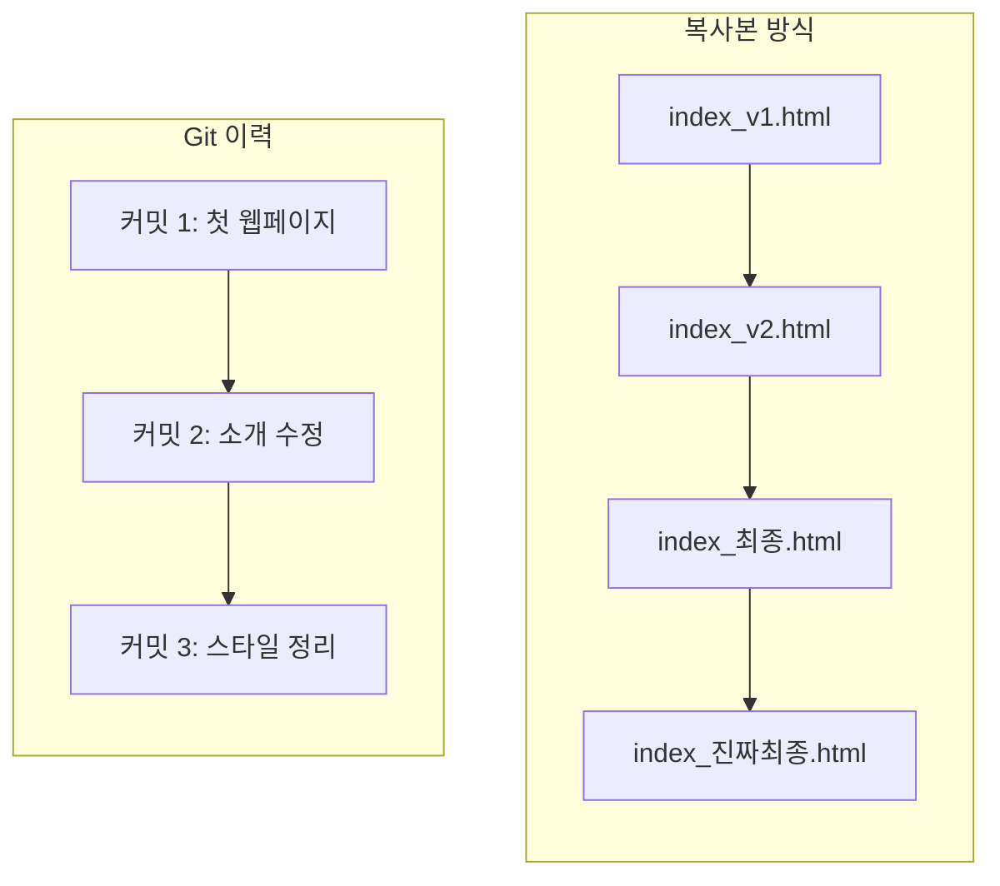
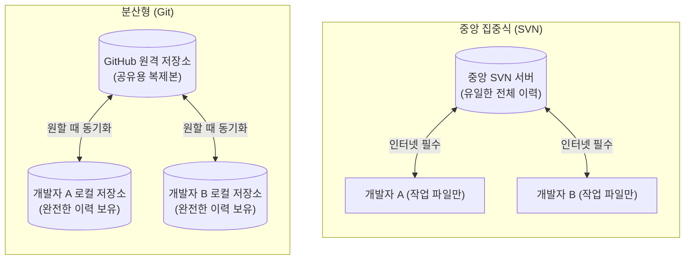
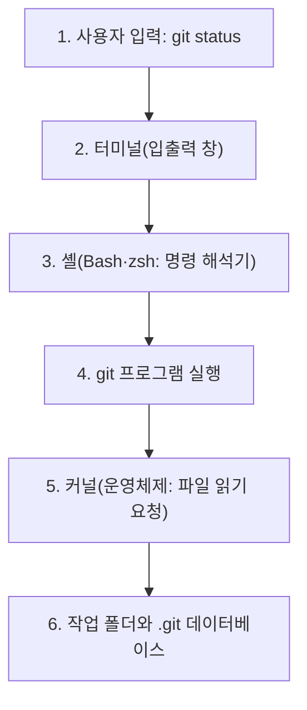

# Git CLI란?

프로그래밍을 시작하면 누구나 "코드를 고치다 망쳤을 때 어떻게 이전 상태로 되돌릴까?"라는 고민을 하게 된다. 이 문제를 해결해 주는 도구가 바로 Git이며, 개발자들은 주로 터미널에서 글자 명령을 입력하는 CLI 방식으로 Git을 다룬다.

## 복사본 대신 Git을 쓰는 이유: VCS와 SCM

버전 관리 도구를 모르면 폴더 안에 파일을 수동으로 복사해 두는 방식을 쓰게 된다.

- `index_v1.html`
- `index_v2.html`
- `index_최종.html`
- `index_진짜최종.html`

이렇게 복사본을 쌓아 두면 곤란한 점이 세 가지 있다.

1. 📁 **최신 파일 혼동**: 어떤 파일이 가장 최신인지, 어떤 파일이 정상 동작하던 버전인지 헷갈린다.
2. 🔍 **변경 이유 불명확**: 두 파일 사이에 어떤 코드나 문구가 바뀌었는지 한눈에 파악하기 어렵다.
3. ⚠️ **복구 불가 위험**: 실수로 최신 파일 위에 이전 파일을 덮어쓰면 되돌릴 방법이 없다.

복사본 방식과 Git 이력의 차이

이러한 문제를 해결하고 코드의 변경 이력을 시간순으로 저장해 두었다가 안전한 과거 시점으로 되돌려 주는 도구가 **버전 관리 시스템**(VCS, Version Control System)이다.

그리고 HTML, CSS, JavaScript, 이미지, 문서 등 프로젝트 전체 구성 요소들을 하나의 상태로 묶어 추적하고 관리하는 활동을 **형상 관리**(SCM, Software Configuration Management)라고 부른다. Git은 현재 전 세계에서 가장 널리 쓰이는 대표적인 VCS이자 SCM 도구이다.

<Illustration name="copies" alt="복사본 파일이 쌓인 책상에서 순서대로 정리된 저장 기록 한 줄로 바뀌는 모습" />

## 중앙 집중식 SVN과 분산형 Git의 비교

Git 이전에도 버전 관리 도구는 존재했다. 가장 대표적인 선배 도구가 **SVN**(Apache Subversion)이다. 둘은 저장소를 어디에 두고 관리하느냐에서 본질적인 차이가 있다.

| 구분 | SVN (중앙 집중식 VCS) | Git (분산형 VCS) |
| --- | --- | --- |
| 🏛️ 저장소 위치 | 오직 중앙 서버 한곳에만 전체 이력이 존재함 | 모든 개발자의 PC마다 완전한 로컬 저장소가 복제됨 |
| 📶 오프라인 작업 | ❌ 중앙 서버에 접속하지 못하면 커밋이나 이력 조회 불가 | ✅ 인터넷 없이도 내 컴퓨터에서 자유롭게 커밋하고 로그 확인 |
| ⚡ 실행 속도 | 매번 서버와 네트워크 통신을 거쳐야 하므로 느림 | 대부분의 작업이 내 컴퓨터 로컬에서 즉시 실행되어 매우 빠름 |
| 🛡️ 서버 장애 복구 | 중앙 서버가 고장 나거나 유실되면 전체 프로젝트 이력 손실 위험 | 중앙 서버가 손상되어도 개발자 PC의 저장소로 완벽히 복원 가능 |

쉽게 비유하자면, SVN은 도서관 본관에만 있는 유일한 원본 대출 대장과 같다. 대장을 확인하거나 새 기록을 쓰려면 반드시 본관 창구로 가야 한다. 반면 Git은 모든 연구원이 완벽한 복사본 대장을 각자 책상에 가지고 있는 것과 같다. 각자 편하게 기록하다가, 필요한 순간에만 서로의 변경 사항을 맞추면 된다.

## 화면(GUI) 대신 명령(CLI)으로 쓰는 이유

컴퓨터를 다루는 방식에는 크게 두 가지가 있다.

- **GUI (Graphical User Interface)**: 창, 메뉴, 버튼을 마우스로 클릭하여 조작하는 방식이다.
- **CLI (Command Line Interface)**: 키보드로 정해진 글자 명령을 입력하여 프로그램을 조작하는 방식이다.

터미널을 처음 열면 검은 화면에 깜빡이는 커서만 보여 낯설고 두려울 수 있다. 하지만 개발자들이 Git을 GUI 전용 프로그램 대신 CLI로 주로 다루는 데는 확실한 이유가 있다.

| 용어 | 뜻과 역할 | 예시 |
| --- | --- | --- |
| 🖥️ GUI | 마우스로 창과 버튼을 눌러 조작하는 화면 방식 | VS Code 창, 파일 탐색기 |
| ⌨️ CLI | 키보드로 정해진 글자 명령을 입력해 프로그램을 다루는 방식 | `git status`, `git commit` |
| 🪟 터미널 | 사용자가 명령을 입력하고 실행 결과를 보여 주는 창 | VS Code 통합 터미널, Git Bash 창 |
| 🐚 셸 | 입력받은 명령을 해석해 해당 프로그램을 찾아 실행하는 프로그램 | Bash, zsh |
| ⚙️ 커널 | 파일 읽기/쓰기, 메모리, 장치를 관리하는 운영체제의 핵심 | Windows, macOS의 심장부 |

CLI를 사용하는 핵심 이유는 다음과 같다:

1. 🎯 **정확성과 통제력**: 마우스 커서의 미세한 클릭 실수 없이 정확한 옵션을 지정하여 명령을 실행할 수 있다.
2. 🔁 **재현성과 기록**: 실행했던 명령 목록이 텍스트 기록으로 남아, 나중에 그대로 다시 실행하거나 문서 매뉴얼로 공유하기 쉽다.
3. 🤖 **AI 에이전트와의 협업**: ChatGPT, Claude, OpenCode 등 현대 AI 도구는 텍스트 명령을 바탕으로 소통한다. AI가 제안한 Git 명령을 확인하고 터미널에서 그대로 실행할 수 있다.

## 터미널에서 Git이 실행되는 흐름

터미널은 입력과 출력을 보여 주는 화면일 뿐이며, Git은 터미널에 내장된 기능이 아니라 컴퓨터에 독립적으로 설치된 프로그램이다.

1. 사용자가 터미널 창에 `git status`라고 글자를 입력한다.
2. 터미널이 이 글자열을 내부에서 돌아가는 **셸**(Shell)에 전달한다.
3. 셸이 시스템 경로에서 `git`이라는 실행 프로그램을 찾아 실행한다.
4. Git 프로그램이 현재 폴더의 `.git` 저장소와 작업 파일들을 확인하기 위해 **커널**(Kernel)에 파일 읽기를 요청한다.
5. 커널이 디스크에서 데이터를 읽어 Git 프로그램에 건네준다.
6. Git이 상태를 분석한 뒤 셸을 거쳐 터미널 창에 친절한 안내 문구로 결과를 출력한다.

<Illustration name="snapshots" alt="작업 중간에 저장한 지점들을 따라 원하는 시점으로 되돌아가는 모습" />

각 도구의 구체적인 역할을 알면 "명령을 찾을 수 없습니다" 같은 오류가 났을 때 어디를 점검해야 할지 명확해진다. Git의 내부 저장 원리는 [Git의 원리](/git-easy/05-git-principle)에서 살펴보고, 실제 도구 설치와 환경 설정은 [Git 실습](/git-easy/git-practice/01-git-install)에서 진행한다.

## 추가자료

- [STEP 01 왜 버전·형상 관리를 할까](/git/01-environment)
- [STEP 03 커밋과 이력 기록](/git/03-commit-history)
- [부록 CLI·터미널·셸](/git/appendix/06-cli-terminal-shell)
- [부록 호스팅과 버전 관리](/git/appendix/15-hosting-vcs)
