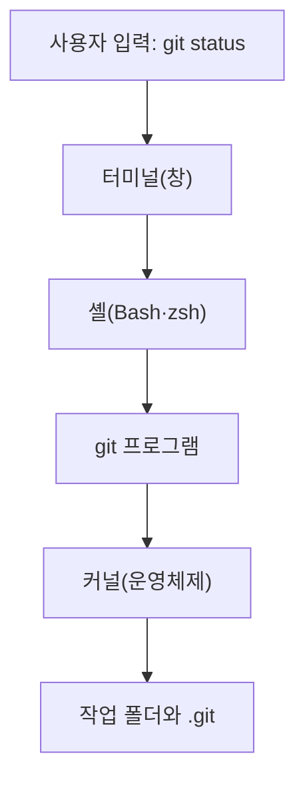

# Git CLI란?

{{ easyNotice }}

출처: [부록 CLI·터미널·셸](/git/appendix/06-cli-terminal-shell)

## 터미널, 셸, Git

터미널은 명령으로 조작하는 인터페이스(CLI)를 띄우는 창이다. 셸(Bash 등)은 입력한 명령을 해석하고 커널을 통해 실행하며, Git은 이 셸에서 실행하는 프로그램이다.

Windows에서는 Git을 설치할 때 함께 들어오는 Git Bash가 터미널과 Bash 셸 역할을 한다.

## Git 실행 흐름

Git은 터미널이나 셸 안의 기능이 아니라 별도로 설치된 프로그램이며, 셸이 찾아서 실행한다.

`git status`를 입력했을 때의 실행 흐름

1. 터미널이 입력한 글자를 셸에 전달한다.
2. 셸이 `git`이라는 이름의 프로그램을 PATH에서 찾아 실행한다.
3. Git이 현재 폴더의 `.git`과 작업 파일을 읽으려고 커널에 요청한다.
4. 결과를 셸이 받아 터미널 창에 출력한다.
