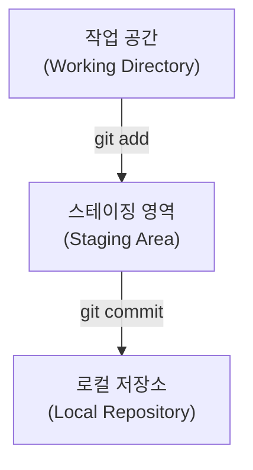
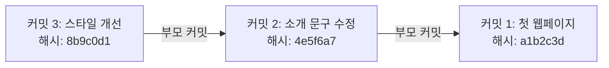
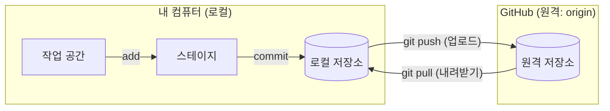
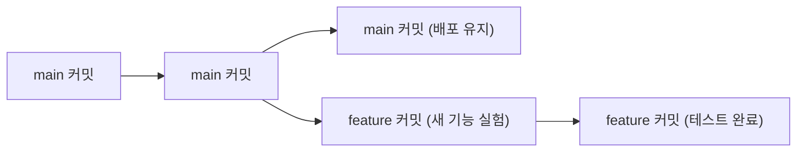
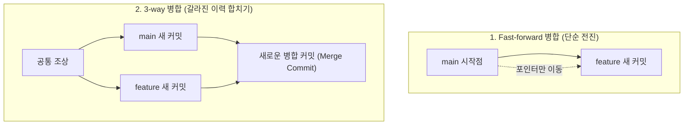

# Git의 원리

{{ easyNotice }}

출처: [STEP 01 버전 관리의 세 영역](/git/01-environment), [STEP 03 커밋과 이력 기록](/git/03-commit-history), [STEP 05 원격 저장소와 동기화](/git/05-remote), [STEP 10 브랜치와 태그](/git/10-branches-tags), [STEP 11 병합과 충돌 해결](/git/11-merge-conflicts)

Git은 단순한 파일 백업 프로그램이 아니라, 정교한 내부 데이터 구조와 흐름을 통해 버전과 협업을 관리한다. 여기서는 실습에 들어가기 전 반드시 알아야 할 Git의 다섯 가지 핵심 원리를 차례대로 살펴본다.

## 로컬 3단계 구조: 작업 공간, 스테이지, 저장소

Git은 파일이 수정되었다고 해서 무작정 저장소에 기록하지 않는다. 작업물을 신중하게 확인하고 골라 담을 수 있도록 확실하게 구분되는 3단계를 거친다.



세 영역은 마트에서 물건을 쇼핑하고 결제하는 과정에 비유하면 직관적으로 이해할 수 있다:

1. 🛒 **작업 공간 (Working Directory)**
   - 에디터(VS Code 등)에서 파일을 열고 글을 쓰고 코드를 저장하는 실제 작업 폴더이다.
   - 마트의 진열대에서 여러 상품을 만져보고 비교하며 장을 보는 단계와 같다.
2. 🧺 **스테이징 영역 (Staging Area / Index)**
   - 작업 공간에서 수정한 수많은 파일 중, 이번 저장 단위(커밋)에 포함할 파일만 쏙 골라 올려 두는 대기 장소이다.
   - 진열대의 모든 물건이 아니라, 계산할 물건만 골라 **쇼핑 카트**(장바구니)에 담는 단계와 같다.
3. 🧾 **로컬 저장소 (Local Repository)**
   - 카트에 담긴 파일들의 현재 상태를 영구적인 스냅샷으로 확정하여 폴더 안의 숨김 데이터베이스(`.git`)에 안전하게 보관하는 공간이다.
   - 카트에 담긴 물건들을 계산대에서 결제하고 **영수증을 발행받아 보관 앨범**에 철해 두는 단계와 같다.

<Illustration name="stages" alt="작업 공간에서 스테이징 영역을 거쳐 로컬 저장소로 파일 변경이 옮겨지는 3단계 흐름" />

이 3단계 구조 덕분에 여러 파일을 동시에 수정했더라도 관련된 변경 파일들만 골라 깔끔한 단위로 이력을 쪼개어 기록할 수 있다.

## 커밋 스냅샷과 커밋 해시

Git에서 **커밋**(Commit)은 단순한 저장이 아니다. "특정 시점에 의미 있는 작업 단위가 완성되었음을 선언하고, 그 순간의 전체 프로젝트 모습을 영구적인 스냅샷으로 남기는 행위"이다.

과거의 파일 변경 차이점(diff)만 얼기설기 이어 붙이는 방식과 달리, Git은 매 커밋마다 프로젝트 전체 파일의 상태를 찰칵 사진을 찍듯 **스냅샷**(Snapshot)으로 보관한다.



커밋에는 고유한 이름표 역할을 하는 **커밋 해시**(Commit Hash)가 부여된다.

- 🔑 **고유한 지문**: 커밋을 작성한 사람, 작성 시각, 파일 내용, 그리고 바로 이전(부모) 커밋의 정보를 종합해 암호학적 알고리즘(SHA)으로 계산한 고유 문자열이다.
- 🛡️ **위변조 방지**: 파일 내용이나 커밋 정보가 1글자만 달라져도 해시가 완전히 바뀌기 때문에 이력이 몰래 조작될 위험이 없다.
- 🏷️ **짧은 해시**: 원래는 40자리(SHA-1)의 긴 문자열이지만, 터미널이나 일상 작업에서는 식별 가능한 앞 7자리(예: `8b9c0d1`)만으로도 편리하게 커밋을 가리킬 수 있다.

## 로컬 저장소와 원격 저장소: push와 pull

Git은 내 컴퓨터 안에 온전한 이력을 갖는 로컬 저장소와, 클라우드 서버에 위치한 GitHub 원격 저장소(Remote Repository)로 나뉜다.



- 📤 **push (밀어올리기)**: 내 컴퓨터 로컬 저장소에 차곡차곡 쌓아 둔 커밋 스냅샷들을 GitHub 원격 저장소로 업로드하여 동기화한다.
- 📥 **pull (당겨오기)**: 협업하는 동료가 올렸거나 다른 컴퓨터에서 작업해 원격 저장소에 새로 생긴 커밋들을 내 컴퓨터 로컬 저장소로 내려받아 반영한다.

인터넷 연결이 끊겨도 내 컴퓨터에서 자유롭게 커밋을 남길 수 있고, 네트워크가 연결되었을 때 한꺼번에 원격으로 push할 수 있는 이유가 바로 이 구조 덕분이다.

## 브랜치: 안전하게 실험하는 독립된 가지

**브랜치**(Branch)는 프로젝트 메인 줄기에서 뻗어나오는 독립된 작업 가지다.



- 🌳 **안전한 메인 줄기 (`main`)**: 사용자에게 배포 중이거나 언제든 배포할 수 있는 정상 작동 코드를 유지하는 기준 브랜치다.
- 🌿 **자유로운 실험 가지 (`feature/...`)**: 새로운 기능이나 실험적인 디자인을 마음껏 시도해 볼 수 있는 독립된 공간이다.

메인 줄기에서 직접 파일을 수정하다 코드가 꼬이면 배포 중인 사이트가 멈추는 대형 사고가 날 수 있다. 별도의 브랜치 가지를 만들어 작업하면, 마음껏 실험하다가 실패하면 가지를 그냥 버리면 되고, 성공했을 때만 메인 줄기에 합칠 수 있다.

<Illustration name="branches" alt="본줄기에서 갈라진 가지에서 실험한 뒤 다시 합쳐지는 모습" />

## 머지와 충돌: 가지 합치기와 교통정리

가지에서 개발과 검증을 성공적으로 끝마쳤다면, 기준이 되는 메인 줄기(`main`)로 변경 내용을 다시 합쳐야 한다. 이 합치는 과정을 **머지**(Merge, 병합)라고 부른다.

### 머지의 두 가지 방식



- ⏩ **Fast-forward 병합**: 기준 브랜치(`main`)에 아무런 새 변경이 없었던 경우, 단순히 메인 브랜치의 이름표를 기능 브랜치의 최신 커밋 위치로 앞으로 쓱 전진시키는 방식이다.
- 🔀 **3-way 병합**: 기준 브랜치와 기능 브랜치 양쪽 모두에 각자 새로운 커밋이 생겨 이력이 갈라진 경우다. 두 브랜치의 공통 조상과 양쪽 최신 커밋 3가지를 비교하여 자동으로 내용을 합치고, 그 결과를 담은 새로운 **병합 커밋**(Merge Commit)을 만든다.

### 충돌(Conflict)이 발생하는 이유와 해결

병합을 진행할 때, 두 브랜치에서 **서로 다른 파일**을 수정했거나 **같은 파일이라도 서로 다른 줄**을 수정했다면 Git이 알아서 깔끔하게 합쳐 준다.

하지만 두 브랜치가 **같은 파일의 바로 그 동일한 줄을 서로 다르게 수정**했다면 문제가 생긴다.

```markdown
<<<<<<< HEAD (현재 브랜치의 내용)
<h1>고깃집에 오신 것을 환영합니다!</h1>
=======
<h1>맛있는 Git & GitHub 익힘책</h1>
>>>>>>> feature/title (합쳐 들어오는 브랜치의 내용)
```

이 상태를 **충돌**(Conflict)이라고 한다. Git은 사람의 생각이나 프로젝트 기획 의도를 알지 못하므로, 어느 쪽 문구가 정답인지 함부로 판단하지 않고 충돌 마커를 남긴 채 작업을 일시 정지한다. 이는 코드가 멋대로 지워지는 것을 막기 위한 Git의 철저한 안전장치다.

충돌이 발생했을 때의 해결 순서는 다음과 같다:

1. 📋 `git status`를 입력해 어떤 파일에서 충돌이 났는지 확인한다.
2. ✏️ 충돌이 난 파일을 에디터로 열어 `<<<<<<<`, `=======`, `>>>>>>>` 마커 사이의 두 내용을 비교한다.
3. 🤝 동료와 상의하거나 기획 의도에 맞게 최종 코드를 직접 정리하고, 충돌 마커 기호들을 깨끗이 지운다.
4. 💾 수정한 파일을 저장한 뒤 `git add`로 스테이징하고, `git commit`을 실행해 병합을 완료한다.
5. ↩️ 만약 해결 과정이 너무 꼬여 병합 시작 전으로 안전하게 되돌아가고 싶다면 언제든 `git merge --abort`를 입력하면 된다.

이제 이론적 원리를 모두 이해했으므로, [Git 실습](/git-easy/git-practice/01-git-install)으로 넘어가 내 컴퓨터에 Git을 설치하고 직접 명령을 다뤄보자.
