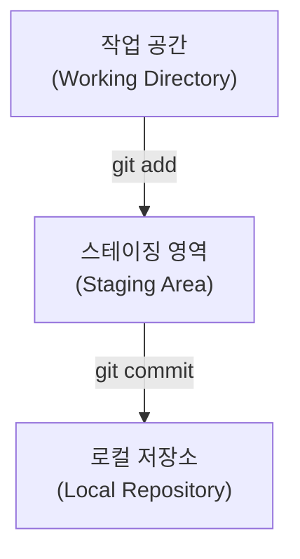

# Git의 원리

{{ easyNotice }}

출처: [STEP 01 버전 관리의 세 영역](/git/01-environment), [STEP 03 커밋과 이력 기록](/git/03-commit-history)

## 왜 버전 관리를 할까

잘 동작하던 코드를 조금 수정했는데 갑자기 실행이 안 돼서 이전 상태로 되돌리고 싶을 때가 있다. 버전 관리 도구를 모르면 `index_v1.html`, `index_최종.html`, `index_진짜최종.html`처럼 파일을 복사해 두게 된다. Git은 복사본 대신 변경 이력을 시간순으로 저장해 두었다가 안전한 과거 시점으로 되돌려 준다.

<Illustration name="copies" alt="복사본 파일이 쌓인 책상에서 순서대로 정리된 저장 기록 한 줄로 바뀌는 모습" />

작업 중간중간 체크포인트를 남겨 두면 문제가 생겼을 때 되돌아갈 기준점이 된다. Git에서 커밋은 그 순간의 전체 프로젝트 모습을 스냅샷으로 남기는 일이고, 커밋 메시지는 무엇을 왜 바꿨는지 알려 준다.

<Illustration name="snapshots" alt="작업 중간에 저장한 지점들을 따라 원하는 시점으로 되돌아가는 모습" />

## 로컬 3단계 구조와 상태 변화

Git은 파일 변경을 무작정 저장하지 않고 확실히 구분되는 3단계를 거친다.

세 영역은 마트에서 물건을 구매하는 과정에 비유하면 쉽게 이해할 수 있다:

1. **작업 공간 (Working Directory)**
   - VS Code에서 파일을 열고 코드를 입력하고 저장하는 현재 작업 폴더이다.
   - 마트의 진열대에서 물건을 살펴보고 손에 집어 드는 단계와 같다.
2. **스테이징 영역 (Staging Area / Index)**
   - 작업 공간에서 수정한 파일 중, 이번 저장 기록(커밋)에 포함할 파일만 골라 올려두는 대기 장소이다.
   - 장바구니나 쇼핑 카트에 구매할 물건만 골라 담는 단계와 같다.
3. **로컬 저장소 (Local Repository)**
   - 카트에 담긴 파일들의 현재 상태를 영구적인 스냅샷으로 확정하여 저장소 폴더 안의 전용 데이터베이스(`.git`)에 안전하게 보관하는 앨범이다.
   - 카트의 물건들을 계산대에서 결제하고 영수증을 발행받아 보관하는 단계와 같다.

<Illustration name="stages" alt="작업 공간에서 스테이징 영역을 거쳐 로컬 저장소로 파일 변경이 옮겨지는 3단계 흐름" />
