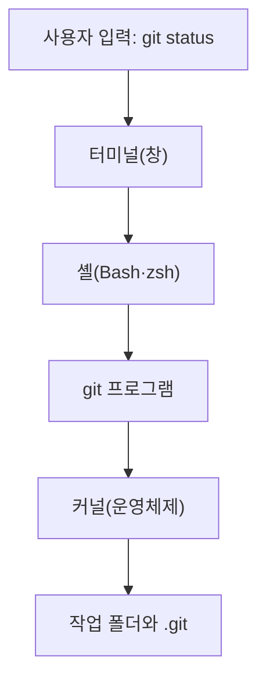
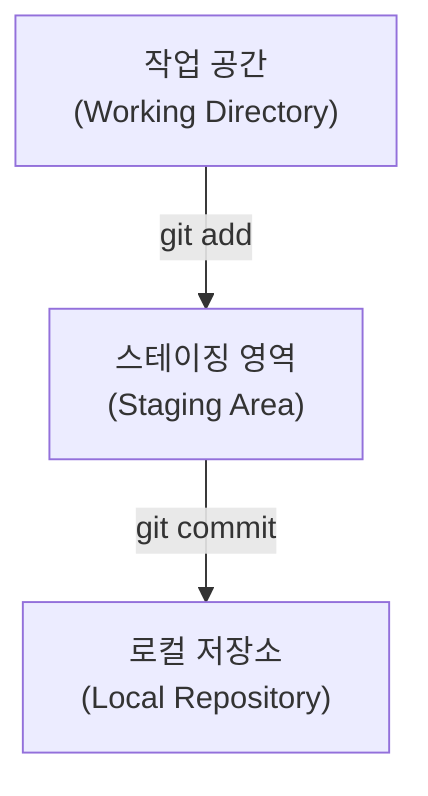

# Git의 원리

{{ easyNotice }}

출처: [부록 CLI·터미널·셸](/git/appendix/06-cli-terminal-shell), [STEP 01 버전 관리의 세 영역](/git/01-environment), [STEP 03 커밋과 이력 기록](/git/03-commit-history), [STEP 10 브랜치와 태그](/git/10-branches-tags)

## 터미널, 셸, Git

터미널은 명령을 입력하고 결과를 보여 주는 창이다. 셸(Bash·zsh 등)은 입력한 명령을 해석해 프로그램을 찾아 실행한다. 프로그램이 파일을 읽거나 쓰는 일은 셸이 직접 하지 않고 커널(운영체제의 핵심)에 요청한다. Git은 터미널이나 셸 안의 기능이 아니라 별도로 설치된 프로그램이며, 셸이 찾아서 실행한다. Windows에서는 Git을 설치할 때 함께 들어오는 Git Bash가 터미널과 Bash 셸 역할을 한다.

`git status`를 입력했을 때의 실행 흐름

1. 터미널이 입력한 글자를 셸에 전달한다.
2. 셸이 `git`이라는 이름의 프로그램을 PATH에서 찾아 실행한다.
3. Git이 현재 폴더의 `.git`과 작업 파일을 읽으려고 커널에 요청한다.
4. 결과를 셸이 받아 터미널 창에 출력한다.

## 로컬 3단계 구조와 상태 변화

Git은 파일 변경을 무작정 저장하지 않고 확실히 구분되는 3단계를 거친다.

세 영역은 마트에서 물건을 구매하는 과정에 비유하면 쉽게 이해할 수 있다:

1. **작업 공간 (Working Directory)**
   - VS Code에서 파일을 열고 코드를 입력하고 저장하는 현재 작업 폴더이다.
   - 마트의 진열대에서 물건을 살펴보고 손에 집어 드는 단계와 같다.
2. **스테이징 영역 (Staging Area / Index)**
   - 작업 공간에서 수정한 파일 중, 이번 저장 기록(커밋)에 포함할 파일만 골라 올려두는 대기 장소이다.
   - 장바구니나 쇼핑 카트에 구매할 물건만 골라 담는 단계와 같다.
3. **로컬 저장소 (Local Repository)**
   - 카트에 담긴 파일들의 현재 상태를 영구적인 스냅샷으로 확정하여 저장소 폴더 안의 전용 데이터베이스(`.git`)에 안전하게 보관하는 앨범이다.
   - 카트의 물건들을 계산대에서 결제하고 영수증을 발행받아 보관하는 단계와 같다.

<Illustration name="stages" alt="작업 공간에서 스테이징 영역을 거쳐 로컬 저장소로 파일 변경이 옮겨지는 3단계 흐름" />

## 커밋과 브랜치

커밋은 특정 시점에 의미 있는 작업 단위가 완성되었음을 선언하고, 그 순간의 전체 프로젝트 모습을 스냅샷으로 남기는 일이다. 커밋 메시지는 내가 어떤 작업을 왜 했는지 알려 주어 동료와 미래의 내가 이력을 쉽게 추적하게 한다.

**브랜치**는 작업 흐름을 나누는 독립된 가지다. 배포 중인 `main`에서 직접 개발하다 코드가 망가지면 사이트에도 영향을 줄 수 있다. 가지를 따로 뻗어 작업하면 마음껏 실험할 수 있고, 실패하면 가지를 버리고 성공했을 때만 합치면 된다.

<Illustration name="branches" alt="본줄기에서 갈라진 가지에서 실험한 뒤 다시 합쳐지는 모습" />
