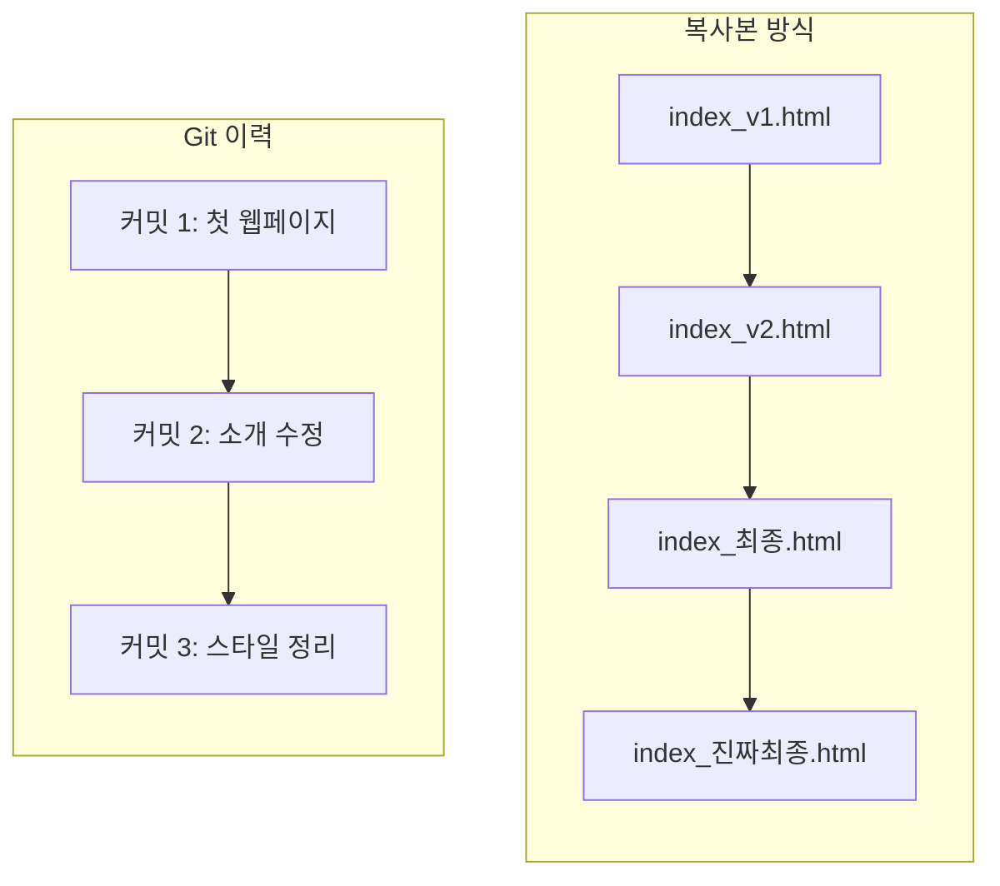
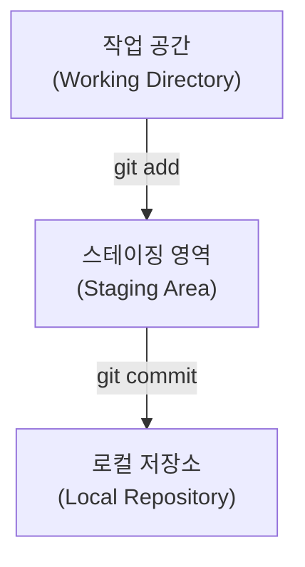

# 버전 관리의 세 영역

## 학습 목표

- 웹 파일을 수동으로 복사하며 버전을 관리하던 방식의 한계를 짚고 버전 관리 시스템(VCS)과 형상 관리(SCM)가 왜 필요한지 이해한다.
- Git이 관리하는 폴더 안에서 파일이 이동하는 세 가지 핵심 영역(작업 공간, 스테이징 영역, 로컬 저장소)의 동작 원리를 파악한다.
- VS Code 통합 터미널에서 `git --version`으로 설치 상태를 점검하고 OpenCode와의 연동을 확인한다.

## 왜 버전·형상 관리를 할까

프로그래밍을 하다 보면 흔히 겪는 상황 중 하나가 잘 동작하던 코드를 조금 수정했는데 갑자기 실행이 안 돼서 이전 상태로 되돌리고 싶어지는 것이다.

이때 버전 관리 도구를 모르면 폴더 안에 파일을 수동으로 복사해 두는 방식을 쓰게 된다:

- `index_v1.html`
- `index_v2.html`
- `index_최종.html`
- `index_진짜최종.html`

이렇게 복사본을 쌓아 두면 곤란한 점이 세 가지 있다.

1. 최신 파일 혼동: 어떤 파일이 가장 최신인지, 어떤 파일이 정상 동작하던 버전인지 확인하기 어렵다.
2. 변경 이유 불명확: 두 파일 사이에 어떤 코드나 문구가 바뀌었는지 한눈에 파악하기 어렵다.
3. 복구 불가 위험: 실수로 최신 파일 위에 이전 파일을 덮어쓰면 복구하기 어렵다.

복사본 방식은 파일만 늘어나지만, Git 이력은 순서와 설명이 함께 남는다.



이러한 문제를 해결하고 코드의 변경 이력을 시간순으로 저장해 두었다가 안전한 과거 시점으로 되돌려 주는 도구가 <strong>버전 관리 시스템(VCS, Version Control System)</strong>이다. 그리고 HTML, CSS, 이미지, 문서 등 프로젝트 전체의 구성 요소들을 하나의 유기적인 상태로 추적하고 통제하는 활동을 <strong>형상 관리(SCM, Software Configuration Management)</strong>라고 부른다.

<Illustration name="copies" alt="복사본 파일이 쌓인 책상에서 순서대로 정리된 저장 기록 한 줄로 바뀌는 모습" />

## 로컬 3단계 구조와 상태 변화

Git은 파일 변경을 무작정 저장하지 않고 확실히 구분되는 3단계를 거친다.



세 영역은 마트에서 물건을 구매하는 과정에 비유하면 쉽게 이해할 수 있다:

1. **작업 공간 (Working Directory)**
   - 내가 VS Code 에디터에서 실제로 `index.html`, `style.css` 코드를 열어 타이핑하고 저장하는 현재 작업 폴더이다.
   - 마트의 진열대에서 물건을 살펴보고 손에 집어 드는 단계와 같다.
2. **스테이징 영역 (Staging Area / Index)**
   - 작업 공간에서 수정한 파일 중, 이번 저장 기록(커밋)에 포함할 파일만 골라 올려두는 대기 장소이다.
   - 장바구니나 쇼핑 카트에 구매할 물건만 골라 담는 단계와 같다.
3. **로컬 저장소 (Local Repository)**
   - 카트에 담긴 파일들의 현재 상태를 영구적인 스냅샷으로 확정하여 내 컴퓨터 안의 전용 데이터베이스(`.git`)에 안전하게 보관하는 앨범이다.
   - 카트의 물건들을 계산대에서 결제하고 영수증을 발행받아 보관하는 단계와 같다.

<Illustration name="stages" alt="작업 공간에서 스테이징 영역을 거쳐 로컬 저장소로 파일 변경이 옮겨지는 3단계 흐름" />

터미널은 명령으로 조작하는 인터페이스(CLI)를 띄우는 창이다. 셸(Bash 등)은 입력한 명령을 해석하고 커널을 통해 실행하며, Git은 이 셸에서 실행하는 프로그램이다. 자세한 관계는 [CLI·터미널·셸](appendix/06-cli-terminal-shell.md) 부록을 참고한다.

## 따라하기

1. VS Code를 실행한다.
2. 상단 메뉴에서 `터미널` → `새 터미널`을 클릭하거나 단축키(`` Ctrl + ` `` 또는 `Ctrl + ~`, macOS는 `` Ctrl + ` ``)를 눌러 터미널 창을 연다.
3. 터미널 종류를 확인한다. Windows 사용자는 Git Bash를 기본 셸로 선택하고, macOS 사용자는 기본 zsh 터미널을 사용한다.
4. 터미널에 `git --version`을 입력하고 `Enter`를 눌러 Git 설치 버전을 확인한다.
5. `pwd` 명령어로 현재 열려 있는 기본 폴더 위치를 확인한다.
6. OpenCode 인터페이스를 열어 질문을 입력해 보고 정상적으로 응답하는지 확인한다.
7. 작업 공간, 스테이징 영역, 로컬 저장소의 3단계 흐름을 정리한다.

## Git 명령

```bash
# Git 설치 버전 확인
git --version

# 현재 작업 중인 절대 경로 확인
pwd
```

## 에이전트 요청 예시

```text
정적 웹 파일 복사 경험 기반 VCS와 SCM 차이 3문장 설명
작업 공간, 스테이징 영역, 로컬 저장소 Mermaid flowchart 시각화
```

## 체크리스트

- [ ] 터미널에 `git version 2.x.x` 형태로 버전 문자열이 정상 출력된다.
- [ ] `pwd` 명령어로 현재 작업 경로를 확인할 수 있다.
- [ ] 세 영역(작업 공간, 스테이징 영역, 로컬 저장소)의 역할 차이를 설명할 수 있다.
- [ ] OpenCode 입력 창에서 정상적으로 응답을 받는다.

## 트러블 슈팅

| 증상 | 원인 | 대응 |
| --- | --- | --- |
| `git: command not found` 에러 | Git 미설치 또는 환경 변수(PATH) 미등록 | [설치 준비](appendix/00-installation.md)를 확인하고 PATH를 점검한다. 터미널 차이는 [운영체제별 차이](appendix/05-os-differences.md) 부록을 참고한다. |
| VS Code 터미널 창이 열리지 않음 | 터미널 기본 셸 설정 충돌 | VS Code를 재시작하거나 `기본 프로필 선택`에서 Git Bash 또는 zsh를 다시 지정한다. |
| OpenCode 응답 지연 | 네트워크 일시 지연 또는 세션 만료 | 브라우저 세션을 새로고침하거나 강사에게 네트워크 연결을 문의한다. |

## 주의할 점

- 터미널 창이나 에이전트 대화창에 개인 비밀번호나 계정 토큰을 입력하지 않는다.
- 모든 실습은 교육용 전용 폴더에서 진행하며, 개인 중요 파일이 있는 폴더에서 명령을 실행하지 않는다.
- 운영체제별 단축키와 경로 표기 차이는 [운영체제별 차이](appendix/05-os-differences.md) 부록을 참고한다.

## 핵심 내용 퀴즈 <QuizHelp />

1. Git이 관리하는 폴더 안에서 파일은 ::작업 공간::, 스테이징 영역, 로컬 저장소 순서로 이동한다.
2. 이번 커밋에 포함할 파일만 골라 올려두는 대기 장소를 ::스테이징 영역::이라고 한다.
3. 파일 변경 이력을 시간순으로 저장하고 안전한 과거 시점으로 되돌려 주는 도구를 ::버전 관리 시스템(VCS)::이라고 한다.
