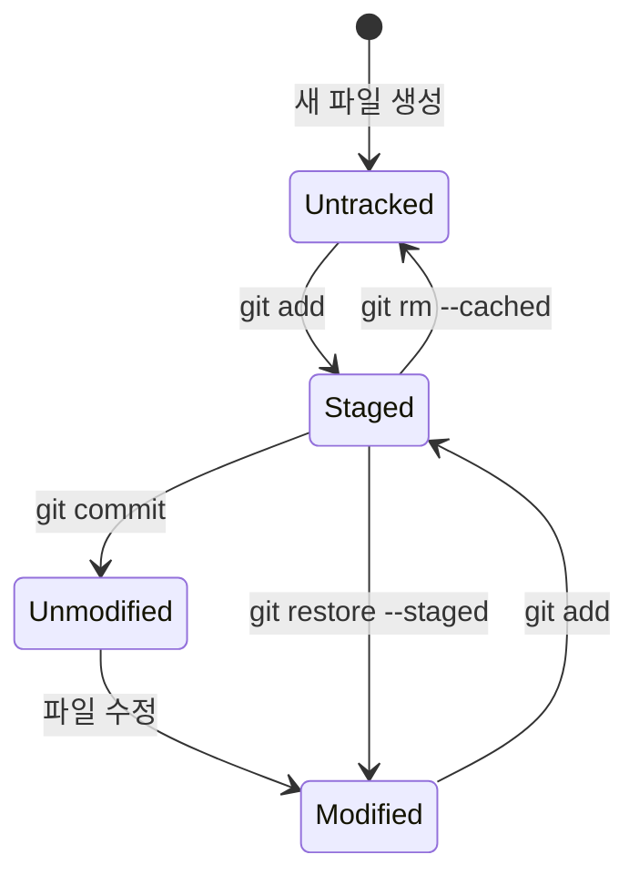

# 저장소 준비와 파일 추적

## 학습 목표

- `git config`로 커밋에 기록될 작업자 이름과 이메일을 등록할 수 있다.
- 실습 폴더를 만들고 `git init`으로 로컬 [저장소](glossary.md#repository)를 초기화할 수 있다.
- OpenCode로 첫 포트폴리오 웹페이지를 만들 수 있다.
- `git status`로 추적되지 않은 파일(Untracked)을 확인하고 `git add`로 스테이징 영역에 올릴 수 있다.
- 빈 폴더를 추적하려고 `.gitkeep` 파일을 두는 관례를 설명할 수 있다.

## 작업자 등록과 저장소 초기화

협업 프로젝트에서는 수많은 사람이 코드를 수정한다. 만약 코드에 문제가 생겼거나 중요한 기능이 추가되었을 때, 누가 해당 변경을 만들었는지 기록되어 있지 않다면 원인을 찾거나 소통하기 어렵다.

따라서 Git을 처음 다룰 때는 가장 먼저 "커밋을 작성하는 사람의 정보"를 등록해야 한다.

또한 일반 컴퓨터 폴더는 파일이 추가되거나 수정되어도 스스로 과거 이력을 기억하지 못한다. 우리가 Git에게 "지금부터 이 폴더를 버전 관리 저장소로 선언하고 모든 변화를 감시하라"고 명령하는 절차가 바로 `git init`이다. `init`은 initialization(초기화)의 줄임말로, 현재 폴더를 Git이 관리하는 저장소로 처음 준비한다. 이 과정에서 숨김 폴더 `.git`이 만들어지고 이력이 그 안에 저장된다.

## 파일 상태와 스테이징 원리

Git에서 파일 상태가 바뀌는 흐름



1. **Untracked (미추적 상태)**
   - 폴더에 새 파일을 만들었지만, Git에게 아직 추적하라고 알려주지 않은 상태이다. `git status` 실행 시 빨간색으로 표시된다.
2. **Tracked (추적 상태)**
   - 한 번이라도 Git에 등록되어 감시 대상이 된 파일이다.
   - **Unmodified**: 마지막 저장(커밋) 이후 아무런 변화가 없는 깨끗한 상태.
   - **Modified**: 이전 저장 상태와 비교해 내용이 변경된 상태.
3. **Staged (스테이징 상태)**
   - `git add` 명령을 통해 다음 커밋 스냅샷에 포함하기로 확정해 둔 상태이다. `git status` 실행 시 초록색으로 표시된다.
   - 이미 커밋된 적 있는 파일은 `git restore --staged`로 스테이징만 취소하면 Modified로 돌아간다. 첫 커밋 전 새 파일은 HEAD가 없어 그 명령이 실패한다. 그때는 `git rm --cached -- <파일>`로 인덱스에서만 빼 Untracked로 되돌린다.

### 빈 폴더와 `.gitkeep`
Git은 빈 폴더 자체를 추적하지 않는다. 폴더 안에 빈 `.gitkeep` 파일을 두면 파일과 함께 폴더가 기록된다. `.gitkeep`은 특별한 Git 기능이나 유일한 표준이 아닌 이름 관례다. `.gitignore` 파일을 두는 방법도 있지만, 이 파일의 내용은 무시할 파일을 정하므로 규칙에 따라 다른 파일이 추적되지 않을 수 있다.

## 예시 산출물

각자 OpenCode에 요청해 첫 웹페이지(`index.html`)를 만든다. 요청은 간결하게, 필요한 내용만 적고 변경 범위를 제한한다. 첫 단계에서는 HTML5만 사용하고 CSS·JavaScript와 외부 라이브러리는 제외한다. 이후 CSS 실습에서 스타일을 추가한다.

### 미리보기 준비

VS Code 확장 메뉴에서 Live Server를 검색해 설치하고, 파일을 만든 뒤 `index.html`을 열어 `Open with Live Server`로 미리 본다. 기본 포트는 5500이다. 확장 변경 기록은 그 포트가 사용 중이면 다른 포트로 넘어갈 수 있다고 적고, 포트를 고정하려면 설정에서 바꾼다. 파일은 확장 없이도 만들고 브라우저에서 열 수 있다. 대안으로 Python이 있으면 작업 폴더에서 `python -m http.server 8000`을 실행한다. 공식 기본 포트는 8000이고, 실행 파일 이름은 설치에 따라 `python3`일 수 있다. Node.js 환경에서는 [http-server](https://github.com/http-party/http-server)를 사용할 수 있다. 서버는 `Ctrl+C`로 중단한다.

### OpenCode 요청

OpenCode에 아래 요청문을 입력한다. 오른쪽 위의 복사 버튼으로 복사할 수 있다.

```text
현재 폴더에 index.html만 생성.
HTML5로 한글 제목과 자기소개 문단을 작성하고 CSS, JavaScript, 외부 라이브러리는 사용하지 않기.
```

### 생성 결과 확인

생성이 끝나면 파일 탐색기에서 `index.html`을 브라우저로 열어 제목과 소개 문단이 보이는지 확인한다.

브라우저에서 열면 제목과 소개 문단이 아래처럼 보인다. 문구와 모양은 요청 결과에 따라 달라질 수 있다.

<Screenshot name="step01-first-page" alt="인사말 제목과 첫 웹페이지라는 문장이 표시된 화면" />


### 예시 코드 참고

생성이 잘 안 되거나 확실하게 진행하고 싶다면 아래 예시 코드를 참고해도 좋다.

::: details 예시 코드 보기

`index.html` 예시:

```html
<!doctype html>
<html lang="ko">
<head>
  <meta charset="utf-8">
  <meta name="viewport" content="width=device-width, initial-scale=1">
  <title>나의 포트폴리오</title>
</head>
<body>
  <main>
    <h1>안녕하세요, 웹 개발 입문자입니다</h1>
    <p>Git과 GitHub를 활용하여 안정적인 형상 관리를 배우고 있습니다.</p>
  </main>
</body>
</html>
```

:::

## GitHub 가입

GitHub는 Git 저장소를 보관하고 협업하는 서비스 중 하나이며, GitLab·Bitbucket도 Git 원격 저장소를 제공한다. 이 과정은 GitHub 화면으로 실습하고, 서비스별 차이와 Git이 아닌 버전 관리 도구는 [호스팅과 버전 관리](appendix/15-hosting-vcs.md)를 참고한다.

Git 명령은 로컬에서 실행되지만, STEP 05부터 쓰는 원격 저장소와 배포에는 GitHub 계정이 필요하다. 지금 가입해 두면 아래 작업자 정보 등록에 같은 이메일을 쓸 수 있다.

1. [github.com/signup](https://github.com/signup)에서 이메일, 비밀번호, 사용자 이름을 입력해 가입한다.
2. 사용자 이름은 저장소 주소(`github.com/사용자이름/…`)에 그대로 쓰이므로 알아보기 쉬운 영문 이름으로 정한다.
3. 가입 이메일로 온 인증 메일을 열어 이메일 인증을 마친다. 메일이 보이지 않으면 [이메일 주소 인증 안내](https://docs.github.com/ko/account-and-profile/how-tos/email-preferences/verifying-your-email-address)를 참고한다.
4. 이메일을 공개하고 싶지 않으면 GitHub 설정의 [Emails](https://github.com/settings/emails)에서 `Keep my email addresses private`를 켜고, 표시되는 `noreply` 이메일을 확인해 둔다. 자세한 절차는 [커밋 이메일 주소 설정 안내](https://docs.github.com/ko/account-and-profile/how-tos/email-preferences/setting-your-commit-email-address)를 참고한다.

## 따라하기

1. GitHub 가입 이메일(또는 `noreply` 이메일)로 작업자 이름과 이메일을 전역(`--global`)으로 설정하고, `git config --global --list`로 확인한다.
2. 실습 전용 폴더(예: `portfolio-web`)를 생성하고 해당 디렉터리로 이동한다. 폴더 이름은 각자 정해도 되며, 이후 예시는 `portfolio-web`을 쓴다.
3. `git init`을 실행하여 저장소를 초기화한다.
4. 예시 산출물의 요청문으로 OpenCode에 첫 웹페이지 생성을 요청해 `index.html`을 만들고 저장한다. 이후 단계는 각자 만든 파일을 기준으로 진행한다.
5. 이미지 폴더를 만들고 빈 폴더 추적용 `.gitkeep` 파일을 만든다: `mkdir -p images && touch images/.gitkeep`.
6. `git status`를 실행하여 생성한 파일이 Untracked 상태로 표시되는지 확인한다. 폴더가 묶여 표시될 수도 있다.
7. `git add index.html images/.gitkeep`을 입력해 스테이징 영역에 파일을 올린다.
8. `git status`를 다시 실행하여 파일들이 초록색 `Changes to be committed:` 목록으로 올라갔는지 확인한다.

`git status`를 처음 실행하면 아직 추적하지 않는 파일이 `Untracked files:` 아래에 나열된다. 아래 화면은 `index.html`만 있는 저장소의 예시다.

<Screenshot name="step02-status-untracked" alt="`$ git status`에 커밋이 없고, 추적되지 않은 파일로 `index.html`이 보인다." />

`git add`로 스테이징 영역에 올린 뒤 다시 실행하면 같은 파일이 `Changes to be committed:` 아래로 옮겨진다.

<Screenshot name="step02-status-staged" alt="`$ git status`에 커밋이 없고, `Changes to be committed` 아래 새 파일 `index.html`이 보인다." />


## Git 명령

명령 이름이 어떤 뜻인지 알면 외우기 쉽다.

- `status`: 상태(status)를 보여 준다는 뜻
- `add`: 변경한 파일을 스테이징 영역에 더한다(add)는 뜻

명령어 참조: [git config](commands/config.md) · [git init](commands/init.md) · [git status](commands/status.md) · [git add](commands/add.md)

작업자 정보 등록은 커밋에 기록될 이름과 이메일을 정하는 단계이다.

- `user.name`과 `user.email`은 새 커밋의 작성자·커미터 기본값이다. 저장소별 설정 등이 이 값을 덮어쓸 수 있다.
- `--global`은 현재 사용자의 저장소에 적용되는 기본값이다. 한 번 설정하면 저장소별 설정이 없는 곳에 쓰인다.
- 이메일을 GitHub 가입 이메일(또는 GitHub `noreply` 이메일)과 맞추면 커밋이 내 GitHub 계정에 연결된다. 다르면 커밋은 만들어지지만 계정과 연결되지 않을 수 있다.

```bash
# 1. 작업자 정보 등록 (본인 영문 이름과 GitHub 가입 이메일로 변경)
git config --global user.name "Your Name"
git config --global user.email "your-email@example.com"

# 2. 실습 폴더 생성 및 이동
mkdir portfolio-web
cd portfolio-web

# 3. 로컬 저장소 초기화
git init

# 4. 빈 이미지 폴더 및 .gitkeep 생성
mkdir -p images
touch images/.gitkeep

# 5. 파일 상태 확인 (Untracked)
git status

# 6. 스테이징 영역에 파일 추가
git add index.html images/.gitkeep

# 7. 파일 상태 재확인 (Staged)
git status
```

작업자 정보는 `git config --global --list`로 확인한다. 이름이나 이메일에 오타를 넣었다면 같은 명령을 다시 실행해 값을 덮어쓴다.

### 선택 참고 명령

```bash
# 현재 설정된 사용자 정보 및 설정 목록 확인
git config --list

# 현재 폴더의 모든 변경 사항을 한 번에 스테이징
git add .
```

## 에이전트 요청 예시

```text
index.html의 자기소개에 한글 취미 문구 한 줄만 추가
```

## 체크리스트

- [ ] `git config user.name`과 `git config user.email` 입력 시 등록한 정보가 출력된다.
- [ ] `portfolio-web` 폴더 안에 숨김 폴더 `.git`이 생성되어 있다 (`ls -la`로 확인).
- [ ] `git status` 결과에서 `index.html`, `images/.gitkeep`이 staged 상태로 표시된다.
- [ ] 빈 폴더를 기록하는 파일 관례를 설명할 수 있다.

## 트러블 슈팅

| 증상 | 원인 | 대응 |
| --- | --- | --- |
| `fatal: not a git repository` | `git init`을 실행하지 않은 폴더에서 git 명령 입력 | `pwd`로 위치를 확인하고 `cd portfolio-web` 이동 후 `git init`을 실행한다. |
| 이름/이메일 오타 발생 | 잘못된 값 등록 | 동일한 `git config --global` 명령으로 올바른 이름과 이메일을 다시 입력하면 덮어써진다. |
| `git status`에 파일이 안 보임 | 파일이 저장되지 않았거나 다른 폴더에 생성됨 | VS Code에서 파일 저장(`Ctrl + S`)을 확인하고 현재 폴더 경로를 점검한다. |
| 실수로 원치 않는 파일을 `add`함 | 전체 추가 또는 파일 오입력 | 첫 커밋 전 새 파일은 `git rm --cached -- <파일명>`으로 인덱스에서만 뺀다. 이미 커밋된 파일은 `git restore --staged <파일명>`으로 스테이징만 취소한다. |

## 주의할 점

- 민감한 개인정보나 임시 파일을 확인 없이 한 번에 올리는 `git add .`는 입문 단계에서 지양하고, 파일명을 명시적으로 지정하여 add하는 습관을 들인다.
- `.git` 폴더 안의 내부 파일들은 Git이 자체적으로 관리하므로 사용자가 직접 수정하거나 삭제하지 않는다.
- 상세한 Git 명령 옵션 일람은 [명령과 옵션 일람](appendix/02-git-options.md) 부록을 참고한다.

## 복습 퀴즈 <QuizHelp />

1. `git status`는 현재 변경 파일과 ::스테이징 상태::를 보여준다.
2. `git add`를 실행하기 전 파일은 untracked 또는 modified이고, 실행한 뒤에는 ::staged::로 바뀐다.
3. `git init`을 실행하면 저장소 이력이 저장될 숨김 폴더 ::.git::이 만들어진다.
