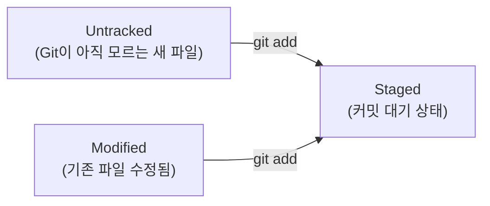

# 저장소 준비와 파일 추적

## 학습 목표

- `git config` 명령어로 커밋에 기록될 작업자 이름과 이메일을 등록한다.
- 실습 폴더 `portfolio-web`를 생성하고 `git init`으로 로컬 저장소를 초기화한다.
- OpenCode를 활용해 첫 포트폴리오 웹페이지(`index.html`, `style.css`)를 생성한다.
- `git status`로 추적되지 않은 파일(Untracked)을 확인하고, `git add`로 스테이징 영역에 올린다.
- 빈 폴더 추적을 위한 `.gitkeep` 파일의 관례를 이해한다.

## 작업자 등록과 저장소 초기화

협업 프로젝트에서는 수많은 사람이 코드를 수정한다. 만약 코드에 문제가 생겼거나 중요한 기능이 추가되었을 때, 누가 해당 변경을 만들었는지 기록되어 있지 않다면 원인을 찾거나 소통하기 어렵다.

따라서 Git을 처음 다룰 때는 가장 먼저 "내 컴퓨터에서 작성하는 모든 커밋의 서명자 정보"를 등록해야 한다.

또한 일반 컴퓨터 폴더는 파일이 추가되거나 수정되어도 스스로 과거 이력을 기억하지 못한다. 우리가 Git에게 "지금부터 이 폴더를 버전 관리 저장소로 선언하고 모든 변화를 감시하라"고 명령하는 절차가 바로 `git init`이다.

## 파일 상태와 스테이징 원리

Git에서 파일은 단순히 존재하기만 하는 것이 아니라 다음과 같은 상태를 거친다:



1. **Untracked (미추적 상태)**
   - 폴더에 새 파일을 만들었지만, Git에게 아직 추적하라고 알려주지 않은 상태이다. `git status` 실행 시 빨간색으로 표시된다.
2. **Tracked (추적 상태)**
   - 한 번이라도 Git에 등록되어 감시 대상이 된 파일이다.
   - **Unmodified**: 마지막 저장(커밋) 이후 아무런 변화가 없는 깨끗한 상태.
   - **Modified**: 이전 저장 상태와 비교해 내용이 변경된 상태.
3. **Staged (스테이징 상태)**
   - `git add` 명령을 통해 다음 커밋 스냅샷에 포함하기로 확정해 둔 상태이다. `git status` 실행 시 초록색으로 표시된다.

### 빈 폴더와 `.gitkeep`
Git은 파일의 내용을 추적하는 시스템이므로 빈 디렉터리(폴더) 자체는 커밋 대상으로 인식하지 않는다. 하지만 웹 프로젝트에서는 이미지(`images/`)나 폰트(`fonts/`)를 담을 빈 폴더 구조를 미리 만들어 두고 형상 관리에 포함해야 할 때가 많다. 이때 폴더 안에 빈 파일인 `.gitkeep`을 넣어 폴더가 Git에 추적되도록 만드는 것이 개발자들의 표준적인 관례이다.

## 첫 웹페이지 코드

실습에서 사용할 가벼운 첫 번째 웹 포트폴리오 코드이다.

### `index.html`

```html
<!doctype html>
<html lang="ko">
<head>
  <meta charset="utf-8">
  <meta name="viewport" content="width=device-width, initial-scale=1">
  <title>나의 포트폴리오</title>
  <link rel="stylesheet" href="style.css">
</head>
<body>
  <main>
    <h1>안녕하세요, 웹 개발 입문자입니다</h1>
    <p>Git과 GitHub를 활용하여 안정적인 형상 관리를 배우고 있습니다.</p>
  </main>
</body>
</html>
```

### `style.css`

```css
body {
  font-family: -apple-system, BlinkMacSystemFont, "Segoe UI", Roboto, sans-serif;
  margin: 0;
  padding: 2rem;
  background-color: #f7f9fa;
  color: #333333;
}

main {
  max-width: 680px;
  margin: 2rem auto;
  background: #ffffff;
  padding: 2.5rem;
  border-radius: 12px;
  box-shadow: 0 4px 12px rgba(0, 0, 0, 0.05);
}

h1 {
  color: #1a73e8;
  font-size: 1.75rem;
  margin-top: 0;
}

p {
  line-height: 1.6;
}
```

## 따라하기

1. 터미널에서 작업자 이름과 이메일을 전역(`--global`)으로 설정한다.
2. 실습 전용 폴더인 `portfolio-web`를 생성하고 해당 디렉터리로 이동한다.
3. `git init`을 실행하여 저장소를 초기화한다.
4. VS Code 탐색기나 OpenCode를 활용해 `index.html`과 `style.css`를 생성하고 위의 코드를 입력 후 저장한다.
5. 이미지 폴더를 만들고 빈 폴더 추적용 `.gitkeep` 파일을 만든다: `mkdir -p images && touch images/.gitkeep`.
6. `git status`를 실행하여 3개의 파일이 빨간색 Untracked 상태로 표시되는지 확인한다.
7. `git add index.html style.css images/.gitkeep`을 입력해 스테이징 영역에 파일을 올린다.
8. `git status`를 다시 실행하여 파일들이 초록색 `Changes to be committed:` 목록으로 올라갔는지 확인한다.

## Git 명령

```bash
# 1. 작업자 정보 등록 (본인 영문 이름과 이메일로 변경)
git config --global user.name "Your Name"
git config --global user.email "your-email@example.com"

# 2. 실습 폴더 생성 및 이동
mkdir portfolio-web
cd portfolio-web

# 3. 로컬 저장소 초기화
git init

# 4. 빈 이미지 폴더 및 .gitkeep 생성
mkdir -p images
touch images/.gitkeep

# 5. 파일 상태 확인 (Untracked)
git status

# 6. 스테이징 영역에 파일 추가
git add index.html style.css images/.gitkeep

# 7. 파일 상태 재확인 (Staged)
git status
```

### 선택 참고 명령

```bash
# 현재 설정된 사용자 정보 및 설정 목록 확인
git config --list

# 현재 폴더의 모든 변경 사항을 한 번에 스테이징
git add .
```

## 에이전트 요청 예시

```text
초보자를 위한 1페이지 자기소개 HTML/CSS 생성
파일명은 index.html과 style.css로 고정
index.html 취미 또는 목표 문구 추가
```

## 체크리스트

- [ ] `git config user.name`과 `git config user.email` 입력 시 등록한 정보가 출력된다.
- [ ] `portfolio-web` 폴더 안에 숨김 폴더 `.git`이 생성되어 있다 (`ls -la`로 확인).
- [ ] `git status` 결과에서 `index.html`, `style.css`, `images/.gitkeep`이 초록색 staged 상태로 표시된다.
- [ ] `.gitkeep` 파일이 왜 필요한지 이유를 설명할 수 있다.

## 트러블 슈팅

| 증상 | 원인 | 대응 |
| --- | --- | --- |
| `fatal: not a git repository` | `git init`을 실행하지 않은 폴더에서 git 명령 입력 | `pwd`로 위치를 확인하고 `cd portfolio-web` 이동 후 `git init`을 실행한다. |
| 이름/이메일 오타 발생 | 잘못된 값 등록 | 동일한 `git config --global` 명령으로 올바른 이름과 이메일을 다시 입력하면 덮어써진다. |
| `git status`에 파일이 안 보임 | 파일이 저장되지 않았거나 다른 폴더에 생성됨 | VS Code에서 파일 저장(`Ctrl + S`)을 확인하고 현재 폴더 경로를 점검한다. |
| 실수로 원치 않는 파일을 `add`함 | 전체 추가 또는 파일 오입력 | `git restore --staged <파일명>` 명령어로 스테이징을 안전하게 취소한다. |

## 주의할 점

- 민감한 개인정보나 임시 파일을 확인 없이 한 번에 올리는 `git add .`는 입문 단계에서 지양하고, 파일명을 명시적으로 지정하여 add하는 습관을 들인다.
- `.git` 폴더 안의 내부 파일들은 Git이 자체적으로 관리하므로 사용자가 직접 수정하거나 삭제하지 않는다.
- 상세한 Git 명령 옵션 일람은 [부록 2. 명령과 옵션 일람](appendix/02-git-options.md)을 참조한다.
- 추가 심화 실습은 [보충안 심화](supplement/01-advanced-practice.md), 복습 퀴즈는 [보충안 퀴즈](supplement/02-review-quiz.md), 에이전트 주도 Git은 [보충안 에이전트](supplement/03-agent-led-git.md)에서 다룬다.
