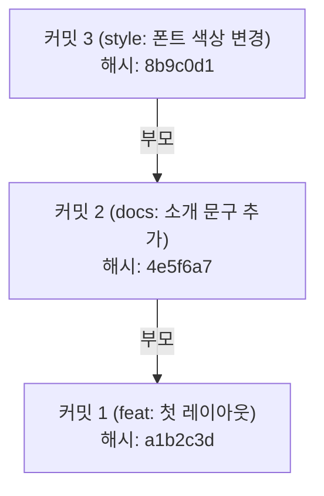

# 커밋과 이력 기록

## 학습 목표

- 스테이징 영역에 올려둔 파일들을 `git commit`으로 확실한 스냅샷 기록으로 남긴다.
- 커밋 해시(SHA-1 Hash)의 고유 식별자 의미와 직관적인 커밋 메시지 규칙을 익힌다.
- `git log --oneline`과 `git diff`로 프로젝트의 변경 이력을 조회한다.
- vi 에디터가 열렸을 때 당황하지 않고 안전하게 저장하고 빠져나오는 법을 체득한다.
- 실수로 스테이징에 올린 파일을 안전하게 내리는 `git restore --staged`를 실습한다.

## 왜 작업 단위로 기록할까

새로운 기능을 추가하거나 코드를 다듬을 때, 작업 중간중간 확실한 체크포인트를 남겨두어야 한다. 그래야 기능이 고장 났을 때 방금 전 정상 동작하던 시점으로 되돌아갈 수 있다.

Git에서 커밋(Commit)은 단순한 파일 저장이 아니다. "특정 시점에 의미 있는 작업 단위가 완성되었음을 선언하고, 그 순간의 전체 프로젝트 모습을 영구적인 스냅샷으로 남기는 행위"이다.

또한 내가 어떤 작업을 왜 수행했는지 한눈에 알 수 있도록 설명해 주는 <strong>커밋 메시지(Commit Message)</strong>를 함께 기록해야 협업하는 동료와 미래의 내가 이력을 쉽게 추적할 수 있다.

<Illustration name="snapshots" alt="작업 중간에 저장한 지점들을 따라 원하는 시점으로 되돌아가는 모습" />

## 커밋 스냅샷과 해시의 원리

Git 커밋은 다음과 같은 특징을 지닌다:

각 커밋은 부모 커밋의 해시를 가리키며 사슬처럼 이어진다.



1. **커밋 해시 (Commit Hash)**
   - 각 커밋은 작성자, 작성 시간, 파일 내용 등을 종합하여 만들어진 40자리 16진수 문자열(SHA-1)을 가진다.
   - 사실상 고유하게 식별되는 지문과 같으며, 보통 앞의 7자리(예: `a1b2c3d`)만으로 커밋을 고유하게 구분한다.
2. **커밋 메시지 컨벤션 (규칙)**
   - 좋은 커밋 메시지는 첫머리에 변경의 성격을 드러내는 접두사를 붙인다:
     - `feat:` 새로운 기능이나 화면 구성 요소 추가
     - `docs:` 문서 수정, HTML 본문 문구 수정
     - `style:` CSS 스타일 변경, 여백이나 색상 조정 (코드 로직 변경 없음)
     - `fix:` 버그나 깨진 마크업 수정
     - `refactor:` 기능 변경 없는 코드 구조 개선
     - `chore:` 설정 파일, 패키지 관리 등 기타 작업

### vi 에디터와 탈출법
만약 `git commit`을 실행할 때 `-m "메시지"` 옵션을 빠뜨리면 터미널 내에서 기본 텍스트 편집기인 vi(또는 vim)가 열린다. 마우스가 동작하지 않아 당황하기 쉽지만, 다음 절차를 거치면 안전하게 빠져나올 수 있다:
- **저장하고 닫기**: `Esc` 키를 누른 뒤 `:wq`를 입력하고 `Enter`
- **저장하지 않고 취소하기**: `Esc` 키를 누른 뒤 `:q!`를 입력하고 `Enter`

## 웹페이지 수정 코드

STEP 03에서 소개 문구를 보강하고 스타일을 다듬는 수정 예시이다.

### `index.html` 수정

`<main>` 태그 안에 학습 목표 목록을 추가한다.

```html
<!doctype html>
<html lang="ko">
<head>
  <meta charset="utf-8">
  <meta name="viewport" content="width=device-width, initial-scale=1">
  <title>나의 포트폴리오</title>
  <link rel="stylesheet" href="style.css">
</head>
<body>
  <main>
    <h1>안녕하세요, 웹 개발 입문자입니다</h1>
    <p>Git과 GitHub를 활용하여 안정적인 형상 관리를 배우고 있습니다.</p>
    <section>
      <h2>현재 학습 목표</h2>
      <ul>
        <li>Git 3단계 영역 이해와 안전한 커밋 남기기</li>
        <li>GitHub Pages를 활용한 정적 웹 배포</li>
      </ul>
    </section>
  </main>
</body>
</html>
```

## 따라하기

1. STEP 02에서 스테이징 영역에 올려둔 파일들을 첫 번째 커밋으로 기록한다:
   `git commit -m "feat: 첫 웹페이지 레이아웃 및 스타일 추가"`
2. `git log --oneline`을 실행하여 첫 번째 커밋의 해시(앞 7자리)와 메시지가 출력되는지 확인한다.
3. VS Code에서 `index.html`을 열고 위의 학습 목표 섹션을 추가한 뒤 저장한다.
4. `git status`를 입력해 `index.html`이 빨간색 `modified` 상태로 감지되는지 확인한다.
5. `git diff`를 실행하여 실제로 어떤 HTML 코드가 추가되었는지 확인한다 (초록색 `+` 줄).
6. `git add index.html`로 스테이징 영역에 올린다.
7. 실수로 올린 상황을 가정하고, 스테이징을 안전하게 해제해 본다:
   `git restore --staged index.html`
8. `git status`로 다시 `Changes not staged for commit:` 상태로 내려갔음을 확인한다.
9. 다시 `git add index.html`을 실행하고 두 번째 커밋을 작성한다:
   `git commit -m "docs: 학습 목표 섹션 및 문구 추가"`
10. `git log --oneline`으로 누적된 2개의 커밋 이력을 확인한다.
11. 깨끗한 작업 트리 상태(`working tree clean`)를 확인한다.

## Git 명령

명령 이름의 뜻은 다음과 같다.

- `commit`: 변경을 이력에 확정해 맡긴다(commit)는 뜻이다.
- `log`: 기록(log)을 시간순으로 읽는다는 뜻이다.
- `diff`: 차이(difference)의 줄임말이다.
- `restore`: 이전 상태로 복원한다는 뜻이다.

명령어 참조: [git add](commands/add.md) · [git commit](commands/commit.md) · [git log](commands/log.md) · [git diff](commands/diff.md) · [git restore](commands/restore.md)

```bash
# 1. 첫 커밋 확정
git commit -m "feat: 첫 웹페이지 레이아웃 및 스타일 추가"

# 2. 한 줄 커밋 이력 조회
git log --oneline

# 3. 작업 공간과 최근 커밋 간의 차이 비교
git diff

# 4. 파일 수정 후 스테이징
git add index.html

# 5. 스테이징 취소 (언스테이징)
git restore --staged index.html

# 6. 재스테이징 및 두 번째 커밋
git add index.html
git commit -m "docs: 학습 목표 섹션 및 문구 추가"

# 7. 상세 커밋 로그 확인
git log
```

### 선택 참고 명령

```bash
# 최근 2개의 커밋 상세 변경 내용 함께 보기
git log -p -2

# 커밋 그래프 형태로 한눈에 보기
git log --oneline --graph --all
```

## 에이전트 요청 예시

```text
커밋 메시지 컨벤션 feat docs style fix 차이 초보자 눈높이 요약
vi 에디터 진입 시 저장 종료 및 취소 종료 키 입력 절차 안내
```

## 체크리스트

- [ ] `git log --oneline` 입력 시 2개의 커밋 해시와 메시지가 시간 역순으로 표시된다.
- [ ] `git status` 입력 시 `nothing to commit, working tree clean` 문구가 출력된다.
- [ ] `git diff`를 통해 수정한 라인이 초록색으로 표시되는 원리를 이해한다.
- [ ] vi 에디터 진입 시 `Esc` 후 `:wq` 또는 `:q!`로 빠져나올 수 있다.

## 트러블 슈팅

| 증상 | 원인 | 대응 |
| --- | --- | --- |
| vi 에디터가 열려 글자가 안 써짐 | `git commit` 시 `-m` 옵션 누락 | `Esc`를 누르고 `:wq`를 입력해 저장 종료하거나, `:q!`로 취소한 뒤 `git commit -m "메시지"`로 다시 실행한다. |
| 커밋 메시지에 오타 발생 | 작성 실수 | 직전 커밋 메시지는 STEP 04에서 배울 `git commit --amend`로 안전하게 수정할 수 있다. |
| `git diff`에 아무것도 안 나옴 | 파일이 이미 `git add` 되었음 | `git diff`는 작업 공간의 변경을 보며, 스테이징된 변경은 `git diff --staged`로 확인한다. |

## 주의할 점

- 커밋 메시지는 "수정 완료", "test", "asdf"처럼 모호하게 적지 말고, 무엇이 바뀌었는지 바로 알 수 있게 기록한다.
- 수업을 마칠 때는 작업 중인 내용을 반드시 커밋해 두거나 저장하여 작업 트리를 안전하게 정리해 둔다.
- 상세한 Git 명령어 옵션은 [명령과 옵션 일람](appendix/02-git-options.md) 부록을 참조한다.

## 핵심 내용 퀴즈 <QuizHelp />

1. 커밋 해시는 40자리 16진수 문자열이며, 보통 앞의 ::7자리::만으로 커밋을 구분한다.
2. 새로운 기능을 추가한 커밋의 메시지는 접두사 ::feat::로 시작한다.
3. `git commit`에서 `-m` 옵션을 빠뜨리면 ::vi 에디터::가 열린다.
