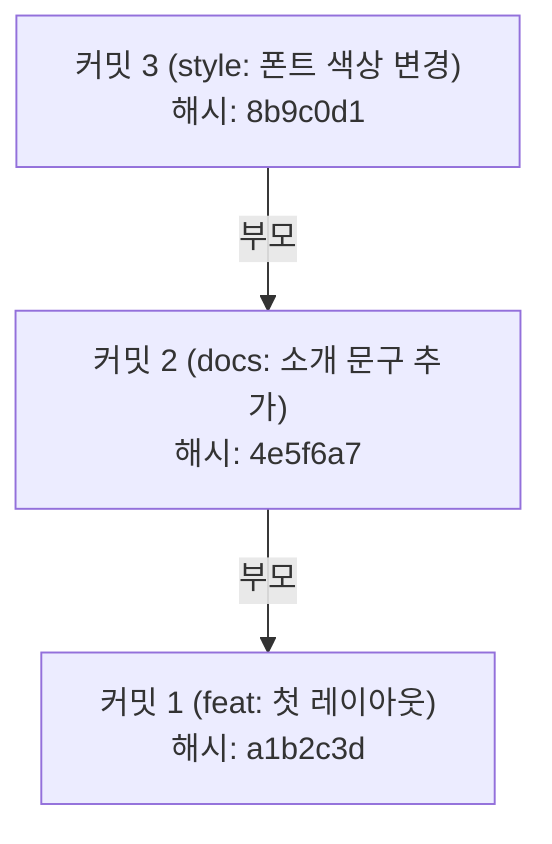

# 커밋과 이력 기록

## 학습 목표

- 스테이징 영역에 올린 파일을 `git commit`으로 [스냅샷](glossary.md#snapshot) 기록으로 남길 수 있다.
- [커밋](glossary.md#commit) [해시](glossary.md#hash)가 무엇을 뜻하는지 설명하고 읽기 쉬운 커밋 메시지를 쓸 수 있다.
- `git log --oneline`과 `git diff`로 변경 이력을 조회할 수 있다.
- 기본 편집기가 열렸을 때 당황하지 않고 저장하거나 빠져나올 수 있다.
- 실수로 스테이징에 올린 파일을 `git restore --staged`로 내릴 수 있다.

## 왜 작업 단위로 기록할까

새로운 기능을 추가하거나 코드를 다듬을 때, 작업 중간중간 확실한 체크포인트를 남겨두어야 한다. 체크포인트는 정상 동작을 확인한 기록이자, 문제가 생겼을 때 되돌아갈 기준점이다.

Git에서 커밋(Commit)은 단순한 파일 저장이 아니다. "특정 시점에 의미 있는 작업 단위가 완성되었음을 선언하고, 그 순간의 전체 프로젝트 모습을 영구적인 스냅샷으로 남기는 행위"이다.

또한 내가 어떤 작업을 왜 수행했는지 한눈에 알 수 있도록 설명해 주는 <strong>커밋 메시지(Commit Message)</strong>를 함께 기록해야 협업하는 동료와 미래의 내가 이력을 쉽게 추적할 수 있다.

<Illustration name="snapshots" alt="작업 중간에 저장한 지점들을 따라 원하는 시점으로 되돌아가는 모습" />

## 커밋 스냅샷과 해시의 원리

커밋에는 기억해 둘 것이 두 가지 있다. 커밋을 구분하는 해시와, 변경 내용을 알려 주는 메시지 규칙이다.

일반 커밋은 부모 커밋이 하나다. 첫 커밋은 부모가 없고, 병합 커밋은 부모가 둘 이상이다. 부모가 있는 커밋은 바로 앞 커밋을 기억하므로 이력이 사슬처럼 이어진다.



1. **커밋 해시 (Commit Hash)**
   - 각 커밋은 작성자, 작성 시간, 파일 내용 등을 종합해 만든 고유한 값인 해시를 가진다. SHA-1 저장소에서는 40자리 16진수 문자열이고, SHA-256 저장소에서는 더 길다.
   - `git log --oneline`은 보통 앞 7자리(예: `a1b2c3d`)를 보여 주지만, 저장소 규모나 설정에 따라 더 길게 표시될 수 있다.
   - 명령에 해시를 직접 넣을 때는 앞 4자리 이상이면 되지만, 그 값이 저장소 안에서 유일해야 한다. 짧을수록 다른 커밋과 겹칠 가능성이 커진다.
2. **커밋 메시지 규칙**
   - 제목은 한 줄로 요약하고, 본문에는 무엇을 왜 바꿨는지 적는다. 대표 접두어와 작성 예시는 [커밋 메시지 규칙](appendix/09-commit-message.md) 부록을 참고한다.

`git commit`에 `-m "메시지"`를 붙이면 명령줄에서 메시지를 바로 넘길 수 있다. `-m`을 빠뜨리면 Git의 기본 편집기(vim, nano 등)가 열려 메시지를 입력하게 된다. vi 화면에서 빠져나오는 법과 VS Code 전환은 [vi 편집기](appendix/08-vi-editor.md) 부록을 참고한다.

`-m` 없이 `git commit`을 실행하면 아래처럼 커밋 메시지를 입력하는 편집기가 열린다. 첫 줄에 메시지를 적고 저장한 뒤 종료한다.

<Screenshot name="step03-commit-editor" alt="vim 커밋 메시지 화면에 `docs: add index`와 스테이징된 `index.html` 안내가 보인다." />

## 웹페이지 수정 코드

STEP 03에서 소개 문구를 보강하고 스타일을 다듬는 수정 예시

::: details 예시 코드 보기

`index.html` 수정 예시: `<main>` 태그 안에 학습 목표 목록을 추가한다.

```html
<!doctype html>
<html lang="ko">
<head>
  <meta charset="utf-8">
  <meta name="viewport" content="width=device-width, initial-scale=1">
  <title>나의 포트폴리오</title>
</head>
<body>
  <main>
    <h1>안녕하세요, 웹 개발 입문자입니다</h1>
    <p>Git과 GitHub를 활용하여 안정적인 형상 관리를 배우고 있습니다.</p>
    <section>
      <h2>현재 학습 목표</h2>
      <ul>
        <li>Git 3단계 영역 이해와 안전한 커밋 남기기</li>
        <li>GitHub Pages를 활용한 정적 웹 배포</li>
      </ul>
    </section>
  </main>
</body>
</html>
```

:::

## 따라하기

1. STEP 02에서 스테이징 영역에 올려둔 파일들을 첫 번째 커밋으로 기록한다:
   `git commit -m "feat: 첫 웹페이지 추가"`
2. `git log --oneline`을 실행하여 첫 번째 커밋의 해시(보통 앞 7자리)와 메시지가 출력되는지 확인한다.
3. VS Code에서 `index.html`을 열고 학습 목표 섹션을 추가한 뒤 저장한다. 수정 예시는 접힌 예시 코드를 참고한다.
4. `git status`를 입력해 `index.html`이 빨간색 `modified` 상태로 감지되는지 확인한다.
5. `git diff`를 실행하여 실제로 어떤 HTML 코드가 추가되었는지 확인한다 (초록색 `+` 줄).
6. `git add index.html`로 스테이징 영역에 올린다.
7. 실수로 올린 상황을 가정하고, 스테이징을 안전하게 해제해 본다:
   `git restore --staged index.html`
8. `git status`로 다시 `Changes not staged for commit:` 상태로 내려갔음을 확인한다.
9. 다시 `git add index.html`을 실행하고 두 번째 커밋을 작성한다:
   `git commit -m "docs: 학습 목표 섹션 및 문구 추가"`
10. `git log --oneline`으로 누적된 2개의 커밋 이력을 확인한다.
11. 깨끗한 작업 트리 상태(`working tree clean`)를 확인한다.

첫 커밋을 만들면 아래처럼 커밋이 만들어졌다는 출력이 나온다. 메시지와 파일 이름은 각자 정한 값으로 나타난다.

<Screenshot name="step02-first-commit" alt="`$ git commit -m &quot;docs: add index&quot;`와 그 커밋이 만들어졌다는 완료 출력이 보인다." />

`git log --oneline`은 커밋을 한 줄씩, 최신 커밋이 위로 오게 보여 준다. 아래는 커밋이 두 개 쌓인 예시다.

<Screenshot name="step03-log-oneline" alt="`$ git log --oneline`에 `docs: add index`와 `feat: add card` 두 커밋이 보인다." />

파일을 수정한 뒤 `git diff`를 실행하면 추가한 줄이 `+`로 표시된다.

<Screenshot name="step03-diff" alt="`$ git diff`에 `index.html`의 추가 줄 `&lt;p>Card&lt;/p>`가 보인다." />

학습 목표 섹션을 추가한 `index.html`을 브라우저에서 열면 목록이 포함된 화면이 보인다. 아래는 비슷한 목록을 넣은 예시 화면이다.

<Screenshot name="step02-local-page" alt="나의 웹페이지 제목과 파일 만들기·첫 커밋 목표 목록" />


## Git 명령

명령 이름이 어떤 뜻인지 알면 외우기 쉽다.

- `commit`: 변경을 이력에 확정해 맡긴다(commit)는 뜻
- `log`: 기록(log)을 시간순으로 읽는다는 뜻
- `diff`: 차이(difference)의 줄임말
- `restore`: 이전 상태로 복원한다는 뜻

명령어 참조: [git add](commands/add.md) · [git commit](commands/commit.md) · [git log](commands/log.md) · [git diff](commands/diff.md) · [git restore](commands/restore.md)

```bash
# 1. 첫 커밋 확정
git commit -m "feat: 첫 웹페이지 추가"

# 2. 한 줄 커밋 이력 조회
git log --oneline

# 3. 작업 공간과 스테이징 영역 비교
git diff
# 스테이징과 최근 커밋은 git diff --staged, 작업 공간과 최근 커밋은 git diff HEAD

# 4. 파일 수정 후 스테이징
git add index.html

# 5. 스테이징 취소 (언스테이징)
git restore --staged index.html

# 6. 재스테이징 및 두 번째 커밋
git add index.html
git commit -m "docs: 학습 목표 섹션 및 문구 추가"

# 7. 상세 커밋 로그 확인
git log
```

### 선택 참고 명령

```bash
# 최근 2개의 커밋 상세 변경 내용 함께 보기
git log -p -2

# 커밋 그래프 형태로 한눈에 보기
git log --oneline --graph --all
```

## 에이전트 요청 예시

```text
커밋 메시지 컨벤션 feat docs style fix 차이 초보자 눈높이 요약
vi 에디터 진입 시 저장 종료 및 취소 종료 키 입력 절차 안내
```

## 체크리스트

- [ ] `git log --oneline` 입력 시 2개의 커밋 해시와 메시지가 시간 역순으로 표시된다.
- [ ] `git status` 입력 시 `nothing to commit, working tree clean` 문구가 출력된다.
- [ ] `git diff`를 통해 수정한 라인이 초록색으로 표시되는 원리를 이해한다.
- [ ] vi에서 편집을 포기할 때는 `:q!`, 커밋 자체를 중단할 때는 `:cq`를 쓴다.

## 트러블 슈팅

| 증상 | 원인 | 대응 |
| --- | --- | --- |
| vi 에디터가 열려 글자가 안 써짐 | `git commit` 시 `-m` 옵션 누락 | 기본 편집기가 vim이면 `i`로 입력 모드에 들어가 메시지를 적고 `Esc`로 돌아온 뒤, 저장하려면 `:wq`, 저장하지 않고 나가려면 `:q!`를 입력한다. `:wq`로 나가도 메시지가 비어 있으면 Git이 커밋을 중단한다. 메시지가 이미 적혀 있으면 `:q!`로도 커밋이 진행될 수 있으므로 확실한 중단은 `:cq`를 쓴다. 자세한 조작법은 [vi 편집기](appendix/08-vi-editor.md) 부록을 참고한다. |
| 커밋 메시지에 오타 발생 | 작성 실수 | 직전 커밋 메시지는 STEP 04에서 배울 `git commit --amend`로 안전하게 수정할 수 있다. |
| `git diff`에 아무것도 안 나옴 | 파일이 이미 `git add` 되었음 | `git diff`는 작업 공간의 변경을 보며, 스테이징된 변경은 `git diff --staged`로 확인한다. |

## 주의할 점

- 커밋 메시지는 "수정 완료", "test", "asdf"처럼 모호하게 적지 말고, 무엇이 바뀌었는지 바로 알 수 있게 기록한다.
- 수업을 마칠 때는 작업 중인 내용을 반드시 커밋해 두거나 저장하여 작업 트리를 안전하게 정리해 둔다.
- 상세한 Git 명령어 옵션은 [명령과 옵션 일람](appendix/02-git-options.md) 부록을 참고한다.

## 복습 퀴즈 <QuizHelp />

1. 커밋 이력을 한 커밋당 한 줄로 요약해 보는 명령은 ::git log --oneline::이다.
2. 커밋은 스테이징한 파일 상태를 ::스냅샷::으로 기록한다.
3. `git commit`에서 `-m` 옵션을 빠뜨리면 ::기본 편집기::가 열린다.
