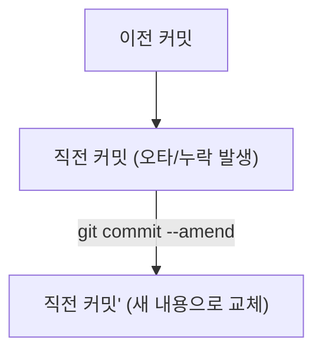
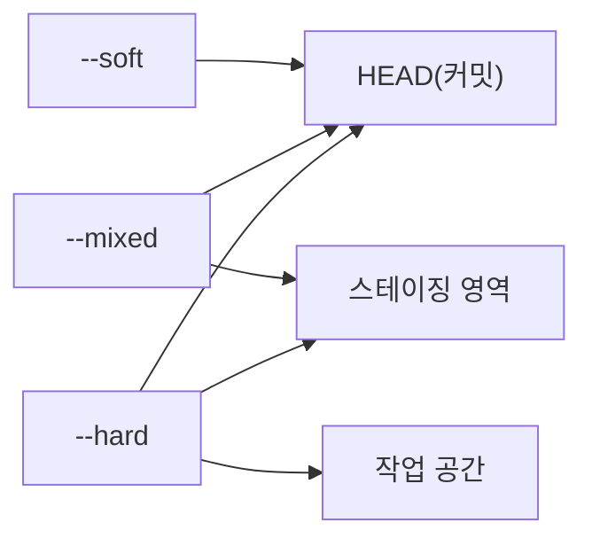
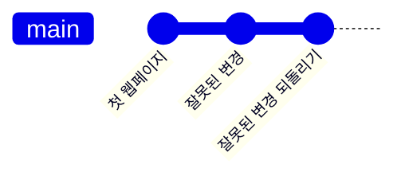

# 되돌리기와 무시 규칙

## 학습 목표

- 방금 작성한 커밋의 메시지 오타나 누락된 파일을 `git commit --amend`로 고칠 수 있다.
- 이미 공유한 커밋은 `git revert`로 취소하고, 로컬에서는 `git reset`의 세 모드 차이에 맞게 되돌릴 수 있다.
- `.gitignore`를 작성해 운영체제 임시 파일, 비밀 키, 캐시 파일이 Git에 기록되지 않게 제외할 수 있다.
- 이미 추적 중인 파일은 인덱스에서 제거해 추적 대상에서 뺄 수 있다.

## 이력을 고치고 제외하는 이유

개발을 하다 보면 누구나 사소한 실수를 한다. 방금 커밋을 마쳤는데 커밋 메시지에 오타가 발견되거나, 깜빡하고 함께 묶었어야 할 스타일 파일 하나를 빠뜨렸을 때가 있다.

이를 매번 새로운 커밋(`"오타 수정"`, `"파일 누락 추가"`)으로 남기면 프로젝트 이력이 지저분해진다. 원격 저장소에 올리기 전인 로컬 커밋이라면, 직전 커밋을 깔끔하게 하나로 합쳐서 수정하는 것이 좋다.

또한 프로젝트 폴더 안에는 Git에 기록하면 안 되는 파일이 생긴다.

- 보안 파일: 비밀번호, 데이터베이스 접속 정보, API 키가 담긴 파일 (`.env` 등)
- 운영체제 임시 파일: macOS의 `.DS_Store`, Windows의 `Thumbs.db` 등
- 편집기·빌드 캐시 파일: 자동 생성되는 로그나 임시 파일 (`*.tmp`, `*.log`)

`.env`에는 API 키나 비밀번호 같은 값이 들어간다. 이 파일을 커밋하면 값이 이력에 남고 공개 저장소에서 노출될 수 있다. 환경 변수와 비밀 정보 관리 방법은 [환경 변수와 비밀 정보](appendix/11-environment-secrets.md) 부록을 참고한다.

이러한 파일들이 한 번이라도 커밋되면 저장소 용량이 불필요하게 커지고 보안 사고로 이어질 수 있다. 따라서 Git이 알아서 무시하도록 미리 가드레일을 걸어 두어야 한다.

## 커밋 교체와 되돌리기

Git에서 과거 이력을 다루는 방법은 목적에 따라 구분된다:



1. **`git commit --amend` (직전 커밋 고치기)**
   - 가장 최근에 만든 커밋의 메시지를 바꾸거나, 새로 수정한 파일을 직전 커밋에 묶어 넣는다.
   - `-m` 없이 실행하면 기본 편집기가 열리고 기존 메시지가 초기값으로 들어 있다. 편집기에서 고쳐 저장하면 새 메시지로 바뀐다. 메시지를 바꾸지 않고 내용만 보충하려면 `--no-edit`을 붙인다.
   - `git commit --amend -m "새 메시지"`는 편집기 없이 메시지를 바로 교체한다. `git commit --amend --no-edit`은 편집기를 열지 않고 기존 메시지를 그대로 쓴다. `-m`은 필수가 아니다.
   - 기존 커밋을 버리고 새로운 해시를 가진 커밋으로 교체한다.
   - **주의**: 아직 GitHub 원격 저장소에 push하지 않은 로컬 커밋에만 사용해야 한다.
2. **`git revert` (안전한 되돌리기 커밋 추가)**
   - 과거 커밋을 지우는 대신, "해당 커밋에서 변경했던 내용을 정반대로 되돌리는 새로운 커밋"을 만든다.
   - 이력이 삭제되지 않고 누적되므로, 이미 원격에 공유된 커밋을 안전하게 취소할 때 사용하는 표준적인 방법이다.
3. **`git reset` (브랜치 위치 되돌리기)**
   - 브랜치가 가리키는 커밋 위치를 과거로 옮긴다. 작업 공간과 스테이징 영역을 어떻게 남길지는 모드로 정한다.
     - `--soft`: 커밋만 취소하고, 수정했던 파일들은 스테이징 영역에 그대로 보존한다.
     - `--mixed` (기본값): 커밋과 스테이징을 취소하고, 작업 공간에 파일 변경 상태를 남겨둔다.
     - `--hard`: **주의!** 작업 공간의 파일 변경 내용까지 전부 강제로 지워버린다.
     - **경고**: `--hard`는 미처 커밋하지 못한 소스코드를 영구적으로 날릴 위험이 있으므로 수업에서는 절대 직접 실행하지 않는다.

### reset 모드 비교

`reset`의 세 모드와 각 모드가 되돌리는 영역



### revert 이력 모양

`revert`로 되돌리는 커밋이 하나 더해지는 이력 모양



## `.gitignore` 작성 규칙

`.gitignore`는 아직 추적하지 않은 파일을 무시한다. 수업에서는 아래 네 줄로 시작한다.

```gitignore
.env*
node_modules/
*.log
!.env.example
```

- `.env`는 이름이 정확히 `.env`인 파일만 막는다. `.env.local`처럼 뒤에 이름이 붙은 파일까지 막으려면 `.env*`를 쓴다. 대신 `.env.example`까지 걸릴 수 있으므로 `!` 예외를 함께 검토한다.
- `!` 예외는 무시 규칙 뒤에 와야 효력이 있다. 순서를 바꾸면 다시 포함되지 않는다.
- 이미 추적 중인 파일은 `.gitignore`에 적어도 계속 추적된다. 저장소에서 빼려면 인덱스에서만 제거하는 `git rm --cached <파일명>`을 쓰거나, 파일 자체를 지워도 될 때는 `git rm <파일명>`을 쓴다. 어느 쪽이든 다음 커밋에 제거가 기록된다.
- 비밀 값이 이미 커밋됐다면 `.gitignore`만으로는 부족하다. 해당 키를 폐기하고 새 값으로 교체(회전)한 뒤 이력 정리 여부를 정한다.

패턴 문법과 예외 처리 전체는 [.gitignore 패턴](appendix/10-gitignore-patterns.md) 부록을 참고한다.

## 따라하기

1. 직전 커밋 메시지에 오타가 있었다고 가정하고 `amend`로 메시지를 수정한다. `--amend -m`은 편집기 없이 메시지를 교체하고, `--amend`만 실행하면 편집기에서 기존 메시지를 고칠 수 있다:
   `git commit --amend -m "docs: 첫 화면 학습 목표 섹션 및 안내 문구 보완"`
2. `git log --oneline`으로 커밋 해시가 새로 갱신되고 메시지가 바뀐 것을 확인한다.
3. 가짜 비밀 파일인 `.env`를 생성해 본다:
   `echo "API_KEY=sample_secret_key_12345" > .env`
4. `git status`를 실행하여 `.env` 파일이 빨간색 Untracked 파일로 나타나는 것을 확인한다.
5. VS Code에서 새 파일 `.gitignore`를 만들고 [.gitignore 패턴](appendix/10-gitignore-patterns.md) 부록의 예시 패턴을 입력한 뒤 저장한다.
6. `git status`를 다시 실행한다. 놀랍게도 방금 보였던 `.env`가 사라지고, 새로 만든 `.gitignore`만 목록에 나타난다.
7. `.gitignore` 파일을 스테이징 영역에 올리고 커밋한다:

   ```bash
   git add .gitignore
   git commit -m "chore: .gitignore 파일 추가"
   ```
8. `git status`로 모든 작업 트리가 깨끗해진 것을 확인한다.

## Git 명령

명령 이름이 어떤 뜻인지 알면 외우기 쉽다.

- `amend`: 고쳐 바로잡는다는 뜻
- `revert`: 되돌린다는 뜻이며, 되돌리는 내용을 새 커밋으로 남긴다.
- `reset`: 이전 상태로 다시 설정한다는 뜻

명령어 참조: [git status](commands/status.md) · [git add](commands/add.md) · [git commit](commands/commit.md) · [git log](commands/log.md) · [git rm](commands/rm.md) · [git revert](commands/revert.md)

```bash
# 1. 직전 커밋 메시지 수정 (편집기에서 기존 메시지 고치기)
git commit --amend

# 2. 편집기 없이 메시지만 교체
git commit --amend -m "docs: 첫 화면 학습 목표 섹션 및 안내 문구 보완"

# 3. 메시지는 그대로 두고 빠뜨린 파일만 보충
git add index.html
git commit --amend --no-edit

# 4. 커밋 갱신 확인
git log --oneline

# 5. 비밀 파일 가상 생성 (테스트)
echo "API_KEY=sample_secret_key_12345" > .env

# 6. 상태 확인 (.env 노출)
git status

# 7. .gitignore 추가 및 커밋
git add .gitignore
git commit -m "chore: .gitignore 파일 추가"

# 8. .env 파일이 여전히 안전하게 무시되는지 확인
git status
```

### 선택 참고 명령

```bash
# 이미 추적된 파일을 Git 관리에서만 제외하고 로컬 파일은 보존할 때
git rm --cached .env

# 공유된 이력을 안전하게 취소하는 새 커밋 생성 (강사 시연 참고)
git revert HEAD
```

## 에이전트 요청 예시

```text
.gitignore에 임시 파일과 캐시 파일 추가
amend와 revert 차이 초보자 눈높이 설명
reset 3가지 모드 soft mixed hard 차이 비교 정리
```

## 체크리스트

- [ ] `git log --oneline`에서 직전 커밋의 메시지가 수정되어 있다.
- [ ] 폴더 안에 `.env` 파일이 실제로 존재하지만 `git status`에 감지되지 않는다.
- [ ] `.gitignore` 파일 자체가 커밋 이력에 성공적으로 기록되어 있다.
- [ ] `reset --hard`가 왜 위험한지 그 이유를 설명할 수 있다.

## 트러블 슈팅

| 증상 | 원인 | 대응 |
| --- | --- | --- |
| `.gitignore`에 적었는데도 파일이 계속 잡힘 | 이전에 이미 `git add` 또는 커밋되어 추적 중임 | `git rm --cached <파일명>`을 실행해 추적 캐시를 해제한 뒤 다시 커밋한다. |
| 원격에 push한 후 `amend`를 실행함 | 원격 이력과 로컬 이력의 불일치 | 이미 원격에 올라간 커밋은 amend하지 말고, 변경 사항을 새 커밋으로 작성하거나 `revert`를 사용한다. |
| 실수로 `git reset --hard`를 생각함 | 작업 파일 유실 위험 | 절대 실행하지 말고, 파일 복원이 필요하면 강사에게 문의한다. |

## 주의할 점

- `reset --hard` 명령은 작업 중이던 파일의 변경을 복구하기 어렵게 지울 수 있으므로 절대 임의로 실행하지 않는다.
- 비밀번호, API 키, 인증 토큰은 절대로 커밋에 포함되어서는 안 되며, 반드시 `.gitignore`로 사전에 보호한다.
- 상세한 Git 옵션과 명령어는 [명령과 옵션 일람](appendix/02-git-options.md) 부록을 참고한다.

## 복습 퀴즈 <QuizHelp />

1. 이미 원격에 공유된 커밋을 안전하게 취소할 때는 ::git revert:: 명령을 사용한다.
2. `reset --hard`는 작업 공간의 변경 내용까지 ::삭제::할 수 있다.
3. `.gitignore`는 아직 추적하지 않는 파일에만 작동하며, 이미 추적 중인 파일은 ::인덱스::에서 제거해야 제외된다.
