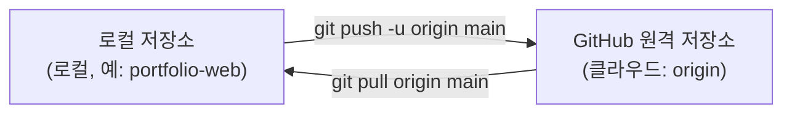
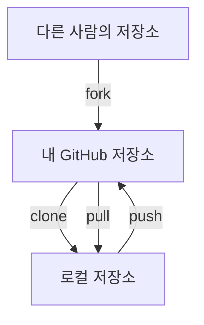

# 원격 저장소와 동기화

## 학습 목표

- GitHub 웹사이트에서 새 빈 [원격 저장소](glossary.md#remote-repository)를 만들 수 있다.
- 로컬 저장소의 브랜치 이름을 확인하고 필요하면 `main`으로 맞출 수 있다.
- `git remote add origin`으로 로컬 저장소와 GitHub 원격 저장소를 연결할 수 있다.
- `git push -u origin main`으로 로컬 커밋을 처음으로 클라우드에 올릴 수 있다.
- `clone`, `pull`, `fork`의 차이를 설명할 수 있다.

## 클라우드 협업이 필요한 이유

지금까지 작성한 커밋과 코드는 로컬 저장소(`.git`)에만 저장되어 있었다. 만약 컴퓨터를 분실하거나 저장 장치에 문제가 생겨 복구하지 못하면 작업물을 잃을 수 있다.

호스팅은 서버에 저장소를 두고 네트워크로 접근할 수 있게 제공하는 것이다. Git 저장소를 호스팅하는 서비스가 **GitHub**이다. 쓰면 좋은 점은 세 가지다.

1. 안전한 원격 백업: 어디서든 다른 PC에서 내 코드를 그대로 복원할 수 있다.
2. 동료와의 협업: 하나의 저장소를 중심으로 여러 사람이 함께 코드를 수정하고 합친다.
3. 배포의 기초: 다음 STEP에서 배울 GitHub Pages로 웹사이트를 무료로 공개하는 바탕이 된다.

## 원격 연결과 동기화 메커니즘

로컬 저장소와 GitHub 원격 저장소는 네트워크로 데이터를 주고받는다.



1. **원격 저장소 별칭 (`origin`)**
   - 긴 웹 URL(`https://github.com/USER/portfolio-web.git`)을 매번 터미널에 타이핑하기 번거로우므로, Git에서는 관례적으로 이 주소에 `origin`이라는 짧은 별칭을 붙여 사용한다.
2. **기본 브랜치 명칭 (`main` vs `master`)**
   - 과거에는 Git의 기본 브랜치 이름으로 `master`를 주로 사용했으나, 포용적 언어 문화의 확산에 따라 현재는 GitHub를 포함한 많은 서비스에서 `main`을 기본 명칭으로 사용한다.
3. **업스트림 등록 (`push -u`)**
   - 업스트림은 로컬 브랜치가 기본으로 변경을 주고받는 원격 브랜치다. 처음 푸시할 때 `-u` (또는 `--set-upstream`) 옵션을 주면, 현재 로컬 `main` 브랜치가 원격 저장소의 `origin/main` 브랜치를 바라보도록 연결 고리를 형성한다. 이후에는 단순히 `git push`나 `git pull`만 입력해도 자동으로 동기화된다.
4. **원격 코드 다루기: clone, pull, fork**
   - **`clone`**: 원격 저장소의 모든 커밋 이력과 코드를 로컬로 통째로 복제해 내려받는다.
   - **`pull`**: 원격 변경을 가져와 설정된 방식으로 통합한다. 이력이 갈라져 있으면 충돌이 나거나 거절될 수 있다.
   - **`fork`**: 다른 사람의 GitHub 저장소를 내 GitHub 계정의 원격 저장소로 복사해 온다 (오픈소스 기여 시 주로 사용).

### 복제와 가져오기

`fork`, `clone`, `pull`로 저장소 사이를 오가는 코드의 방향



## 인증 준비

`git push`는 인증이 필요할 때 GitHub 로그인을 요구한다. 미리 인증했다면 다시 묻지 않을 수 있다. 비밀번호나 토큰을 직접 입력하지 않고 브라우저 로그인으로 인증한다. 원격 저장소를 연결하기 전에 운영체제에 맞게 준비한다.

### macOS

1. [GitHub CLI(`gh`)](https://cli.github.com)를 설치한다. Homebrew를 쓴다면 `brew install gh`를 입력한다. 설치 파일을 쓰려면 [릴리스 페이지](https://github.com/cli/cli/releases/latest)에서 `.pkg` 파일을 받는다. 공식 문서 기준으로 `.pkg`는 서명되지 않은 파일일 수 있어 macOS가 경고할 수 있다. 자세한 방법은 [macOS 설치 안내](https://github.com/cli/cli/blob/trunk/docs/install_macos.md)를 참고한다.
2. 터미널에서 `gh auth login`을 입력하고 `GitHub.com`, `HTTPS`, `Login with a web browser` 순서로 고른다. Git 자격 증명을 함께 설정할지 물으면 `Y`를 입력한다. 일회용 코드는 터미널에 나오고, 그 코드를 브라우저에 입력해 승인한다. 단계별 설명은 [gh auth login 안내](https://cli.github.com/manual/gh_auth_login)를 참고한다.
3. `gh auth status`로 로그인 상태를 확인한다.

### Windows

- Git for Windows에는 Git Credential Manager가 들어 있다. 인증이 필요한 HTTPS 작업에서 브라우저 로그인 창이 뜰 수 있다. 이미 자격 증명이 있으면 창이 뜨지 않을 수 있다. [Git Credential Manager](https://github.com/git-ecosystem/git-credential-manager)와 [GitHub 자격 증명 저장 안내](https://docs.github.com/ko/get-started/git-basics/caching-your-github-credentials-in-git)를 참고한다.
- GitHub CLI(`gh`)가 필요하면 [Windows 설치 안내](https://github.com/cli/cli/blob/trunk/docs/install_windows.md)의 공식 MSI 파일로 설치한 뒤 `gh auth login`을 실행한다. 선택 사항이다.

### 2026년 11월 실습 사례

2026년 11월 5일 Git Credential Manager 창에 GitHub 브라우저 인증 옵션이 표시됐다. 이 로그인 단계 화면과 뒤이은 원격 저장소 결과를 구분해 확인한다. [hello-git의 원격 첫 커밋](https://github.com/ilovejava26/hello-git/commit/bc0db58f2a929105524d08384305aaf89fc0f1cb)에는 `index.html`과 `.gitignore`가 기록되어 있다. [당시 스크린샷](https://github.com/ilovejava26/memo/blob/main/%EC%8A%A4%ED%81%AC%EB%A6%B0%EC%83%B7%202026-11-05%20174216.png)은 인증 완료가 아니라 로그인 방법 선택 단계다.


## 따라하기

1. 브라우저에서 GitHub(github.com)에 로그인한다.
2. 우측 상단의 `+` 아이콘을 누르고 `New repository`를 선택한다.
3. 저장소 정보 입력:
   - **Repository name**: STEP 02에서 만든 폴더 이름과 같게 입력한다(예: `portfolio-web`). 이후 명령의 `portfolio-web`은 각자 정한 이름으로 바꿔 입력한다.
   - **공개 범위**: `Public` 선택
   - **중요 주의사항**: `Add a README file`, `Add .gitignore`, `Choose a license` 등 초기 파일 생성 체크박스를 <strong>모두 해제(체크 없음)</strong>한다. 이미 로컬에 파일이 있으므로 빈 저장소로 만들어야 한다.
   - `Create repository` 초록색 버튼 클릭.
4. 생성된 페이지에서 HTTPS 주소를 확인하고 복사한다 (예: `https://github.com/본인계정/portfolio-web.git`).
5. VS Code 터미널에서 `git branch --show-current`로 브랜치 이름을 확인한다. 이름이 `main`이면 다음 단계로 넘어간다. `master` 등 다른 이름이면 `git branch -m main`으로 이름을 바꾼다. `-m`은 다른 브랜치가 `main`을 쓰고 있으면 거절하므로, 같은 이름이 이미 있을 때는 `-M`으로 덮어쓴다. 이 실습의 뒤 단계는 모두 `main`을 기준으로 한다.
6. 로컬 저장소에 원격 주소를 등록한다:
   `git remote add origin https://github.com/본인계정/portfolio-web.git`
7. 원격 주소가 제대로 등록되었는지 확인한다:
   `git remote -v`
8. 로컬의 커밋들을 원격 저장소로 업로드한다:
   `git push -u origin main`
9. 인증 창이 뜨면 GitHub 로그인을 승인한다. 이미 인증했다면 창이 뜨지 않을 수 있다.
10. GitHub 저장소 웹 페이지를 새로고침한다. 내 로컬에 있던 `index.html`, `.gitignore` 파일과 우리가 작성한 커밋 이력들이 화면에 나타나는 것을 확인한다.

## Git 명령

명령 이름이 어떤 뜻인지 알면 외우기 쉽다.

- `remote`: 멀리 떨어진(원격) 저장소를 뜻한다.
- `origin`: 처음 가져온 출처라는 뜻의 관례적 별칭
- `push`는 원격으로 밀어 올리고, `pull`은 원격에서 끌어오며, `clone`은 통째로 복제한다.

명령어 참조: [git remote](commands/remote.md) · [git clone](commands/clone.md) · [git push](commands/push.md) · [git pull](commands/pull.md) · [git branch](commands/branch.md)

```bash
# 1. 현재 브랜치 이름 확인
git branch --show-current

# 1-1. 이름이 main이 아니면 main으로 정리 (-m은 같은 이름이 있으면 거절, -M은 덮어쓰기)
git branch -m main

# 2. GitHub 원격 저장소 연결 (본인의 계정명으로 입력)
git remote add origin https://github.com/본인계정/portfolio-web.git

# 3. 원격 저장소 목록 및 연결 주소 확인
git remote -v

# 4. 첫 푸시 및 업스트림 등록
git push -u origin main
```

### 원격 등록 실수 대응

`git remote add origin`은 한 번만 입력하지만 실수하기 쉬운 단계다. 흔한 실수는 세 가지다.

| 실수 | 드러나는 모습 | 대응 |
| --- | --- | --- |
| 명령어 철자 오타(예: `git remot add …`) | `git: 'remot' is not a git command.` 오류가 나온다. | 아무것도 등록되지 않았으므로 철자를 고쳐 같은 명령을 다시 입력한다. |
| 원격 이름 오타(예: `orgin`) | 등록은 되지만 `git push -u origin main`에서 `fatal: 'origin' does not appear to be a git repository`가 나온다. | `git remote -v`로 이름을 확인하고 `git remote rename orgin origin`으로 고친다. 이름을 지우고 다시 만들려면 `git remote remove orgin` 뒤에 `git remote add origin 주소`를 입력한다. |
| 주소 오타(계정·저장소 이름) | `git push`에서 `remote: Repository not found.`나 인증 오류가 나온다. | `git remote set-url origin 올바른주소`로 주소만 고치고 `git remote -v`로 확인한다. |

원격을 다루는 명령은 다음 네 가지다.

| 하려는 일 | 명령 |
| --- | --- |
| 조회 | `git remote -v` |
| 삭제 | `git remote remove 이름` |
| 이름 변경 | `git remote rename 옛이름 새이름` |
| 주소 수정 | `git remote set-url 이름 새주소` |

### 선택 참고 명령

```bash
# 원격 저장소의 최신 변경 사항 내려받기
git pull origin main

# 다른 폴더에 저장소를 복제하여 잘 받아와지는지 테스트
cd ..
git clone https://github.com/본인계정/portfolio-web.git portfolio-web-backup
cd portfolio-web
```

### 초기 이력과 오류

GitHub에서 README, LICENSE 또는 .gitignore를 생성하면 원격에 별도 첫 커밋이 생겨 로컬 첫 push가 거절될 수 있다. 기존 파일과 커밋은 보존한다. 원격 저장소를 별도 폴더에 clone한 뒤 로컬 작업 파일을 복사하고 변경을 확인해 커밋하는 방법이 있다. 양쪽 커밋 이력을 모두 유지하려면 이후 [브랜치와 병합](11-merge-conflicts.md)을 배운 뒤 이력을 확인하고 통합한다. 불확실하면 강사에게 문의한다.

`src refspec main does not match any`는 첫 커밋이 없거나 현재 로컬 브랜치 이름이 `main`이 아닐 때 생길 수 있다. 다음 명령으로 상태를 확인한다.

```bash
git status
git log --oneline
git branch --show-current
```

커밋이 없다면 필요한 파일을 추가하고 첫 커밋을 만든다. 브랜치 이름이 다르면 확인한 이름으로 `git push -u origin 브랜치이름`을 사용하거나 이름을 바꿀 필요가 있는지 먼저 판단한다. 이 실습은 따라하기 5번에서 `git branch -m main`으로 이름을 맞춘 뒤 `main`으로 push한다. `-m`은 다른 브랜치가 같은 이름을 쓰고 있으면 거절한다. `git branch -M main`은 같은 이름이 있어도 강제로 바꾸므로, 기존 `main`을 덮어써도 되는지 확인한 뒤에만 사용한다. 두 명령 모두 커밋 내용이나 원격 브랜치는 바꾸지 않는다. 자세한 내용은 [git branch](commands/branch.md)를 참고한다.

빈 GitHub 저장소의 연결과 push는 파일을 원격에 올리는 단계다. 웹 공개는 다음 장의 Pages 설정에서 따로 진행한다.

## 에이전트 요청 예시

```text
GitHub 저장소 생성 및 push 전 확인 체크리스트 작성
clone과 fork 차이 초보자 눈높이 비교 설명
```

## 체크리스트

- [ ] `git remote -v` 실행 시 `origin` 이름으로 fetch, push 두 줄의 올바른 GitHub URL이 표시된다.
- [ ] 브랜치 이름을 확인했고, `main`이 아니었다면 `git branch -m main`으로 정리했다.
- [ ] `git push -u origin main`이 에러 없이 정상 완료된다.
- [ ] 브라우저에서 GitHub 저장소 페이지를 새로고침했을 때 내 파일들과 커밋 목록이 보인다.
- [ ] `git status` 실행 시 `Your branch is up to date with 'origin/main'` 메시지가 나타난다.

## 트러블 슈팅

| 증상 | 원인 | 대응 |
| --- | --- | --- |
| `fatal: remote origin already exists` | 이미 `origin`이라는 이름으로 주소가 등록됨 | `git remote -v`로 확인하고, 주소가 틀렸다면 `git remote set-url origin 올바른주소`로 바꾼다. 다른 실수는 [원격 등록 실수 대응](#원격-등록-실수-대응)을 참고한다. |
| `error: failed to push some refs` (원격에 없는 이력) | 원격 초기화로 README, LICENSE 또는 .gitignore 커밋이 생김 | 원격 이력을 확인하고 아래 안내를 따른다. 강제 push나 삭제로 해결하지 않는다. |
| 인증 실패 또는 403 Forbidden 오류 | 이전 다른 계정의 로그인 정보가 남아 있거나 로그인이 만료됨 | Windows 자격 증명 관리자에서 이전 계정을 삭제하고 재인증한다. 상세 절차는 [자격 증명 재인증](appendix/01-authentication.md)과 [운영체제별 차이](appendix/05-os-differences.md) 부록을 참고한다. |
| 공개 저장소 clone에 인증을 요구 | HTTPS가 일시적으로 인증을 요구할 수 있음 | 인증 후 다시 시도하거나, 공지의 보호 해제를 기다릴 수 있다. |

## 주의할 점

- 비밀번호나 로그인 토큰을 소스 코드 파일, 공개 채팅, 이슈에 남기지 않는다.
- 강제 push는 원격 이력을 덮어쓸 수 있다. 차이는 [git push](commands/push.md)를 참고하고 이 실습에서는 사용하지 않는다.
- 상세한 인증 문제 해결은 [자격 증명 재인증](appendix/01-authentication.md) 부록을 참고한다.

## 복습 퀴즈 <QuizHelp />

1. 로컬 커밋을 원격 저장소에 올리는 명령은 ::git push::이다.
2. 로컬에서 버전을 관리하는 도구는 ::Git::이고, 원격 저장소와 협업을 제공하는 서비스는 GitHub다.
3. `git push -u origin main`에서 `-u`는 로컬 `main`과 원격 ::origin/main::을 기본 연결로 등록한다.
