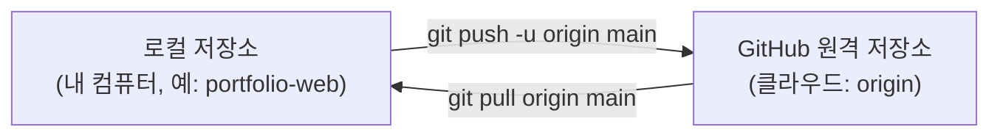
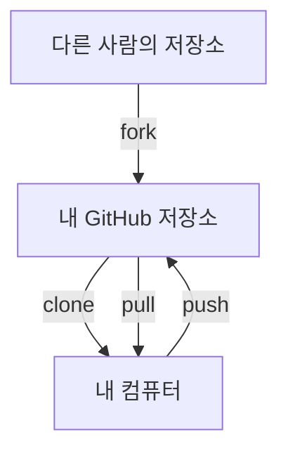

# 원격 저장소와 동기화

## 학습 목표

- GitHub 웹사이트에서 새 빈 원격 저장소를 만들 수 있다.
- 로컬 저장소의 기본 브랜치 이름을 `main`으로 맞출 수 있다.
- `git remote add origin`으로 로컬 저장소와 GitHub 원격 저장소를 연결할 수 있다.
- `git push -u origin main`으로 내 컴퓨터의 커밋을 처음으로 클라우드에 올릴 수 있다.
- `clone`, `pull`, `fork`의 차이를 설명할 수 있다.

## 클라우드 협업이 필요한 이유

지금까지 작성한 커밋과 코드는 내 컴퓨터(`.git`)에만 저장되어 있었다. 만약 컴퓨터를 분실하거나 디스크가 고장 나면 그동안 작성한 작업물이 사라질 수 있다.

클라우드에서 Git 저장소를 호스팅해 주는 서비스가 **GitHub**이다. 쓰면 좋은 점은 세 가지다.

1. 안전한 원격 백업: 어디서든 다른 PC에서 내 코드를 그대로 복원할 수 있다.
2. 동료와의 협업: 하나의 저장소를 중심으로 여러 사람이 함께 코드를 수정하고 합친다.
3. 배포의 기초: 다음 STEP에서 배울 GitHub Pages로 웹사이트를 무료로 공개하는 바탕이 된다.

## 원격 연결과 동기화 메커니즘

로컬 저장소와 GitHub 원격 저장소는 네트워크로 데이터를 주고받는다.



1. **원격 저장소 별칭 (`origin`)**
   - 긴 웹 URL(`https://github.com/USER/portfolio-web.git`)을 매번 터미널에 타이핑하기 번거로우므로, Git에서는 관례적으로 이 주소에 `origin`이라는 짧은 별칭을 붙여 사용한다.
2. **기본 브랜치 명칭 (`main` vs `master`)**
   - 과거에는 Git의 기본 브랜치 이름으로 `master`를 주로 사용했으나, 포용적 언어 문화의 확산에 따라 현재는 GitHub를 포함한 많은 서비스에서 `main`을 기본 명칭으로 사용한다.
3. **업스트림 등록 (`push -u`)**
   - 처음 푸시할 때 `-u` (또는 `--set-upstream`) 옵션을 주면, 현재 로컬 `main` 브랜치가 원격 저장소의 `origin/main` 브랜치를 바라보도록 연결 고리를 형성한다. 이후에는 단순히 `git push`나 `git pull`만 입력해도 자동으로 동기화된다.
4. **원격 코드 다루기: clone, pull, fork**
   - **`clone`**: 원격 저장소의 모든 커밋 이력과 코드를 내 컴퓨터로 통째로 복제하여 다운로드한다.
   - **`pull`**: 원격 저장소에 새로 추가된 최신 커밋들을 내 로컬 브랜치로 가져와 병합한다.
   - **`fork`**: 다른 사람의 GitHub 저장소를 내 GitHub 계정의 원격 저장소로 복사해 온다 (오픈소스 기여 시 주로 사용).

### 복제와 가져오기

`fork`, `clone`, `pull`로 저장소 사이를 오가는 코드의 방향



## 인증 준비

첫 `git push`에서 GitHub가 로그인을 요구한다. 비밀번호나 토큰을 직접 입력하지 않고 브라우저 로그인으로 인증한다. 원격 저장소를 연결하기 전에 운영체제에 맞게 한 번만 준비한다.

### macOS

1. [GitHub CLI(`gh`)](https://cli.github.com)를 설치한다. Homebrew를 쓴다면 `brew install gh`를 입력한다. 설치 파일을 쓰려면 [릴리스 페이지](https://github.com/cli/cli/releases/latest)에서 `.pkg` 파일을 받는다. 공식 문서 기준으로 `.pkg`는 서명되지 않은 파일일 수 있어 macOS가 경고할 수 있다. 자세한 방법은 [macOS 설치 안내](https://github.com/cli/cli/blob/trunk/docs/install_macos.md)를 참고한다.
2. 터미널에서 `gh auth login`을 입력하고 `GitHub.com`, `HTTPS`, `Login with a web browser` 순서로 고른다. Git 자격 증명을 함께 설정할지 물으면 `Y`를 입력한다. 브라우저에 나오는 일회용 코드를 입력해 승인한다. 단계별 설명은 [gh auth login 안내](https://cli.github.com/manual/gh_auth_login)를 참고한다.
3. `gh auth status`로 로그인 상태를 확인한다.

### Windows

- Git for Windows에는 Git Credential Manager가 들어 있다. 첫 `git push`를 하면 브라우저 로그인 창이 뜨며, GitHub 계정으로 로그인해 승인한다. [Git Credential Manager](https://github.com/git-ecosystem/git-credential-manager)와 [GitHub 자격 증명 저장 안내](https://docs.github.com/ko/get-started/git-basics/caching-your-github-credentials-in-git)를 참고한다.
- GitHub CLI(`gh`)가 필요하면 [Windows 설치 안내](https://github.com/cli/cli/blob/trunk/docs/install_windows.md)의 공식 MSI 파일로 설치한 뒤 `gh auth login`을 실행한다. 선택 사항이다.

## 따라하기

1. 브라우저에서 GitHub(github.com)에 로그인한다.
2. 우측 상단의 `+` 아이콘을 누르고 `New repository`를 선택한다.
3. 저장소 정보 입력:
   - **Repository name**: STEP 02에서 만든 폴더 이름과 같게 입력한다(예: `portfolio-web`). 이후 명령의 `portfolio-web`은 각자 정한 이름으로 바꿔 입력한다.
   - **공개 범위**: `Public` 선택
   - **중요 주의사항**: `Add a README file`, `Add .gitignore`, `Choose a license` 등 초기 파일 생성 체크박스를 <strong>모두 해제(체크 없음)</strong>한다. 이미 로컬에 파일이 있으므로 빈 저장소로 만들어야 한다.
   - `Create repository` 초록색 버튼 클릭.
4. 생성된 페이지에서 HTTPS 주소를 확인하고 복사한다 (예: `https://github.com/본인계정/portfolio-web.git`).
5. VS Code 터미널로 돌아와 기본 브랜치 이름을 `main`으로 지정한다:
   `git branch -M main`
6. 로컬 저장소에 원격 주소를 등록한다:
   `git remote add origin https://github.com/본인계정/portfolio-web.git`
7. 원격 주소가 제대로 등록되었는지 확인한다:
   `git remote -v`
8. 로컬의 커밋들을 원격 저장소로 업로드한다:
   `git push -u origin main`
9. 브라우저 로그인 승인 창이 뜨면 GitHub 로그인을 승인한다.
10. GitHub 저장소 웹 페이지를 새로고침한다. 내 로컬에 있던 `index.html`, `style.css`, `.gitignore` 파일과 우리가 작성한 커밋 이력들이 화면에 나타나는 것을 확인한다.

## Git 명령

명령 이름이 어떤 뜻인지 알면 외우기 쉽다.

- `remote`: 멀리 떨어진(원격) 저장소를 뜻한다.
- `origin`: 처음 가져온 출처라는 뜻의 관례적 별칭
- `push`는 원격으로 밀어 올리고, `pull`은 원격에서 끌어오며, `clone`은 통째로 복제한다.

명령어 참조: [git remote](commands/remote.md) · [git clone](commands/clone.md) · [git push](commands/push.md) · [git pull](commands/pull.md) · [git branch](commands/branch.md)

```bash
# 1. 기본 브랜치 이름을 main으로 확실히 지정
git branch -M main

# 2. GitHub 원격 저장소 연결 (본인의 계정명으로 입력)
git remote add origin https://github.com/본인계정/portfolio-web.git

# 3. 원격 저장소 목록 및 연결 주소 확인
git remote -v

# 4. 첫 푸시 및 업스트림 등록
git push -u origin main
```

### 원격 등록 실수 대응

`git remote add origin`은 한 번만 입력하지만 실수하기 쉬운 단계다. 흔한 실수는 세 가지다.

| 실수 | 드러나는 모습 | 대응 |
| --- | --- | --- |
| 명령어 철자 오타(예: `git remot add …`) | `git: 'remot' is not a git command.` 오류가 나온다. | 아무것도 등록되지 않았으므로 철자를 고쳐 같은 명령을 다시 입력한다. |
| 원격 이름 오타(예: `orgin`) | 등록은 되지만 `git push -u origin main`에서 `fatal: 'origin' does not appear to be a git repository`가 나온다. | `git remote -v`로 이름을 확인하고 `git remote rename orgin origin`으로 고친다. 이름을 지우고 다시 만들려면 `git remote remove orgin` 뒤에 `git remote add origin 주소`를 입력한다. |
| 주소 오타(계정·저장소 이름) | `git push`에서 `remote: Repository not found.`나 인증 오류가 나온다. | `git remote set-url origin 올바른주소`로 주소만 고치고 `git remote -v`로 확인한다. |

원격을 다루는 명령은 다음 네 가지다.

| 하려는 일 | 명령 |
| --- | --- |
| 조회 | `git remote -v` |
| 삭제 | `git remote remove 이름` |
| 이름 변경 | `git remote rename 옛이름 새이름` |
| 주소 수정 | `git remote set-url 이름 새주소` |

### 선택 참고 명령

```bash
# 원격 저장소의 최신 변경 사항 내려받기
git pull origin main

# 다른 폴더에 저장소를 복제하여 잘 받아와지는지 테스트
cd ..
git clone https://github.com/본인계정/portfolio-web.git portfolio-web-backup
cd portfolio-web
```

## 에이전트 요청 예시

```text
GitHub 저장소 생성 및 push 전 확인 체크리스트 작성
clone과 fork 차이 초보자 눈높이 비교 설명
```

## 체크리스트

- [ ] `git remote -v` 실행 시 `origin` 이름으로 fetch, push 두 줄의 올바른 GitHub URL이 표시된다.
- [ ] `git push -u origin main`이 에러 없이 정상 완료된다.
- [ ] 브라우저에서 GitHub 저장소 페이지를 새로고침했을 때 내 파일들과 커밋 목록이 보인다.
- [ ] `git status` 실행 시 `Your branch is up to date with 'origin/main'` 메시지가 나타난다.

## 트러블 슈팅

| 증상 | 원인 | 대응 |
| --- | --- | --- |
| `fatal: remote origin already exists` | 이미 `origin`이라는 이름으로 주소가 등록됨 | `git remote -v`로 확인하고, 주소가 틀렸다면 `git remote set-url origin 올바른주소`로 바꾼다. 다른 실수는 [원격 등록 실수 대응](#원격-등록-실수-대응)을 참고한다. |
| `error: failed to push some refs ... (non-fast-forward)` | GitHub에서 빈 저장소를 만들지 않고 README 등을 함께 생성함 | GitHub 저장소를 삭제 후 체크박스를 모두 풀고 빈 저장소로 다시 만들거나 강사에게 문의한다. |
| 인증 실패 또는 403 Forbidden 오류 | 이전 다른 계정의 로그인 정보가 남아 있거나 로그인이 만료됨 | Windows 자격 증명 관리자에서 이전 계정을 삭제하고 재인증한다. 상세 절차는 [자격 증명 재인증](appendix/01-authentication.md)과 [운영체제별 차이](appendix/05-os-differences.md) 부록을 참고한다. |

## 주의할 점

- 비밀번호나 로그인 토큰을 소스 코드 파일, 공개 채팅, 이슈에 남기지 않는다.
- 원격 저장소의 이력을 강제로 덮어쓰는 `git push --force` (또는 `-f`) 명령은 팀원의 작업을 덮어쓸 수 있으므로 절대 실행하지 않는다.
- 상세한 인증 문제 해결은 [자격 증명 재인증](appendix/01-authentication.md) 부록을 참고한다.

## 핵심 내용 퀴즈 <QuizHelp />

1. commit은 ::로컬 기록::이고 push는 ::원격 공유::이다.
2. Git은 ::로컬 버전 관리::이고 GitHub는 ::원격 저장소와 협업 서비스::이다.
