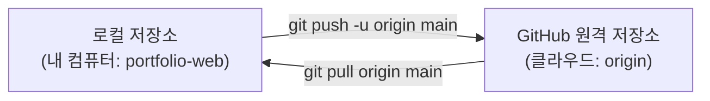

# 원격 저장소와 동기화

## 학습 목표

- GitHub 웹사이트에서 새로운 빈 원격 저장소(`portfolio-web`)를 생성한다.
- 로컬 저장소의 기본 브랜치 이름을 표준인 `main`으로 정렬한다.
- `git remote add origin` 명령으로 로컬 저장소와 GitHub 원격 저장소를 연결한다.
- `git push -u origin main` 명령으로 내 컴퓨터의 커밋들을 클라우드에 처음으로 업로드한다.
- `clone`, `pull`, `fork`의 개념과 차이를 이해한다.

## 클라우드 협업이 필요한 이유

지금까지 우리가 작성한 모든 커밋과 웹 코드는 오직 내 컴퓨터 하드디스크(`.git`)에만 저장되어 있었습니다. 만약 컴퓨터를 분실하거나 하드디스크가 고장 나면 그동안 작성한 모든 작업물이 영구히 사라집니다.

클라우드 기반 Git 저장소 호스팅 서비스인 **GitHub**를 이용하면 다음과 같은 강력한 이점을 얻습니다:
1. **안전한 원격 백업**: 언제 어디서나 다른 PC에서도 내 코드를 그대로 복원할 수 있습니다.
2. **동료와의 협업**: 하나의 저장소를 중심으로 여러 사람이 함께 코드를 수정하고 합칠 수 있습니다.
3. **전 세계 배포의 기초**: 다음 차시에서 배울 GitHub Pages를 통해 전 세계 누구나 접속할 수 있는 웹사이트로 무료 공개할 수 있습니다.

## 원격 연결과 동기화 메커니즘

로컬 저장소와 GitHub 원격 저장소는 네트워크를 통해 다음과 같이 데이터를 주고받습니다:



1. **원격 저장소 별칭 (`origin`)**
   - 긴 웹 URL(`https://github.com/USER/portfolio-web.git`)을 매번 터미널에 타이핑하기 번거로우므로, Git에서는 관례적으로 이 주소에 `origin`이라는 짧은 별칭을 붙여 사용합니다.
2. **기본 브랜치 명칭 (`main` vs `master`)**
   - 과거에는 Git의 기본 브랜치 이름으로 `master`를 주로 사용했으나, 포용적 언어 문화의 확산에 따라 현재는 GitHub를 포함한 모든 현대적 소프트웨어 생태계에서 `main`을 공식 표준 명칭으로 사용합니다.
3. **업스트림 등록 (`push -u`)**
   - 처음 푸시할 때 `-u` (또는 `--set-upstream`) 옵션을 주면, 현재 로컬 `main` 브랜치가 원격 저장소의 `origin/main` 브랜치를 바라보도록 연결 고리를 형성합니다. 이후에는 단순히 `git push`나 `git pull`만 입력해도 자동으로 동기화됩니다.
4. **원격 코드 다루기: clone, pull, fork**
   - **`clone`**: 원격 저장소의 모든 커밋 이력과 코드를 내 컴퓨터로 통째로 복제하여 다운로드합니다.
   - **`pull`**: 원격 저장소에 새로 추가된 최신 커밋들을 내 로컬 브랜치로 가져와 병합합니다.
   - **`fork`**: 다른 사람의 GitHub 저장소를 내 GitHub 계정의 원격 저장소로 복사해 옵니다 (오픈소스 기여 시 주로 사용).

## 따라하기

1. 브라우저에서 GitHub(github.com)에 로그인합니다.
2. 우측 상단의 `+` 아이콘을 누르고 `New repository`를 선택합니다.
3. 저장소 정보 입력:
   - **Repository name**: 반드시 `portfolio-web` 입력
   - **공개 범위**: `Public` 선택
   - **중요 주의사항**: `Add a README file`, `Add .gitignore`, `Choose a license` 등 초기 파일 생성 체크박스를 <strong>모두 해제(체크 없음)</strong>합니다. 이미 로컬에 파일이 있으므로 반드시 완전한 빈 저장소여야 합니다.
   - `Create repository` 초록색 버튼 클릭.
4. 생성된 페이지에서 HTTPS 주소를 확인하고 복사합니다 (예: `https://github.com/본인계정/portfolio-web.git`).
5. VS Code 터미널로 돌아와 기본 브랜치 이름을 `main`으로 지정합니다:
   `git branch -M main`
6. 로컬 저장소에 원격 주소를 등록합니다:
   `git remote add origin https://github.com/본인계정/portfolio-web.git`
7. 원격 주소가 제대로 등록되었는지 확인합니다:
   `git remote -v`
8. 로컬의 커밋들을 원격 저장소로 업로드합니다:
   `git push -u origin main`
9. 브라우저 로그인 승인 창이 뜨면 GitHub 로그인을 승인합니다.
10. GitHub 저장소 웹 페이지를 새로고침합니다. 내 로컬에 있던 `index.html`, `style.css`, `.gitignore` 파일과 우리가 작성한 커밋 이력들이 화면에 나타나는 것을 확인합니다.

## Git 명령

```bash
# 1. 기본 브랜치 이름을 main으로 확실히 지정
git branch -M main

# 2. GitHub 원격 저장소 연결 (본인의 계정명으로 입력)
git remote add origin https://github.com/본인계정/portfolio-web.git

# 3. 원격 저장소 목록 및 연결 주소 확인
git remote -v

# 4. 첫 푸시 및 업스트림 등록
git push -u origin main
```

### 선택 참고 명령

```bash
# 원격 저장소의 최신 변경 사항 내려받기
git pull origin main

# 다른 폴더에 저장소를 복제하여 잘 받아와지는지 테스트
cd ..
git clone https://github.com/본인계정/portfolio-web.git portfolio-web-backup
cd portfolio-web
```

## 에이전트 요청 예시

```text
GitHub 저장소 생성 및 push 전 확인 체크리스트 작성
clone과 fork 차이 초보자 눈높이 비교 설명
```

## 체크리스트

- [ ] `git remote -v` 실행 시 `origin` 이름으로 fetch, push 두 줄의 올바른 GitHub URL이 표시된다.
- [ ] `git push -u origin main`이 에러 없이 정상 완료된다.
- [ ] 브라우저에서 GitHub 저장소 페이지를 새로고침했을 때 내 파일들과 커밋 목록이 보인다.
- [ ] `git status` 실행 시 `Your branch is up to date with 'origin/main'` 메시지가 나타난다.

## 트러블 슈팅

| 증상 | 원인 | 대응 |
| --- | --- | --- |
| `fatal: remote origin already exists` | 이미 `origin`이라는 이름으로 주소가 등록됨 | `git remote -v`로 확인하고, 주소가 틀렸다면 `git remote set-url origin <올바른주소>`로 변경한다. |
| `error: failed to push some refs ... (non-fast-forward)` | GitHub에서 빈 저장소를 만들지 않고 README 등을 함께 생성함 | GitHub 저장소를 삭제 후 체크박스를 모두 풀고 빈 저장소로 다시 만들거나 강사에게 문의한다. |
| 인증 실패 또는 403 Forbidden 오류 | 이전 다른 계정 자격 증명이 남아있거나 토큰 만료 | Windows 자격 증명 관리자에서 이전 계정을 삭제하고 재인증한다. 상세 절차는 [부록 1](appendix/01-authentication.md)과 [부록 5](appendix/05-os-differences.md)를 참조한다. |

## 주의할 점

- Personal Access Token이나 비밀번호를 절대 소스 코드 파일이나 공개 채팅, 이슈에 남기지 않습니다.
- 원격 저장소의 이력을 강제로 덮어쓰는 `git push --force` (또는 `-f`) 명령은 팀원의 작업을 파괴할 수 있으므로 절대 실행하지 않습니다.
- 상세한 인증 문제 해결은 [부록 1. Windows 자격 증명 삭제와 GitHub 재인증](appendix/01-authentication.md)을 참조합니다.
- 추가 심화 실습은 [보충안 심화](supplement/01-advanced-practice.md), 복습 퀴즈는 [보충안 퀴즈](supplement/02-review-quiz.md), 에이전트 주도 Git은 [보충안 에이전트](supplement/03-agent-led-git.md)에서 다룹니다.
