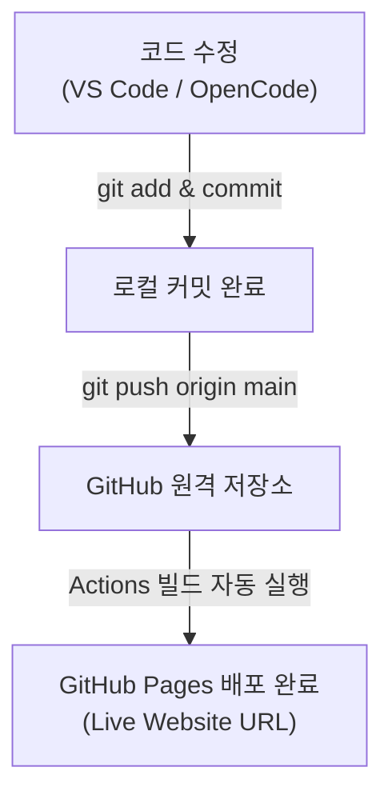
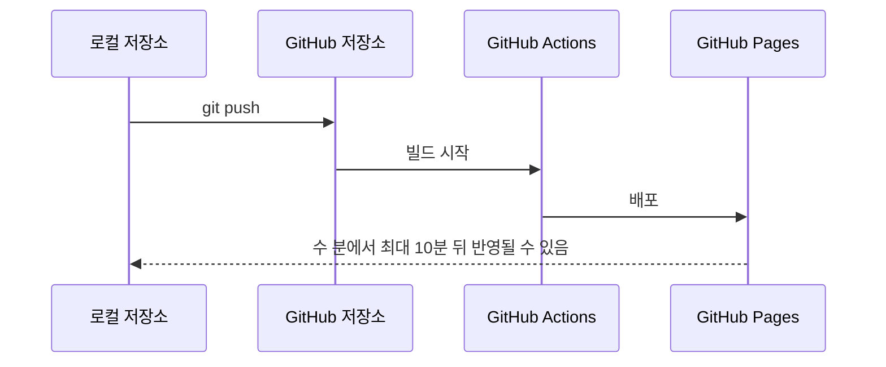

# 웹사이트 배포

## 학습 목표

- [GitHub Pages](glossary.md#github-pages)를 켜서 포트폴리오 웹사이트를 무료로 공개할 수 있다.
- 인터넷에서 접속할 수 있는 사이트 URL(`https://계정이름.github.io/저장소이름/`)을 확인할 수 있다.
- OpenCode로 웹페이지 하단에 푸터(연락처·저작권)를 추가하고, `push`하면 배포 사이트가 자동으로 갱신되는 흐름을 확인할 수 있다.
- 폰트·색상·파비콘과 Open Graph의 역할을 설명하고 폰트 라이선스를 확인할 수 있다.

## 정적 웹 배포의 목적

HTML 파일을 브라우저로 바로 열면 주소창에 인터넷 주소 대신 지금 쓰는 PC 안의 파일 경로가 표시된다. 이 PC에서만 열리는 주소라서 외부에 공유해도 상대방 컴퓨터에서는 열리지 않는다.

[정적 웹](glossary.md#static-web)은 서버가 요청마다 페이지를 새로 만들지 않고 준비된 HTML·CSS·이미지 등의 파일을 제공하는 웹사이트다. GitHub Pages로 정적 웹을 공개할 수 있다. 다른 배포 서비스는 [웹 디자인·배포 도구](appendix/03-web-tools.md#배포-서비스)에서 살펴본다.

설정된 게시 브랜치에 적절한 권한으로 `push`하면 GitHub가 변경을 감지해 사이트를 갱신할 수 있다. `GITHUB_TOKEN`으로 푸시한 커밋은 Pages 빌드를 시작하지 않을 수 있다. 이 흐름이 <strong>지속적 배포(Continuous Deployment)</strong>의 기초다.

<Illustration name="publish" alt="나만 열 수 있는 집에서 누구나 볼 수 있는 광장의 게시판으로 사이트가 공개되는 모습" />

## 링크 미리보기

링크를 공유하면 서비스가 페이지의 제목·설명·이미지를 먼저 보여 준다. 이 미리보기 값을 정하는 meta 태그가 Open Graph다. `index.html`의 `<head>`에 `og:title`·`og:description`·`og:image`·`og:url`을 넣으면 카카오톡·X 같은 서비스가 이 값을 읽어 미리보기를 만든다.

태그 설명은 [Open Graph 프로토콜](https://ogp.me/)을 참고한다. 카카오톡 공유 미리보기는 [카카오 공유 디버거](https://developers.kakao.com/tool/debugger/sharing)에서 확인할 수 있으며 로그인이 필요하다.

### OpenCode 요청

OpenCode에 아래 요청문을 입력한다. 오른쪽 위의 복사 버튼으로 복사할 수 있다.

```text
index.html head에 Open Graph 메타 태그 추가.
og:title·og:description·og:image·og:url 포함.
이미지는 저장소의 images 폴더 파일 사용.
```

::: details 예시 코드 보기

`index.html`의 `<head>` 예시:

```html
<meta property="og:title" content="나의 포트폴리오">
<meta property="og:description" content="Git과 GitHub로 만든 첫 웹사이트">
<meta property="og:image" content="https://계정이름.github.io/portfolio-web/images/preview.png">
<meta property="og:url" content="https://계정이름.github.io/portfolio-web/">
```

`og:image`에는 외부에서 접근할 수 있는 전체 URL을 넣는다.

:::

## 호스팅 원리와 자동 재배포

설정된 게시 브랜치에 권한 있는 계정으로 `push`하면 Pages가 사이트를 갱신할 수 있다.



1. **호스팅 진입점 (`index.html`)**
   - 이 실습은 지정된 브랜치(`main`) 루트의 `index.html`을 첫 화면으로 쓴다. Pages는 `index.md`와 `README.md`도 진입점으로 찾는다. 파일명은 소문자다.
2. **배포 주소 체계**
   - 기본적으로 `https://<GitHub계정명>.github.io/<저장소이름>/` 형식의 고유 주소가 생성된다.
   - 본 실습의 주소는 `https://<GitHub계정명>.github.io/<저장소이름>/` 형태가 된다. 예시 저장소 이름은 `portfolio-web`이다.
3. **자동 재배포 주기**
   - 로컬에서 코드를 고친 뒤 게시 브랜치에 `push`하면 GitHub Actions가 빌드할 수 있다. 반영은 수 분에서 최대 10분이 걸릴 수 있다. Actions 상태와 Pages 설정을 확인한다.

### 배포 시간 순서

`push`부터 사이트 반영까지의 배포 순서



### 디자인 보조 도구

폰트는 글자의 모습을, 색상은 화면의 분위기와 가독성을 정한다. 파비콘은 브라우저 탭의 아이콘이고 Open Graph는 공유할 때 보이는 제목·설명·이미지를 정한다. 보조 도구와 적용 방법은 [웹 디자인·배포 도구](appendix/03-web-tools.md)를 참고한다. 폰트마다 사용 범위가 다르므로 개별 라이선스를 확인한다.

## 푸터 추가 코드

실시간 배포 갱신 실습을 위해 `index.html` 하단에 추가할 푸터 마크업과 스타일 예시

::: details 예시 코드 보기

`index.html` 하단 예시:

```html
<!-- </main> 닫는 태그 바로 아래에 추가 -->
<footer>
  <p>© 2026 나의 포트폴리오. All rights reserved.</p>
  <p>문의: your-email@example.com</p>
</footer>
```

`style.css` 하단 예시:

```css
footer {
  max-width: 680px;
  margin: 1.5rem auto 3rem auto;
  text-align: center;
  font-size: 0.875rem;
  color: #777777;
  border-top: 1px solid #e5e7eb;
  padding-top: 1.5rem;
}
```

:::

## 따라하기

1. 브라우저에서 GitHub의 `portfolio-web` 저장소 페이지를 연다.
2. 상단 탭 메뉴에서 `Settings`를 클릭한다.
3. 좌측 사이드바 메뉴에서 `Pages`를 클릭한다.
4. `Build and deployment` 영역의 설정을 진행한다:
   - **Source**: `Deploy from a branch` 선택 상태 유지
   - **Branch**: 드롭다운에서 `None`을 클릭하여 `main`으로 변경한다. 목록에 `main`이 없으면 [STEP 05](05-remote.md)의 브랜치 이름 확인으로 돌아간다.
   - **Folder**: `/(root)` 선택 상태 유지
   - 우측의 `Save` 버튼을 클릭한다.
5. 배포가 시작되면 알림이 뜰 수 있다. 공식 화면의 확인 링크는 `Visit site`다. 색과 문구는 계정 화면에 따라 다를 수 있다. 수 분에서 최대 10분 뒤 새로고침해 사이트 주소를 확인한다.
6. 제공된 배포 링크(`https://계정이름.github.io/portfolio-web/`)를 새 탭에서 열어 내 사이트가 정상적으로 열리는지 확인한다.
7. VS Code로 돌아와 푸터 HTML을 추가하고 저장한다. CSS를 적용하려면 `style.css`를 만들고 HTML에서 연결한다. 예시는 접힌 예시 코드를 참고한다.
8. 터미널에서 변경 사항을 커밋하고 푸시한다. CSS 파일을 만들었다면 아래 코드 블록의 주석을 풀어 `git add style.css`도 실행한다:

   ```bash
   git add index.html
   # style.css를 만들었다면 아래 줄의 주석을 풀고 실행한다
   # git add style.css
   git commit -m "feat: 푸터 연락처 및 저작권 영역 추가"
   git push origin main
   ```
9. GitHub 저장소 상단의 `Actions` 탭을 클릭하여 `pages build and deployment` 워크플로가 돌아가는 것을 확인한다.
10. Actions에서 성공 표시를 확인한 뒤, 브라우저의 배포 URL 탭을 강력 새로고침(`Ctrl + Shift + R` 또는 `Cmd + Shift + R`)하여 푸터가 반영되었는지 확인한다. 반영까지 최대 10분이 걸릴 수 있다.

배포가 끝난 사이트는 누구나 공개 주소로 열 수 있다. 아래는 이 과정 사이트의 첫 화면으로, 공개 주소로 열리는 정적 사이트의 예시다. 내 사이트는 `https://계정이름.github.io/portfolio-web/` 주소에서 직접 만든 페이지로 열린다.

<Screenshot name="step06-public-page" alt="과정 사이트 예시: Go Git 과정의 제목과 표지, 왼쪽 강의 목차" />


## Git 명령

명령어 참조: [git status](commands/status.md) · [git add](commands/add.md) · [git commit](commands/commit.md) · [git push](commands/push.md)

```bash
# 1. 파일 변경 상태 확인
git status

# 2. 변경된 파일 스테이징
git add index.html
# style.css를 만들었다면 아래 줄의 주석을 풀고 실행
# git add style.css

# 3. 커밋 생성
git commit -m "feat: 푸터 연락처 및 저작권 영역 추가"

# 4. 원격 저장소로 푸시 (자동 배포 트리거)
git push origin main
```

## 에이전트 요청 예시

```text
index.html 하단 연락처 이메일과 카피라이트 푸터 HTML 추가
Coolors 색상 코드 추천 및 배경 포인트 색상 적용
```

## 2026년 11월 실습 사례

[실습 기록](https://github.com/ilovejava26/memo/blob/main/261106.md)에서는 11월 6일 `index.html`을 만든 뒤 `ilovejava26.github.io` 저장소에 `git push -u origin main`으로 올렸다. [소스 파일](https://github.com/ilovejava26/ilovejava26.github.io/blob/main/index.html)과 [공개 사이트](https://ilovejava26.github.io/)를 비교해 본다. 계정 사이트 저장소는 주소에 저장소 이름이 반복되지 않는다.


화면에서 배포 소스 `main`과 `/(root)`, 공개 주소를 확인할 수 있다. 화면 출처: [memo 스크린샷](https://github.com/ilovejava26/memo/blob/main/%EC%8A%A4%ED%81%AC%EB%A6%B0%EC%83%B7%202026-11-06%20135451.png).

## 체크리스트

- [ ] GitHub Pages 설정에서 Branch가 `main` / `/(root)`로 저장되어 있다.
- [ ] 브라우저에서 `https://<계정이름>.github.io/portfolio-web/` 접속 시 첫 웹페이지가 정상 출력된다.
- [ ] 게시 브랜치에 `git push`한 뒤 Actions와 Pages를 확인하고, 새로고침했을 때 수정 내용이 라이브 사이트에 반영된다.
- [ ] GitHub `Actions` 탭에서 배포 빌드 작업의 성공(초록색 체크)을 확인할 수 있다.

## 트러블 슈팅

| 증상 | 원인 | 대응 |
| --- | --- | --- |
| 배포 주소에서 404 Not Found 발생 | 배포 빌드 진행 중이거나 브랜치 설정 미저장 | Settings → Pages에서 Branch가 `main`으로 저장되었는지 확인하고 Actions 상태를 본다. 최대 10분까지 걸릴 수 있다. |
| 첫 화면 파일 인식 불가 | 파일명이 대문자이거나 진입점이 없음 | 이 실습은 소문자 `index.html`을 쓴다. Pages는 `index.md`·`README.md`도 진입점으로 찾는다. |
| push 후에도 사이트 내용이 안 바뀜 | 브라우저 캐시로 인해 이전 버전 표시 | 브라우저 강력 새로고침(`Ctrl + F5` 또는 `Ctrl + Shift + R`)을 누르거나 시크릿 창에서 접속한다. |
| CSS 스타일이 적용되지 않고 깨짐 | `link` 태그의 CSS 파일 경로 오류 | `<link rel="stylesheet" href="style.css">`처럼 같은 폴더 상대 경로로 지정되었는지 확인한다. |

## 주의할 점

- GitHub Pages로 배포된 사이트는 인터넷에 공개되는 웹페이지이다. 개인 휴대폰 번호, 개인 이메일, 집 주소, 이력서 PDF에 적힌 생년월일·연락처, 사진의 위치 정보(EXIF), 회사·학교 내부 자료처럼 민감한 정보를 올리지 않는다.
- 눈누 사이트 등에서 웹폰트를 가져올 때는 라이선스 표기 및 상업적/비상업적 허용 범위를 반드시 확인한다. 세부 안내는 [웹 디자인·배포 도구](appendix/03-web-tools.md) 부록을 참고한다.
- 카카오톡·X 등은 링크 미리보기를 캐시하므로 Pages를 고쳐도 한동안 예전 미리보기가 보일 수 있다. 카카오톡은 [공유 디버거](https://developers.kakao.com/tool/debugger/sharing)에서 캐시를 초기화한 뒤 확인한다.

## 복습 퀴즈 <QuizHelp />

1. 요청마다 새 페이지를 만들지 않고 준비된 파일을 제공하는 웹사이트는 ::정적 웹::이다.
2. 워크플로를 설정하면 저장소에 push할 때 사이트 빌드와 배포를 자동 실행할 수 있는 GitHub 기능은 ::GitHub Actions::이다.
3. 이 실습에서 GitHub Pages 첫 화면으로 쓰는 파일은 ::index.html::이다.
