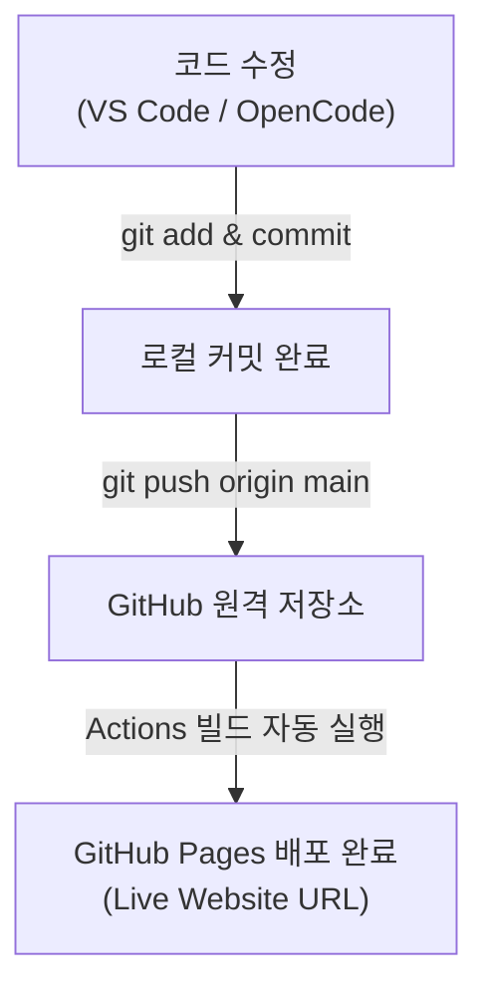
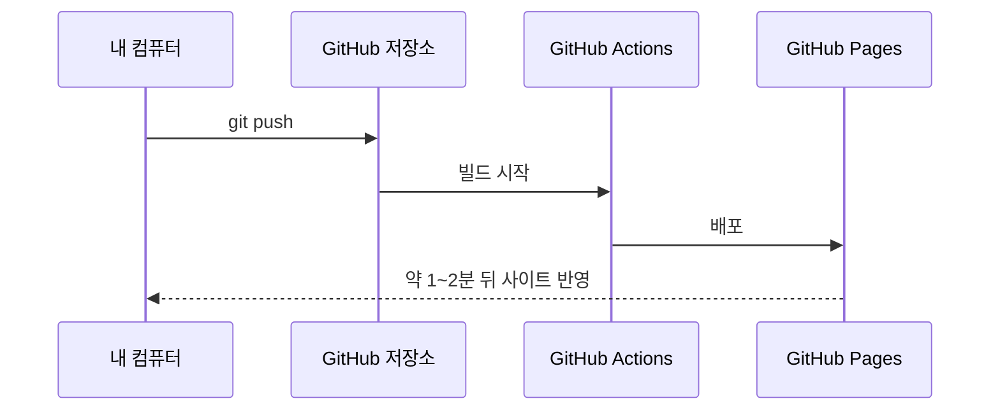

# 웹사이트 배포

## 학습 목표

- GitHub Pages 호스팅 서비스를 활성화하여 내 포트폴리오 웹사이트를 무료 공개 주소로 배포한다.
- 인터넷에서 접속할 수 있는 라이브 사이트 URL(`https://계정이름.github.io/저장소이름/`)을 확인한다.
- OpenCode로 웹페이지 하단 푸터(연락처 및 저작권)를 추가하고, 변경 사항을 push하여 배포 사이트가 자동으로 갱신되는 파이프라인을 체득한다.
- 디자인 보조 도구인 눈누(무료 폰트)와 Coolors(색상 조합)를 소개하고 폰트 라이선스 확인 원칙을 배운다.

## 정적 웹 배포의 목적

내가 내 컴퓨터에서 개발한 웹페이지는 주소창에 `file:///` 또는 `http://localhost:5500`으로 뜬다. 이는 오직 내 컴퓨터 안에서만 볼 수 있는 로컬 주소이므로, 친구나 채용 담당자에게 링크를 보내주어도 상대방 컴퓨터에서는 열리지 않는다.

내 웹사이트를 전 세계에 공개하려면 인터넷 서버 컴퓨터를 빌리고 도메인을 연결해야 하지만, HTML·CSS·이미지로 구성된 정적 웹(Static Web)은 GitHub가 제공하는 **GitHub Pages** 서비스를 이용하면 무료로 공개할 수 있다.

또한 Git으로 코드를 수정하고 원격 저장소에 `push`하기만 하면, GitHub가 변경된 코드를 자동으로 감지하여 실제 운영 웹사이트를 최신 내용으로 알아서 갈아 끼워주는 <strong>지속적 배포(Continuous Deployment)</strong>의 기초를 경험할 수 있다.

## 호스팅 원리와 자동 재배포

GitHub Pages는 다음과 같은 자동화 흐름으로 동작한다:



1. **호스팅 진입점 (`index.html`)**
   - GitHub Pages는 지정된 브랜치(`main`)의 루트 폴더에 위치한 `index.html` 파일을 첫 대문 페이지로 인식하여 웹 브라우저에 서비스한다. 파일명이 소문자 `index.html`이어야 올바르게 동작한다.
2. **배포 주소 체계**
   - 기본적으로 `https://<GitHub계정명>.github.io/<저장소이름>/` 형식의 고유 주소가 생성된다.
   - 본 실습의 주소는 `https://<GitHub계정명>.github.io/<저장소이름>/` 형태가 된다. 예시 저장소 이름은 `portfolio-web`이다.
3. **자동 재배포 주기**
   - 로컬에서 코드를 고친 뒤 `push`하면, GitHub 내부의 배포 자동화 로봇(GitHub Actions)이 동작하여 약 1~2분 안에 실제 사이트에 반영한다.

### 배포 시간 순서

`push`부터 사이트 반영까지는 아래 순서로 진행된다.



### 눈누와 Coolors
포트폴리오 웹페이지를 가꿀 때 유용한 참고 도구이다:
- **눈누 (noonnu.com)**: 다양한 한글 폰트를 미리 보고 웹폰트 코드를 복사할 수 있는 사이트이다.
  - **주의**: 눈누의 폰트들이 일괄 상업적 무료인 것은 아니다. 폰트마다 인쇄용, 웹 임베드, BI/CI 등 허용 범위가 다르므로 프로젝트 적용 전 개별 라이선스를 반드시 확인해야 한다.
- **Coolors (coolors.co)**: 어울리는 색상 팔레트를 탐색하고 HEX 색상 코드(예: `#1a73e8`)를 추천받는 도구이다.
- 자세한 사용법과 적용 안내는 [웹 디자인 보조 도구](appendix/03-web-tools.md) 부록을 참조한다.

## 푸터 추가 코드

실시간 배포 갱신 실습을 위해 `index.html` 하단에 추가할 푸터 마크업과 스타일이다.

### `index.html` 하단

```html
<!-- </main> 닫는 태그 바로 아래에 추가 -->
<footer>
  <p>© 2026 나의 포트폴리오. All rights reserved.</p>
  <p>문의: your-email@example.com</p>
</footer>
```

### `style.css` 하단

```css
footer {
  max-width: 680px;
  margin: 1.5rem auto 3rem auto;
  text-align: center;
  font-size: 0.875rem;
  color: #777777;
  border-top: 1px solid #e5e7eb;
  padding-top: 1.5rem;
}
```

## 따라하기

1. 브라우저에서 GitHub의 `portfolio-web` 저장소 페이지를 연다.
2. 상단 탭 메뉴에서 `Settings`를 클릭한다.
3. 좌측 사이드바 메뉴에서 `Pages`를 클릭한다.
4. `Build and deployment` 영역의 설정을 진행한다:
   - **Source**: `Deploy from a branch` 선택 상태 유지
   - **Branch**: 드롭다운에서 `None`을 클릭하여 `main`으로 변경
   - **Folder**: `/(root)` 선택 상태 유지
   - 우측의 `Save` 버튼을 클릭한다.
5. 페이지 상단에 파란색/초록색 알림 상자가 뜨며 배포가 시작된다. 약 1~2분 후 새로고침하면 `Your site is live at https://...` 링크가 표시된다.
6. 제공된 배포 링크(`https://계정이름.github.io/portfolio-web/`)를 새 탭에서 열어 내 사이트가 정상적으로 열리는지 확인한다.
7. VS Code로 돌아와 OpenCode 또는 직접 편집으로 위의 푸터 HTML과 CSS 코드를 추가하고 저장한다.
8. 터미널에서 변경 사항을 커밋하고 푸시한다:
   `git add index.html style.css`
   `git commit -m "feat: 푸터 연락처 및 저작권 영역 추가"`
   `git push origin main`
9. GitHub 저장소 상단의 `Actions` 탭을 클릭하여 `pages build and deployment` 워크플로가 돌아가는 것을 확인한다.
10. 초록색 체크 표시가 뜨면(약 1분 소요), 브라우저의 배포 URL 탭을 강력 새로고침(`Ctrl + Shift + R` 또는 `Cmd + Shift + R`)하여 푸터가 반영되었는지 확인한다.

## Git 명령

명령어 참조: [git status](commands/status.md) · [git add](commands/add.md) · [git commit](commands/commit.md) · [git push](commands/push.md)

```bash
# 1. 파일 변경 상태 확인
git status

# 2. 변경된 파일 스테이징
git add index.html style.css

# 3. 커밋 생성
git commit -m "feat: 푸터 연락처 및 저작권 영역 추가"

# 4. 원격 저장소로 푸시 (자동 배포 트리거)
git push origin main
```

## 에이전트 요청 예시

```text
index.html 하단 연락처 이메일과 카피라이트 푸터 HTML/CSS 추가
Coolors 색상 코드 추천 및 배경 포인트 색상 적용
```

## 체크리스트

- [ ] GitHub Pages 설정에서 Branch가 `main` / `/(root)`로 저장되어 있다.
- [ ] 브라우저에서 `https://<계정이름>.github.io/portfolio-web/` 접속 시 첫 웹페이지가 정상 출력된다.
- [ ] 코드를 고치고 `git push`한 후 약 1~2분 뒤 새로고침했을 때 수정된 내용이 라이브 사이트에 반영된다.
- [ ] GitHub `Actions` 탭에서 배포 빌드 작업의 성공(초록색 체크)을 확인할 수 있다.

## 트러블 슈팅

| 증상 | 원인 | 대응 |
| --- | --- | --- |
| 배포 주소에서 404 Not Found 발생 | 배포 빌드 진행 중이거나 브랜치 설정 미저장 | Settings → Pages에서 Branch가 `main`으로 저장되었는지 확인하고 2~3분 기다린 뒤 다시 접속한다. |
| 첫 화면 파일 인식 불가 | 파일명이 대문자이거나 이름이 다름 | 파일명이 반드시 소문자 `index.html`인지 확인한다. |
| push 후에도 사이트 내용이 안 바뀜 | 브라우저 캐시로 인해 이전 버전 표시 | 브라우저 강력 새로고침(`Ctrl + F5` 또는 `Ctrl + Shift + R`)을 누르거나 시크릿 창에서 접속한다. |
| CSS 스타일이 적용되지 않고 깨짐 | `link` 태그의 CSS 파일 경로 오류 | `<link rel="stylesheet" href="style.css">`처럼 같은 폴더 상대 경로로 지정되었는지 확인한다. |

## 주의할 점

- GitHub Pages로 배포된 사이트는 인터넷에 공개되는 웹페이지이다. 개인 휴대폰 번호, 주민등록번호, 실제 집 주소 등 민감한 개인정보를 올리지 않는다.
- 눈누 사이트 등에서 웹폰트를 가져올 때는 라이선스 표기 및 상업적/비상업적 허용 범위를 반드시 확인한다. 세부 안내는 [웹 디자인 보조 도구](appendix/03-web-tools.md) 부록을 참조한다.
- Day 1의 STEP 01~06 공식 일정이 완료되었다.
- Day 2에는 Markdown 문서화, Issue 관리, 브랜치와 Pull Request 협업을 이어간다.

## 퀴즈 풀기

빈칸을 누르거나 Enter·Space 키를 눌러 정답을 확인한다.

1. GitHub Pages 변경 반영은 ::Pages URL::과 저장소의 ::Actions/Pages 상태::에서 확인한다.
