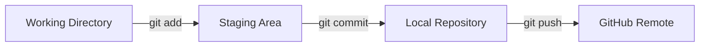

# 마크다운과 다이어그램

## 학습 목표

- 프로젝트 얼굴인 `README.md`를 Markdown으로 작성한다.
- Mermaid 코드 블록으로 Git 흐름을 시각화한다.
- VS Code 미리보기에서 렌더링을 확인한다.
- 변경을 커밋하고 원격 저장소에 반영한다.
- Bulma, 눈누, Coolors는 선택 참고 도구로만 소개한다.

## 왜 필요한가

코드가 아무리 잘 동작해도 설명서가 없으면 다른 사람이 프로젝트를 이해하고 실행하기 어렵다. README는 저장소의 첫 화면에 자동으로 노출되므로 프로젝트의 목적, 배포 주소, 기술 스택, 작업 흐름을 짧게 정리하는 문서다. Mermaid는 별도 이미지 편집기 없이 텍스트 코드로 흐름도를 그려 주므로 README와 함께 버전 관리할 수 있다.

## 핵심 개념

- Markdown은 제목, 목록, 링크, 표, 코드 블록, 체크리스트를 표현한다.
- Mermaid는 `` ```mermaid `` 코드 블록 안에 텍스트로 다이어그램을 작성한다.
- `flowchart LR`은 왼쪽에서 오른쪽으로 흐르는 순서도를 만든다.
- 노드는 `[이름]`, 화살표는 `-->`, 라벨은 `-->|텍스트|`로 표현한다.
- VS Code 미리보기와 GitHub 렌더링 결과가 같아야 한다.
- 세부 Markdown 문법은 [다이어그램 작성](appendix/04-mermaid.md) 부록을 참고한다.

## 따라하기

1. 실습 폴더(예: `portfolio-web`)를 VS Code로 연다.
2. 루트에 `README.md` 파일을 만든다.
3. VS Code 미리보기를 연다 (`Ctrl + K`, 그다음 `V`).
4. README에 제목, 소개, 배포 주소, 기술 스택, Git 흐름도를 작성한다.
5. Mermaid 블록이 미리보기에서 렌더링되는지 확인한다.
6. `git status`로 변경 파일을 확인한다.
7. `git add README.md`로 stage 한다.
8. 커밋 메시지를 작성하고 커밋한다.
9. `git push origin main`으로 원격에 반영한다.
10. GitHub 저장소 메인 화면에서 README와 Mermaid가 렌더링되는지 확인한다.

## Git 명령

명령어 참조: [git status](commands/status.md) · [git add](commands/add.md) · [git commit](commands/commit.md) · [git push](commands/push.md)

```bash
git status
git add README.md
git commit -m "docs: README 및 Mermaid 다이어그램 추가"
git push origin main
```

## README 코드

~~~markdown
# 나의 포트폴리오

## 소개
Git과 GitHub를 배우며 만든 첫 웹페이지이다.

## 배포 주소
https://계정이름.github.io/portfolio-web/

## 기술 스택
| 구분 | 기술명 |
| :--- | :--- |
| 언어 | HTML5, CSS3 |
| 형상관리 | Git, GitHub |
| 배포 | GitHub Pages |

## Git 흐름


## 향후 추가 계획
- [x] 기본 소개와 기술 스택 작성
- [ ] 다크 모드 토글 기능 추가
- [ ] 프로젝트 카드 반응형 레이아웃 보완
~~~

## Mermaid 코드


## 에이전트 요청 예시

```text
README 프로젝트 소개, 배포 링크, Mermaid 흐름도 작성
Mermaid 다이어그램에 pull 흐름 화살표 추가
```

## 체크리스트

- [ ] VS Code 미리보기에서 제목, 표, 체크리스트가 렌더링된다.
- [ ] Mermaid 순서도가 미리보기에서 표시된다.
- [ ] GitHub 저장소 메인 화면에서 README가 렌더링된다.
- [ ] GitHub에서 Mermaid 순서도가 표시된다.
- [ ] 배포 주소 링크를 클릭해 사이트가 열린다.
- [ ] `git status`가 깨끗하다.

## 트러블 슈팅

| 증상 | 원인 | 대응 |
| --- | --- | --- |
| Mermaid가 렌더링되지 않음 | 코드 블록 언어가 `mermaid`가 아님 | 첫 줄을 `` ```mermaid ``로 고친다 |
| 표가 깨짐 | 파이프(`\|`) 개수 불일치 | 헤더와 구분선의 열 개수를 맞춘다 |
| 링크가 열리지 않음 | GitHub Pages URL 오타 | `계정이름.github.io/portfolio-web/` 형식으로 다시 복사한다 |
| push가 거절됨 | 원격에 없는 커밋이 있음 | `git pull origin main` 후 다시 push 한다 |

## 주의할 점

- README에 비밀 값, 토큰, 비밀번호를 적지 않는다.
- 공개 저장소이므로 배포 주소와 소개 문구만 노출한다.
- Bulma, 눈누, Coolors는 선택 참고 도구이며 필수 설치 대상이 아니다. 폰트 라이선스는 [웹 디자인 보조 도구](appendix/03-web-tools.md) 부록을 참고한다.

## 핵심 내용 퀴즈 <QuizHelp />

1. Markdown은 ::README, TIL, 회고, Issue 설명:: 등 문서를 작성하는 데 쓴다.
