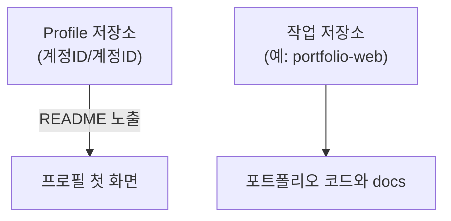

# 프로필과 작업 기록

## 학습 목표

- GitHub Profile 저장소를 따로 만들 수 있다.
- 포트폴리오 저장소와 Profile 저장소를 구분해 설명할 수 있다.
- `docs/post-mortem.md`를 만들어 사후분석을 기록할 수 있다.
- [TIL](glossary.md#til), 회고, 부검, Wiki를 어떤 때 쓰는지 설명할 수 있다.
- 기록의 종류와 작성 틀을 구분하고 목적에 맞는 틀을 고를 수 있다.
- 변경을 커밋하고 원격에 반영할 수 있다.

## 왜 필요한가

개발이나 학습을 이어가다 보면 배운 내용을 다시 찾아볼 일이 생긴다. 해결 과정을 기록하면 같은 문제를 다시 만났을 때 참고할 수 있다.

## 핵심 개념

- **Profile 저장소**는 GitHub 사용자명과 이름이 같은 공개 저장소(`https://github.com/<사용자명>/<사용자명>`)다. 루트 [README](glossary.md#readme)가 비어 있지 않으면 `https://github.com/<사용자명>` 프로필에 보인다. 2020년 7월 전에 만든 저장소는 설정에서 프로필 표시를 켜야 할 수 있다.
- **개인 사이트 저장소** `<사용자명>.github.io`는 GitHub Pages로 `https://<사용자명>.github.io/`에 기술 블로그나 이력서를 게시하는 곳이다. README가 프로필에 표시되는 특수 저장소와 다르다.
- **작업 저장소**는 실제 포트폴리오 코드와 문서를 담는 저장소다. 예시 이름은 `portfolio-web`이다.
- **TIL**(Today I Learned)은 오늘 알게 된 점을 짧게 기록한 글이다.
- **회고**는 작업 경험과 느낌을 돌아보고 다음 행동을 정하는 기록이다.
- **부검**(Post-mortem)은 버그, 오류, 비용 초과 등의 원인과 개선 조치, 재발 방지책을 기록한다.
- **GitHub Wiki**는 코드 저장소와 분리하여 매뉴얼이나 용어집을 웹에서 정리하는 탭 기능이다.

### 저장소 역할 구분

Profile 저장소와 작업 저장소의 역할 구분



프로필에는 소개, 관심·학습 내용, 프로젝트, 이력, 구직 정보를 필요한 만큼 적는다. [본 자료 작성자](https://github.com/qus0in)처럼 간결하게 작성할 수 있다. 프로필의 `Customize your pins`에서 대표 저장소를 고정(Pin)할 수 있다.

### 프로필 저장소

프로필 저장소는 GitHub에서 나를 소개하는 README를 담는 곳이다. 방문자가 관심 분야와 대표 작업을 빠르게 찾도록 돕는다. 사용자명과 같은 이름의 공개 저장소를 만들고 루트 README에 필요한 정보만 적는다.

- 짧은 소개와 관심·학습 분야
- 대표 프로젝트 링크와 맡은 역할
- 공개해도 되는 연락 방법

### 개인 사이트 저장소

개인 사이트 저장소는 GitHub Pages로 블로그나 이력서 같은 웹사이트를 공개하는 곳이다. 프로필 README보다 자유롭게 글과 작업물을 구성할 때 쓴다. `<사용자명>.github.io` 저장소에 사이트 파일을 넣고 Pages 게시 설정을 확인한다.

- 첫 화면의 소개와 글·프로젝트 목록
- 프로젝트별 설명과 실행 화면
- 프로필에서 개인 사이트로 가는 링크

### TIL

TIL은 오늘 배운 내용 중 다시 참고할 점을 짧게 남기는 기록이다. 명령어만 복사하기보다 언제 쓰고 무엇을 확인했는지 적으면 복습에 도움이 된다. 날짜나 주제별 파일에 배운 점과 직접 확인한 결과를 적는다.

- 해결하려던 질문과 배운 내용
- 실행한 명령 또는 참고 링크
- 확인 결과와 남은 질문

### 기록 종류와 작성 틀

기록의 종류는 글을 쓰는 목적이고, 작성 틀은 내용을 배열하는 방법이다. 둘은 서로 다른 축이다. 어떤 종류든 상황에 맞는 틀을 골라 쓸 수 있으며, 아래 조합은 예시일 뿐이다.

| 종류 | 목적 | 어울리는 틀 예 |
| --- | --- | --- |
| TIL | 배운 내용과 확인 결과 남기기 | Why→What→How, STAR |
| 회고 | 경험을 돌아보고 다음 행동 정하기 | KPT, 4F |
| 부검 | 문제 원인과 재발 방지책 찾기 | STAR, Why→What→How |

각 틀의 뜻과 출처는 [프로필과 기록 작성](appendix/13-profile-records.md#기록과-작성-틀)을 참고한다. 부검에서는 어떤 틀을 쓰든 원인의 근거와 재발 방지책을 빠뜨리지 않는다.

### 회고

회고는 작업 경험과 느낌을 돌아보고 다음 행동을 정하는 기록이다. 작성 틀에는 KPT, 4F 등이 있다. 여기서는 예시 틀 하나인 KPT로 유지할 점, 어려웠던 점, 다음에 시도할 점을 나눈다. 작업을 마친 뒤 구체적인 경험을 적고 다음 작업에서 확인할 작은 시도 하나를 고른다.

- Keep: 이어갈 행동과 그 이유
- Problem: 어려웠던 상황과 영향
- Try: 다음에 실행하고 확인할 행동

### 부검

부검(Post-mortem)은 오류나 실패가 어떻게 생겼고 무엇을 바꿀지 분석하는 기록이다. 사람을 탓하기보다 재발 조건과 개선할 절차를 찾는 데 쓴다. 현상과 영향을 먼저 적고 확인한 근거로 원인·조치·재발 방지책을 구분한다.

- 발생 상황과 영향, 시간 흐름
- 원인 판단의 근거와 해결 결과
- 후속 조치의 담당자·기한·확인 방법

상세 템플릿과 예시는 [기록 작성 예시](appendix/16-record-examples.md)를 참고한다. 다른 작성 틀과 프로필 참고 자료는 [프로필과 기록 작성](appendix/13-profile-records.md)에 있다.

## 따라하기

1. `portfolio-web` 폴더가 현재 작업 저장소임을 확인한다.
2. GitHub 웹에서 본인 사용자명과 정확히 같은 이름의 공개 저장소 `<계정ID>/<계정ID>`를 README와 함께 만든다.
3. Profile 저장소 README에 본인 소개 문구와 관심 기술을 작성하고 커밋한다.
4. `portfolio-web`으로 돌아와 `docs` 폴더를 만든다.
5. `docs/post-mortem.md` 파일을 만들고 사후분석 예시를 작성한다.
6. `git status`로 변경 파일을 확인한다.
7. `git add docs/post-mortem.md`로 stage 한다.
8. 커밋한다.
9. `git push origin main`으로 `portfolio-web`에 반영한다.
10. 저장소의 `Wiki` 탭을 열고 `Create the first page`로 첫 페이지를 만든 뒤 저장한다. `Edit`으로 내용을 고치고 다른 페이지 이름을 `[[페이지 이름]]`으로 적어 연결한다. Wiki가 지원되지 않거나 권한이 없으면 `docs/wiki-draft.md`에 기록한다.

Profile 저장소의 `README.md`를 렌더링하면 소개 문구와 관심 기술이 아래처럼 보인다.

<Screenshot name="step08-profile-readme" alt="Demo User 소개와 관심 분야, 학습 내용" />

TIL은 그날 배운 내용을 짧게 남기는 기록이다. 아래는 렌더링한 예시다.

<Screenshot name="step08-til" alt="첫 커밋 만들기에 관한 오늘 배운 내용과 정리" />

`docs/post-mortem.md`는 목표, 잘된 점, 개선할 점으로 나누어 쓰면 읽기 쉽다.

<Screenshot name="step08-post-mortem" alt="웹페이지 배포 연습의 목표, 잘된 점, 다음에 개선할 점" />


## Git 명령

명령어 참조: [git status](commands/status.md) · [git add](commands/add.md) · [git commit](commands/commit.md) · [git push](commands/push.md)

```bash
mkdir -p docs
printf '# 에러 사후분석\n- 현상: ...\n- 원인: ...\n- 조치: ...\n- 재발 방지: ...\n' > docs/post-mortem.md
git status
git add docs/post-mortem.md
git commit -m "docs: 사후분석 문서 추가"
git push origin main
```

## 에이전트 요청 예시

```text
TIL 한 단락과 회고 한 단락 구분 작성
Post-mortem 템플릿 작성
Profile 저장소와 작업 저장소 차이 설명
```

## 2026년 11월 실습 사례

11월 6일 계정 이름과 같은 [ilovejava26 저장소의 README](https://github.com/ilovejava26/ilovejava26/blob/main/README.md)를 자기소개와 기술 배지로 구성했다. [실습 기록](https://github.com/ilovejava26/memo/blob/main/261106.md)에는 `git add . && git commit -m "AI 엔지니어 프로필" && git push origin main`이 남아 있다. 소개 문구와 배지가 [프로필](https://github.com/ilovejava26)에 표시되는 방식을 확인한다.

학습 기록은 별도 저장소 `ai-issue`의 [TIL](https://github.com/ilovejava26/ai-issue/blob/main/docs/til.md), [회고](https://github.com/ilovejava26/ai-issue/blob/main/docs/retrospective.md), [부검](https://github.com/ilovejava26/ai-issue/blob/main/docs/postmortem.md)으로 작성했다. TIL은 Why·What·How로 배운 이유, 한 일, 적용 방법을 구분한다. 이 문서들은 가상의 2주 프로젝트가 완료됐다고 가정한 작성 연습이며, 실제 14일간의 작업 실적이 아니다.


화면 출처: [memo 스크린샷](https://github.com/ilovejava26/memo/blob/main/%EC%8A%A4%ED%81%AC%EB%A6%B0%EC%83%B7%202026-11-06%20134138.png).

## 체크리스트

- [ ] `https://github.com/<계정ID>` 접속 시 프로필 소개 카드가 노출된다.
- [ ] `portfolio-web` 저장소에 `docs/post-mortem.md`가 있다.
- [ ] `git status`가 깨끗하다.
- [ ] Profile 저장소와 `portfolio-web` 저장소를 구분해서 말할 수 있다.
- [ ] Wiki 또는 대체 문서 위치를 확인했다.

## 트러블 슈팅

| 증상 | 원인 | 대응 |
| --- | --- | --- |
| Profile 저장소가 보이지 않음 | 이름, 공개 설정 또는 README 확인 필요 | 사용자명과 저장소 이름, 공개 여부, 비어 있지 않은 루트 README를 확인한다. 2020년 7월 전 저장소는 프로필 표시 설정도 본다 |
| `docs` 폴더 생성 실패 | 현재 경로가 `portfolio-web`이 아님 | `pwd`로 위치를 확인하고 올바른 폴더로 이동한다 |
| Wiki 탭이 보이지 않음 | 기능 미지원 또는 권한 부족 | `docs/wiki-draft.md`로 대체한다 |
| push가 거절됨 | 원격과 로컬 이력이 다를 수 있음 | `git status`와 `git log`로 양쪽 이력을 먼저 확인한다. 통합 방식은 [STEP 05](05-remote.md)를 참고하고, 바로 `git pull`하지 않는다 |

## 주의할 점

- 공개 프로필에 개인 정보를 과도하게 적지 않는다.
- Post-mortem에는 비밀 값, 토큰, 비밀번호를 적지 않는다.
- 프로필 README는 Profile 저장소에서, 프로젝트 문서와 코드는 작업 저장소에서 커밋한다.

## 복습 퀴즈 <QuizHelp />

1. 프로필 화면에 README를 보여 주려면 저장소 이름을 GitHub ::사용자명::과 같게 만든다.
2. 버그의 원인과 재발 방지책을 정리해 남기는 글은 TIL이 아니라 ::부검::이다.
3. 해당 저장소에 연결된 기능으로 매뉴얼이나 용어집을 웹에서 정리하려면 ::Wiki:: 탭을 쓴다.
