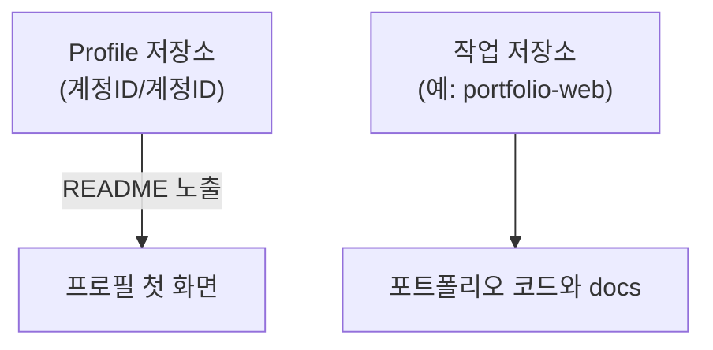
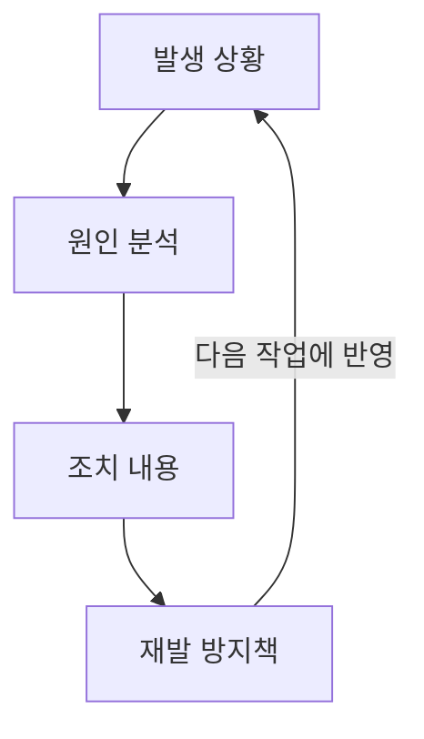

# 프로필과 작업 기록

## 학습 목표

- GitHub Profile 저장소를 따로 만들 수 있다.
- 포트폴리오 저장소와 Profile 저장소를 구분해 설명할 수 있다.
- `docs/post-mortem.md`를 만들어 사후분석을 기록할 수 있다.
- [TIL](glossary.md#til), KPT 회고, Wiki를 어떤 때 쓰는지 설명할 수 있다.
- 변경을 커밋하고 원격에 반영할 수 있다.

## 왜 필요한가

개발이나 학습을 이어가다 보면 배운 내용을 다시 찾아볼 일이 생긴다. 해결 과정을 기록하면 같은 문제를 다시 만났을 때 참고할 수 있다.

## 핵심 개념

- **Profile 저장소**는 GitHub 사용자명과 이름이 같은 공개 저장소(`https://github.com/<사용자명>/<사용자명>`)다. 루트의 [README](glossary.md#readme)가 `https://github.com/<사용자명>` 프로필에 보인다.
- **개인 사이트 저장소** `<사용자명>.github.io`는 GitHub Pages로 `https://<사용자명>.github.io/`에 기술 블로그나 이력서를 게시하는 곳이다. README가 프로필에 표시되는 특수 저장소와 다르다.
- **작업 저장소**는 실제 포트폴리오 코드와 문서를 담는 저장소다. 예시 이름은 `portfolio-web`이다.
- **TIL**(Today I Learned)은 오늘 알게 된 점을 짧게 기록한 글이다.
- **회고**는 작업을 돌아보며 느낌과 감상, 좋았던 점과 아쉬운 점을 정성적으로 정리한 글이다.
- **부검**(Post-mortem)은 버그, 오류, 비용 초과 등의 원인과 개선 조치, 재발 방지책을 기록한다.
- **KPT 회고**는 Keep(좋았던 점), Problem(어려웠던 점), Try(다음에 시도할 점)으로 나누는 회고 방식이다.
- **GitHub Wiki**는 코드 저장소와 분리하여 매뉴얼이나 용어집을 웹에서 정리하는 탭 기능이다.

### 저장소 역할 구분

Profile 저장소와 작업 저장소의 역할 구분



프로필에는 소개, 관심·학습 내용, 프로젝트, 이력, 구직 정보를 필요한 만큼 적는다. [본 자료 작성자](https://github.com/qus0in)처럼 간결하게 작성할 수 있다. 프로필의 `Customize your pins`에서 대표 저장소를 고정(Pin)할 수 있다.

TIL·회고·부검은 기록의 종류이고 KPT·Why-What-How·4F·STAR는 내용을 정리하는 작성 틀이다. 용도와 예시, 작성 프롬프트는 [프로필과 기록 작성](appendix/13-profile-records.md)을 참고한다. 회고와 부검은 향후 하네스 엔지니어링의 자가개선 루프로 연결할 수 있다.

## 따라하기

1. `portfolio-web` 폴더가 현재 작업 저장소임을 확인한다.
2. GitHub 웹에서 본인 사용자명과 정확히 같은 이름의 공개 저장소 `<계정ID>/<계정ID>`를 README와 함께 만든다.
3. Profile 저장소 README에 본인 소개 문구와 관심 기술을 작성하고 커밋한다.
4. `portfolio-web`으로 돌아와 `docs` 폴더를 만든다.
5. `docs/post-mortem.md` 파일을 만들고 사후분석 예시를 작성한다.
6. `git status`로 변경 파일을 확인한다.
7. `git add docs/post-mortem.md`로 stage 한다.
8. 커밋한다.
9. `git push origin main`으로 `portfolio-web`에 반영한다.
10. 저장소의 `Wiki` 탭을 열고 `Create the first page`로 첫 페이지를 만든 뒤 저장한다. `Edit`으로 내용을 고치고 다른 페이지 이름을 `[[페이지 이름]]`으로 적어 연결한다. Wiki가 지원되지 않거나 권한이 없으면 `docs/wiki-draft.md`에 기록한다.

## Git 명령

명령어 참조: [git status](commands/status.md) · [git add](commands/add.md) · [git commit](commands/commit.md) · [git push](commands/push.md)

```bash
mkdir -p docs
printf '# 에러 사후분석\n- 현상: ...\n- 원인: ...\n- 조치: ...\n- 재발 방지: ...\n' > docs/post-mortem.md
git status
git add docs/post-mortem.md
git commit -m "docs: 사후분석 문서 추가"
git push origin main
```

## Post-mortem 예시

한 번 쓰고 끝내지 않고 다음 작업에 반영하는 Post-mortem의 고리



```markdown
# 에러 사후분석

## 1. 발생 상황
- `git commit` 입력 후 터미널이 멈춤

## 2. 원인 분석
- `-m` 옵션을 빼먹어 vi 편집기가 실행됨

## 3. 조치 내용
- `Esc` 후 `:wq` 입력

## 4. 재발 방지책
- 항상 `git commit -m "메시지"` 사용
```

## TIL과 KPT 예시

```markdown
# TIL
- `git reset <파일명>`은 커밋을 지우지 않고 stage만 해제한다.
- Profile 저장소 이름은 계정 ID와 정확히 일치해야 한다.

# KPT 회고
- Keep: status와 diff를 먼저 확인하는 습관
- Problem: vi 편집기에 갇혀 시간을 잃음
- Try: 커밋 전 명령어 옵션을 한 번 더 확인
- 느낌: 당황했지만 직접 해결한 뒤 자신감이 생김
```

## 에이전트 요청 예시

```text
TIL 한 단락과 회고 한 단락 구분 작성
Post-mortem 템플릿 작성
Profile 저장소와 작업 저장소 차이 설명
```

## 체크리스트

- [ ] `https://github.com/<계정ID>` 접속 시 프로필 소개 카드가 노출된다.
- [ ] `portfolio-web` 저장소에 `docs/post-mortem.md`가 있다.
- [ ] `git status`가 깨끗하다.
- [ ] Profile 저장소와 `portfolio-web` 저장소를 구분해서 말할 수 있다.
- [ ] Wiki 또는 대체 문서 위치를 확인했다.

## 트러블 슈팅

| 증상 | 원인 | 대응 |
| --- | --- | --- |
| Profile 저장소가 보이지 않음 | 이름, 공개 설정 또는 README 확인 필요 | 사용자명과 저장소 이름, 공개 여부와 루트 README를 확인한다 |
| `docs` 폴더 생성 실패 | 현재 경로가 `portfolio-web`이 아님 | `pwd`로 위치를 확인하고 올바른 폴더로 이동한다 |
| Wiki 탭이 보이지 않음 | 기능 미지원 또는 권한 부족 | `docs/wiki-draft.md`로 대체한다 |
| push가 거절됨 | 원격에 없는 커밋이 있음 | `git pull origin main` 후 다시 push 한다 |

## 주의할 점

- 공개 프로필에 개인 정보를 과도하게 적지 않는다.
- Post-mortem에는 비밀 값, 토큰, 비밀번호를 적지 않는다.
- 프로필 README는 Profile 저장소에서, 프로젝트 문서와 코드는 작업 저장소에서 커밋한다.

## 복습 퀴즈 <QuizHelp />

1. GitHub Wiki는 저장소에서 매뉴얼이나 용어집을 정리하는 ::탭 기능::이다.
2. GitHub 프로필에 README가 표시되는 공개 저장소는 사용자명과 저장소 이름이 같은 ::Profile 저장소::다.
3. `<사용자명>.github.io` 저장소는 GitHub Pages로 공개하는 ::개인 사이트::에 사용할 수 있다.
