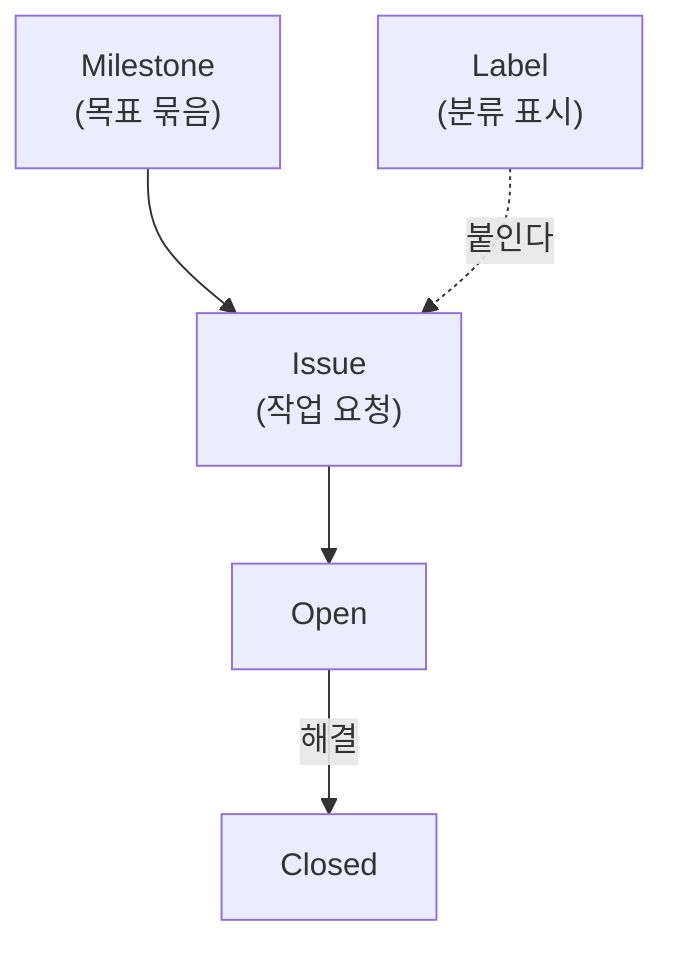

# 이슈로 작업 관리

## 학습 목표

- GitHub [Issue](glossary.md#issue)로 작업 요청서를 등록할 수 있다.
- Label로 이슈 종류를 분류할 수 있다.
- Milestone으로 목표와 진행률을 추적할 수 있다.
- 비밀 값을 Issue에 남기지 않도록 주의할 수 있다.

## 왜 필요한가

개발할 기능이나 고쳐야 할 버그를 머릿속으로만 생각하면 중요한 작업을 빠뜨리게 된다. GitHub Issue를 활용하면 할 일을 카드 형태로 만들고, 색상 라벨로 분류하며, 목표 마감일(Milestone)별로 진척도를 시각적으로 추적할 수 있다.

## 핵심 개념

- **Issue**는 작업을 요청하거나 버그를 알리는 티켓이다.
- **Label**은 이슈의 종류(`bug`, `enhancement`, `documentation`)를 나타내는 색상 태그다.
- **Milestone**은 목표 스프린트와 소속 이슈들의 해결률을 게이지 바로 보여 준다.

| 위치 | 용도 | 공개와 관리 |
| --- | --- | --- |
| `docs/*.md` | 배운 내용과 해결 과정 기록 | 저장소 공개 범위를 따르고 커밋으로 변경 이력을 남긴다 |
| Issue | 작업 요청과 진행 상황 관리 | 저장소 공개 범위를 따르고 라벨과 마일스톤으로 분류한다 |

예를 들어 오류 해결 과정을 `docs/post-mortem.md`에 기록하고, 재발 방지 작업 Issue에 해당 문서 링크를 붙인다. 문서에도 Issue 주소를 적으면 기록과 작업을 함께 찾을 수 있다.

### 라벨 관리

저장소의 `Issues` → `Labels`에서 기존 라벨을 `Edit`으로 수정하거나 삭제하고, `New label`로 이름·설명·색상을 정해 새 라벨을 만든다. 삭제 전에 기존 이슈의 분류에 미칠 영향을 확인한다. `bug`는 오류, `enhancement`는 기능 개선, `documentation`은 문서 작업을 구분할 때 쓴다.

### Issue 관계도

Milestone, Label, Issue의 관계와 Issue 상태 변화



## 따라하기

1. GitHub 저장소 웹 페이지의 `Issues` 탭을 연다.
2. `Milestones` 메뉴로 들어가 `v1.0 포트폴리오 완성` 마일스톤을 만든다.
3. 새 이슈 2건을 등록한다.
   - 1건: `[기능] 다크모드 토글 버튼 추가` (Label: `enhancement`, Milestone 할당)
   - 1건: `[문서] README에 라이선스 표기 보완` (Label: `documentation`, Milestone 할당)
4. Milestones 탭에서 0% 진척도 게이지를 확인한다.
5. `Labels`에서 라벨을 만들거나 수정하고 이슈에 적용한다.
6. 관련 기록 문서의 링크를 이슈에 적는다.

## 에이전트 요청 예시

```text
Issue 초안 작성: 목적, 하지 않을 일, 완료 조건 3개 제안
Label과 Milestone 차이 설명
```

## Issue 초안 예시

```markdown
## 목적
다크모드 토글 버튼을 추가한다.

## 하지 않을 일
- 전체 테마 시스템 재작성
- 외부 라이브러리 도입

## 완료 조건
- [ ] 토글 버튼이 화면에 보인다.
- [ ] 클릭 시 배경색이 바뀐다.
- [ ] README에 사용법이 적혀 있다.
```

## 체크리스트

- [ ] Issues 목록에 라벨 색상이 입혀진 티켓이 2개 이상 있다.
- [ ] Milestone 게이지가 표시된다.
- [ ] Issue 본문에 비밀 값이 없다.
- [ ] 기록 문서와 관련 이슈를 링크했다.

## 트러블 슈팅

| 증상 | 원인 | 대응 |
| --- | --- | --- |
| Issue 권한 없음 | 저장소 권한 부족 | 개인 저장소에서 재시도한다 |
| Milestone이 보이지 않음 | 메뉴 위치를 찾지 못함 | 저장소 `Issues` 탭의 `Milestones` 메뉴를 다시 확인한다 |
| Label이 적용되지 않음 | Label 미생성 | `Labels` 메뉴에서 먼저 Label을 만든다 |

## 주의할 점

- Issue와 PR 본문에 비밀 값, 토큰, 비밀번호를 적지 않는다.

## 복습 퀴즈 <QuizHelp />

1. Issue는 작업 요청이나 버그를 번호가 붙은 ::글::로 관리한다.
2. Label은 Issue의 ::종류::를 나타내는 표시다.
3. Milestone은 목표와 관련 Issue의 ::해결 진행률::을 보여 준다.
