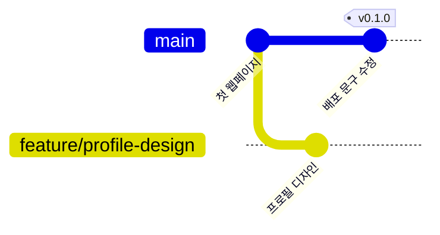

# 브랜치와 태그

## 학습 목표

- [브랜치](glossary.md#branch)로 작업을 나눠 메인 코드를 보호할 수 있다.
- `git switch -c`로 브랜치를 만들고 전환할 수 있다.
- `checkout`, `switch`, `restore`의 역할을 구분할 수 있다.
- [태그](glossary.md#tag)로 릴리스 지점을 기록할 수 있다.
- 브랜치를 전환하면 파일 내용이 바뀌는 것을 직접 확인할 수 있다.

## 왜 필요한가

배포 중인 `main` 브랜치에서 직접 코드를 개발하다가 코드가 망가지면 배포 사이트에도 영향을 줄 수 있다. 독립된 가지(Branch)를 따로 뻗어 작업하면 마음껏 실험할 수 있다. 실패하면 가지를 버리고 성공했을 때만 합치면 되므로 안전하다.

<Illustration name="branches" alt="본줄기에서 갈라진 가지에서 실험한 뒤 다시 합쳐지는 모습" />

## 핵심 개념

- **브랜치**는 작업 흐름을 나누는 독립된 가지다.
- `git switch -c`는 새 브랜치를 만들면서 동시에 그 브랜치로 이동한다.
- `git switch`는 기존 브랜치로 옮겨 갈 때 쓴다.
- `git checkout`은 현재도 브랜치 전환과 파일 복원 등에 사용한다. `switch`는 전환, `restore`는 파일 복원과 stage 해제에 역할을 나눈다.
- **태그**는 특정 커밋에 이름을 붙인 표시다. 릴리스 지점에는 주석 태그를 쓴다.
- **주석 태그**는 `git tag -a v0.1.0 -m "Release v0.1.0"`처럼 작성자·날짜·설명을 포함한다.
- **경량 태그**는 `git tag v0.1.0`처럼 이름만 붙인다. 임시 표시에 쓰고, 릴리스에는 쓰지 않는다.

### 브랜치 분기 그림

`main`에서 갈라진 브랜치와 릴리스 태그



## 따라하기

1. 터미널에서 현재 브랜치를 확인한다.
2. `feature/profile-design` 브랜치를 만들고 이동한다.
3. OpenCode에 명사형 프롬프트를 입력해 스타일 수정 초안을 받는다.
4. 변경을 확인하고 stage 한다.
5. 커밋한다.
6. `main`으로 돌아온다.
7. 브랜치 격리 현상, 즉 코드가 원래대로 돌아오는 것을 확인한다.
8. 현재 `main`에 주석 태그 `v0.1.0`을 부여한다.
9. 태그 목록을 확인한다.
10. 브랜치 삭제는 아직 하지 않는다. 병합 뒤 STEP 11에서 수행한다.

`git branch`, `git tag`, `git log --graph --oneline --all`을 차례로 실행하면 브랜치 목록과 태그, 브랜치와 태그가 달린 커밋이 보인다. 아직 병합하지 않은 상태라 그래프는 갈라지지 않는다.

<Screenshot name="step10-log-graph" alt="`$ git branch`에 `feature/profile-design`과 현재 브랜치 `main`, `$ git tag`에 `v0.1.0`, `$ git log --graph --oneline --all`에 그 브랜치와 태그가 달린 두 커밋이 보인다. 병합 그래프는 아니다." />


## Git 명령

명령 이름이 어떤 뜻인지 알면 외우기 쉽다.

- `branch`: 나뭇가지처럼 갈라진 작업 흐름을 뜻한다.
- `switch`: 다른 브랜치로 전환한다는 뜻
- `tag`: 특정 커밋에 붙이는 꼬리표를 뜻한다.

명령어 참조: [git add](commands/add.md) · [git commit](commands/commit.md) · [git branch](commands/branch.md) · [git switch](commands/switch.md) · [git tag](commands/tag.md)

```bash
git branch
git switch -c feature/profile-design
git add .
git commit -m "feat: 프로필 카드 그림자 효과 추가"
git switch main
git tag -a v0.1.0 -m "Release v0.1.0"
git tag
```

## 선택 참고 명령

```bash
git checkout feature/profile-design
# 임시 표시용 경량 태그. 릴리스에는 쓰지 않는다
git tag temp-mark
```

커밋 내용을 보기만 할 때는 `git show <해시>`를 쓴다. 특정 커밋으로 이동하려면 `git switch --detach <해시>` 또는 `git checkout <해시>`를 쓴다. 이때 HEAD가 브랜치가 아닌 커밋을 직접 가리키는 detached HEAD 상태가 된다. 이 상태에서 만든 커밋을 보존하려면 이동 전에 `git switch -c 새브랜치`로 브랜치를 만든다. 기존 브랜치로 돌아갈 때는 `git switch main`을 사용한다. 이동 전 변경 사항을 확인한다.

병합 전에는 `git branch -d feature/profile-design`이 `not fully merged`로 실패한다. 브랜치 삭제는 STEP 11 병합 뒤에 수행한다.

## 에이전트 요청 예시

```text
프로필 영역 부드러운 그림자 스타일 추가
브랜치와 태그 차이 설명
```

## 2026년 11월 실습 사례

11월 6일 [실습 기록](https://github.com/ilovejava26/memo/blob/main/261106.md)에서 `git branch dev`로 브랜치를 만들고 `git switch dev`로 이동해 `2.txt`를 커밋했다. 이후 `main`에서 `git merge dev`를 실행했다. [커밋 9c98243](https://github.com/ilovejava26/merge/commit/9c9824392db124759761ad73bc60afef41fe5006)과 아래 화면을 함께 보면 `main`이 해당 커밋으로 전진한 fast-forward 병합을 확인할 수 있다.


계정·기기 식별 정보는 가렸다. 화면 출처: [memo 스크린샷](https://github.com/ilovejava26/memo/blob/main/%EC%8A%A4%ED%81%AC%EB%A6%B0%EC%83%B7%202026-11-06%20164036.png).

## 체크리스트

- [ ] `git switch`로 두 브랜치를 오간다.
- [ ] 브랜치 전환 시 파일 내용이 바뀌는 것을 확인한다.
- [ ] `git tag` 실행 시 `v0.1.0`이 표시된다.
- [ ] `git status`가 깨끗하다.

## 트러블 슈팅

| 증상 | 원인 | 대응 |
| --- | --- | --- |
| 파일이 저장되지 않음 | 커밋 전 전환 | 커밋 후 전환한다 |
| 브랜치 이름 중복 | 이미 존재하는 브랜치 | 다른 이름을 사용한다 |
| 브랜치 삭제 실패 | 병합 전 삭제 시도 | STEP 11 병합 뒤에 삭제한다 |
| 태그가 보이지 않음 | 태그 생성 실패 | `git tag -a v0.1.0 -m "Release v0.1.0"`을 다시 실행한다 |

## 주의할 점

- `git branch -D`로 브랜치를 강제 삭제하지 않는다.
- 미커밋 변경이 있는 상태에서 브랜치를 전환하지 않는다.
- 태그는 릴리스 지점에만 붙인다.

## 복습 퀴즈 <QuizHelp />

1. 메인과 별개로 기능 개발의 작업 흐름을 나누는 가지를 ::브랜치::라 한다.
2. `switch`와 `restore` 중 파일 내용은 유지하고 stage만 해제하는 `--staged` 옵션을 쓸 명령은 ::restore::다.
3. 작업 흐름을 새로 나누지 않고 검증한 커밋에 릴리스 이름만 붙이려면 브랜치가 아니라 ::태그::를 만든다.
