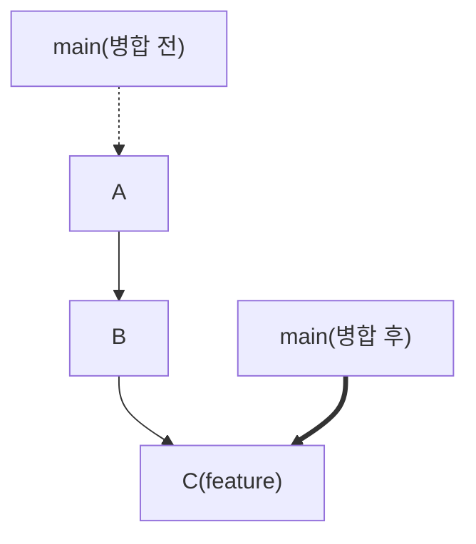
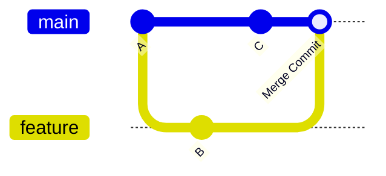
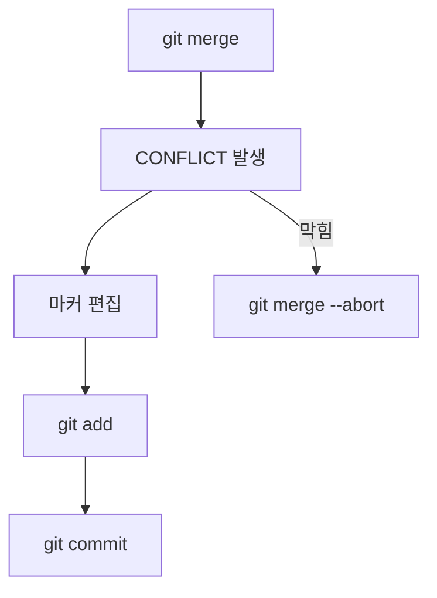

# 병합과 충돌 해결

## 학습 목표

- Fast-forward [병합](glossary.md#merge)과 3-way 병합의 차이를 설명할 수 있다.
- 의도적으로 [충돌](glossary.md#conflict)을 만들고 직접 해결할 수 있다.
- 충돌 마커의 의미를 읽을 수 있다.
- `git merge --abort`로 병합을 취소할 수 있다.
- `git log --graph --oneline --all`로 브랜치 흐름을 확인할 수 있다.

## 왜 필요한가

브랜치에서 개발을 성공적으로 마쳤다면 메인 줄기(`main`)에 합쳐야 배포 사이트에 반영된다. 이때 여러 작업자가 같은 파일의 같은 위치를 동시에 고쳤다면 Git은 어느 쪽 코드가 맞는지 판단할 수 없어 멈춘다. 이 충돌을 개발자는 직접 보고 정리할 수 있어야 한다.

## 핵심 개념

- **Fast-forward 병합**은 기준 브랜치에 새 커밋이 없어 포인터만 앞으로 이동하는 경우다.
- **3-way 병합**은 기준 브랜치와 분기 브랜치 양쪽에 새 커밋이 있는 경우다. 공통 조상을 바탕으로 합쳐지고 새로운 Merge Commit이 생성된다.
- **충돌 마커**:
  - `<<<<<<< HEAD`: 현재 브랜치의 코드
  - `=======`: 경계선
  - `>>>>>>> feature/...`: 가져오려는 브랜치의 코드
- `git merge --abort`는 충돌이 났을 때 병합을 취소하고 시작 전 상태로 되돌린다.

### 병합 두 가지 방식

Fast-forward 병합과 3-way 병합의 이력 모양 차이





### 충돌 해결 흐름

충돌을 해결하는 순서와 `--abort`로 돌아가는 출구



## 따라하기

1. `main` 브랜치에서 `index.html` 5번째 줄 제목을 수정하고 커밋한다.
2. `feature/profile-design` 브랜치로 전환한다.
3. 같은 5번째 줄을 다르게 수정하고 커밋한다.
4. `main`으로 복귀한다.
5. `git merge feature/profile-design`을 실행한다.
6. 터미널의 `CONFLICT` 경고를 확인한다.
7. VS Code 또는 직접 편집으로 충돌 마커를 제거하고 원하는 코드로 정리한다.
8. `git add index.html`로 해결을 stage 한다.
9. `git commit`으로 병합을 완료한다.
10. `git log --graph --oneline --all`로 갈라졌다가 합쳐진 흐름을 확인한다.
11. 병합이 완료된 뒤 `git branch -d feature/profile-design`으로 브랜치를 정리한다.

편집기에서 병합 메시지를 작성할 때는 [vi 편집기](appendix/08-vi-editor.md) 부록을 참고한다.

## Git 명령

명령 이름이 어떤 뜻인지 알면 외우기 쉽다.

- `merge`: 갈라진 이력을 하나로 합친다는 뜻

명령어 참조: [git add](commands/add.md) · [git commit](commands/commit.md) · [git log](commands/log.md) · [git branch](commands/branch.md) · [git switch](commands/switch.md) · [git merge](commands/merge.md)

```bash
git switch main
git commit -am "docs: 메인에서 타이틀 수정"
git switch feature/profile-design
git commit -am "docs: 기능브랜치에서 타이틀 수정"
git switch main
git merge feature/profile-design
git add index.html
git commit -m "merge: 메인 타이틀 충돌 수동 해결"
git log --graph --oneline --all
git branch -d feature/profile-design
```

## 선택 참고 명령

```bash
git merge --abort
```

병합이 꼬이면 `git merge --abort`로 병합 전 상태로 돌아간다. 충돌 파일을 저장하기 전에 강사와 확인한다.

## 에이전트 요청 예시

```text
충돌 양쪽 문장 통합 문장 제안, 파일 수정 금지
log graph에서 Fast-forward 가능 이유 설명
```

## 체크리스트

- [ ] 충돌 마커가 파일에 남아 있지 않다.
- [ ] Merge Commit이 생성되었다.
- [ ] `git log --graph --oneline --all`에서 갈라짐과 합쳐짐이 보인다.
- [ ] `feature/profile-design` 브랜치가 정리되었다.
- [ ] `git status`가 깨끗하다.

## 트러블 슈팅

| 증상 | 원인 | 대응 |
| --- | --- | --- |
| 충돌 마커가 남음 | 해결 미완료 | 파일을 다시 편집하고 `git add` 한다 |
| 병합이 꼬임 | 잘못된 해결 | `git merge --abort`로 복귀한다 |
| 그래프가 보이지 않음 | 옵션 누락 | `git log --graph --oneline --all`을 실행한다 |
| 브랜치 삭제 실패 | 병합 미완료 | 병합 커밋을 먼저 완료한다 |

## 주의할 점

- 충돌 파일을 저장하기 전에 강사와 확인한다.
- `reset --hard`로 충돌을 해결하지 않는다.
- `merge --abort`는 병합 중일 때만 사용한다.

## 핵심 내용 퀴즈 <QuizHelp />

1. 충돌은 ::같은 파일의 같은 줄::을 다르게 수정했을 때 생긴다.
