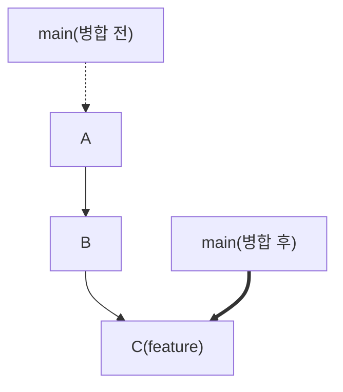
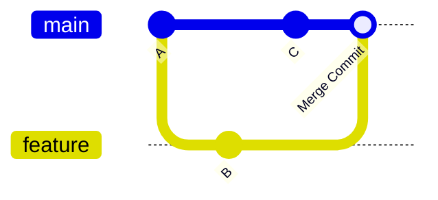
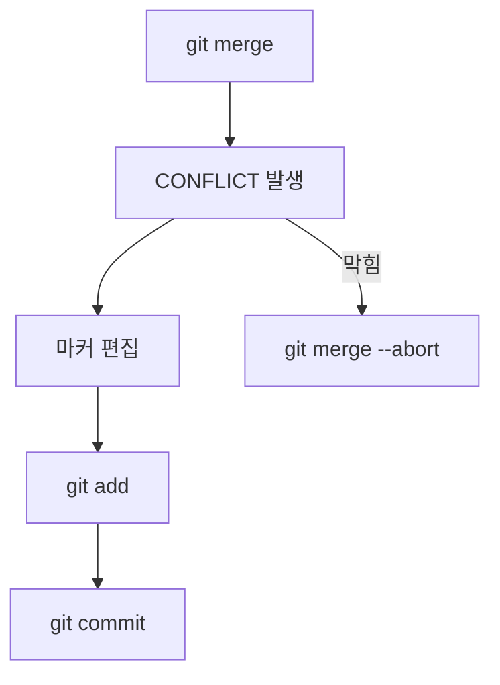

# 병합과 충돌 해결

## 학습 목표

- [Fast-forward](glossary.md#fast-forward) [병합](glossary.md#merge)과 3-way 병합의 차이를 설명할 수 있다.
- 의도적으로 [충돌](glossary.md#conflict)을 만들고 직접 해결할 수 있다.
- 충돌 마커의 의미를 읽을 수 있다.
- `git merge --abort`로 병합을 취소할 수 있다.
- `git log --graph --oneline --all`로 브랜치 흐름을 확인할 수 있다.

## 왜 필요한가

브랜치에서 개발을 성공적으로 마쳤다면 메인 줄기(`main`)에 합쳐야 배포 사이트에 반영된다. 이때 여러 작업자가 같은 파일의 같은 위치를 동시에 고쳤다면 Git은 어느 쪽 코드가 맞는지 판단할 수 없어 멈춘다. 이 충돌을 개발자는 직접 보고 정리할 수 있어야 한다.

## 핵심 개념

- **Fast-forward 병합**은 기준 브랜치에 새 커밋이 없어 포인터만 앞으로 이동하는 경우다.
- **3-way 병합**은 기준 브랜치와 분기 브랜치 양쪽에 새 커밋이 있는 경우다. 공통 조상을 바탕으로 합쳐지고 새로운 Merge Commit이 생성된다.
- **충돌 마커**:
  - `<<<<<<< HEAD`: 현재 브랜치의 코드
  - `=======`: 경계선
  - `>>>>>>> feature/...`: 가져오려는 브랜치의 코드
- `git merge --abort`는 충돌이 났을 때 병합을 취소한다. 커밋된 상태에서 시작했다면 병합 전으로 돌아간다. 커밋하지 않은 변경이 있으면 그 변경은 복구되지 않을 수 있다.

### 병합 두 가지 방식

Fast-forward 병합과 3-way 병합의 이력 모양 차이





### 이력을 합치는 방법

| 방법 | 이력에 반영되는 방식 |
| --- | --- |
| merge | 갈라진 이력을 합친다. 3-way 병합에서는 병합 커밋이 생긴다. |
| squash merge | `git merge --squash`로 변경을 모은 뒤 커밋한다. GitHub에서는 `Squash and merge`를 선택할 수 있다. |
| rebase | `git rebase`로 커밋을 다른 기준 위에 다시 적용해 이력을 재작성한다. 공유 브랜치에서는 사용하지 않는다. |
| 대화형 rebase | `git rebase -i`로 커밋을 정리한다. `pick`은 유지, `squash`는 앞 커밋과 합치기, `reword`는 메시지 수정이다. 이력 재작성에 주의하고 공유 브랜치에서는 사용하지 않는다. |

명령의 자세한 설명은 Git 공식 문서의 [merge](https://git-scm.com/docs/git-merge)와 [rebase](https://git-scm.com/docs/git-rebase)를 참고한다. GitHub에서 PR을 병합하는 흐름은 [STEP 12 풀 리퀘스트와 협업](12-pull-request.md)을 참고한다.

### 충돌 해결 흐름

충돌을 해결하는 순서와 `--abort`로 돌아가는 출구



## 따라하기

1. `main` 브랜치에서 `index.html` 5번째 줄 제목을 수정하고 커밋한다.
2. `feature/profile-design` 브랜치로 전환한다.
3. 같은 5번째 줄을 다르게 수정하고 커밋한다.
4. `main`으로 복귀한다.
5. `git merge feature/profile-design`을 실행한다.
6. 터미널의 `CONFLICT` 경고를 확인한다.
7. `git status`로 충돌 파일을 확인하고 양쪽 변경의 의도를 읽는다.
8. 관련 범위만 편집해 두 의도에 맞게 정리하고 충돌 마커를 제거한다.
9. `git diff`와 실행 또는 관련 검사로 결과를 확인한다.
10. `git add index.html`로 해결을 stage 한다.
11. `git commit`으로 병합을 완료한다.
12. `git log --graph --oneline --all`로 갈라졌다가 합쳐진 흐름을 확인한다.
13. 병합이 완료된 뒤 `git branch -d feature/profile-design`으로 브랜치를 정리한다.

편집기에서 병합 메시지를 작성할 때는 [vi 편집기](appendix/08-vi-editor.md) 부록을 참고한다.

충돌이 난 파일을 열면 `<<<<<<<`, `=======`, `>>>>>>>` 마커 사이에 양쪽 변경이 함께 들어 있다. 두 변경의 의도를 읽고 마커를 지워 정리한다.

<Screenshot name="step11-conflict-markers" alt="`$ cat index.html` 결과에 `&lt;&lt;&lt;&lt;&lt;&lt;&lt;`, `=======`, `>>>>>>>` 충돌 마커가 보인다." />

충돌을 정리해 `git add`를 하면 `git status`에 `All conflicts fixed but you are still merging.`이 나타난다. 병합 커밋을 만들기 전 상태다.

<Screenshot name="step11-status-resolved" alt="`$ git status`에 `All conflicts fixed but you are still merging.`과 커밋 대기 중인 `index.html`이 보인다. 병합 커밋 전이다." />

병합 커밋을 만든 뒤에는 `git log --graph --oneline --all`에서 갈라졌던 이력이 한 커밋으로 합쳐진 모양이 보인다.

<Screenshot name="step11-merge-graph" alt="`$ git log --graph --oneline --all`에 갈라졌다가 한 커밋으로 합쳐진 그래프가 보인다." />


## Git 명령

명령 이름이 어떤 뜻인지 알면 외우기 쉽다.

- `merge`: 갈라진 이력을 하나로 합친다는 뜻

명령어 참조: [git add](commands/add.md) · [git commit](commands/commit.md) · [git log](commands/log.md) · [git branch](commands/branch.md) · [git switch](commands/switch.md) · [git merge](commands/merge.md)

```bash
git switch main
git commit -am "docs: 메인에서 타이틀 수정"
git switch feature/profile-design
git commit -am "docs: 기능브랜치에서 타이틀 수정"
git switch main
git merge feature/profile-design
git add index.html
git commit -m "merge: 메인 타이틀 충돌 수동 해결"
git log --graph --oneline --all
git branch -d feature/profile-design
```

## 선택 참고 명령

```bash
git merge --abort
```

병합이 꼬이면 `git merge --abort`로 병합을 취소할 수 있다. 커밋된 상태에서 시작했다면 병합 전으로 돌아간다. 커밋하지 않은 변경은 복구되지 않을 수 있다. 충돌 파일을 저장하기 전에 강사와 확인한다.

## 에이전트 요청 예시

```text
충돌한 양쪽 변경의 의도를 설명하고 관련 범위만 수정하는 해결안을 제안해 줘.
변경 이유와 검증 방법을 설명하고 승인 전 수정하지 마. diff와 실행 결과로 검증해 줘.
비밀정보를 입력하지 않고, 무조건 한쪽을 선택하거나 강제 push로 우회하지 마.
```

## 2026년 11월 실습 사례

11월 6일 [실습 기록](https://github.com/ilovejava26/memo/blob/main/261106.md)에서 `feat/awesome2`에 `feat/awesome1`을 병합할 때 `4.txt`의 같은 위치가 충돌했다. `git merge feat/awesome1` 후 내용을 선택하거나 직접 편집하고 `git add . && git commit`으로 해결을 기록했다. [병합 커밋](https://github.com/ilovejava26/merge/commit/5fa92a83ee3b4292de71585577bce58521a4a78a)도 확인한다.


화면의 `HEAD`는 현재 브랜치, `feat/awesome1`은 들어오는 변경을 가리킨다. 출처: [memo 스크린샷](https://github.com/ilovejava26/memo/blob/main/%EC%8A%A4%ED%81%AC%EB%A6%B0%EC%83%B7%202026-11-06%20165917.png).

## 체크리스트

- [ ] 충돌 마커가 파일에 남아 있지 않다.
- [ ] Merge Commit이 생성되었다.
- [ ] `git log --graph --oneline --all`에서 갈라짐과 합쳐짐이 보인다.
- [ ] `feature/profile-design` 브랜치가 정리되었다.
- [ ] `git status`가 깨끗하다.

## 트러블 슈팅

| 증상 | 원인 | 대응 |
| --- | --- | --- |
| 충돌 마커가 남음 | 해결 미완료 | 파일을 다시 편집하고 `git add` 한다 |
| 병합이 꼬임 | 잘못된 해결 | `git merge --abort`로 복귀한다 |
| 그래프가 보이지 않음 | 옵션 누락 | `git log --graph --oneline --all`을 실행한다 |
| 브랜치 삭제 실패 | 병합 미완료 | 병합 커밋을 먼저 완료한다 |

## 주의할 점

- 충돌 파일을 저장하기 전에 강사와 확인한다.
- `reset --hard`로 충돌을 해결하지 않는다.
- AI에 비밀정보를 넣지 않고, 양쪽 의도 확인 없이 한쪽을 선택하거나 강제 push로 충돌을 우회하지 않는다.
- `merge --abort`는 병합 중일 때만 사용한다.

## 복습 퀴즈 <QuizHelp />

1. 같은 파일의 같은 부분을 두 브랜치가 다르게 고쳐 Git이 자동으로 합치지 못하는 상황을 ::충돌::이라 한다.
2. 기능 브랜치에만 새 커밋이 있고 메인은 분기 지점 그대로다. 이때 메인에서 기능 브랜치를 합치면 병합 커밋 없이 포인터를 옮기는 ::Fast-forward::가 가능하다.
3. 충돌 마커를 없앴지만 양쪽 변경의 의도를 몰라 올바른 결과인지 확인할 수 없다. 병합 전 상태에서 다시 검토하려면 ‘병합 완료/병합 취소’ 중 ::병합 취소::를 선택한다.
