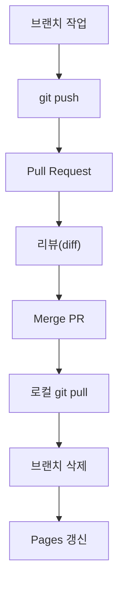

# 풀 리퀘스트와 협업

## 학습 목표

- 기능 브랜치를 원격에 push 한다.
- GitHub 웹에서 Pull Request를 만든다.
- Files changed에서 diff를 검토한다.
- PR을 병합한다.
- 로컬 `main`을 동기화하고 브랜치를 정리한다.
- Pages 사이트 갱신을 확인한다.

## 왜 필요한가

실무에서는 아무리 뛰어난 개발자라도 `main` 브랜치에 함부로 직접 push하지 못하도록 막아 둔다. 브랜치에서 만든 코드를 "작업 내용 검토 및 메인 브랜치 병합 제안"으로 공식 전달하는 절차가 Pull Request(PR)다. 동료의 리뷰를 거치면서 버그를 사전에 차단하고 코드 품질을 높인다.

<Illustration name="review" alt="동료들이 문서에서 바뀐 부분을 함께 보며 검토하는 모습" />

## 핵심 개념

- **Pull Request**: 브랜치 변경을 기본 브랜치에 반영해 달라고 제안하는 절차다.
- **diff**: 변경 전후 코드 차이를 보여 주는 비교 결과다.
- **셀프 리뷰**: 혼자 작업할 때도 PR diff를 읽고 변경 의도를 확인하는 습관이다.
- **Merge PR**: 검토가 끝난 변경을 기본 브랜치에 합친다.
- **동기화**: 원격에서 병합된 내용을 `git pull`로 로컬에 가져온다.
- **브랜치 정리**: 다 쓴 브랜치를 삭제해 저장소를 깔끔하게 유지한다.

### PR 전체 흐름

브랜치를 올린 뒤 PR로 검토하고 병합하며, 로컬을 동기화하고 브랜치를 정리한다.



## 따라하기

1. 새 브랜치 `feature/final-polish`를 만든다.
2. OpenCode에 명사형 프롬프트를 입력해 최종 스타일 수정 초안을 받는다.
3. 실제 변경이 발생했는지 `git status`와 `git diff`로 확인한다.
4. 변경이 없으면 `index.html` 소개 문구 한 줄을 직접 수정한다.
5. 변경을 stage 하고 커밋한다.
6. 브랜치를 원격에 push 한다.
7. GitHub 저장소 웹 페이지에서 `Compare & pull request`를 클릭한다.
8. PR 제목과 본문을 작성하고 `Create pull request`를 클릭한다.
9. `Files changed` 탭에서 diff를 확인하고 셀프 리뷰 코멘트를 작성한다.
10. `Merge pull request` → `Confirm merge`를 클릭한다.
11. 로컬 터미널로 돌아와 `main`으로 전환한다.
12. `git pull origin main`으로 병합 내용을 받는다.
13. 다 쓴 브랜치를 삭제한다.
14. Pages 사이트를 확인한다.

## Git 명령

명령 이름의 뜻은 다음과 같다.

- Pull Request: 내 브랜치의 변경을 가져가(pull) 합쳐 달라고 요청(request)한다는 뜻이다.

명령어 참조: [git add](commands/add.md) · [git commit](commands/commit.md) · [git diff](commands/diff.md) · [git push](commands/push.md) · [git pull](commands/pull.md) · [git branch](commands/branch.md) · [git switch](commands/switch.md)

```bash
git switch -c feature/final-polish
```

변경 코드:

```html
<!-- index.html의 </main> 앞에 추가 -->
<p>최종 포트폴리오 스타일을 다듬었습니다.</p>
```

```bash
git diff
git add index.html
git commit -m "feat: 최종 포트폴리오 스타일 다듬기"
git push -u origin feature/final-polish
git switch main
git pull origin main
git branch -d feature/final-polish
```

## 선택 참고 명령

```bash
gh pr create --base main --head feature/final-polish
gh pr diff
```

## 에이전트 요청 예시

```text
PR 본문 목적, 변경, 확인 결과, 남은 한계 작성
PR diff 목적·안전·재현성 기준 검토
```

## PR 본문 예시

```markdown
## 목적
최종 포트폴리오 스타일을 다듬는다.

## 변경 내용
- `index.html` 소개 문구 1줄 추가

## 확인 결과
- 로컬 브라우저에서 문구가 보인다.
- `git diff`에서 의도한 1줄만 변경되었다.

## 남은 한계
- 반응형 레이아웃은 다음 작업으로 남긴다.
```

## 체크리스트

- [ ] GitHub에 Merged PR이 보인다.
- [ ] `git pull` 후 `git status`가 깨끗하다.
- [ ] `git log --oneline`에 병합 커밋이 보인다.
- [ ] Pages 사이트가 갱신되었다.
- [ ] PR 본문에 비밀 값이 없다.

## 트러블 슈팅

| 증상 | 원인 | 대응 |
| --- | --- | --- |
| PR 버튼이 보이지 않음 | push 미완료 | push 후 페이지를 새로고침한다 |
| 병합 충돌 | 원격 변경과 충돌 | 로컬에서 해결 후 다시 push 한다 |
| PR 변경이 없음 | 실제 파일 수정이 발생하지 않음 | `index.html` 한 줄을 직접 수정하고 다시 커밋한다 |
| 브랜치 삭제 실패 | 병합 미완료 | PR 병합 후 `git pull origin main`을 먼저 실행한다 |

## 주의할 점

- PR 본문에 비밀 값, 토큰, 비밀번호를 적지 않는다.
- `push --force`로 PR 브랜치를 덮어쓰지 않는다.
- 실제 변경이 없는 PR은 만들지 않는다.
- 상세 명령 옵션은 [명령과 옵션 일람](appendix/02-git-options.md) 부록을 참조한다.

## 핵심 내용 퀴즈 <QuizHelp />

1. PR은 ::브랜치 변경을 기본 브랜치에 반영해 달라고:: 제안한다.
