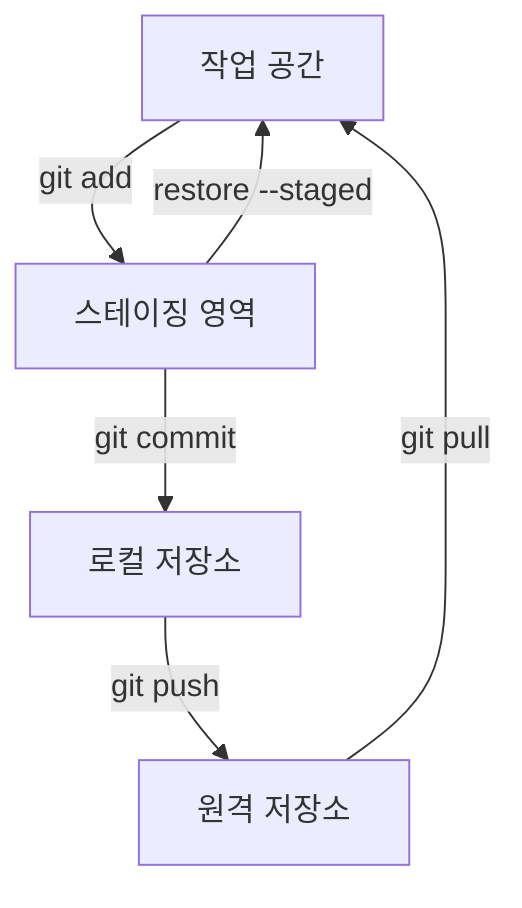

# 명령과 옵션 일람

관련 STEP: [STEP 02 저장소 준비와 파일 추적](../02-local-repository.md) · [STEP 03 커밋과 이력 기록](../03-commit-history.md) · [STEP 04 되돌리기와 무시 규칙](../04-amend-ignore.md) · [STEP 05 원격 저장소와 동기화](../05-remote.md)

수업에서 쓰는 Git 명령을 필수, 참고, 실행하지 않는 명령으로 나눈다. 처음에는 필수만 사용하고, 참고는 해당 STEP을 마친 뒤 강사 설명과 함께 실행한다. 같은 명령이라도 옵션에 따라 되돌릴 수 있는 범위가 달라지므로, 모르는 옵션은 먼저 `git status`와 `git diff`로 현재 상태를 확인한다.

## 왜 필요한가

`git commit`은 `-m`이 있으면 한 줄 메시지로 끝나지만, 없으면 vi 편집기가 열린다. `git push`는 처음 한 번 `-u`를 붙여야 다음부터 브랜치 이름을 줄일 수 있다. `git add .`는 편리하지만 의도하지 않은 파일까지 담을 수 있다. 이런 차이를 알고 있어야 초보자가 명령을 외우는 대신 상황에 맞게 고를 수 있다. 반대로 `reset --hard`, `push --force`처럼 작업을 잃을 수 있는 옵션은 수업에서 사용하지 않는다.

## 핵심 개념

- 작업 공간의 변경은 `git status`와 `git diff`로, stage된 변경은 `git diff --cached`로 확인한다.
- `-m`은 커밋 메시지를 인라인으로 넣고, `-u`는 첫 push에서 업스트림을 연결한다.
- `-a`는 이미 추적 중인 파일의 변경만 담는다. 새 파일은 `git add`가 필요하다.
- `--oneline`, `--graph`, `--all`은 이력을 읽기 쉽게 만든다.
- `--amend`는 공유 전 최근 커밋을 고치고, `--abort`는 진행 중인 병합을 취소한다.
- `--hard`, `--force`, `-D`, `-fd`는 되돌리기 어려운 작업을 만든다.

## 필수 명령

명령어 참조: [git config](../commands/config.md) · [git init](../commands/init.md) · [git status](../commands/status.md) · [git add](../commands/add.md) · [git commit](../commands/commit.md) · [git log](../commands/log.md) · [git diff](../commands/diff.md) · [git restore](../commands/restore.md) · [git rm](../commands/rm.md) · [git remote](../commands/remote.md) · [git clone](../commands/clone.md) · [git push](../commands/push.md) · [git pull](../commands/pull.md) · [git branch](../commands/branch.md) · [git switch](../commands/switch.md) · [git merge](../commands/merge.md) · [git tag](../commands/tag.md) · [git reset](../commands/reset.md) · [git revert](../commands/revert.md)

| 명령 | 의미와 사용 상황 |
| --- | --- |
| `git status` | 현재 변경과 stage 상태 확인 |
| `git diff` | 작업 파일 변경 확인 |
| `git add 파일명` | 다음 커밋에 넣을 파일 선택 |
| `git commit -m "메시지"` | 선택한 변경을 기록 |
| `git commit -am "메시지"` | 이미 추적 중인 파일의 변경만 자동 stage 후 커밋. 새 파일은 담지 않음 |
| `git log --oneline` | 짧은 커밋 이력 확인 |
| `git log --graph --oneline --all` | 브랜치 흐름 확인 |
| `git push` | 로컬 커밋을 원격에 보냄 |
| `git pull origin main` | 원격 변경을 로컬에 통합 |
| `git switch -c 이름` | 새 브랜치 생성과 이동 |
| `git restore --staged 파일명` | stage 해제, 작업 파일 보존 |
| `git init` | 빈 폴더를 Git 저장소로 초기화 |
| `git config --global user.name "이름"` | 커밋 작성자 이름 등록 |
| `git config --global user.email "이메일"` | 커밋 작성자 이메일 등록 |
| `git remote add origin 주소` | 원격 저장소 주소 등록 |
| `git remote -v` | 등록된 원격 주소 확인 |
| `git push -u origin main` | 첫 업로드와 업스트림 설정 |

## 참고 명령

| 명령 | 의미와 사용 상황 |
| --- | --- |
| `git diff --cached` | stage된 변경 확인 |
| `git log -n 3` | 최근 3개 커밋 확인 |
| `git log --stat` | 파일별 변경 통계 확인 |
| `git merge --no-ff` | merge 커밋을 남기는 병합 |
| `git tag -a v1.0.0 -m "메시지"` | 작성자와 설명이 포함된 주석 태그 생성 |
| `git tag v0.1.0` | 가벼운 태그 생성 |
| `git branch -d 이름` | 병합 완료된 브랜치 삭제 |
| `git config --local user.name "이름"` | 이 저장소에만 작성자 이름 등록 |
| `git clone 주소` | 원격 저장소를 별도 폴더에 복제 |
| `git revert HEAD` | 공유 후 커밋을 안전하게 되돌림 |
| `git merge --abort` | 진행 중인 병합 취소 |
| `git checkout 브랜치명` | 브랜치 전환(과거 명령) |
| `git add .` | 현재 폴더의 모든 변경을 stage |
| `git status --short` | 변경 상태를 짧게 표시 |
| `git log --decorate` | 브랜치와 태그 이름을 함께 표시 |
| `git diff --staged` | stage된 변경 확인(`--cached`와 같음) |

## 실행하지 않는 명령

| 명령 | 위험 | 대신 쓰는 방법 |
| --- | --- | --- |
| `git reset --hard` | 추적 파일 변경 유실 가능 | `git revert`로 커밋을 되돌리고, 작업 파일은 커밋 전 백업에서 복구 |
| `git push --force` | 원격 이력 덮어쓰기 위험 | `git pull` 후 일반 `git push` |
| `git clean -fd` | 추적되지 않은 파일 삭제 | `git status`로 확인하고 필요한 파일만 직접 정리 |
| `git branch -D 이름` | 병합 여부와 관계없이 브랜치 강제 삭제 | 병합 후 `git branch -d 이름` |

## 명령 지도

작업 공간, 스테이징 영역, 로컬 저장소, 원격 저장소 사이를 옮기는 명령을 한 장으로 본다.

## STEP별로 다시 보기

- STEP 01–02: `git --version`, `git config`, `git init`, `git status`, `git add` → [STEP 01](../01-environment.md) · [STEP 02](../02-local-repository.md)
- STEP 03: `git commit`, `git log`, `git reset <파일명>` → [STEP 03](../03-commit-history.md)
- STEP 04: `git commit --amend`, `git revert`, `.gitignore` → [STEP 04](../04-amend-ignore.md)
- STEP 05: `git remote`, `git push`, `git pull`, `git clone` → [STEP 05](../05-remote.md)
- STEP 06: Pages 배포와 갱신 → [STEP 06](../06-pages.md)
- STEP 10: `git branch`, `git switch`, `git tag` → [STEP 10](../10-branches-tags.md)
- STEP 11: `git merge`, 충돌 해결, `git log --graph` → [STEP 11](../11-merge-conflicts.md)
- STEP 12: 브랜치 push와 Pull Request → [STEP 12](../12-pull-request.md)

## 주의

- `USER`, `REPO`, `ISSUE_NUMBER` 같은 자리표시자는 실제 값으로 바꾼다.
- 공백이 있는 경로는 따옴표로 감싼다.
- 토큰을 URL, 명령, 파일, AI 대화에 넣지 않는다.
- 오류가 난 뒤에는 다음 명령을 연속 실행하지 말고 `git status`로 상태를 확인한다.
