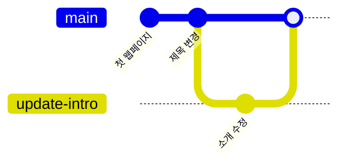
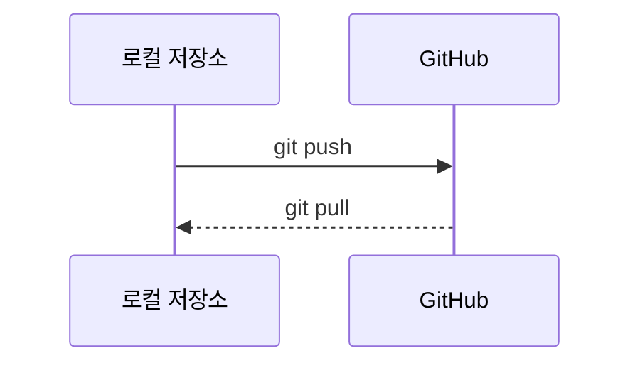

# 다이어그램 작성

관련 STEP: [STEP 07 마크다운과 다이어그램](../07-markdown-mermaid.md) · [STEP 11 병합과 충돌 해결](../11-merge-conflicts.md)

Mermaid는 Markdown 코드 블록 안에 텍스트로 다이어그램을 그리는 도구이다. Git의 3영역, 브랜치 흐름, push와 pull을 그림으로 남길 수 있다. 이미지 파일 대신 텍스트로 저장되므로 README와 함께 버전 관리되고, 변경 내용을 diff로 비교할 수 있다.

## 왜 필요한가

그림을 이미지로만 만들면 수정할 때 원본 파일이 필요하고, 변경 이력을 비교하기 어렵다. Mermaid는 다이어그램의 원본이 Markdown 안에 있으므로 Git으로 함께 커밋할 수 있다. README에 Git 흐름도를 넣어 두면 처음 보는 사람도 저장소의 작업 순서를 빠르게 이해한다.

## 참고 자료

이 페이지의 [GitHub 원본](https://github.com/qus0in-factory/learn/blob/dev/docs/lecture/appendix/04-mermaid.md)에서 각 그림의 텍스트를 볼 수 있다.

- [Mermaid 공식 문서](https://mermaid.js.org/): 다이어그램 종류와 작성법 확인
- [GitHub 다이어그램 안내](https://docs.github.com/en/get-started/writing-on-github/working-with-advanced-formatting/creating-diagrams): GitHub 문서에 다이어그램 표시
- [Notion 다이어그램 안내](https://www.notion.com/help/code-blocks): 문서에서 다이어그램 표시
- [draw.io Mermaid 안내](https://www.drawio.com/blog/mermaid-diagrams): 다이어그램 도구에서 Mermaid 사용

## Git 흐름도


## 브랜치 흐름



## push와 pull



## README에 넣기

GitHub 원본에서 필요한 예시를 확인하고 README에 적용한다. 편집기 미리보기와 GitHub 저장소 화면에서 결과를 확인한다.

## 에이전트 요청 예시

```text
저장소 Git 흐름 Mermaid flowchart README 추가. 실제 파일 수정 금지, 코드 제안만
```

## 체크리스트

- [ ] VS Code 미리보기에서 다이어그램이 보인다.
- [ ] GitHub 저장소 화면에서도 같은 다이어그램이 보인다.
- [ ] 노드 이름과 화살표 라벨이 읽기 쉽다.
- [ ] README의 다른 Markdown 문법이 깨지지 않았다.

## 주의

- 다이어그램이 너무 커지면 한 장에 모든 내용을 넣지 말고 두세 개로 나눈다.
- README에 비밀값이나 내부 주소를 넣지 않는다.
- 렌더링 결과는 GitHub와 VS Code에서 확인한다. 코드만 보고 통과로 판단하지 않는다.
