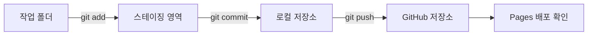
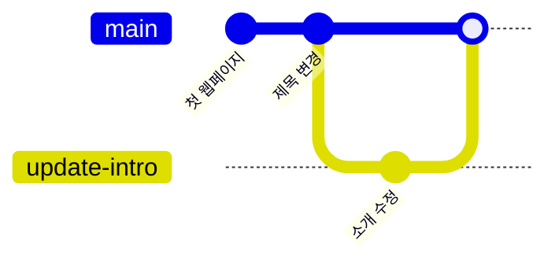
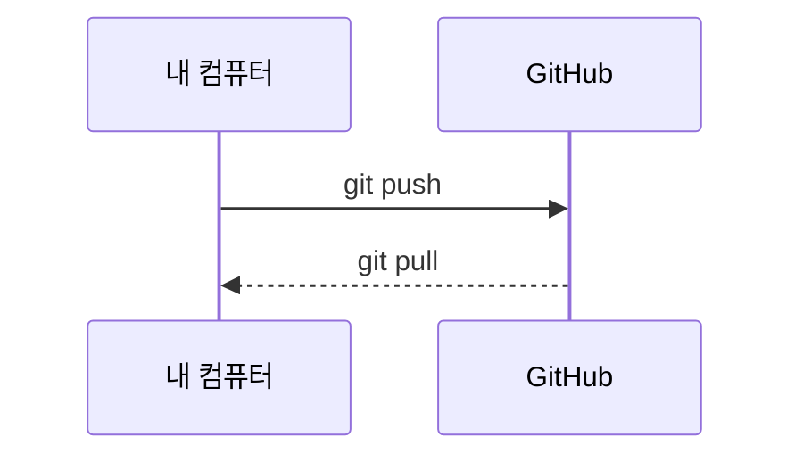

# 다이어그램 작성

관련 STEP: [STEP 07 마크다운과 다이어그램](../07-markdown-mermaid.md) · [STEP 11 병합과 충돌 해결](../11-merge-conflicts.md)

Mermaid는 Markdown 코드 블록 안에 텍스트로 다이어그램을 그리는 도구이다. Git의 3영역, 브랜치 흐름, push와 pull을 그림으로 남길 수 있다. 이미지 파일 대신 텍스트로 저장되므로 README와 함께 버전 관리되고, 변경 내용을 diff로 비교할 수 있다.

## 왜 필요한가

그림을 이미지로만 만들면 수정할 때 원본 파일이 필요하고, 변경 이력을 비교하기 어렵다. Mermaid는 다이어그램의 원본이 Markdown 안에 있으므로 Git으로 함께 커밋할 수 있다. README에 Git 흐름도를 넣어 두면 처음 보는 사람도 저장소의 작업 순서를 빠르게 이해한다.

## 핵심 개념

- 코드 블록 언어를 `mermaid`로 지정하면 GitHub와 VS Code 미리보기가 다이어그램으로 렌더링한다.
- `flowchart`는 순서도, `sequenceDiagram`은 시간 순서의 메시지, `gitGraph`는 커밋과 브랜치 흐름을 그린다.
- 노드는 `[이름]`, 화살표는 `-->`, 화살표 라벨은 `-->|텍스트|`로 표현한다.
- 노드 ID는 영문으로 두고, 화면에 보이는 이름은 대괄호 안에 적는다.
- 렌더링이 되지 않으면 코드 블록 첫 줄이 `mermaid`인지 먼저 확인한다.

## Git 흐름도



## 브랜치 흐름



## push와 pull



## README에 넣기

1. `README.md`를 연다.
2. 다이어그램을 넣을 위치에 빈 줄을 만들고, 언어 이름을 `mermaid`로 지정한 코드 블록을 연다.
3. 위 코드 중 필요한 하나를 붙여 넣는다.
4. 코드 블록을 닫는다.
5. VS Code 미리보기(`Ctrl + K`, 그다음 `V`)에서 렌더링을 확인한다.
6. `git add README.md`, `git commit`, `git push`로 반영한다.
7. GitHub 저장소 메인 화면에서도 다이어그램이 보이는지 확인한다.

## 에이전트 요청 예시

```text
저장소 Git 흐름 Mermaid flowchart README 추가. 실제 파일 수정 금지, 코드 제안만
```

## 체크리스트

- [ ] 코드 블록 언어가 `mermaid`다.
- [ ] VS Code 미리보기에서 다이어그램이 보인다.
- [ ] GitHub 저장소 화면에서도 같은 다이어그램이 보인다.
- [ ] 노드 이름과 화살표 라벨이 읽기 쉽다.
- [ ] README의 다른 Markdown 문법이 깨지지 않았다.

## 주의

- 노드 ID에 공백이나 특수 문자를 넣지 않는다. 화면에 보이는 이름은 `[ ]` 안에 적는다.
- `end`는 Mermaid 예약어와 충돌할 수 있으므로 노드 ID로 쓰지 않는다.
- 다이어그램이 너무 커지면 한 장에 모든 내용을 넣지 말고 두세 개로 나눈다.
- README에 비밀값이나 내부 주소를 넣지 않는다.
- 렌더링 결과는 GitHub와 VS Code에서 확인한다. 코드만 보고 통과로 판단하지 않는다.
