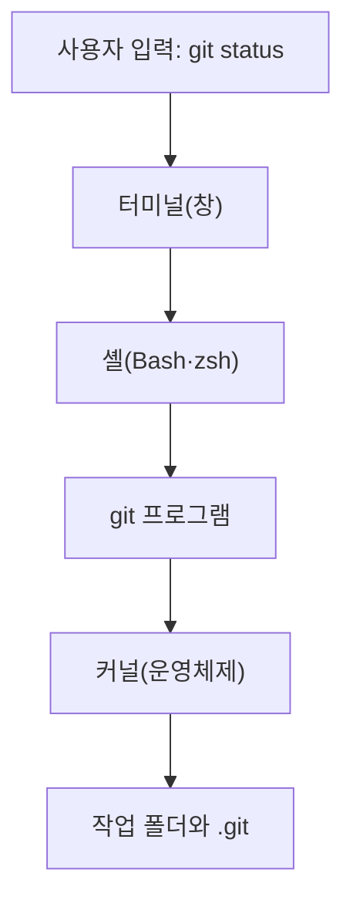

# CLI·터미널·셸

관련 STEP: [STEP 01 버전 관리의 세 영역](../01-environment.md) · [운영체제별 차이](05-os-differences.md) 부록

수업에서는 마우스 대신 글자로 명령을 입력해 Git을 쓴다. 이 부록은 그 명령이 어디에서 입력되고 어떻게 실행되는지 짧게 정리한다. 이름이 비슷한 용어가 많으므로 한 번만 구분해 두면 이후 오류 메시지를 읽기 쉽다.

## 학습 목표

- CLI와 GUI의 차이를 설명할 수 있다.
- 터미널, 셸, 커널의 역할을 구분할 수 있다.
- Windows의 Git Bash와 macOS 터미널의 기본 셸이 무엇인지 말할 수 있다.
- `git` 명령이 셸에서 실행되는 흐름을 설명할 수 있다.

## 왜 필요한가

터미널을 처음 열면 검은 창에 깜빡이는 커서만 보여 무엇을 하는 곳인지 알기 어렵다. 터미널과 셸을 같은 것으로 생각하면 "명령을 찾을 수 없다"는 오류가 났을 때 어디를 확인해야 하는지 막막해진다. 각 용어의 역할을 알면 문제가 창, 셸, Git 중 어디에서 생겼는지 나누어 볼 수 있다.

## 핵심 개념

| 용어 | 뜻 | 예 |
| --- | --- | --- |
| GUI | 창과 버튼을 마우스로 누르는 화면 조작 방식 | VS Code, 파일 탐색기 |
| CLI | 글자 명령을 입력해 프로그램을 조작하는 방식 | `git status`, `cd` |
| 터미널 | 명령을 입력하고 결과를 보여 주는 창 | VS Code 터미널, macOS 터미널 |
| 셸 | 입력한 명령을 해석해 프로그램을 실행하는 프로그램 | Bash, zsh |
| 커널 | 파일·메모리·장치를 관리하는 운영체제의 핵심 | Windows, macOS의 핵심부 |

- GUI는 눈에 보이는 버튼을 누르는 방식이고, CLI는 정해진 명령을 글자로 적는 방식이다. CLI는 같은 명령을 반복하거나 기록으로 남기기 쉽다.
- 터미널은 입력과 출력을 보여 주는 창일 뿐이다. 명령의 뜻을 해석하는 일은 터미널 안에서 돌아가는 셸이 맡는다.
- 셸은 명령을 해석해 해당 프로그램을 찾아 실행한다. 프로그램이 파일을 읽거나 쓰는 일은 셸이 직접 하지 않고 커널에 요청한다.
- Windows에서는 Git을 설치할 때 함께 들어오는 Git Bash가 터미널과 Bash 셸 역할을 한다. 수업은 Git Bash를 기준으로 한다.
- macOS의 기본 터미널은 zsh 셸을 쓴다. PowerShell과 CMD는 Bash와 다른 셸이므로 수업 명령을 그대로 실행한다고 가정하지 않는다.

## Git 실행 흐름

Git은 터미널이나 셸 안의 기능이 아니라 별도로 설치된 프로그램이며, 셸이 찾아서 실행한다.

`git status`를 입력했을 때의 실행 흐름

1. 터미널이 입력한 글자를 셸에 전달한다.
2. 셸이 `git`이라는 이름의 프로그램을 PATH에서 찾아 실행한다.
3. Git이 현재 폴더의 `.git`과 작업 파일을 읽으려고 커널에 요청한다.
4. 결과를 셸이 받아 터미널 창에 출력한다.

## 따라하기

1. Windows에서는 Git Bash, macOS에서는 터미널을 연다.
2. `echo $SHELL`을 입력해 사용 중인 셸을 확인한다. macOS에서는 보통 `/bin/zsh`, Git Bash에서는 Bash 경로가 나온다.
3. `pwd`를 입력해 현재 폴더를 확인한다.
4. `which git`을 입력해 셸이 찾은 Git 프로그램의 위치를 확인한다.
5. `git --version`을 입력해 Git이 실행되는지 확인한다.

## 체크리스트

- [ ] 터미널, 셸, 커널의 역할을 한 문장씩 말할 수 있다.
- [ ] `echo $SHELL`로 내 셸 이름을 확인했다.
- [ ] `which git`이 Git 위치를 출력한다.
- [ ] `git --version`이 정상 출력된다.
- [ ] Windows 수업 환경으로 PowerShell이나 CMD가 아닌 Git Bash를 쓴다.

## 주의

- 명령은 한 줄씩 실행하고 출력 결과를 읽은 뒤 다음 명령으로 넘어간다.
- `which git`이 아무것도 출력하지 않으면 Git 설치나 PATH 등록을 먼저 확인한다.
- 의미를 모르는 명령을 복사해 붙여 넣지 않는다.
- 비밀번호와 토큰을 터미널 출력으로 채팅·파일·Issue에 노출하지 않는다.
- OS별 경로와 인증 차이는 [운영체제별 차이](05-os-differences.md) 부록을 참고한다.
