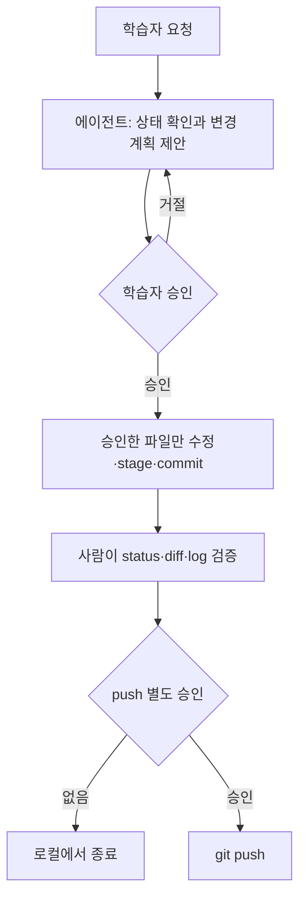

# Git 실습 시나리오

관련 STEP: [STEP 03 커밋과 이력 기록](../03-commit-history.md) · [STEP 04 되돌리기와 무시 규칙](../04-amend-ignore.md) · [STEP 11 병합과 충돌 해결](../11-merge-conflicts.md) · [STEP 12 풀 리퀘스트와 협업](../12-pull-request.md)

STEP 01~12에서 배운 명령과 개념만으로 실제 작업 상황을 처음부터 끝까지 해결하는 연습이다. 세 시나리오는 기초·응용·심화 순서로 어려워진다. 각 단계는 사람이 직접 실행하는 명령과 OpenCode 에이전트에게 지시하는 문장을 함께 제시한다. 에이전트는 학습자를 대신해 결정하지 않는다. 파일 수정, 명령 실행, 원격 변경은 학습자가 승인한다.

## 학습 목표

- 상황을 읽고 어느 STEP의 명령으로 해결할지 고를 수 있다.
- 에이전트에게 계획을 먼저 요청하고, 승인한 범위에서만 실행하게 할 수 있다.
- `git status`·`git diff`·`git log`로 결과를 스스로 검증할 수 있다.
- 되돌리기 어려운 명령을 쓰지 않고 상황을 해결할 수 있다.

## 왜 필요한가

STEP마다 명령을 따라 쳐 보면 손에는 익지만, 실제 작업에서는 "지금 어떤 명령이 필요한가"를 스스로 골라야 한다. 에이전트를 쓰면 반복 작업이 빨라지는 대신 잘못된 파일을 고치거나 승인 없이 원격을 바꿀 수 있다. 특히 초보자는 에이전트의 설명을 실제 Git 결과로 착각하기 쉽다. 이 부록은 에이전트를 믿고 맡기는 연습이 아니라 계획을 읽고 승인하고 결과를 검증하는 연습이다.

## 핵심 개념

- 에이전트는 설명과 제안을 먼저 제공하고, 실행은 학습자가 승인한 뒤에 한다.
- 원격 push와 되돌리기 어려운 명령은 별도 명시 승인이 필요하다.
- 비밀정보, 토큰, 비밀번호는 에이전트에게 전달하지 않는다.
- 에이전트의 설명과 실제 Git 결과가 다르면 실제 결과를 기준으로 멈춘다.
- 커밋 저자는 `git config user.name`·`user.email`에 등록된 학습자로 유지한다.

## 공통 안전 프롬프트

모든 에이전트 요청 앞에 다음 문구를 붙인다. "원격 변경 금지"는 승인 없는 push를 금지한다는 뜻이며 승인된 push는 허용한다.

```text
교육용 저장소 한정. 비밀정보 요청 및 원격 변경 금지. 실행 전 변경 계획 제시. 학습자 승인 후 실행과 결과 검증.
```



## 기초: 섞인 변경 정리

사용 STEP: 02 · 03 · 04

### 상황

작업 폴더(예: `portfolio-web`)에서 `index.html`의 자기소개 문장을 고치고, 같은 김에 `style.css`의 색상도 바꿨다. 폴더에는 운영체제가 만든 `.DS_Store`(또는 `Thumbs.db`)도 생겼다. `git status`에 세 파일이 함께 보인다.

### 목표

자기소개 수정과 색상 변경을 서로 다른 커밋으로 남기고, 운영체제 파일은 앞으로도 추적하지 않게 한다.

### 단계

1. 직접 실행: `git status`로 변경된 파일 세 개를 확인한다.
2. 직접 실행: `git diff`로 `index.html`과 `style.css`의 변경 내용을 읽는다.
3. 에이전트 지시: "교육용 저장소 상태 확인: 변경 파일 목록과 각 파일의 변경 요약. 커밋을 어떻게 나눌지 계획만 제시." 계획을 읽고 자기소개와 색상을 분리하는 안을 승인한다.
4. 직접 실행: `git add index.html` 뒤 `git status`로 stage된 파일이 하나인지 확인한다.
5. 직접 실행: `git commit -m "docs: 자기소개 문장 수정"`.
6. 직접 실행: `git add style.css`, `git commit -m "style: 포인트 색상 변경"`.
7. 에이전트 지시: "`.gitignore`에 운영체제 임시 파일 패턴을 추가하는 변경 계획 제시. 파일은 내가 승인한 뒤 수정." 승인한 뒤 에이전트가 `.gitignore`를 수정하면 `git diff`로 추가된 줄을 읽는다.
8. 직접 실행: `git add .gitignore`, `git commit -m "chore: 운영체제 임시 파일 무시"`.
9. 직접 실행: `git log --oneline`으로 커밋 세 개가 의도한 순서로 쌓였는지 본다.

실수로 `git add .`를 눌러 세 파일이 함께 stage됐다면 `git restore --staged style.css`처럼 파일 단위로 stage를 해제한다. 작업 파일은 그대로 남는다.

### 확인

- [ ] `git status`가 깨끗하다(커밋할 변경 없음).
- [ ] `git log --oneline`에 커밋 세 개가 각각 한 가지 변경만 담았다.
- [ ] `.DS_Store`가 `git status`에 나타나지 않는다.
- [ ] 에이전트가 수정한 파일이 승인한 `.gitignore` 하나뿐이다.

### 흔한 실수

- `git add .`로 모든 변경을 한 커밋에 담는다. 커밋 단위가 섞이면 되돌릴 때 함께 사라진다.
- `.DS_Store`를 이미 커밋한 뒤 `.gitignore`만 추가한다. 추적 중인 파일은 `git rm --cached .DS_Store`로 먼저 추적을 끊어야 한다.
- 에이전트가 "커밋했다"고 말한 것을 그대로 믿는다. `git log --oneline`으로 직접 확인한다.

## 응용: 브랜치 작업과 충돌

사용 STEP: 05 · 10 · 11

### 상황

`main`에서 포트폴리오를 GitHub에 올려 둔 상태다. 프로젝트 소개 섹션을 새로 만들려는데, 동료(또는 두 번째 터미널)가 같은 `index.html`의 제목 문구를 `main`에서 바꿔 push했다.

### 목표

새 섹션을 브랜치에서 작업하고 `main`과 병합한다. 충돌이 나면 두 변경을 모두 살려 해결하고, 완료 버전에 태그를 붙여 push한다.

### 단계

1. 직접 실행: `git switch -c feature/projects`로 작업 브랜치를 만들고 이동한다.
2. 에이전트 지시: "`index.html`에 프로젝트 소개 섹션을 추가하는 변경 계획 제시. 제목 문구는 건드리지 말 것. 승인 전 수정 금지." 계획을 승인하고 결과를 `git diff`로 읽는다.
3. 직접 실행: `git add index.html`, `git commit -m "feat: 프로젝트 소개 섹션 추가"`.
4. 직접 실행: `git switch main` 뒤 `git pull`로 동료의 제목 변경을 받는다.
5. 직접 실행: `git merge feature/projects`. 충돌 메시지가 나오면 `git status`로 충돌 파일을 확인한다.
6. 에이전트 지시: "충돌한 양쪽 변경의 의도를 설명하고 관련 범위만 수정할 해결안을 제시해 줘. 변경 이유와 diff·실행 검증 방법을 설명하고 승인 전 수정하지 마. 비밀정보 입력, 무조건 한쪽 선택, 강제 push 우회 금지." 해결안을 읽고 승인한다. 판단이 어려우면 `git merge --abort`로 병합 전 상태로 돌아간 뒤 강사와 상의한다.
7. 직접 실행: 충돌 표시와 두 의도가 반영됐는지 `git diff`와 실행 결과로 확인하고 `git add index.html`, `git commit -m "merge: 프로젝트 섹션과 제목 변경 통합"`.
8. 직접 실행: `git log --graph --oneline --all`로 두 갈래가 합쳐진 모양을 본다.
9. 직접 실행: `git tag -a v1.1.0 -m "프로젝트 섹션 추가"`.
10. 에이전트 지시: "push 전 확인 항목 정리: 현재 브랜치, 원격 주소(`git remote -v`), 마지막 커밋 해시." 확인한 뒤 push를 명시적으로 승인한다.
11. 직접 실행: `git push`와 `git push origin v1.1.0`. 브라우저로 GitHub 저장소와 GitHub Pages 주소를 열어 두 변경이 모두 반영됐는지 본다.
12. 직접 실행: `git branch -d feature/projects`로 병합이 끝난 브랜치를 지운다.

### 확인

- [ ] `git log --graph --oneline --all`에 병합 커밋이 보이고 브랜치 두 개가 합쳐졌다.
- [ ] `index.html`에 새 제목 문구와 프로젝트 섹션이 모두 있다.
- [ ] `git tag`에 `v1.1.0`이 보이고 GitHub 저장소 태그 목록에도 있다.
- [ ] push는 학습자가 승인한 뒤 한 번만 실행했다.

### 흔한 실수

- `main`에서 바로 작업을 시작한다. 브랜치를 먼저 만들지 않으면 병합 연습이 되지 않는다.
- 충돌 표시 줄을 지우지 않고 커밋한다. `git diff`에 `<<<<<<<`가 남아 있으면 커밋하지 않는다.
- 충돌이 무서워 `git reset --hard`나 `git push --force`를 찾는다. 수업에서는 쓰지 않으며 `git merge --abort`가 안전한 탈출구다.
- `git branch -D`로 강제 삭제한다. 병합이 끝난 브랜치는 `-d`로 지워진다.

## 심화: 이슈에서 되돌리기까지

사용 STEP: 04 · 09 · 12

### 상황

GitHub 저장소에 "모바일에서 메뉴가 겹친다"는 Issue가 올라왔다. 수정해서 Pull Request로 리뷰를 받고 병합했는데, 배포된 사이트에서 다른 화면이 깨진 것을 발견했다. 원격 `main`에는 이미 그 커밋이 올라가 있다.

### 목표

이슈 번호를 커밋과 PR에 연결해 작업하고, 배포 뒤 문제가 된 커밋을 이력을 지우지 않고 되돌린다.

### 단계

1. 직접 실행: GitHub 웹에서 Issue 내용을 읽고 번호(예: #7)를 메모한다. `gh issue list`를 설치했다면 터미널에서 확인해도 된다.
2. 직접 실행: `git switch main`, `git pull`로 최신 상태를 받고 `git switch -c fix/mobile-menu`.
3. 에이전트 지시: "Issue #7 모바일 메뉴 겹침을 고치는 변경 계획 제시: 대상 파일, 수정 이유, 예상 diff. 이번 목적과 무관한 변경은 포함하지 말 것." 계획을 승인하고 결과를 `git diff`로 읽는다.
4. 직접 실행: `git add style.css`, `git commit -m "fix: 모바일 메뉴 겹침 수정 (#7)"`.
5. 에이전트 지시: "push 전 확인 항목: 브랜치 이름, 원격, 커밋 해시." 확인한 뒤 승인한다.
6. 직접 실행: `git push -u origin fix/mobile-menu`.
7. 직접 실행: GitHub 웹에서 Pull Request를 만들고 본문에 `Closes #7`을 적는다. 동료 리뷰를 받고 웹에서 병합한다. `gh pr create`를 쓰는 경우도 리뷰와 병합은 웹에서 확인한다.
8. 직접 실행: `git switch main`, `git pull`, `git branch -d fix/mobile-menu`. Issue #7이 닫혔는지 웹에서 확인한다.
9. 배포된 GitHub Pages 사이트에서 다른 화면이 깨진 것을 발견한다. 직접 실행: `git log --oneline`으로 문제 커밋(병합으로 들어온 fix 커밋)의 해시를 찾는다.
10. 에이전트 지시: "커밋 `해시`를 `git revert`로 되돌리는 계획 제시. 이력을 지우는 명령은 제안하지 말 것." 계획을 승인한다.
11. 직접 실행: `git revert 해시`. 편집기가 열리면 기본 메시지를 저장하고 닫는다. `git log --oneline`에 revert 커밋이 추가됐는지 본다.
12. 에이전트 지시: "push 전 확인 항목 정리." 확인한 뒤 push를 승인하고 직접 실행: `git push`.
13. 직접 실행: GitHub 웹에서 Issue #7에 "되돌림 커밋 해시와 이유"를 코멘트로 남기고 다시 연다.

### 확인

- [ ] 커밋 메시지와 PR 본문에 Issue 번호가 들어가 PR 병합으로 Issue가 닫혔다.
- [ ] `git log --oneline`에 fix 커밋과 revert 커밋이 모두 남아 있다.
- [ ] 배포 사이트에서 깨진 화면이 복구됐다.
- [ ] 원격 변경은 push 두 번(브랜치, revert)뿐이며 각각 승인했다.

### 흔한 실수

- `main`에서 직접 커밋하고 push해 PR 없이 병합한다. 리뷰 기록이 남지 않는다.
- 문제 커밋을 지우려고 `git reset --hard` 뒤 `git push --force`를 생각한다. 공유된 이력은 `git revert`로만 되돌린다.
- revert 뒤 Issue를 갱신하지 않는다. 다음 작업자가 왜 되돌렸는지 알 수 없다.
- 에이전트에게 토큰이나 비밀번호를 붙여 넣는다. 인증 창과 2FA는 학습자가 직접 처리한다.

## 사용한 명령과 STEP

| 명령 | STEP | 시나리오 |
| --- | --- | --- |
| `git status`, `git add`, `git config` | 02 | 기초·응용·심화 |
| `git commit -m`, `git diff`, `git log --oneline`, `git restore --staged` | 03 | 기초·응용·심화 |
| `git rm --cached`, `.gitignore`, `git revert` | 04 | 기초·심화 |
| `git remote -v`, `git push`, `git push -u`, `git pull` | 05 | 응용·심화 |
| GitHub Pages 확인 | 06 | 응용·심화 |
| Issue 번호 연결, `gh issue list`(선택) | 09 | 심화 |
| `git switch -c`, `git switch`, `git tag -a`, `git branch -d` | 10 | 응용·심화 |
| `git merge`, `git merge --abort`, `git log --graph --oneline --all` | 11 | 응용 |
| Pull Request, `Closes #번호`, `gh pr create`(선택) | 12 | 심화 |

## 주의

- `reset --hard`, `push --force`, `branch -D`, `clean -fd`는 어느 시나리오에서도 실행하지 않는다.
- 에이전트의 자동 전체 승인을 켜지 않는다. 파일 수정, 명령 실행, 원격 변경을 하나씩 확인한다.
- 에이전트의 설명과 실제 Git 결과가 다르면 실제 결과를 기준으로 멈추고 강사에게 알린다.
- 명령 옵션은 [명령과 옵션 일람](02-git-options.md), OS별 차이는 [운영체제별 차이](05-os-differences.md)를 참고한다.
