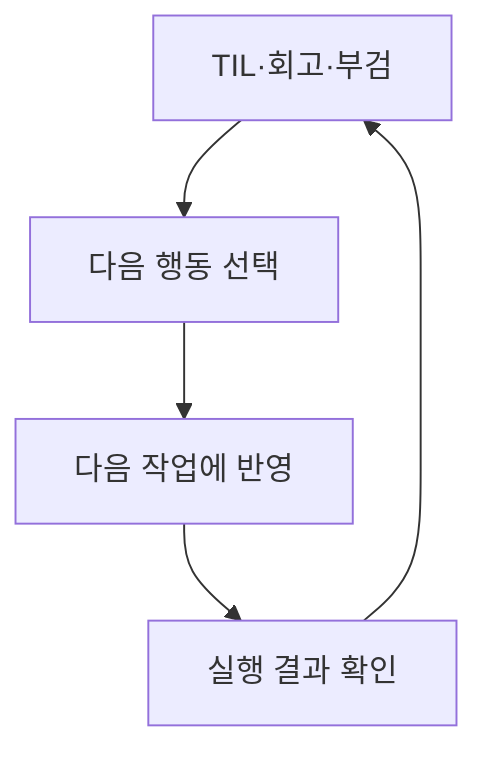

# 기록 작성 예시

관련 STEP: [STEP 08 프로필과 작업 기록](../08-profile-records.md)

## TIL 템플릿

주제별로 짧게 적고, 직접 확인한 내용과 아직 확인하지 못한 내용을 나눈다.

```markdown
# 날짜 · 배운 주제
- 질문: 무엇을 해결하려 했는가?
- 배운 점: 어떤 개념이나 방법을 알게 되었는가?
- 확인: 무엇을 실행했고 어떤 결과를 보았는가?
- 참고: 다시 볼 문서 링크
- 다음 질문: 더 확인할 점
```

### TIL 예시

```markdown
# stage 해제
- 질문: 수정 내용은 남기고 stage에서만 빼려면?
- 배운 점: git restore --staged <파일명>으로 stage를 해제한다.
- 확인: git status에서 파일이 staged가 아닌 수정 파일로 표시됐다.
- 참고: https://git-scm.com/docs/git-restore
- 다음 질문: 파일 내용까지 되돌리는 옵션과 어떻게 다른가?
```

## KPT 템플릿

감상도 남기되 Try는 다음 작업에서 실행 여부를 확인할 수 있게 적는다.

```markdown
# 작업 회고
- 작업과 느낌: 무엇을 했고 어떻게 느꼈는가?
- Keep: 유지할 행동과 도움이 된 이유
- Problem: 어려웠던 상황과 영향
- Try: 다음에 바꿀 행동, 실행 시점, 확인 방법
```

### KPT 예시

```markdown
# 첫 커밋 회고
- 작업과 느낌: 커밋을 마쳤지만 편집기가 열려 당황했다.
- Keep: 커밋 전 diff를 읽어 불필요한 변경을 찾았다.
- Problem: 편집기 종료법을 몰라 작업이 지연됐다.
- Try: 다음 실습 전에 vi 저장·종료를 한 번 연습하고 직접 종료해 본다.
```

## 부검 템플릿

관찰한 사실과 추측을 나눈다. 원인을 확인하지 못했다면 미확인으로 남기고 추가 확인 방법을 적는다.

```markdown
# 문제 이름
- 발생 상황: 언제, 어떤 작업에서 무엇이 일어났는가?
- 영향: 어떤 작업이 얼마나 지연되거나 실패했는가?
- 시간 흐름: 발견, 조사, 조치, 복구 순서
- 원인과 근거: 확인한 원인과 이를 뒷받침하는 결과
- 조치와 검증: 무엇을 바꿨고 복구를 어떻게 확인했는가?
- 후속 작업: 담당자, 기한, 완료 확인 방법
```

### 부검 예시

```markdown
# 커밋 편집기 종료 지연
- 발생 상황: git commit 실행 뒤 vi가 열렸고 종료 방법을 몰랐다.
- 영향: 실습 커밋이 약 5분 늦어졌다.
- 시간 흐름: 편집기 진입 → 종료법 확인 → 메시지 저장 → 커밋 확인
- 원인과 근거: -m 없이 실행해 설정된 편집기가 열렸다. 오류로 멈춘 상태는 아니었다.
- 조치와 검증: 메시지를 적고 Esc, :wq로 종료한 뒤 git log -1로 커밋을 확인했다.
- 후속 작업: 작성자가 다음 실습 전 vi 종료법을 연습하고 직접 저장·종료를 확인한다.
```

## 다음 작업 반영

기록만 남기지 않고 Try와 후속 작업을 다음 작업의 체크리스트나 이슈에 옮긴다. 다음 회고에서 실행 결과를 확인하고 효과가 없으면 방법을 고친다. 에이전트에게 작업을 맡길 때도 확인된 개선 사항을 작업 조건에 넣고 결과를 검토한다.



공개 기록에는 비밀번호·토큰·개인정보를 넣지 않는다. 명령 출력이나 화면을 붙일 때도 비밀 값이 없는지 확인한다.
