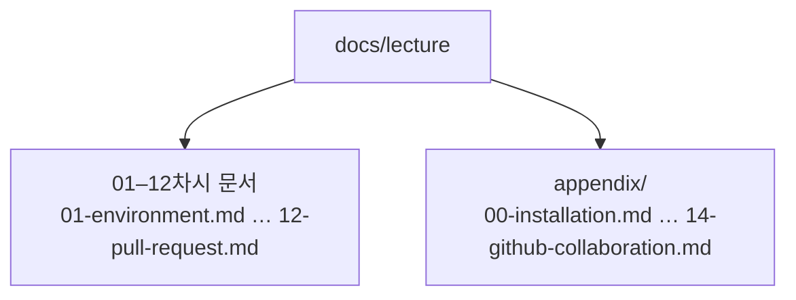

# Git과 웹 배포: 2일 12차시

개발 입문 15일 차 학습자를 위한 과정이다. `index_v1.html`, `index_final.html`처럼 파일을 복사해 버전을 관리하던 습관을 Git으로 바꾼다. 내 컴퓨터에 변경 이력을 남기고, GitHub에 백업한 뒤, GitHub Pages로 실제 웹 주소에 공개한다. 둘째 날에는 Markdown 문서화, Issue 관리, 브랜치와 Pull Request로 동료와 협업하는 흐름을 익힌다.

## 과정을 마치면

- 웹페이지 변경을 커밋으로 남기고 이전 상태를 확인할 수 있다.
- GitHub에 코드를 백업하고 Pages 주소로 공개할 수 있다.
- README, TIL, Issue로 작업과 배운 점을 기록할 수 있다.
- 브랜치에서 실험하고 Pull Request로 `main`에 합칠 수 있다.

## 12차시 일정

각 차시는 수업 45분과 휴식 15분으로 끝난다. 점심은 양일 모두 12:00–13:00 고정이다. 강의 일정과 PDF 자산 정보를 D1에서 조회하는 [카탈로그](catalog.md)도 제공한다.

| 일자 | 차시 | 수업 45분 | 휴식 15분 | 주제 |
| :--- | :---: | :---: | :---: | :--- |
| Day 1 | 1차시 | 09:00–09:45 | 09:45–10:00 | [형상관리 입문과 도구 점검](01-environment.md) |
| Day 1 | 2차시 | 10:00–10:45 | 10:45–11:00 | [Git 설정과 로컬 저장소](02-local-repository.md) |
| Day 1 | 3차시 | 11:00–11:45 | 11:45–12:00 | [커밋과 이력 기록](03-commit-history.md) |
| Day 1 | 점심 | 12:00–13:00 | — | 고정 휴식 |
| Day 1 | 4차시 | 13:00–13:45 | 13:45–14:00 | [이력 수정과 파일 배제](04-amend-ignore.md) |
| Day 1 | 5차시 | 14:00–14:45 | 14:45–15:00 | [GitHub 원격 연동](05-remote.md) |
| Day 1 | 6차시 | 15:00–15:45 | 15:45–16:00 | [GitHub Pages 배포](06-pages.md) |
| Day 2 | 7차시 | 09:00–09:45 | 09:45–10:00 | [Markdown과 Mermaid](07-markdown-mermaid.md) |
| Day 2 | 8차시 | 10:00–10:45 | 10:45–11:00 | [프로필과 지속적 기록](08-profile-records.md) |
| Day 2 | 9차시 | 11:00–11:45 | 11:45–12:00 | [Issue, Label, Milestone](09-issues.md) |
| Day 2 | 점심 | 12:00–13:00 | — | 고정 휴식 |
| Day 2 | 10차시 | 13:00–13:45 | 13:45–14:00 | [브랜치와 태그](10-branches-tags.md) |
| Day 2 | 11차시 | 14:00–14:45 | 14:45–15:00 | [병합과 충돌 해결](11-merge-conflicts.md) |
| Day 2 | 12차시 | 15:00–15:45 | 15:45–16:00 | [Pull Request와 협업](12-pull-request.md) |

<Illustration name="journey" alt="도구 점검과 Git 설정에서 커밋, 원격 연동, 배포, 기록, 브랜치와 Pull Request 협업까지 이어지는 12차시 학습 흐름" />

<a href="https://raw.githubusercontent.com/qus0in-factory/learn/73c7250d0f277bf54cdec29eb4af6a0e10847a01/review-assets/82-journey.png" target="_blank" rel="noopener noreferrer">원본 크게 보기 (새 창)</a>

## 남는 2시간 활용

12차시 12시간(720분, 점심 제외)과 별도로 2시간 버퍼를 둔다. 설치·네트워크 장애와 진도 지연을 먼저 흡수하고, 남은 시간만 보충에 쓴다. 2시간을 확정 추가 수업으로 정하지 않으며, 파트별 고정 시간도 두지 않는다. 개별 학습으로 진행할지, 강사와 함께 추가 실습을 할지 현장에서 정한다.

| 남은 시간 | 가능한 조합 예시 |
| :---: | :--- |
| 15분 | README 링크 1개 확인, 퀴즈 3문항 |
| 30분 | README 보완 1개, 스타일 조정 1개 |
| 60분 | 심화 실습 2개, 복습 퀴즈 6문항 |
| 120분 | 심화 실습 3개, 복습 퀴즈 10문항, 에이전트 주도 Git |

## 부록

- [설치 준비](appendix/00-installation.md)
- [자격 증명 재인증](appendix/01-authentication.md)
- [명령과 옵션 일람](appendix/02-git-options.md)
- [웹 디자인 보조 도구](appendix/03-web-tools.md)
- [다이어그램 작성](appendix/04-mermaid.md)
- [운영체제별 차이](appendix/05-os-differences.md)
- [CLI·터미널·셸](appendix/06-cli-terminal-shell.md)
- [Git 실습 시나리오](appendix/07-git-scenarios.md)
- [vi 편집기](appendix/08-vi-editor.md)
- [커밋 메시지 규칙](appendix/09-commit-message.md)
- [.gitignore 패턴](appendix/10-gitignore-patterns.md)
- [환경 변수와 비밀 정보](appendix/11-environment-secrets.md)
- [AI 서비스 연결](appendix/12-nvidia-nim.md)
- [프로필과 기록 작성](appendix/13-profile-records.md)
- [GitHub 협업](appendix/14-github-collaboration.md)

## 문서 구조

## 준비물과 안전 규칙

- VS Code, Git, 터미널(Windows Git Bash 또는 macOS 터미널), GitHub 계정, OpenCode를 준비한다.
- 눈누, Bulma, Coolors 등 [웹 디자인 보조 도구](appendix/03-web-tools.md)의 사용 범위와 라이선스를 확인한다.
- 모든 명령은 별도 교육용 폴더에서 한 줄씩 실행한다. 오류가 나면 다음 명령을 이어서 실행하지 않는다.
- 토큰, 비밀번호, 개인정보를 채팅·파일·Issue에 남기지 않는다.
- `reset --hard`, `push --force`, `clean -fd`, 브랜치 강제 삭제는 수업에서 실행하지 않는다.
- 원격 push는 교육용 저장소인지 확인하고 실행한다. 인증 창은 학습자가 직접 처리한다.
- OS별 경로와 인증 저장소가 다르면 [운영체제별 차이](appendix/05-os-differences.md) 부록을 먼저 확인한다.
