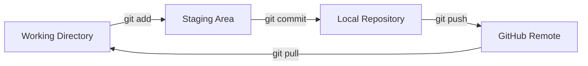

# 보충 1. 추가 심화 실습안

관련 차시: [6차시 Pages 배포](../06-pages.md) · [7차시 Markdown과 Mermaid](../07-markdown-mermaid.md)

본 과정 12차시를 마친 뒤 남은 시간에 쓰는 보충 자료이다. 12차시 순서를 바꾸지 않는다. 파트별 고정 시간은 두지 않고, 남은 시간에 따라 진입·중단·산출물을 조정한다. 대상은 개발 입문 15일 차 학습자이다.

## 이 파트에서 하는 일

- 본 과정의 기본 흐름을 마친 학습자가 작은 변경을 더 안전하고 읽기 쉽게 다듬는다.
- README, 스타일, 배포 결과를 한 번 더 검토한다.

## 왜 필요한가

기능을 크게 바꾸지 않아도 README의 링크 하나, 배경색 하나, 다이어그램 화살표 하나를 고치는 일은 자주 생긴다. 이런 작은 변경을 `git status`와 `git diff`로 확인하고 커밋하는 습관을 들이면, 나중에 큰 변경을 할 때도 실수 범위를 줄일 수 있다. 심화 실습은 새로운 기능을 추가하는 시간이 아니라, 이미 만든 결과물을 안전하게 다듬는 시간이다.

## 핵심 개념

- 코드 변경은 작은 단위로 나눈다.
- 변경 전후 `git status`, `git diff`를 확인한다.
- README는 프로젝트의 목적, 설치와 실행 순서, 링크를 처음 보는 사람에게 설명한다.
- 스타일은 한 번에 한 가지 속성만 바꿔 결과를 비교한다.
- Mermaid는 텍스트 코드로 그리므로 화살표 하나도 diff로 검토할 수 있다.

## 시간별 진입 조건

- **15분:** README 링크 1개와 오탈자만 확인한다.
- **30분:** 스타일 또는 문구 1개를 수정하고 커밋한다.
- **60분:** 심화 실습 2개를 수행한다.

## 1. README 보완

1. README의 목적, 환경, 실행 명령, 링크를 읽는다.
2. 빠진 항목 1개만 고른다.
3. OpenCode로 수정 초안을 받는다.
4. `git diff`로 변경을 검토한다.
5. `git add`, `git commit`, `git push`를 실행한다.

```bash
git status
git diff
git add README.md
git commit -m "docs: README 사용법 보완"
git push origin main
```

```text
README에서 초보자가 막힐 수 있는 항목 1개만 골라 보완 문장 제안
README 링크가 실제 파일을 가리키는지 점검 항목 목록
```

확인:

- README가 GitHub에서 렌더링된다.
- 링크를 클릭해 실제 파일이 열린다.

## 2. 스타일 조정

1. 변경할 색상 또는 간격 1개를 고른다.
2. OpenCode로 CSS 수정 초안을 받는다.
3. 브라우저에서 결과를 확인한다.
4. `git diff`로 변경 범위를 확인한다.
5. 커밋하고 push한다.

```css
body {
  background: #f7f7f7;
  color: #222222;
}

main {
  max-width: 720px;
  margin: 0 auto;
  padding: 2rem;
}
```

```bash
git status
git diff
git add style.css
git commit -m "style: 배경색과 간격 조정"
git push origin main
```

```text
style.css에서 배경색과 본문 간격만 조정하는 변경안
변경 파일과 CSS 속성 목록 정리
```

확인:

- 브라우저에서 색상 또는 간격이 바뀐다.
- Pages URL에서도 같은 결과가 보인다.

## 3. Mermaid 보완

1. README의 Mermaid 코드를 연다.
2. 화살표 1개를 추가한다.
3. 미리보기에서 렌더링을 확인한다.
4. 커밋하고 push한다.



```text
Mermaid 다이어그램에 pull 흐름 화살표 추가
노드 이름과 화살표 의미 표 작성
```

확인:

- Mermaid 다이어그램이 렌더링된다.
- 추가한 화살표가 보인다.

## 산출물

- README 또는 CSS 변경 1개
- Mermaid 보완 1개
- 커밋 1개 이상

## 주의할 점

- 보충안은 본 과정을 대체하지 않는다. 핵심 실습을 먼저 마친다.
- 모든 명령은 별도 교육용 저장소에서 실행한다.
- 비밀정보, 토큰, 비밀번호를 채팅·파일·Issue에 남기지 않는다.
- 원격 push는 교육용 저장소와 브랜치를 확인한 뒤 승인된 범위에서 실행한다.
- OS별 경로와 인증 차이는 [부록 5](../appendix/05-os-differences.md)를 참조한다.
- 웹폰트·색상·Bulma는 [부록 3](../appendix/03-web-tools.md), Mermaid 문법은 [부록 4](../appendix/04-mermaid.md)를 참조한다.
- 명령 옵션이 기억나지 않으면 [부록 2](../appendix/02-git-options.md)의 필수 명령만 사용한다.
