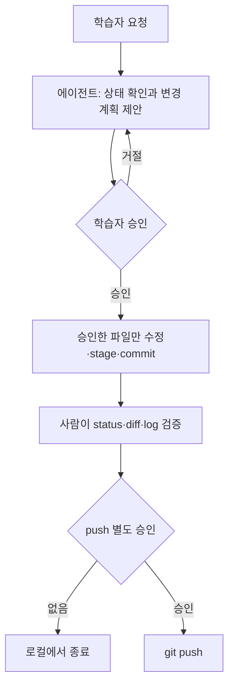

# 보충 3. 에이전트 주도 Git

관련 차시: [4차시 이력 수정과 파일 배제](../04-amend-ignore.md) · [12차시 Pull Request](../12-pull-request.md)

사람이 직접 명령을 실행하는 기초 실습과 달리, 에이전트가 상태 확인·diff 검토·stage·commit을 제안하고 수행하는 흐름을 체험합니다. 에이전트는 학습자를 대신해 결정하지 않습니다. 파일 수정, 명령 실행, 원격 변경은 학습자가 승인합니다.

## 이 파트에서 하는 일

- 사람이 직접 실행하는 Git 기초와 달리, 에이전트가 상태 확인·diff 검토·stage·commit 등을 수행하는 흐름을 체험합니다.
- 에이전트 사용 시 승인 경계와 결과 확인을 명확히 합니다.

## 왜 필요한가

에이전트는 반복 작업을 빠르게 줄여 주지만, 잘못된 파일을 고치거나 승인 없이 원격에 push할 수 있습니다. 특히 초보자는 에이전트의 설명을 실제 Git 결과로 착각하기 쉽습니다. 이 파트는 에이전트를 믿고 맡기는 연습이 아니라, 계획을 읽고 승인하고 결과를 검증하는 연습입니다.

## 핵심 개념

- 이 파트는 보충안입니다.
- 에이전트는 설명과 제안을 먼저 제공합니다.
- 파일 수정, 명령 실행, 원격 변경은 학습자가 승인합니다.
- 원격 push와 파괴적 명령은 별도 명시 승인이 필요합니다.
- 비밀정보는 에이전트에게 전달하지 않습니다.

## 시간별 진입 조건

- **15분:** 상태 확인과 diff 검토만 수행합니다.
- **30분:** stage 후보 확인까지 수행합니다.
- **60분:** stage와 commit까지 수행합니다.

## 공통 안전 프롬프트

모든 에이전트 요청 앞에 다음 문구를 붙입니다.

```text
교육용 저장소 한정. 비밀정보 요청 및 원격 변경 금지. 실행 전 변경 계획 제시. 학습자 직접 실행과 결과 검증.
```

### 적용 예외

- 본 과정 공통 안전 프롬프트의 "학습자 직접 실행"은 사람이 직접 실행하는 기초 실습에 적용합니다.
- 에이전트 주도 Git에서는 에이전트가 제안하고 학습자가 승인한 범위에서만 실행합니다.
- "원격 변경 금지"는 학습자 승인 없이 push하는 것을 금지합니다. 승인된 push는 허용합니다.
- 파괴적 명령과 비밀정보 전달은 여전히 금지합니다.
- 실행 후 사람이 `git status`, `git diff`, `git log`로 검증합니다.

## 승인 흐름



## 실행 검증 명령

```bash
git status
git diff
git diff --cached
git log --oneline -3
```

## 진행 순서

1. 에이전트에게 현재 저장소 상태 확인을 요청합니다.
2. 에이전트가 제안한 변경 계획을 읽습니다.
3. 학습자가 승인한 파일만 수정합니다.
4. `git status`와 `git diff`로 변경을 검토합니다.
5. stage할 파일 목록을 확인합니다.
6. 학습자가 승인한 뒤 commit합니다.
7. push는 별도 명시 승인 후에만 실행합니다.

## 명사형 프롬프트

```text
교육용 저장소 상태 확인: branch, status, 변경 파일 목록
변경 계획 제시: 대상 파일, 수정 이유, 예상 diff
diff 검토: 이번 목적과 무관한 변경 여부 확인
stage 후보 파일 목록과 제외 이유 제안
커밋 메시지 2개 제안: type과 변경 의도
push 전 확인 항목: branch, remote, commit hash
```

## 승인 경계

- 자동 전체 승인을 켜지 않습니다.
- 파일 수정, 명령 실행, 원격 변경은 학습자가 확인합니다.
- `reset --hard`, `push --force`, `branch -D`, `clean -fd`는 실행하지 않습니다.
- 원격 push는 별도 명시 승인이 필요합니다.
- 인증 창은 학습자가 직접 처리합니다.
- 커밋 저자는 `git config user.name/email`에 등록된 학습자로 유지합니다. 에이전트가 커밋해도 저자를 바꾸지 않습니다.
- AI 결과와 실제 Git 결과가 다르면 실제 Git 결과를 기준으로 멈춥니다.

## 결과 확인

- `git status`가 깨끗한지 확인합니다.
- `git log --oneline`으로 커밋을 확인합니다.
- `git diff`와 `git diff --cached`로 변경을 검토합니다.
- 원격 변경이 있다면 GitHub 웹에서 파일과 커밋을 확인합니다.

## 산출물

- 에이전트가 제안한 변경 계획
- 학습자가 승인한 stage/commit 결과
- 상태 확인 기록

## 주의

- 에이전트의 설명과 실제 Git 결과가 다르면 실제 결과를 기준으로 멈추고 강사에게 알립니다.
- 비밀정보, 토큰, 비밀번호를 프롬프트에 넣지 않습니다.
- `reset --hard`, `push --force`, `branch -D`, `clean -fd`는 보충 실습에서도 실행하지 않습니다.
- push 전에는 브랜치, 원격, 커밋 해시를 확인합니다.
- 인증 창과 2FA 승인은 학습자가 직접 처리합니다.
- 명령 옵션은 [부록 2](../appendix/02-git-options.md), OS별 차이는 [부록 5](../appendix/05-os-differences.md)를 참조합니다.
