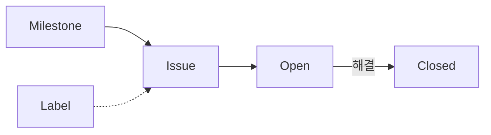

# 이슈로 작업 관리
교안: [STEP 09 §학습 목표](https://echo.qus0in.dev/git/09-issues#학습-목표)

- Issue로 작업 요청을 등록한다.
- Label로 분류하고 Milestone으로 진행률을 추적한다.
- Issue에 비밀 값을 남기지 않는다.

## Issue가 필요한 이유
교안: [STEP 09 §왜 필요한가](https://echo.qus0in.dev/git/09-issues#왜-필요한가)

- 할 일을 머릿속에만 두면 빠뜨리기 쉽다.
- 카드, 라벨, 마일스톤으로 작업과 진척을 눈에 보이게 한다.

## 핵심 개념
교안: [STEP 09 §핵심 개념](https://echo.qus0in.dev/git/09-issues#핵심-개념)

| 요소 | 역할 |
| --- | --- |
| Issue | 작업 요청·버그 티켓 |
| Label | 종류 표시 (bug, enhancement, documentation) |
| Milestone | 목표 묶음과 해결률 |

## 처리 흐름
교안: [STEP 09 §Issue 관계도](https://echo.qus0in.dev/git/09-issues#issue-관계도)

## 등록 순서
교안: [STEP 09 §따라하기](https://echo.qus0in.dev/git/09-issues#따라하기)

1. Milestone을 만든다.
2. Issue를 등록하고 Label과 Milestone을 지정한다.
3. 진척도 게이지를 확인한다.
4. 관련 기록 문서의 링크를 Issue에 적는다.

## Issue에 담을 정보
교안: [STEP 09 §Issue 초안 예시](https://echo.qus0in.dev/git/09-issues#issue-초안-예시)

- 목적: 무엇을 왜 하는가.
- 하지 않을 일: 범위의 경계.
- 완료 조건: 확인할 수 있는 기준.

## 기록용 Issue
교안: [STEP 09 §Issue로 기록하기](https://echo.qus0in.dev/git/09-issues#issue로-기록하기)

- TIL·회고·부검 등 기록 종류에 맞는 틀을 고른다.
- 본문과 공개 범위를 검토한 뒤 등록한다.
- 웹 대신 GitHub CLI로도 만들고 닫을 수 있다.

## 완료 기준
교안: [STEP 09 §체크리스트](https://echo.qus0in.dev/git/09-issues#체크리스트)

- 라벨이 붙은 Issue가 2개 이상 있다.
- Milestone 게이지가 표시된다.
- 본문에 비밀 값이 없고 기록 문서와 링크했다.
